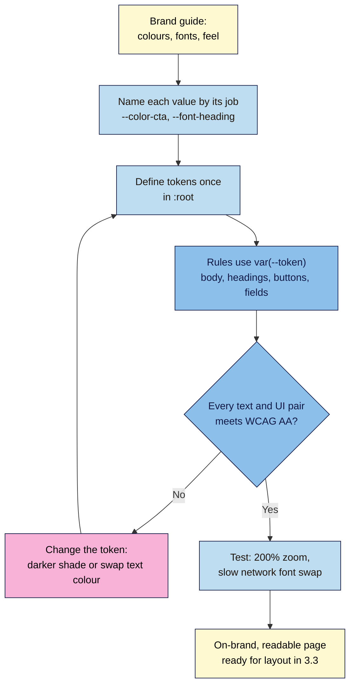

# M03.L02 — Typography, Color & Brand Tokens
> After this lesson you can turn a brand guide into a short list of CSS variables, give your launch page readable, on-brand type, and prove that every text and button colour passes WCAG contrast before anyone complains.

**Time:** ~18 min reading + ~30 min exercise · **Level:** L1 Foundation (beginner) · **Prereqs:** M03.L01 · **Remediate to:** M03.L01
**Verified against:** MDN "Using CSS custom properties", "Fundamental text and font styling", "Web fonts" and `font-display`; W3C WCAG 2.2 Understanding docs for 1.4.3 Contrast (Minimum), 1.4.11 Non-text Contrast, 1.4.4 Resize Text and 1.4.12 Text Spacing; Chrome DevTools "Make your website more readable" (contrast); Google Fonts CSS API (live response: `font-display: swap`, Lora 600 split into 7 `unicode-range` subsets, Latin ≈ 22 KB); every contrast ratio in this lesson computed with the WCAG 2.2 relative-luminance formula; the lesson stylesheet validated live with the W3C CSS Validation Service; the Part B stylesheet and both Part C break-its run in headless Chrome 156 (computed colours, fonts and the white field background), on 2026-11-02.

> ⚠️ **Freshness flag:** the contrast numbers here are WCAG 2.2, the version laws and procurement rules point to in 2026. WCAG 3 is still a Working Draft (last updated March 2026) and is exploring a different way to measure contrast; the method isn't settled, and you may hear the name APCA. If a client mentions it, treat it as "coming, not required yet" and re-check this lesson when WCAG 3 becomes a W3C Recommendation.

## Learning objectives
1. **Turn** a brand guide into CSS custom properties (colour, font, size and spacing tokens) and apply them with `var()`. *(O1)*
2. **Set** readable type: a system or web font that loads with `font-display: swap`, sizes in `rem`, comfortable line height and line length. *(O2)*
3. **Check** text and UI contrast against WCAG 2.2 AA (4.5:1 normal text, 3:1 large text and UI parts) and fix a failing pair by changing one token. *(O3)*

## Why it matters
Priya's brand guide says the button colour is "Caramel #E0A458" with white text. It looks lovely on her designer's large monitor. On a phone in sunlight, half her visitors can barely read "Subscribe", and the colour is copied by hand into 14 different places in the CSS. When the brand refresh changes caramel to a darker shade, three buttons get missed. Two fixes solve both problems: **tokens** (define each brand value once, use it everywhere) and a **contrast check** before launch. White on that caramel is 2.18:1. WCAG AA asks for 4.5:1 for normal text, so the brand's own button fails. The people who pay the price are those with low vision, many older visitors, and anyone reading a phone in bright sun: exactly the people you want to sign up.

## Core concept
**Plain version:** a **brand token** is a named value (a colour, a font, a size) that you define once and reuse everywhere. In CSS, tokens are **custom properties** (often called CSS variables): you set `--color-cta: #b45309;` once in `:root` and use it with `var(--color-cta)`. Change the token, and every button, link and border that uses it updates together.

**Analogy:** tokens are like the paint chips in a decorator's fan deck. The walls never say "#B45309"; they say "Burnt Orange, chip 7". Repaint chip 7, and every wall marked chip 7 changes.

### Custom properties in 5 rules
1. **Define** them in `:root` (the `<html>` element) so the whole page can use them: `:root { --color-text: #2b1d14; }`
2. **Name** them by **job**, not by look: `--color-cta`, not `--orange`. When orange becomes green next year, `--orange: green` would be a lie.
3. **Use** them with `var()`: `color: var(--color-text);`. A fallback is allowed: `var(--color-text, #000)`.
4. They **inherit** and obey the cascade like any other property, so you can override one inside a section later (Lesson 3.5 uses this for a dark pricing card).
5. They're **case-sensitive** and must start with two hyphens: `--Color-CTA` and `--color-cta` are two different tokens.

### Typography essentials
| Decision | Good default | Why |
|---|---|---|
| **Font family** | A **font stack**: your choice first, then fallbacks, then a generic family (`serif`, `sans-serif`) | If the first font fails to load or lacks a character (₹, ñ, 中), the browser tries the next |
| **System fonts** | `system-ui, -apple-system, "Segoe UI", Roboto, sans-serif` | Zero download, native look, wide language coverage. Ideal for body text |
| **Web fonts** | At most **2 families** and **2–3 weights**; load with `font-display: swap` | Every weight is another file to download. `swap` shows fallback text at once and swaps in the brand font when it arrives, so text is never invisible |
| **Size** | Body `1rem` (usually 16 px) or larger; headings on a scale (e.g. 1.25 → 1.75 → 2.5rem) | `rem` respects the visitor's own browser text-size setting (WCAG 1.4.4 Resize Text) |
| **Line height** | `1.5`–`1.6` for body text, about `1.2` for headings | Unitless values scale with the font size. WCAG 1.4.12 requires the page to survive line height 1.5 without breaking |
| **Line length** | `max-width: 65ch` on paragraphs (about 45–75 characters per line) | Long lines tire the eye; `ch` is roughly one character's width in the current font |

**Loading a web font, two ways:**
- **Google Fonts link** (quickest): paste the `<link>` tags it gives you into `<head>`, with `&display=swap` in the URL.
- **Self-hosting** (download the `.woff2` files and write your own `@font-face`): one less third-party connection, so it's faster to connect and better for privacy. ⚠️ In January 2022 a German court (Landgericht München I, 3 O 17493/20) ruled that loading Google Fonts from Google's servers without consent sent visitors' IP addresses to Google unlawfully under GDPR, and awarded €100 in damages. If you have EU visitors, self-hosting avoids the issue. This is one court ruling, not EU-wide law, and not legal advice. Lesson 6.4 covers consent properly.

### Contrast: the WCAG 2.2 AA numbers
Contrast ratio compares how light two colours are, from **1:1** (identical) to **21:1** (black on white).

| What | Minimum ratio (AA) | WCAG 2.2 criterion |
|---|---|---|
| Normal text (body, links, button labels, placeholder text) | **4.5:1** | 1.4.3 Contrast (Minimum) |
| Large text: at least 24 px regular, or about 18.66 px **bold** (18 pt / 14 pt) | **3:1** | 1.4.3 |
| UI parts needed to see a control: a text field's border, a checkbox outline, a focus ring | **3:1** against what's next to it | 1.4.11 Non-text Contrast |
| Icons and chart parts that carry meaning | **3:1** | 1.4.11 |
| Logos, purely decorative lines, disabled buttons | no requirement | exceptions in 1.4.3 / 1.4.11 |

Two common traps: **placeholder text** is text, so grey placeholders need 4.5:1 too; and a **light grey field border** on white (often around 1.5:1) fails 1.4.11, so users can't see where to type.

### Nila Coffee's tokens (all ratios computed and checked)
| Token | Value | Used for | Contrast |
|---|---|---|---|
| `--color-bg` | `#fffaf2` (cream) | page background | — |
| `--color-text` | `#2b1d14` (dark roast) | body text | 15.68:1 on bg ✅ |
| `--color-heading` | `#6b3f1f` (coffee) | headings, links | 8.58:1 ✅ |
| `--color-muted` | `#6b5d52` | captions, hints | 6.10:1 ✅ |
| `--color-cta` + `--color-on-cta` | `#b45309` + `#ffffff` | buttons | 5.02:1 ✅ |
| `--color-field` | `#8c6e54` | form field borders | 4.52:1 on cream, 4.69:1 on the white field ✅ (needs 3:1) |
| `--color-line` | `#d9c7b0` | decorative section dividers only | 1.59:1 (fine for decoration, **not** for field borders) |

Contrast is always measured **between two colours that touch**. A field border touches the page outside and the field's own background inside, and browsers give text fields a **white** background by default, not your cream. So check the border against both; the lower ratio counts.

## How it works



**In words:** start from the brand guide, give every value a job name, and define it once in `:root`. Every rule uses `var()` instead of a raw value. Then check each text-and-background pair and each control border against WCAG AA. A failing pair is fixed by changing the token (one edit), not by hunting through the file. Finally, check the page at 200% zoom and on a slow connection to see the font fallback.

## Hands-on walkthrough

**Part A: brand guide → token list (5 min)**
1. Read Nila Coffee's one-line brand guide: *"Warm and crafted. Cream backgrounds, dark-roast text, coffee-brown headlines in a classic serif, burnt-orange action buttons. Body text in a clean sans-serif."*
2. Compare it with the token table in Core concept. Notice that "coffee brown" became **two** tokens with different jobs (`--color-heading` for text, `--color-line` for decoration), because they need different contrast.
3. Now write **your** brand's list in your project note: 6–8 colour tokens named by job, 2 font tokens, and the hex codes. No brand guide yet? Pick a background, a text colour, one accent for buttons and one muted colour; that's enough.
   **Expected:** a short table like Nila's, with no token named after a colour (`--blue`, `--orange`).

**Part B: put the tokens in `styles.css` (10 min)**
1. Open `styles.css` from Lesson 3.1. Add this block at the **very top**:
   ```css
   /* 0. Brand tokens: change the brand here, and only here */
   :root {
     /* Colour: named by job, not by hue */
     --color-bg: #fffaf2;       /* cream page background */
     --color-text: #2b1d14;     /* dark roast: body text (15.7:1 on bg) */
     --color-heading: #6b3f1f;  /* coffee: headings and links (8.6:1) */
     --color-muted: #6b5d52;    /* captions and hints (6.1:1) */
     --color-cta: #b45309;      /* burnt orange: button background */
     --color-on-cta: #ffffff;   /* text on buttons (5.0:1 on cta) */
     --color-line: #d9c7b0;     /* decorative dividers only (1.6:1) */
     --color-field: #8c6e54;    /* form field borders (4.5:1 on cream, 4.7:1 on white; needs 3:1) */

     /* Type */
     --font-body: system-ui, -apple-system, "Segoe UI", Roboto, sans-serif;
     --font-heading: "Lora", Georgia, "Times New Roman", serif;
     --text-sm: 0.875rem;
     --text-base: 1rem;
     --text-lg: 1.25rem;
     --text-xl: 1.75rem;
     --text-2xl: 2.5rem;
     --leading: 1.6;

     /* Space and shape */
     --space-1: 0.5rem;
     --space-2: 1rem;
     --space-3: 2rem;
     --radius: 0.5rem;
   }
   ```
2. Replace the raw values in your Lesson 3.1 rules with tokens, and add the type and field rules. The full file should now read:
   ```css
   *,
   *::before,
   *::after {
     box-sizing: border-box;
   }

   body {
     margin: 0;
     font-family: var(--font-body);
     font-size: var(--text-base);
     line-height: var(--leading);
     color: var(--color-text);
     background-color: var(--color-bg);
   }

   h1,
   h2,
   h3 {
     font-family: var(--font-heading);
     font-weight: 600;
     line-height: 1.2;
     color: var(--color-heading);
   }

   h1 { font-size: var(--text-2xl); }
   h2 { font-size: var(--text-xl); }
   h3 { font-size: var(--text-lg); }

   p,
   li {
     max-width: 65ch;
   }

   a {
     color: var(--color-heading);
   }

   figcaption,
   .hint {
     font-size: var(--text-sm);
     color: var(--color-muted);
   }

   header,
   main,
   footer {
     max-width: 60rem;
     margin: 0 auto;
     padding: 0 var(--space-2);
   }

   section {
     padding: var(--space-3) 0;
     border-bottom: 1px solid var(--color-line);
   }

   input,
   select,
   textarea {
     font: inherit;
     padding: var(--space-1);
     border: 2px solid var(--color-field);
     border-radius: var(--radius);
   }

   .button,
   button {
     display: inline-block;
     padding: 0.75rem 1.25rem;
     border: 2px solid var(--color-cta);
     border-radius: var(--radius);
     background-color: var(--color-cta);
     color: var(--color-on-cta);
     font: inherit;
     font-weight: 600;
     text-decoration: none;
   }
   ```
   (Place the `:root` block above all of this.)
3. In `launch.html`, add `class="hint"` to the email hint from Lesson 2.4: `<span id="email-hint" class="hint">…</span>`.
4. Load the heading font. In `<head>`, **above** your `styles.css` link, add:
   ```html
   <link rel="preconnect" href="https://fonts.googleapis.com">
   <link rel="preconnect" href="https://fonts.gstatic.com" crossorigin>
   <link rel="stylesheet" href="https://fonts.googleapis.com/css2?family=Lora:wght@600&display=swap">
   ```
   Only **one** weight (600) of one family is requested; body text uses the system font, so it costs nothing.
5. Save and reload.
   **Expected:** a cream page, dark-brown body text in your system's sans-serif, coffee-brown serif headings in Lora, paragraphs that stop at a comfortable width, and burnt-orange buttons with white text. The email field has a visible brown border.
   > 🖼️ **Image prompt:** Desktop screenshot (1280×800) of the Nila Coffee launch page after this lesson: cream background, coffee-brown serif h1 "Fresh beans every month", dark body text in a narrow column, and a burnt-orange "Join the launch list" button. Outline the heading and the button. Highlight the key element with a 3px #F9B2D7 outline; blur any personal details.
   > **Alt text:** Launch page with cream background, brown serif headline, readable body text and an orange call-to-action button.
6. Open DevTools → **Elements**, select `<html>`, and look at the **Styles** pane. **Expected:** your `:root` tokens listed. Hover a `var(--color-cta)` anywhere: a tooltip shows its value.
7. Validate `styles.css` in the W3C CSS checker. **Expected (checked 2026-11-02):** "Congratulations! No Error Found." You'll also see a few **Warnings** such as "Due to their dynamic nature, CSS variables are currently not statically checked". Those are fine: the checker is saying it can't test values that live in tokens, which is why you check contrast yourself.

**Part C: break it and fix it: the brand colour that fails (8 min)**
1. Change one token to the "brand guide" caramel: `--color-cta: #e0a458;`. Save and reload. **Every** button changes, because they all use the token.
2. Inspect the button. In **Styles**, find `color: var(--color-on-cta)` and click the small colour square next to the value.
   **Expected:** the colour picker shows **Contrast ratio 2.18** with a warning icon; the AA (4.5) and AAA (7) lines both show as failing.
   > 🖼️ **Image prompt:** Desktop screenshot (1440×900) of the Chrome DevTools colour picker opened on a button's white text over a caramel #E0A458 background, showing "Contrast ratio 2.18" with failing AA and AAA indicators and the AA line drawn across the colour area. Outline the contrast ratio section. Highlight the key element with a 3px #F9B2D7 outline; blur any personal details.
   > **Alt text:** DevTools colour picker reporting a failing contrast ratio of 2.18 for white text on a caramel button.
3. Confirm with a second tool: open **https://webaim.org/resources/contrastchecker/**, foreground `#FFFFFF`, background `#E0A458`. **Expected:** 2.18:1, **Fail** for normal text at AA.
4. Fix it **two ways** and pick one:
   - **Darker background, same text:** `--color-cta: #b45309;` → 5.02:1 ✅
   - **Keep caramel, change the text:** keep `--color-cta: #e0a458;` and set `--color-on-cta: #2b1d14;` → 7.47:1 ✅ (dark text on caramel; it still looks on-brand)
   **Expected:** one token edit, every button fixed. Write down which you chose and why.
5. Second bug, a non-text one: set `--color-field: var(--color-line);` and look at the email field. **Expected:** the border almost disappears (1.59:1 against the cream page, 1.65:1 against the white inside of the field). That fails WCAG 1.4.11, which asks for 3:1 for the parts needed to see a control. Put `#8c6e54` back.

**Part D: stress-test the type (5 min)**
1. Press **Ctrl/Cmd and +** until the zoom is **200%**. **Expected:** text grows and wraps; nothing is cut off or overlapping (WCAG 1.4.4). Lesson 3.4 fixes any layout that breaks.
2. Press **Ctrl/Cmd + 0** to reset. In DevTools → **Network**, set throttling to **Slow 4G** and tick **Disable cache**, then reload while watching the headings.
   **Expected:** headings appear first in a fallback serif (Georgia on Windows and Mac), then switch to Lora when the font arrives. That's `font-display: swap` working: text is never invisible. In the Network list, filter by **Font**: you'll see one or two small `.woff2` files (Google splits each font by alphabet, and the browser downloads only the parts your text uses; the Latin part of Lora 600 is about 22 KB).
3. Set throttling back to **No throttling**.

## When to use / when not to
- **System fonts vs a web font:** system fonts for body text are free, fast and support almost every language. Add a web font for headings when it carries the brand. **Trade-off:** each web font weight is a download (often 15–50 KB per alphabet) and a moment of font swap; two families and three weights is a sensible ceiling for a launch page.
- **Google Fonts link vs self-hosting:** the link is quickest for learning and prototypes. For a live site with EU visitors, self-host the `.woff2` files (Google Fonts lets you download the families) to avoid the third-party request.
- **How many tokens:** enough to cover every job, few enough to remember. 6–10 colours, 2 fonts, a 5-step type scale and 3–4 spacing steps is plenty for a single page. A big design system can have hundreds; you don't need that yet.
- **Brand colour vs readability:** when the official brand colour fails contrast, don't break WCAG to honour it. Use it for large shapes, borders or backgrounds with dark text, and pick a darker shade for small text.

## Use AI for this
**Example prompt:**
> "Here is my brand guide: [paste colours and fonts]. Turn it into CSS custom properties in `:root`, named by job (background, text, heading, muted, CTA, text-on-CTA, field border, decorative line). For each text/background and CTA pair, list the WCAG 2.2 contrast ratio. If a pair fails AA, suggest the closest on-brand shade that passes. Don't invent new brand colours beyond those fixes."

**What AI does well here:** structuring a messy brand guide into tokens, proposing a type scale, and suggesting nearby shades.
**Where it gets it wrong:** AI tools often **state contrast ratios that are simply wrong**, because they guess instead of calculating. They name tokens by colour (`--brand-orange`), load six font weights "to be safe", and forget field borders and placeholder text.
**How to check:** never trust an AI-stated ratio. Check every pair in DevTools' colour picker or the WebAIM checker yourself, count the font files in the Network panel, and validate the CSS.

## Common mistakes
- **Raw hex codes scattered through the CSS** instead of tokens, so a brand change misses some places.
- **Tokens named by colour** (`--orange`), which become wrong after a rebrand.
- **Light grey text** for "elegant" body copy or placeholders, below 4.5:1.
- **Faint field borders** (light grey on white): the field becomes invisible to many users (fails 1.4.11).
- **Font sizes in `px` everywhere**, which ignore a visitor's larger default text size, or body text under 16 px.
- **Loading many font weights** (300, 400, 500, 600, 700, italic…) and only using two.
- **Forgetting `display=swap`**, so text stays invisible while the font downloads on slow connections.
- **A missing generic family** at the end of the stack (`font-family: "Lora";`). If Lora fails, the browser picks its default, which may not even be a serif.

## Troubleshooting
| Symptom | Likely cause | Fix |
|---|---|---|
| A `var()` value doesn't apply | Typo or wrong case in the token name; token defined inside another selector instead of `:root` | Inspect: DevTools shows the property struck through or the var as undefined; match the name exactly |
| Web font never shows | `<link>` missing or placed inside `<body>`; family name in CSS doesn't match (`"Lora"`); offline | Check Network → **Font** for the file; copy the family name exactly from the font's CSS |
| Text invisible for a second or two on slow networks | No `font-display: swap` | Add `&display=swap` to the Google Fonts URL, or `font-display: swap;` in your `@font-face` |
| Brand colour fails contrast | The colour is too light or too mid-tone for its text | Darker shade for small text, or swap to dark text on the brand colour; change the token once |
| Page text looks huge or tiny on one computer only | The visitor (or you) changed the browser's default text size or zoom | That's `rem` working as intended; reset with Ctrl/Cmd + 0 to compare |
| Headings look bold and blurry | Requested weight not loaded, so the browser fakes bold ("faux bold") | Request the weight you use (here 600) |

## Exercise
**Task:** give **your** launch page its brand layer.
1. Your token table in the project note (6–10 colour tokens by job, 2 font tokens, type scale, spacing), each colour pair with its contrast ratio checked in DevTools or WebAIM.
2. The `:root` block and the rules above in `styles.css`, using **only** `var()` for colours and fonts (search the file for `#`: the only hex codes left should be inside `:root`).
3. A web font for headings with one or two weights and `display=swap`, **or** a written reason for using system fonts only.
4. A **contrast report**: a 5-row table (body text, headings, muted text, CTA label, field border against both the page and the field background) with ratio, required minimum and pass/fail.
5. One break-it-and-fix-it: make your CTA fail, screenshot the DevTools evidence, fix it by changing one token.
6. The W3C CSS checker shows "Congratulations! No Error Found."

**Expected outcome:** an on-brand page where every text pair is at least 4.5:1 (3:1 for large text), field borders are at least 3:1, no hex codes outside `:root`, and a one-paragraph note on your font choice.
**Stretch goal:** self-host your heading font. Download the family from Google Fonts, put the `.woff2` file in a `fonts` folder, and write an `@font-face` rule with `font-display: swap`. Confirm in the Network panel that no request goes to `fonts.googleapis.com` any more.

## Key takeaways
- **Tokens** = custom properties in `:root`, named by job (`--color-cta`), used with `var()`. Change once, update everywhere.
- **Type:** a font stack ending in a generic family, body at `1rem`+ with line height ~1.5–1.6, lines around `65ch`, and few web font weights with `font-display: swap`.
- **Contrast (WCAG 2.2 AA):** 4.5:1 normal text, 3:1 large text, 3:1 for field borders, focus rings and meaningful icons.
- **Measure, never guess:** DevTools' colour picker and WebAIM give the real ratio; AI and eyeballs don't.
- If the brand colour fails, **change the token**: a darker shade or dark text on the brand colour.

## Teach it back
Explain to a friend in 3 sentences why their designer's pale-orange button with white text might need to change, and how CSS variables make that change a 10-second job.

## Glossary terms added
- Brand token / design token — added to `webdev-101/glossary.md`
- Custom property (CSS variable), `var()` — added to `webdev-101/glossary.md`
- `:root` — added to `webdev-101/glossary.md`
- Font stack / generic family — added to `webdev-101/glossary.md`
- System font — added to `webdev-101/glossary.md`
- Web font / `@font-face` — added to `webdev-101/glossary.md`
- `font-display: swap` — added to `webdev-101/glossary.md`
- Line height / line length (`ch`) — added to `webdev-101/glossary.md`
- Contrast ratio — added to `webdev-101/glossary.md`
- Large text (WCAG) — added to `webdev-101/glossary.md`
- Non-text contrast — added to `webdev-101/glossary.md`
- WCAG 2.2 AA — added to `webdev-101/glossary.md`

## Further reading
*All checked 2026-11-02.*
- MDN — Using CSS custom properties (variables): https://developer.mozilla.org/en-US/docs/Web/CSS/Using_CSS_custom_properties
- MDN — Fundamental text and font styling: https://developer.mozilla.org/en-US/docs/Learn_web_development/Core/Text_styling/Fundamentals
- MDN — Web fonts: https://developer.mozilla.org/en-US/docs/Learn_web_development/Core/Text_styling/Web_fonts
- MDN — `font-display`: https://developer.mozilla.org/en-US/docs/Web/CSS/@font-face/font-display
- W3C WAI — Understanding SC 1.4.3 Contrast (Minimum): https://www.w3.org/WAI/WCAG22/Understanding/contrast-minimum.html
- W3C WAI — Understanding SC 1.4.11 Non-text Contrast: https://www.w3.org/WAI/WCAG22/Understanding/non-text-contrast.html
- W3C WAI — Understanding SC 1.4.4 Resize Text: https://www.w3.org/WAI/WCAG22/Understanding/resize-text.html
- W3C WAI — Understanding SC 1.4.12 Text Spacing: https://www.w3.org/WAI/WCAG22/Understanding/text-spacing.html
- Chrome for Developers — Make your website more readable (contrast in DevTools): https://developer.chrome.com/docs/devtools/accessibility/contrast
- WebAIM — Contrast Checker: https://webaim.org/resources/contrastchecker/
- Google Fonts — Getting started with the Fonts API (`display=swap`): https://developers.google.com/fonts/docs/getting_started
- Landgericht München I, judgment of 20 January 2022, 3 O 17493/20 (Google Fonts and IP addresses; German, official Bavarian database): https://www.gesetze-bayern.de/Content/Document/Y-300-Z-BECKRS-B-2022-N-612

## Refresher card
*Used by remediation when a learner fails a quiz twice on a later lesson that points back here.*
Tokens: `:root { --color-cta: #b45309; }`, used as `background-color: var(--color-cta);`. Name by job, not colour; case-sensitive; two hyphens. Fonts: stack ending in `serif`/`sans-serif`; system fonts for body; ≤2 web font families, few weights, `display=swap`. Body `1rem`+, line height 1.5–1.6, `max-width: 65ch`. WCAG 2.2 AA: 4.5:1 normal text, 3:1 large text (24 px, or ~18.66 px bold), 3:1 field borders/focus/icons. Check with DevTools colour picker or WebAIM; fix by changing one token.
