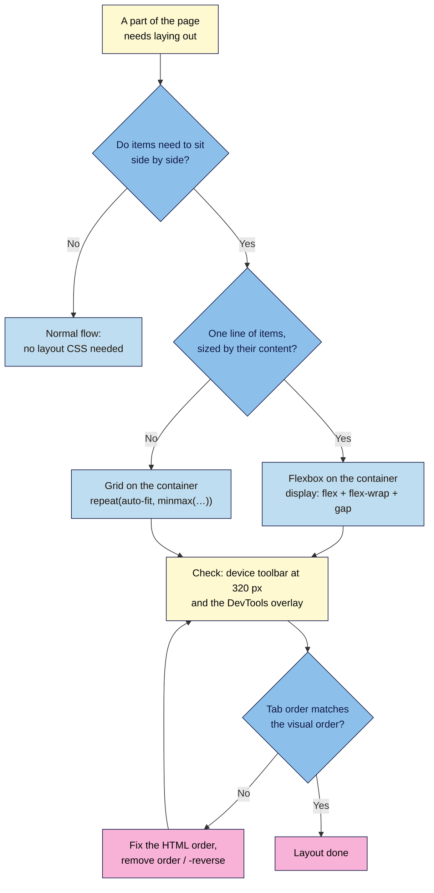

# M03.L03 — Layout with Flexbox & Grid
> After this lesson you can put a logo and menu on one line, place hero text beside an image, and lay out benefit cards that rearrange themselves from one column on a phone to three on a laptop, without breaking the keyboard order.

**Time:** ~17 min reading + ~35 min exercise · **Level:** L1 Foundation (beginner) · **Prereqs:** M03.L01, M03.L02 · **Remediate to:** M03.L01
**Verified against:** MDN "CSS layout" learning area (Introduction, Flexbox, Grids) and the `order` reference; MDN "Grid layout and accessibility"; W3C WAI Understanding SC 1.3.2 Meaningful Sequence and SC 2.4.3 Focus Order (WCAG 2.2); Chrome DevTools "Inspect CSS grid" and "Inspect and debug CSS flexbox"; this lesson's stylesheet validated live with the W3C CSS Validation Service and run in headless Chrome 156 at 320, 375, 600, 768 and 1280 px (wrapping points, card columns, the three Part D bugs and the Tab order), on 2026-11-02 (Chrome/Edge and Firefox stable).

## Learning objectives
1. **Explain** normal flow and **choose** Flexbox (one direction) or Grid (rows and columns) for a layout job. *(O1)*
2. **Build** a header/nav bar and a hero with Flexbox (`gap`, `justify-content`, `align-items`, `flex-wrap`). *(O2)*
3. **Build** a card grid that adapts without media queries (`repeat(auto-fit, minmax(…))`), check it with the DevTools overlays, and keep the visual order the same as the source order. *(O3)*

## Why it matters
Musa's agency template shows three neat benefit cards on his laptop. On his phone, the cards are squeezed into three columns two words wide, and the menu runs off the right edge of the screen. His freelancer's fix used `float`, fixed pixel widths and a separate "mobile version" of the HTML, so every content edit has to be made twice. Modern CSS replaces all of that with two tools: **Flexbox** for things in a row (a menu, a logo and a menu, a button group) and **Grid** for things in rows *and* columns (cards, galleries, pricing tables). Ten lines of CSS give a layout that fits any screen, from the same HTML.

## Core concept
**Plain version:** without any layout CSS, the browser stacks block elements (headings, paragraphs, sections) **top to bottom** and runs inline elements (links, `strong`, images) **left to right** like words in a sentence. That's **normal flow**, and it's already responsive. You only add layout when you need things **side by side**. You do it by setting `display: flex` or `display: grid` on a **container**; its **direct children** become the items you arrange.

**Analogy:** Flexbox is a **bookshelf**: items sit in one line, you decide how they share the space and where they line up, and when the shelf is full they move to the next shelf (with `flex-wrap`). Grid is a **muffin tray**: rows and columns are defined first, and items drop into the cells.

### Flexbox or Grid?
| Job | Use | Why |
|---|---|---|
| Logo + menu, menu links, button group, icon + text | **Flexbox** | One direction; each item's size comes from its content |
| Hero: text beside image, stacking when narrow | **Flexbox** with `flex-wrap` (or Grid) | Two items that share a row and wrap |
| Benefit cards, testimonials, gallery, pricing plans | **Grid** | Rows *and* columns, equal-width cards that line up |
| A whole page with header, sidebar, content, footer | **Grid** | Two-dimensional areas |
| Plain text: paragraphs, headings, lists | **Neither** (normal flow) | It already works on every screen |

**A simple test:** if you'd draw it as **one line of things**, use Flexbox. If you'd draw a **table of boxes**, use Grid.

### Flexbox: the properties you'll use
Set on the **container**:
| Property | Common values | What it does |
|---|---|---|
| `display: flex` | — | Children line up in a row |
| `flex-wrap` | `wrap` | Items move to a new line when there's no room (otherwise they squash or overflow) |
| `justify-content` | `space-between`, `center`, `flex-start` | Spreads items along the row |
| `align-items` | `center`, `flex-start`, `stretch` | Lines items up across the row (vertical centring!) |
| `gap` | `1rem`, or `0.5rem 1rem` (rows, columns) | Space between items, never at the outer edges |

Set on an **item** (a direct child):
| Property | Example | What it does |
|---|---|---|
| `flex` | `flex: 1 1 18rem` | "Grow: yes. Shrink: yes. Start at 18rem." Two items with this sit side by side when there's room for both starting widths plus the gap (36rem + gap), and stack when there isn't |

### Grid: the properties you'll use
| Property | Example | What it does |
|---|---|---|
| `display: grid` | — | Children become grid items |
| `grid-template-columns` | `1fr 1fr 1fr`, `repeat(3, 1fr)` | Column sizes; `fr` = a fraction of the free space |
| The responsive pattern | `repeat(auto-fit, minmax(min(14rem, 100%), 1fr))` | "As many columns as fit, each at least 14rem, sharing the space equally." With 14rem cards in Nila's 60rem column: 1 column on a phone, 2 from about 500 px wide, 3 from about 740 px (so a 768 px tablet already shows 3). **No media queries.** The `min(…, 100%)` stops a card from overflowing on very narrow screens |
| `gap` | `1rem` | Space between rows and columns |

### Visual order = source order
Flexbox and Grid can **move** items on screen (`order`, `flex-direction: row-reverse`, placing items in other cells). The **keyboard and screen readers don't follow**; they follow the HTML. If the "Join" button looks first but comes last in the code, a keyboard user tabs through everything else before reaching it, and focus appears to jump around the screen. WCAG 2.2 SC 1.3.2 Meaningful Sequence and SC 2.4.3 Focus Order both ask that the reading and focus order make sense. **Rule for this course:** to change the order, change the HTML; never use `order` or `-reverse` to rearrange content.

## How it works



**In words:** first ask whether items need to sit side by side at all; if not, normal flow is enough. For one line of items sized by their content, use Flexbox; for rows and columns, use Grid. Then check the layout at phone width and with the DevTools overlay, and press Tab to confirm the focus order matches what you see. If it doesn't, fix the HTML order instead of reordering with CSS.

## Hands-on walkthrough

**Part A: feel Flexbox and Grid in CodePen (8 min)**
1. Open **https://codepen.io/pen/**. HTML panel:
   ```html
   <ul class="row">
     <li>Roast</li><li>Grind</li><li>Ship</li><li>Enjoy</li>
   </ul>
   ```
   CSS panel:
   ```css
   .row { display: flex; gap: 1rem; list-style: none; padding: 0; }
   .row li { padding: 1rem; border: 2px solid #6b3f1f; }
   ```
   **Expected:** four boxes in a row, each as wide as its word, with equal gaps.
2. Add `justify-content: space-between;` to `.row`. **Expected:** the first box sits at the left edge, the last at the right, the rest spread evenly. Try `center`.
3. Now replace `display: flex;` with:
   ```css
   display: grid;
   grid-template-columns: repeat(auto-fit, minmax(8rem, 1fr));
   ```
   Make your browser window narrower and wider (or open the device toolbar, Ctrl+Shift+M / Cmd+Shift+M, and drag its width).
   **Expected:** equal-width boxes; 4 per row when wide, then 3, 2 and 1 as it narrows. No media query anywhere.

**Part B: header and hero with Flexbox (12 min)**
1. In `launch.html`, give the hero section a class and wrap its text in one `div` (a `div` is right here: it groups for layout only and adds no meaning, Lesson 2.3):
   ```html
   <section class="hero" aria-labelledby="hero-title">
     <div>
       <h1 id="hero-title">Fresh beans every month</h1>
       <p>Roasted this week, at your door in 3 days.</p>
       <a class="button" href="#signup">Join the launch list</a>
     </div>
     
   </section>
   ```
2. Add one token to `:root` in `styles.css` (cards need a surface colour, and Lesson 3.2's rule is no raw hex outside `:root`):
   ```css
   --color-surface: #ffffff;  /* card background (text 16.3:1) */
   ```
3. Add this at the **end** of `styles.css`:
   ```css
   /* 6. Lesson 3.3: layout */

   /* Images shrink to fit their box (Lesson 3.4 explains this fully) */
   img {
     max-width: 100%;
     height: auto;
   }

   /* Header: logo left, nav right; wraps on narrow screens */
   header {
     display: flex;
     flex-wrap: wrap;
     justify-content: space-between;
     align-items: center;
     gap: var(--space-2);
     padding-top: var(--space-2);
     padding-bottom: var(--space-2);
   }

   /* Nav links in a row */
   nav ul {
     display: flex;
     flex-wrap: wrap;
     gap: var(--space-1) var(--space-2);
     margin: 0;
     padding: 0;
     list-style: none;
   }

   /* Hero: text and image side by side when there's room */
   .hero {
     display: flex;
     flex-wrap: wrap;
     align-items: center;
     gap: var(--space-3);
   }

   .hero > * {
     flex: 1 1 18rem;
   }
   ```
   (`.hero > *` means "every **direct child** of `.hero`": here the text `div` and the `img`.)
4. Save and reload with the window wide.
   **Expected:** the logo on the left and the menu on the right of one line, vertically centred; the hero text and image side by side, centred against each other.
5. Open DevTools → **Elements**. Next to `<header>` and `<section class="hero">` you'll see a small **flex** badge. Click it.
   **Expected:** a coloured overlay on the page outlining each flex item and the gaps (hatched).
   > 🖼️ **Image prompt:** Desktop screenshot (1440×900) of the Nila Coffee launch page with Chrome DevTools open; the "flex" badge next to the header element is switched on and the page shows the flex overlay outlining the logo, the nav and the hatched gap between them. Outline the flex badge and the overlay. Highlight the key element with a 3px #F9B2D7 outline; blur any personal details.
   > **Alt text:** DevTools flex badge turned on, outlining the logo and menu as flex items with a hatched gap between them.
6. Make the window narrow (or open the device toolbar, Ctrl+Shift+M / Cmd+Shift+M, at 375 px wide). **Expected:** the menu drops below the logo; the hero image moves below the text. Same HTML, no media query.

**Part C: benefit cards with Grid (8 min)**
1. In `launch.html`, add `class="card-grid"` to the benefits list: `<ul class="card-grid">` (inside your "Why subscribe" section).
2. Add to the end of `styles.css`:
   ```css
   /* Cards: as many columns as fit, each at least 14rem wide */
   .card-grid {
     display: grid;
     grid-template-columns: repeat(auto-fit, minmax(min(14rem, 100%), 1fr));
     gap: var(--space-2);
     margin: 0;
     padding: 0;
     list-style: none;
   }

   .card-grid > * {
     max-width: none;
     margin: 0;
     padding: var(--space-2);
     border: 1px solid var(--color-line);
     border-radius: var(--radius);
     background-color: var(--color-surface);
   }
   ```
   `max-width: none` overrides Lesson 3.2's `li { max-width: 65ch; }`; `.card-grid > *` (0-1-0) beats `li` (0-0-1), the cascade from Lesson 3.1 at work.
3. Reload. **Expected:** three white cards in a row on a laptop and on a 768 px tablet, two at around 500–730 px, one per row on a phone, all the same width with even gaps. Drag the device-toolbar width slowly to watch the columns change.
4. Click the **grid** badge next to the `ul` in Elements. **Expected:** the grid overlay with numbered lines. In the **Layout** tab (next to **Styles** and **Computed** in Chrome/Edge; Firefox's Layout panel has a similar Grid section) you can switch overlays on and off and choose to show line numbers.
   > 🖼️ **Image prompt:** Desktop screenshot (1440×900) of three Nila Coffee benefit cards in a row with the Chrome DevTools grid overlay on, showing numbered grid lines and hatched gaps, and the Layout pane listing the grid. Outline the overlay and the Layout pane. Highlight the key element with a 3px #F9B2D7 outline; blur any personal details.
   > **Alt text:** DevTools grid overlay with numbered lines over three benefit cards, and the Layout pane listing the grid.
5. Validate `styles.css`. **Expected (checked 2026-11-02):** "Congratulations! No Error Found." plus warnings that CSS variables aren't statically checked, which are fine.

**Part D: break it and fix it (7 min)**
Plant each bug, find it, fix it.
1. **No wrap.** First add two more links to the menu (for example `<li><a href="#why">Why subscribe</a></li>` and `<li><a href="#pricing">Pricing</a></li>`): three short links fit on one line at 320 px even without wrapping, so you'd see no change. Now remove `flex-wrap: wrap;` from `nav ul` and view at 320 px in the device toolbar.
   **Symptom:** the links squash into narrow columns and multi-word links break over two or three lines (checked in Chrome: "How it works" became three lines). A link with one long word, such as a brand name, can't break at all and pushes past the screen edge, so the page scrolls sideways. **Find it:** the flex overlay shows the items squeezed (or overflowing) on one line. **Fix:** put `flex-wrap: wrap` back. Keep the extra links if your real menu needs them.
2. **Flex on the wrong element.** Move `display: flex;` from `nav ul` to `nav li`. **Symptom:** the links stack vertically again. **Find it:** the **flex** badge now appears next to each `li`, not the `ul`. Remember, `display: flex` arranges the element's **children**, and each `li` has only one child (its link). **Fix:** put it back on the `ul`.
3. **Visual order trap.** Add `flex-direction: row-reverse;` to `nav ul`. Reload at full width: the menu now reads "Join · FAQ · How it works". Click in the address bar, then press **Tab** repeatedly.
   **Symptom:** after the logo, focus lands on "How it works", which is now the item furthest to the **right**, then moves **leftwards**. A sighted keyboard user sees focus jumping against the reading direction; a screen-reader user hears the links in a different order from what sighted colleagues see. **Find it:** compare the order in the Elements tree with the order on screen. **Fix:** remove `row-reverse`. If "Join" should come first, move its `<li>` to the top of the list in the HTML.

## When to use / when not to
- **Flexbox vs Grid:** Flexbox when items size themselves (a menu with short and long labels); Grid when you want equal columns that line up across rows (cards). **Trade-off:** a Flexbox card row with `flex-wrap` leaves a stretched last card on its own line; Grid keeps every card the same width.
- **`auto-fit` + `minmax` vs media queries:** the pattern handles most card layouts on its own. Use media queries (Lesson 3.4) when the layout should **change shape** at a breakpoint, for example a hero that's stacked on phones but split 60/40 on desktops.
- **Don't add layout to text.** Paragraphs, headings and FAQ answers belong in normal flow. Layout CSS on everything makes pages fragile.
- **Old techniques:** `float` for page layout and table-based layouts are legacy; you'll see them in old themes and emails (HTML email still relies on tables). Don't start new pages with them.

## Use AI for this
**Example prompt:**
> "Here's my header HTML [paste]. Write the CSS to put the logo on the left and the nav links on the right on wide screens, wrapping under the logo on narrow screens. Use Flexbox with gap and flex-wrap, my existing tokens (--space-1, --space-2), no media queries, no fixed pixel widths, and don't change the HTML order. Explain each property in one line."

**What AI does well here:** producing working Flexbox/Grid code quickly and explaining each property.
**Where it gets it wrong:** it often uses `position: absolute`, fixed widths (`width: 1200px`), or `order` / `row-reverse` to rearrange items, which breaks small screens and keyboard order. It may wrap things in extra `div`s you don't need, or invent class names that aren't in your HTML.
**How to check:** paste it in, then test at 320 px with the device toolbar, switch on the flex/grid overlays, and Tab through the page to confirm the focus order matches the visual order.

## Common mistakes
- **Putting `display: flex` on the item instead of its container.** It arranges the element's **children**.
- **Forgetting `flex-wrap: wrap`,** so items squash or overflow on phones.
- **Using margins to space flex or grid items** instead of `gap` (margins add space at the outer edges too, so you end up removing the extra margin from the first or last item).
- **Fixed widths** (`width: 400px`) on cards or hero halves. Use `flex-basis`/`minmax` and let the container decide.
- **Reordering with `order` or `row-reverse`,** so keyboard focus jumps around the screen.
- **Using Grid for everything,** including a simple two-link menu, then fighting it on small screens.
- **Expecting `.card-grid` on a `section` to arrange the cards** when they're inside a `ul` within it. Only **direct children** become items.

## Troubleshooting
| Symptom | Likely cause | Fix |
|---|---|---|
| Nothing changes after `display: flex` | It's on the wrong element, or the element has only one child | Check where the **flex**/**grid** badge appears in Elements; move the rule to the parent of the items |
| Page scrolls sideways on a phone | No `flex-wrap`; a fixed width; a large image without `max-width: 100%` | Device toolbar at 320 px; find the widest element (Lesson 3.4 shows a quick finder); add wrap or `max-width: 100%` |
| Cards are different heights | Different amounts of content; Flexbox wrapping | Grid stretches the cards **in each row** to the same height by default; use the `.card-grid` pattern |
| Last card stretches across the whole row | Flexbox wrapping with `flex-grow` | Use Grid for cards, or accept it as a design choice |
| Bullets or indent still showing on the card list | Browser default list styles | `list-style: none; padding: 0; margin: 0;` on the `ul` |
| Tab focus jumps around | `order`, `-reverse` or grid placement changed the visual order | Remove the reordering CSS and fix the HTML order |
| Cards overflow at 200% zoom on a phone | `minmax(14rem, 1fr)` without the `min(…, 100%)` guard | Use `minmax(min(14rem, 100%), 1fr)` |

## Exercise
**Task:** lay out **your** launch page.
1. Header with Flexbox: logo/brand on one side, nav links on the other, wrapping on narrow screens.
2. Hero with Flexbox: text and image (or text and a sign-up teaser) side by side on wide screens, stacked on narrow ones.
3. Benefits as a `.card-grid`. Then reuse the **same class** for your testimonials: wrap your `<figure>`s in `<div class="card-grid">` inside the testimonials section.
4. Screenshots (or notes) at **320, 768 and 1280 px** wide from the device toolbar, one with a flex overlay and one with a grid overlay switched on.
5. A Tab test: list the order focus moves through your page and confirm it matches what you see.
6. W3C CSS checker: no errors.

**Expected outcome:** one header line on desktop that wraps cleanly on phones; a hero that goes from side by side to stacked; equal-width cards that go from 3 → 2 → 1 columns; no sideways scrolling at 320 px; focus order matches the visual order; no new hex codes outside `:root`.
**Stretch goal:** on your Module 1 brand site, switch on the DevTools flex and grid badges and find one Flexbox and one Grid layout. Write down each container's selector and the main properties it uses (`grid-template-columns`, `gap`, `justify-content`…).

## Key takeaways
- **Normal flow** already stacks content; add layout only where things sit side by side.
- `display: flex` / `display: grid` go on the **container**; its **direct children** are the items.
- **Flexbox** for one line of content-sized things (`flex-wrap`, `justify-content`, `align-items`, `gap`). **Grid** for rows and columns of equal cards.
- `repeat(auto-fit, minmax(min(14rem, 100%), 1fr))` gives responsive cards with **no media queries**.
- Never reorder with CSS. **Visual order = source order** keeps keyboard and screen-reader users on track.

## Teach it back
Explain to a friend in 3 sentences when they'd use Flexbox and when Grid, using their own website's menu and product cards as the examples.

## Glossary terms added
- Normal flow — added to `webdev-101/glossary.md`
- Flexbox (flex container, flex item) — added to `webdev-101/glossary.md`
- `flex-wrap` — added to `webdev-101/glossary.md`
- `justify-content` / `align-items` — added to `webdev-101/glossary.md`
- `gap` — added to `webdev-101/glossary.md`
- `flex` shorthand (grow, shrink, basis) — added to `webdev-101/glossary.md`
- CSS Grid (grid container, track) — added to `webdev-101/glossary.md`
- `fr` unit — added to `webdev-101/glossary.md`
- `repeat(auto-fit, minmax())` — added to `webdev-101/glossary.md`
- Child combinator (`>`) — added to `webdev-101/glossary.md`
- Source order / visual order — added to `webdev-101/glossary.md`
- Flex and grid overlays (DevTools) — added to `webdev-101/glossary.md`

## Further reading
*All checked 2026-11-02.*
- MDN — CSS layout (learning area): https://developer.mozilla.org/en-US/docs/Learn_web_development/Core/CSS_layout
- MDN — Introduction to CSS layout (normal flow, Flexbox, Grid overview): https://developer.mozilla.org/en-US/docs/Learn_web_development/Core/CSS_layout/Introduction
- MDN — Flexbox: https://developer.mozilla.org/en-US/docs/Learn_web_development/Core/CSS_layout/Flexbox
- MDN — Grids: https://developer.mozilla.org/en-US/docs/Learn_web_development/Core/CSS_layout/Grids
- MDN — Grid layout and accessibility: https://developer.mozilla.org/en-US/docs/Web/CSS/CSS_grid_layout/Grid_layout_and_accessibility
- MDN — `order` (accessibility concerns): https://developer.mozilla.org/en-US/docs/Web/CSS/order
- W3C WAI — Understanding SC 1.3.2 Meaningful Sequence: https://www.w3.org/WAI/WCAG22/Understanding/meaningful-sequence.html
- W3C WAI — Understanding SC 2.4.3 Focus Order: https://www.w3.org/WAI/WCAG22/Understanding/focus-order.html
- Chrome for Developers — Inspect CSS grid: https://developer.chrome.com/docs/devtools/css/grid
- Chrome for Developers — Inspect and debug CSS flexbox: https://developer.chrome.com/docs/devtools/css/flexbox

## Refresher card
*Used by remediation when a learner fails a quiz twice on a later lesson that points back here.*
Normal flow stacks blocks; add layout only for side-by-side items. `display: flex` or `grid` goes on the **container**; direct children are items. Flexbox = one line: `flex-wrap: wrap; justify-content: space-between; align-items: center; gap: 1rem;` and `flex: 1 1 18rem` on items to share a row and stack when narrow. Grid = rows and columns: `grid-template-columns: repeat(auto-fit, minmax(min(14rem, 100%), 1fr)); gap: 1rem;` (responsive cards, no media query). Check with the DevTools flex/grid badges and the device toolbar at 320 px. Don't reorder with `order`/`-reverse`; change the HTML.
