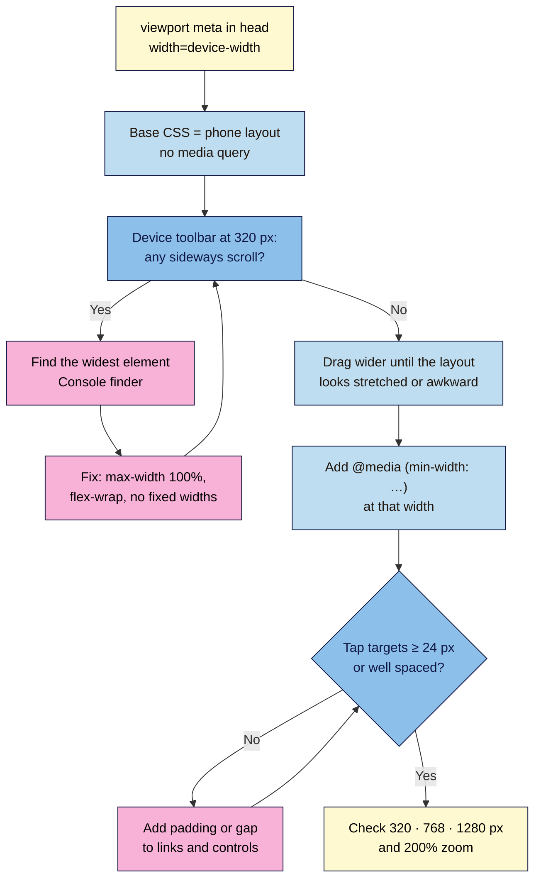

# M03.L04 — Responsive, Mobile-First Design
> After this lesson you can make your launch page work on a 320 px phone first, add space and size for bigger screens with media queries, and find and fix the one element that makes a page scroll sideways.

**Time:** ~17 min reading + ~30 min exercise · **Level:** L1 Foundation (beginner) · **Prereqs:** M03.L03 · **Remediate to:** M03.L03
**Verified against:** MDN "Responsive design", "Media queries", viewport `<meta>`, `clamp()` and `aspect-ratio`; web.dev "Responsive web design basics"; W3C WAI Understanding SC 1.4.10 Reflow, SC 2.5.8 Target Size (Minimum) and SC 1.4.4 Resize Text (WCAG 2.2); Google Search Central "Mobile-first indexing best practices"; Chrome DevTools "Simulate mobile devices with device mode"; this lesson's stylesheet validated live with the W3C CSS Validation Service and run in headless Chrome 156 at 320, 768, 1024 and 1280 px (heading sizes, 41.6 px menu links, 24 px checkboxes, hero split, both Part C bugs and what the Console finder does and doesn't catch), on 2026-11-02 (Chrome/Edge and Firefox stable).

## Learning objectives
1. **Explain** the viewport meta tag and mobile-first CSS: base styles for small screens, `min-width` media queries that add to them. *(O1)*
2. **Use** fluid sizing (`%`, `rem`, `max-width`, `clamp()`) and flexible images and embeds (`max-width: 100%`). *(O2)*
3. **Test** at 320, 768 and 1280 px in the DevTools device toolbar and fix sideways scrolling and small tap targets (WCAG 2.2 SC 1.4.10 Reflow, SC 2.5.8 Target Size). *(O3)*

## Why it matters
Ana launches a cookery course on Instagram. Nearly every visitor arrives from the app on a phone. Her page was designed on a laptop: on a phone the YouTube trailer pokes out past the right edge, so the whole page wobbles sideways when you scroll; the "Enrol" button sits half off-screen; and the menu links are so close together that people tap "Refunds" instead of "Curriculum". Nothing is "broken" on her laptop, which is why she never noticed. Google also looks at the **mobile** version of a page when it indexes and ranks it (mobile-first indexing). Designing for the small screen first, then adding to it, avoids all of this.

## Core concept
**Plain version:** **responsive design** means one page, one set of HTML, whose CSS adapts to the screen it's on. **Mobile-first** means you write the base CSS for the **smallest** screen, then use **media queries** to add or change things when there's more room. Small screens get simple, light CSS; big screens get extra.

**Analogy:** packing for a trip. Mobile-first is packing a carry-on first (the essentials), then adding extra items when you learn you have a bigger suitcase. Desktop-first is packing the big suitcase and then trying to squeeze it into a carry-on at the airport. Something always gets left behind or forced in.

### The viewport tag (you added it in Lesson 2.1)
```html
<meta name="viewport" content="width=device-width, initial-scale=1">
```
Without it, phones pretend to be a ~980 px-wide desktop and shrink the whole page, so text is tiny. With it, the page uses the phone's real width in **CSS pixels** (often 360–430 px), and your responsive CSS can work. Never add `maximum-scale=1` or `user-scalable=no`: they stop people zooming, which fails WCAG 1.4.4 for many users.

### Media queries
```css
/* Base: phones (no query) */
section { padding: 2rem 0; }

/* Tablet and up: 48rem = 768 px at the default text size */
@media (min-width: 48rem) {
  section { padding: 3rem 0; }
}
```
- **`min-width` = "this wide or wider".** Mobile-first stylesheets use `min-width` queries, ordered small → large, so each one adds to the one before.
- **Pick breakpoints by content, not by device names.** Widen the device toolbar until your layout looks stretched or awkward; that's your breakpoint. 48rem and 64rem are common starting points, not rules.
- **Fewer than you think.** With Lesson 3.3's `flex-wrap` and `auto-fit` grid, most launch pages need only one or two media queries.

### Fluid sizing
| Tool | Example | Use |
|---|---|---|
| `%` and `max-width` | `max-width: 60rem; margin: 0 auto;` | A content column that's full width on phones and stops growing on wide screens (Lesson 3.1 already does this) |
| `rem` | `padding: 1rem;` | Spacing and text that grow with the visitor's text-size setting |
| `vw` | `1vw` = 1% of the viewport width | Only *inside* `clamp()` for headings. Never on its own for text (it doesn't grow when people zoom) |
| `clamp(min, preferred, max)` | `font-size: clamp(2rem, 1.75rem + 1vw, 3rem);` | A heading that's 2rem on a phone, grows smoothly, and stops at 3rem. Keep the `vw` part small and test at 200% zoom: the `vw` part doesn't grow with zoom |
| `max-width: 100%` | `img, video, iframe { max-width: 100%; }` | Media never wider than its container. Add `height: auto` to images so they keep their shape |
| `aspect-ratio` | `iframe { width: 100%; height: auto; aspect-ratio: 16 / 9; }` | Embeds (YouTube) that scale and keep 16:9, instead of the fixed 560 × 315 they're pasted with |

### Two WCAG 2.2 checks every responsive page needs
- **SC 1.4.10 Reflow (AA):** content must work at **320 CSS px** wide with **no sideways scrolling** (it's the same as a 1280 px desktop zoomed to 400%). Exceptions are things that need two dimensions, like maps, data tables or a video's own frame.
- **SC 2.5.8 Target Size (Minimum) (AA):** things you tap must be at least **24 × 24 CSS px**, **or** spaced so a 24 px circle centred on each doesn't touch its neighbours. Links inside a sentence are exempt, and so are browser-default controls you haven't resized. 24 px is the legal minimum; **44 × 44 px** (WCAG's AAA level and Apple's guideline) is better for main buttons.

## How it works



**In words:** with the viewport tag in place, write the base CSS for a phone and check it at 320 px. If anything scrolls sideways, find the widest element and make it flexible. Then widen the preview until the layout looks wrong and add a `min-width` media query at that point. Finally check that tap targets are big enough or well spaced, and test at 320, 768 and 1280 px and at 200% zoom.

## Hands-on walkthrough

**Part A: see your page as a phone sees it (5 min)**
1. Open `launch.html` in Chrome or Edge. Press **F12**, then **Ctrl+Shift+M** (Mac: **Cmd+Shift+M**) to open the **device toolbar**.
2. In the toolbar's device menu choose **Responsive**, then type **320** in the width box.
   **Expected:** after Lesson 3.3, the header wraps, the hero stacks and the cards sit in one column. If you embedded a YouTube video in Lesson 2.2, you probably also see a **horizontal scrollbar**, or the page shifts sideways when you swipe. That's the bug Part C fixes.
3. Open the toolbar's **⋮** (More options) menu and tick **Show media queries**. **Expected:** a bar above the page; it's empty for now, and fills with coloured bands once you add queries in Part B.
   > 🖼️ **Image prompt:** Desktop screenshot (1440×900) of Chrome DevTools device toolbar in Responsive mode at 320 px wide showing the Nila Coffee launch page in one column, with "Show media queries" turned on and two coloured bands above the page for min-width 48rem and 64rem. Outline the width box and the media-query bars. Highlight the key element with a 3px #F9B2D7 outline; blur any personal details.
   > **Alt text:** DevTools device toolbar at 320 px wide showing the launch page in one column and media-query bars above it.

**Part B: fluid type, flexible media and two media queries (10 min)**
1. In `:root`, change two type tokens to fluid ones and add one spacing step:
   ```css
   --text-xl: clamp(1.5rem, 1.375rem + 0.5vw, 2rem);
   --text-2xl: clamp(2rem, 1.75rem + 1vw, 3rem);
   --space-4: 3rem;
   ```
2. Add this to the end of `styles.css`:
   ```css
   /* 7. Lesson 3.4: responsive, mobile-first */

   /* Embeds (YouTube, maps) scale like images, keeping 16:9 */
   iframe,
   video {
     max-width: 100%;
   }

   iframe {
     width: 100%;
     height: auto;
     aspect-ratio: 16 / 9;
   }

   /* Long words, URLs and email addresses wrap instead of overflowing */
   body {
     overflow-wrap: break-word;
   }

   /* Comfortable tap targets: menu links at least 24 px tall, with space */
   nav a {
     display: inline-block;
     padding: var(--space-1) 0.25rem;
   }

   /* Bigger checkbox and radio buttons (24 px) */
   input[type="checkbox"],
   input[type="radio"] {
     width: 1.5rem;
     height: 1.5rem;
   }

   /* Tablet and up (48rem = 768 px at default text size): more room */
   @media (min-width: 48rem) {
     section {
       padding: var(--space-4) 0;
     }
   }

   /* Laptop and up (64rem = 1024 px): hero text gets more of the row */
   @media (min-width: 64rem) {
     .hero > div {
       flex-grow: 1.5;
     }
   }
   ```
3. Save, reload, and drag the device toolbar's width from **320** to **1280**.
   **Expected:** the `h1` grows smoothly from 32 px at 320 px to about 41 px at 1280 px (it would stop at 48 px on very wide screens); sections get more vertical space from 768 px; above 1024 px the hero text takes the larger share of the row (a little over half) and the image the rest. The media-query bar now shows two bands; clicking one jumps to that width.
4. Validate `styles.css`. **Expected (checked 2026-11-02):** "Congratulations! No Error Found.", plus the usual warnings that CSS variables aren't statically checked.

**Part C: break it and fix it: find what scrolls sideways (8 min)**
1. Comment out the iframe rules you just added (wrap them in `/* … */`), save, and reload at **320** px.
   **Symptom:** a horizontal scrollbar, or the page slides left and right when you swipe.
2. Find the culprit. Open the **Console** and paste this one-liner (it lists every element whose right edge goes past the screen):
   ```js
   document.querySelectorAll('body *').forEach(el => { if (el.getBoundingClientRect().right > document.documentElement.clientWidth + 1) console.log(el); });
   ```
   **Expected:** `<iframe width="560" height="315" …>` in the list. Hover it in the Console and the page highlights it. (If several elements are listed, the **first** one that isn't inside another listed element is usually the cause.)

   **Its blind spot:** the finder checks element **boxes**. Text that spills out of a box that's the right width (a long word, URL or email address) isn't caught. So also paste `document.documentElement.scrollWidth` into the Console: at 320 px it should say **320**. A bigger number with an empty finder means overflowing text (step 4).
   > 🖼️ **Image prompt:** Desktop screenshot (1440×900) of Chrome DevTools at 320 px wide with the Console showing the overflow one-liner and its output, an `<iframe width="560" height="315">` element, highlighted on the page as it overflows the right edge. Outline the Console output and the overflowing iframe. Highlight the key element with a 3px #F9B2D7 outline; blur any personal details.
   > **Alt text:** DevTools Console listing an iframe 560 pixels wide as the element overflowing a 320 pixel screen.
3. Uncomment the iframe rules, reload. **Expected:** the video fits the column at 16:9 and the scrollbar is gone; the one-liner prints nothing.
4. Plant a second classic: in the FAQ, add a sentence with a long unbroken address such as `https://nilacoffee.example/subscriptions/monthly-medium-roast-whole-bean-gift-box`. Temporarily remove `overflow-wrap: break-word;` from `body`. **Symptom:** the address pushes past the edge at 320 px. Run the finder: it prints **nothing**, because the paragraph's box is still 288 px wide and only its text spills out. `document.documentElement.scrollWidth` gives the game away (in Chrome it showed **413** instead of 320). Put the rule back: the address wraps and `scrollWidth` is 320 again.

**Part D: test tap targets and the three widths (7 min)**
1. At **320** px, inspect a menu link. Hover it in Elements: the tooltip shows its size, e.g. `a 104 × 41.6`. **Expected:** every menu link is at least **24 px** tall, and the gap between links keeps neighbours apart.
2. Check the sign-up checkbox and radio buttons: about **24 × 24** px now (browser defaults are often around 13 px; those are exempt from SC 2.5.8 as browser-controlled, but bigger is kinder on a phone, and the `<label>` you linked in Lesson 2.4 also responds to taps).
3. Take three screenshots for your project note at **320, 768 and 1280** px: in the device toolbar's ⋮ menu choose **Capture full size screenshot**.
   **Expected:** no sideways scrolling at any width, readable text, the hero stacked on phones and side by side on laptops.
4. Finally, reset the device toolbar, set the browser to **200% zoom** (Ctrl/Cmd and +), and scroll the page. **Expected:** body text is twice as big, nothing overlaps or gets cut off, and you only scroll up and down.

## When to use / when not to
- **Mobile-first (`min-width`) vs desktop-first (`max-width`):** mobile-first gives phones the simplest CSS and makes each query an addition. Desktop-first queries undo things ("on small screens, remove the columns, shrink the padding…"), which grows into a pile of overrides. You'll meet `max-width` queries in older themes; read them, don't start with them.
- **Media query vs intrinsic layout:** if `flex-wrap` or `auto-fit` already handles it, don't add a query. Use a query when the design should **change shape** at a size (a hero split 60/40, a sticky header, bigger section spacing).
- **`clamp()` for headings vs fixed steps:** `clamp()` gives smooth growth with less code. **Trade-off:** its `vw` part doesn't grow when visitors zoom, so keep body text in plain `rem` and test headings at 200% zoom.
- **A separate mobile site (`m.example.com`) or "mobile version" HTML:** don't. One responsive page is easier to maintain, and Google recommends responsive design.

## Use AI for this
**Example prompt:**
> "Here is my CSS [paste]. Rewrite only what's needed to make it mobile-first: base styles for a 320 px screen with no media query, then `min-width` media queries in rem for larger screens. Keep my tokens. Don't add fixed pixel widths, don't use `maximum-scale` or `user-scalable=no`, and list every change with a one-line reason."

**What AI does well here:** spotting fixed widths, converting desktop-first `max-width` queries to `min-width`, and writing `clamp()` values.
**Where it gets it wrong:** it often adds a dozen device-named breakpoints ("iPhone 14 Pro Max"), uses `vw` alone for text (which breaks zoom), suggests `overflow-x: hidden` on `body` to "fix" sideways scrolling (that hides content instead of fixing the culprit, and can trap keyboard focus off-screen), or adds `user-scalable=no` to the viewport tag.
**How to check:** run the overflow one-liner at 320 px, test at 768 and 1280 px, zoom to 200%, and reject any `overflow-x: hidden` or `user-scalable=no` in its answer.

## Common mistakes
- **Designing at laptop width and "fixing mobile later."** Start the device toolbar at 320 px.
- **Fixed widths:** `width: 600px` on a banner, card or form. Use `max-width` and let it shrink.
- **Pasted embeds** (YouTube 560 × 315, maps 600 × 450) left at their fixed size.
- **`overflow-x: hidden` on `body`** to hide sideways scrolling instead of finding the cause.
- **Breakpoints named after devices** and a query for every phone model. Choose by content.
- **Text sized only in `vw`,** which doesn't grow when people zoom.
- **Tiny, crowded tap targets:** footer links in one line at 12 px with no space between them.
- **Hiding important content on phones** (`display: none` for the price or testimonials). Mobile visitors, and Google's mobile-first indexing, see less.

## Troubleshooting
| Symptom | Likely cause | Fix |
|---|---|---|
| Phone shows a tiny zoomed-out page | Viewport `<meta>` missing or misspelt | Add `<meta name="viewport" content="width=device-width, initial-scale=1">` in `<head>` |
| Page scrolls sideways at 320 px | A fixed-width element: embed, image without `max-width`, long URL, `width` in px, flex row without wrap | Run the Console finder one-liner; make that element flexible |
| Media query never applies | Missing brace, `min-width:48rem` written without the parentheses, or it's earlier in the file than the rule it should override | Validate; check that the query is **after** the base rule; tick **Show media queries** and click the band |
| Media query applies at the wrong width | Mixed `px` and `rem` thinking, or the browser's default text size isn't 16 px | 48rem = 768 px only at a 16 px default; that's intended, since layouts then adapt to larger text too |
| Video squashed or letterboxed | `height` fixed while `width` changes | `width: 100%; height: auto; aspect-ratio: 16 / 9;` |
| Device toolbar looks fine, real phone doesn't | Browser cache, or a different file | Reload without cache on the phone; open the same URL (in Module 4 you'll test the live site on a real phone) |

## Exercise
**Task:** make **your** launch page mobile-first and prove it.
1. Fluid `h1`/`h2` tokens with `clamp()`, and media and embed rules (`max-width: 100%`, `aspect-ratio` for iframes).
2. At most **two** `min-width` media queries in `rem`, each with a comment saying what it adds and why at that width.
3. At 320 px, the overflow finder prints nothing **and** `document.documentElement.scrollWidth` is 320. Note anything you found and how you fixed it.
4. A tap-target check: every link in your header, footer and form at least 24 px tall or clearly spaced.
5. Full-size screenshots at 320, 768 and 1280 px, plus one at 200% zoom.
6. W3C CSS checker: no errors.

**Expected outcome:** no sideways scrolling at 320 px; layout changes only where your queries say; headings that scale; tap targets that meet SC 2.5.8; four screenshots in your project note.
**Stretch goal:** open your Module 1 brand site at 320 px and run the overflow finder. If it finds something, write down the element and the one-line CSS fix you'd suggest.

## Key takeaways
- **Viewport tag + mobile-first CSS:** base styles for phones, `min-width` media queries (in `rem`) that **add** for larger screens.
- **Fluid beats fixed:** `max-width`, `%`, `rem`, `clamp()` for headings; `max-width: 100%` on images, video and iframes; `aspect-ratio` for embeds.
- **WCAG 2.2:** no sideways scrolling at 320 px (1.4.10 Reflow); targets ≥ 24 × 24 px or well spaced (2.5.8).
- **Find, don't hide:** the Console one-liner names the element that overflows (and `scrollWidth` catches spilling text); never paper over it with `overflow-x: hidden`.
- Test at **320 · 768 · 1280 px** and at **200% zoom** every time you change layout.

## Teach it back
Explain to a friend in 3 sentences why their landing page scrolls sideways on a phone, how to find the element causing it, and why "mobile-first" CSS prevents it.

## Glossary terms added
- Responsive design — added to `webdev-101/glossary.md`
- Mobile-first (CSS) — added to `webdev-101/glossary.md`
- Media query (`@media`, `min-width`) — added to `webdev-101/glossary.md`
- Breakpoint — added to `webdev-101/glossary.md`
- CSS pixel — added to `webdev-101/glossary.md`
- `vw` (viewport width unit) — added to `webdev-101/glossary.md`
- `clamp()` — added to `webdev-101/glossary.md`
- `aspect-ratio` — added to `webdev-101/glossary.md`
- `overflow-wrap` — added to `webdev-101/glossary.md`
- Reflow (WCAG 1.4.10) — added to `webdev-101/glossary.md`
- Target size (WCAG 2.5.8) — added to `webdev-101/glossary.md`
- Mobile-first indexing — added to `webdev-101/glossary.md`

## Further reading
*All checked 2026-11-02.*
- MDN — Responsive design: https://developer.mozilla.org/en-US/docs/Learn_web_development/Core/CSS_layout/Responsive_Design
- MDN — Media queries: https://developer.mozilla.org/en-US/docs/Learn_web_development/Core/CSS_layout/Media_queries
- MDN — Viewport `<meta>` tag: https://developer.mozilla.org/en-US/docs/Web/HTML/Viewport_meta_tag
- MDN — `clamp()`: https://developer.mozilla.org/en-US/docs/Web/CSS/clamp
- MDN — `aspect-ratio`: https://developer.mozilla.org/en-US/docs/Web/CSS/aspect-ratio
- web.dev — Responsive web design basics: https://web.dev/articles/responsive-web-design-basics
- W3C WAI — Understanding SC 1.4.10 Reflow: https://www.w3.org/WAI/WCAG22/Understanding/reflow.html
- W3C WAI — Understanding SC 2.5.8 Target Size (Minimum): https://www.w3.org/WAI/WCAG22/Understanding/target-size-minimum.html
- W3C WAI — Understanding SC 1.4.4 Resize Text: https://www.w3.org/WAI/WCAG22/Understanding/resize-text.html
- Google Search Central — Mobile-first indexing best practices: https://developers.google.com/search/docs/crawling-indexing/mobile/mobile-sites-mobile-first-indexing
- Chrome for Developers — Simulate mobile devices with device mode: https://developer.chrome.com/docs/devtools/device-mode

## Refresher card
*Used by remediation when a learner fails a quiz twice on a later lesson that points back here.*
Viewport tag `width=device-width, initial-scale=1` (never `user-scalable=no`). Mobile-first: base CSS = phone; `@media (min-width: 48rem) { … }` adds for bigger screens, placed after the base rule. Fluid: `max-width`, `%`, `rem`; `clamp(2rem, 1.75rem + 1vw, 3rem)` for headings only; `img, video, iframe { max-width: 100%; }`, `iframe { width: 100%; height: auto; aspect-ratio: 16 / 9; }`. WCAG: no sideways scroll at 320 px (1.4.10); tap targets ≥ 24 × 24 px or spaced (2.5.8). Find overflow with the Console one-liner (plus `document.documentElement.scrollWidth` = 320 for long words and URLs), don't hide it with `overflow-x: hidden`. Test 320 · 768 · 1280 px + 200% zoom.
