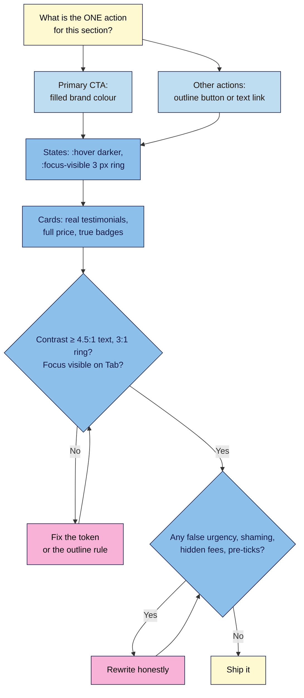

# M03.L05 — Conversion-Focused UI Patterns
> After this lesson you can style a clear main call-to-action and a quieter second option, make every button obviously focusable for keyboard users, build honest pricing and testimonial cards, and decide whether a ready-made CSS library is worth adding.

**Time:** ~18 min reading + ~35 min exercise · **Level:** L1 Foundation (beginner) · **Prereqs:** M03.L03, M03.L04 · **Remediate to:** M03.L03
**Verified against:** MDN `:focus-visible` and Subresource Integrity; W3C WAI Understanding SC 2.4.7 Focus Visible, SC 2.4.11 Focus Not Obscured (Minimum) and SC 1.4.11 Non-text Contrast (WCAG 2.2); India's CCPA Guidelines for Prevention and Regulation of Dark Patterns, 2023 (PIB release); EU Digital Services Act Art. 25; FTC staff report "Bringing Dark Patterns to Light" (2022); Pico CSS v2.1.1 on npm/jsDelivr (MIT licence, SRI hash computed from the file); every contrast ratio computed with the WCAG 2.2 formula; this lesson's stylesheet validated live with the W3C CSS Validation Service, on 2026-11-02.

> ⚠️ **Freshness flag:** consumer-protection rules on "dark patterns" are changing fast (India 2023, EU DSA 2024, US state laws; the US FTC's 2024 "click-to-cancel" rule was struck down by a federal appeals court in July 2025). This lesson teaches honest design, which is safe under all of them; it is not legal advice.

## Learning objectives
1. **Style** primary and secondary calls-to-action (CTAs) with clear hierarchy and visible `:hover` and `:focus-visible` states. *(O1)*
2. **Build** honest testimonial and pricing-card patterns, and **recognise** dark patterns (false urgency, confirmshaming, drip pricing, hidden opt-outs) to avoid. *(O2)*
3. **Decide** when a ready-made CSS library helps, and add one safely (pinned version, integrity hash, licence, contrast re-check). *(O3)*

## Why it matters
Tunde's course page has four orange buttons of equal size: "Enrol", "Download syllabus", "Watch trailer" and "Contact us". Visitors don't know which one matters, so many click none. A keyboard user can't see where they are, because a template removed the focus outline "to look cleaner". The pricing table shows "₹2,999" and adds ₹600 of "platform fees" at checkout. A countdown says "Offer ends in 09:59" and restarts every time the page reloads. Each trick might lift clicks for a week; together they cost trust, refunds and, in India, the EU and many US states, can break consumer law. Conversion-focused design is the opposite of tricks: **one clear next step, visible to everyone, with the real price.**

## Core concept
**Plain version:** a page converts when visitors can see **what to do next**, trust **what they're getting**, and **do it easily** with mouse, touch or keyboard. CSS controls the first and third parts: **visual hierarchy** (the most important action looks most important) and **interaction states** (hover, focus, pressed). Honest content controls the second.

**Analogy:** a good shop window has **one** door with a clear sign, prices on every item, and a shop assistant who doesn't block the exit. Dark patterns are the shop that hides the prices, shouts "last one!" all day, and makes you say "No, I don't like saving money" to leave.

### The CTA hierarchy
| Level | Looks like | Example | How many per screen |
|---|---|---|---|
| **Primary** | Filled, brand CTA colour, strongest contrast | "Join the launch list" | **One** per view |
| **Secondary** | Outline (border + text colour), same size and shape | "See the plans", "Watch the 1-minute video" | One or two |
| **Tertiary** | A normal text link | "Read the FAQ" | As needed |

Rules that matter more than colour:
- **Button text says what happens:** "Join the launch list", "Get my first box", not "Submit" or "Click here".
- **Link or button?** A **link** (`<a href>`) goes somewhere: another page or `#signup`. A **button** (`<button>`) does something: submits a form, opens a menu. Style them alike if you want; keep the right element (Lesson 2.4).
- **Size:** main buttons at least **44 px** tall (the course starter already gives about 54 px); every target at least 24 px (Lesson 3.4).

### States: hover, focus, active
| State | Selector | Must |
|---|---|---|
| Hover (mouse over) | `.button:hover` | A visible change (darker shade); never the *only* hint, since phones have no hover |
| **Keyboard focus** | `:focus-visible` | A clearly visible indicator (WCAG 2.2 SC 2.4.7, AA). An outline at least 2–3 px with **3:1 contrast** against what's around it is the safe default |
| Focus not hidden | — | A focused element mustn't be completely covered by a sticky header, cookie banner or chat widget (SC 2.4.11, new in WCAG 2.2, AA) |

`:focus-visible` shows the ring when someone uses the keyboard, but not when they click with a mouse. That's why there's **no** reason to write `outline: none` any more.

### Honest cards
- **Testimonials:** real people, real words, with permission; name + role or city; no stock photos pretending to be customers. Never invent them (Capstone 2's rule still applies).
- **Pricing:** the full price up front (tax, delivery or "from $4 delivery outside India"), the billing period, and what happens at renewal. "Best value" only if the numbers show it.
- **Featured plan:** highlight one plan with a contrasting card. In CSS you do this by **swapping tokens** inside that card (Lesson 3.2 promised this), so headings, text, links and focus rings all switch together.

### Dark patterns to avoid (and that regulators now name)
| Pattern | What it looks like | Do this instead |
|---|---|---|
| **False urgency** | Fake countdowns that reset; "Only 2 left!" that's always 2 | Real deadlines only, with the actual date |
| **Confirmshaming** | Decline link: "No thanks, I don't like good coffee" | Neutral: "No thanks" |
| **Interface interference** | "Accept" big and bright; "Decline" tiny, light grey, low contrast | Both options readable (4.5:1), similar weight |
| **Drip pricing** | Extra fees appear only at checkout | Show the full price, or "from" price plus all fees, on the page |
| **Basket sneaking / pre-ticked boxes** | Add-ons or marketing consent ticked by default | Unticked optional boxes (Lesson 2.4) |
| **Subscription trap** | Easy to join, hard to cancel | Say how to cancel next to the price |

India's Central Consumer Protection Authority lists 13 specified dark patterns in its **2023 Guidelines**, including false urgency, confirmshaming, basket sneaking, drip pricing, subscription traps and interface interference. The **EU Digital Services Act (Art. 25)** bans online platforms from designing interfaces that deceive or manipulate users. The US **FTC** documented the same tactics in its 2022 staff report "Bringing Dark Patterns to Light" and acts against them as unfair or deceptive practices. Rules differ by country and by type of business; honest design is safe everywhere.

### Ready-made CSS libraries
| Kind | Example (version checked 2026-11-02) | Good for | Watch out for |
|---|---|---|---|
| **Classless** | Pico CSS 2.1.1 (`pico.classless.min.css`, MIT, ~10 KB compressed) | Instantly decent-looking semantic HTML, prototypes, docs pages | Its own colours and fonts: you still check contrast and override with your tokens |
| **Component framework** | Bootstrap 5.3.8 (MIT) | Big sites with many standard components | Large; you add its classes to your HTML; "Bootstrap look" |
| **Utility-first** | Tailwind CSS | Teams that build everything from small classes | Needs a build step for real projects; long `class` lists |

**Safe-adoption checklist:** (1) **licence** allows commercial use (MIT does); (2) **pin an exact version** (`@2.1.1`, never "latest"), so an update can't change your page overnight; (3) add an **`integrity`** hash (Subresource Integrity), so the browser refuses a file that's been tampered with on the CDN; (4) **re-check contrast and focus** with your colours; (5) a third-party CDN is another server that sees your visitors' IP addresses (the same issue as Google Fonts in Lesson 3.2): **self-host** the file for a live site; (6) load it **before** your `styles.css` so your rules win ties.

## How it works



**In words:** decide the single most important action for each section and make it the only filled button; everything else is an outline button or a link. Give every interactive element a hover change and a clearly visible keyboard focus ring. Keep cards honest: real testimonials, full prices, true badges. Then check contrast and focus with the keyboard, and review the copy for dark patterns before shipping.

## Hands-on walkthrough

**Part A: tokens and button states (8 min)**
1. Add these tokens to `:root` in `styles.css`:
   ```css
   --color-cta-hover: #92400e;       /* button hover (white text 7.1:1) */
   --color-focus: #6b3f1f;           /* focus ring (8.6:1 on bg) */
   --color-inverse-bg: #2b1d14;      /* dark card background */
   --color-inverse-text: #fffaf2;    /* text on dark (15.7:1) */
   --color-inverse-heading: #e0a458; /* caramel on dark (7.5:1) */
   ```
   (The caramel that failed as a button background in Lesson 3.2 is fine here: as **text on dark roast** it's 7.47:1.)
2. Add to the end of `styles.css`:
   ```css
   /* 8. Lesson 3.5: conversion UI */

   /* Primary button: darker on hover */
   .button:hover,
   button:hover {
     background-color: var(--color-cta-hover);
     border-color: var(--color-cta-hover);
   }

   /* Secondary action: same size, outline style, less visual weight */
   .button-secondary {
     background-color: transparent;
     border-color: var(--color-heading);
     color: var(--color-heading);
   }

   .button-secondary:hover {
     background-color: var(--color-surface);
     border-color: var(--color-heading);
   }

   /* Keyboard focus: always visible, never removed */
   a:focus-visible,
   button:focus-visible,
   input:focus-visible,
   select:focus-visible,
   textarea:focus-visible,
   summary:focus-visible {
     outline: 3px solid var(--color-focus);
     outline-offset: 2px;
   }
   ```
3. In the hero, add a secondary action after the primary one: `<a class="button button-secondary" href="#plans">See the plans</a>`.
4. Reload. Hover both buttons, then click in the address bar and press **Tab** through the page.
   **Expected:** the primary button darkens on hover; the secondary is an outline that fills white on hover. On Tab, every link, button and field shows a **3 px brown ring** with a small gap. Click a button with the mouse: no ring (that's `:focus-visible`).
   > 🖼️ **Image prompt:** Desktop screenshot (1280×800) of the Nila Coffee hero with a filled burnt-orange "Join the launch list" button and an outline "See the plans" button; the outline button has keyboard focus, shown by a 3 px brown ring with a small gap. Outline both buttons. Highlight the key element with a 3px #F9B2D7 outline; blur any personal details.
   > **Alt text:** Hero with a filled primary button and an outline secondary button showing a visible keyboard focus ring.

**Part B: honest pricing and testimonial cards (12 min)**
1. Add a pricing section to `launch.html` before the FAQ:
   ```html
   <section id="plans" aria-labelledby="plans-title">
     <h2 id="plans-title">Choose your plan</h2>
     <div class="card-grid">
       <article class="plan">
         <h3>Taster</h3>
         <p class="price">₹499 / $6 a month</p>
         <ul>
           <li>250 g, roasted this week</li>
           <li>Whole bean or ground</li>
           <li>Pause or cancel any time in your account</li>
         </ul>
         <a class="button button-secondary" href="#signup">Choose Taster</a>
       </article>
       <article class="plan plan-featured">
         <p class="plan-badge">Best value: ₹180 per 100 g</p>
         <h3>Regular</h3>
         <p class="price">₹899 / $11 a month</p>
         <ul>
           <li>500 g, roasted this week</li>
           <li>Whole bean or ground</li>
           <li>Pause or cancel any time in your account</li>
         </ul>
         <a class="button" href="#signup">Choose Regular</a>
       </article>
     </div>
     <p class="hint">Prices include tax. Free delivery in India; delivery elsewhere from $4, shown before you pay.</p>
   </section>
   ```
   The badge is true (₹899 ÷ 5 = ₹180 per 100 g, against ₹200 for Taster). "Most popular" would be false before launch.
2. Add the card styles:
   ```css
   /* Testimonials */
   .card-grid blockquote {
     margin: 0 0 var(--space-1);
     font-size: var(--text-lg);
   }

   /* Pricing cards */
   .plan {
     display: flex;
     flex-direction: column;
     gap: var(--space-1);
   }

   .plan .button {
     margin-top: auto;
     text-align: center;
   }

   .price {
     margin: 0;
     font-size: var(--text-xl);
     font-weight: 700;
     color: var(--color-heading);
   }

   .plan-badge {
     align-self: flex-start;
     margin: 0;
     padding: 0.25rem var(--space-1);
     border-radius: var(--radius);
     background-color: var(--color-heading);
     color: var(--color-surface);
     font-size: var(--text-sm);
     font-weight: 700;
   }

   /* Featured plan: swap the tokens, and everything inside follows */
   .plan-featured {
     --color-surface: var(--color-inverse-bg);
     --color-text: var(--color-inverse-text);
     --color-heading: var(--color-inverse-heading);
     --color-focus: var(--color-inverse-heading);
     color: var(--color-text);
   }
   ```
   `margin-top: auto` on the button pushes it to the bottom of each card, so buttons line up even when the lists differ in length. The `.plan-featured` rule changes **five tokens** and never names a colour: the card background, text, heading, price, badge, secondary button and focus ring all follow.
3. Reload and check.
   **Expected:** two equal-height cards (stacked on a phone); the Regular card is dark roast with cream text, caramel heading and price, a caramel badge with dark text, and a filled orange button. Tab into the dark card: its focus ring is **caramel**, not brown, because the token changed.
   > 🖼️ **Image prompt:** Desktop screenshot (1280×800) of two Nila Coffee pricing cards side by side: a white "Taster" card with an outline button and a dark-roast "Regular" card with a caramel "Best value: ₹180 per 100 g" badge, caramel price and a filled orange "Choose Regular" button, with the delivery note below. Outline the featured card and the price note. Highlight the key element with a 3px #F9B2D7 outline; blur any personal details.
   > **Alt text:** Two pricing cards, one dark featured card with a best-value badge, and a note showing tax and delivery costs.
4. Inspect the dark card in DevTools, select it and look at **Styles**: the five overridden tokens are listed on `.plan-featured`. Hover `var(--color-heading)` on the `h3` rule: the tooltip shows `#e0a458`.
5. Validate. **Expected (checked 2026-11-02):** "Congratulations! No Error Found." plus the usual CSS-variable warnings.

**Part C: break it and fix it (8 min)**
1. **Invisible focus.** Add `*:focus { outline: none; }` at the end of `styles.css`, reload and Tab through. **Symptom:** you can't see where you are; it fails SC 2.4.7. **Find it:** in DevTools, select a link and tick **:focus** in the Styles pane's **:hov** menu (force element state): the rule removing the outline is listed and wins. **Fix:** delete the rule.
2. **Interface interference.** Under the sign-up button, add `<p><a class="decline" href="#">No thanks, I don't like fresh coffee</a></p>` and style it `.decline { color: #d9c7b0; font-size: 0.7rem; }`.
   **Symptom:** two problems in one line: the text is 1.59:1 on cream (fails 4.5:1) and about 11 px, and the wording shames the visitor (confirmshaming). **Fix:** delete the class rule so it uses the normal link colour, and reword it to "No thanks". Better still, ask whether the page needs a decline link at all.
3. **Hover-only information.** Imagine the plan's delivery cost appeared only in a tooltip on hover. **Question for your notes:** who never sees it? (Phone and keyboard users. Information that matters must be on the page.)

**Part D: try a classless library (7 min)**
1. Save a copy of your page as `launch-pico.html`. In its `<head>`, **replace** your `styles.css` link and the Google Fonts links with:
   ```html
   <link rel="stylesheet"
     href="https://cdn.jsdelivr.net/npm/@picocss/pico@2.1.1/css/pico.classless.min.css"
     integrity="sha384-NZhm4G1I7BpEGdjDKnzEfy3d78xvy7ECKUwwnKTYi036z42IyF056PbHfpQLIYgL"
     crossorigin="anonymous">
   ```
2. Open it. **Expected:** a clean, consistent page with styled headings, form fields and buttons, from **zero** classes, and an automatic dark theme if your system is in dark mode.
3. Change one character of the `integrity` value and reload. **Expected:** the page is unstyled, and the **Console** reports that the integrity check failed and the resource was blocked. That's SRI protecting you from a changed file.
4. Compare the two pages in your notes: what Pico does better, what your own CSS does better (brand, featured plan, layout), and whether you'd use Pico as a **starting point** under your `styles.css` or not at all. There's no wrong answer; the reasoning is the exercise.

## When to use / when not to
- **One primary CTA per view:** when two actions both matter (buy vs learn more), make one primary and one secondary. Two filled buttons compete. **Trade-off:** the secondary action gets fewer clicks; that's the point.
- **Featured plan:** highlight the plan most people *should* choose, based on value to them. Don't feature an expensive plan just to make the cheaper one look small ("decoy pricing").
- **Countdown timers:** only for real deadlines (a launch date, an early-bird end date) that are the same for everyone and don't reset.
- **CSS library:** a classless library is great for a quick prototype, documentation or an internal page. For a branded launch page, your own ~200 lines of CSS with tokens is usually smaller, clearer and fully yours. Big component frameworks pay off on large sites with many templates, or when a team already uses one.

## Use AI for this
**Example prompt:**
> "Review this landing-page section [paste HTML and CSS] as a conversion and accessibility reviewer. List: (1) the primary action and whether it's visually the strongest, (2) any button text that doesn't say what happens, (3) any missing hover or focus-visible styles, (4) contrast problems (give the colour pairs, I'll measure them myself), and (5) anything that could be a dark pattern under India's 2023 CCPA guidelines or the EU DSA (false urgency, confirmshaming, drip pricing, hidden opt-outs). Don't rewrite the page."

**What AI does well here:** spotting vague button text, competing CTAs, and copy that sounds manipulative; suggesting honest alternatives.
**Where it gets it wrong:** asked to "increase conversions", AI often *suggests* dark patterns itself: fake scarcity ("Only 3 spots left!"), countdowns, guilt-trip decline links, and "Most popular" badges with no data. It also writes `outline: none` for a "cleaner" look and states contrast ratios it never calculated.
**How to check:** measure every colour pair yourself, Tab through the page, and read every claim on the page asking "is this true today, for every visitor?".

## Common mistakes
- **Several equal primary buttons** competing for attention.
- **"Submit", "Click here", "Learn more"** as the only button text.
- **`outline: none`** (or `outline: 0`) with no replacement focus style.
- **Hover as the only feedback,** or important info only in hover tooltips.
- **A "decline" option that's tiny, grey and shaming.**
- **Prices without tax, delivery or billing period,** or a "from" price that nobody can actually buy.
- **Fake badges and fake scarcity** ("Most popular" before launch, "Only 2 left" that never changes).
- **Adding a CSS library from "latest"** with no integrity hash, then fighting its specificity with `!important`.

## Troubleshooting
| Symptom | Likely cause | Fix |
|---|---|---|
| No focus ring when tabbing | An `outline: none` rule somewhere (often in a reset or library) | Force **:focus** state in DevTools (**:hov**), find the rule, remove it or add your `:focus-visible` style after it |
| Focus ring shows on mouse click too | You styled `:focus` instead of `:focus-visible` | Use `:focus-visible` for the visible ring |
| Focused field hidden behind a sticky header | Sticky element covers it (SC 2.4.11) | Add `scroll-padding-top` equal to the header height on `html`, or don't make the header sticky |
| Featured card text still dark | Overrode the token but didn't re-set `color` on the card | Add `color: var(--color-text);` to `.plan-featured` (inherited text colour was computed on `body`) |
| Buttons in cards don't line up | Different list lengths | Make the card a flex column and give the button `margin-top: auto` |
| Library styles beat yours | Library loaded **after** `styles.css`, or higher specificity | Load the library first; match its selector specificity rather than using `!important` |
| Library file blocked, page unstyled | Integrity hash doesn't match (wrong version or a copy-paste error) | Copy the hash for that exact version from the CDN's page, or self-host the file |

## Exercise
**Task:** make **your** launch page convert honestly.
1. One primary CTA per section, at most one secondary (outline) CTA, and button text that says what happens.
2. Hover and `:focus-visible` styles for all links, buttons and fields; Tab through the whole page and confirm you can always see where you are.
3. Style your testimonials (real, or a clear TODO) and, if you sell something, an honest pricing block: full price, period, delivery or tax note, how to cancel, and a featured card made by swapping tokens.
4. A **dark-pattern audit** of your page in your notes: go through the six rows of the dark-patterns table and write "none" or what you changed.
5. A **library decision**: try Pico classless (Part D) and write three sentences on whether you'll use it and why.
6. W3C CSS checker: no errors.

**Expected outcome:** one clearly dominant CTA per section; visible focus everywhere (3:1 against the background); honest, readable cards; an audit with no dark patterns left; and a reasoned library decision.
**Stretch goal:** find a real sign-up or checkout page (any brand) and list every dark pattern you can spot using the table above. Then rewrite one of them honestly in your notes.

## Key takeaways
- **One primary action per view.** Secondary actions are outline buttons or links; button text says what happens.
- **Every interactive element needs visible keyboard focus.** Use `:focus-visible` with a 3:1 ring; never `outline: none` without a replacement.
- **Honest cards convert long-term:** real testimonials, full prices, true badges. Dark patterns are named and restricted in India, the EU and the US.
- **Swap tokens to theme a component:** a featured card changes a few tokens and everything inside follows, contrast included.
- **CSS libraries:** pin the version, add an `integrity` hash, check the licence and contrast, self-host for live sites, and load them before your own CSS.

## Teach it back
Explain to a friend in 3 sentences why their landing page's four bright buttons and a 10-minute countdown that resets on reload are hurting them, and what they should do instead.

## Glossary terms added
- Call to action (CTA), primary and secondary — added to `webdev-101/glossary.md`
- Visual hierarchy — added to `webdev-101/glossary.md`
- `:hover` / `:focus-visible` — added to `webdev-101/glossary.md`
- Focus indicator (focus ring) — added to `webdev-101/glossary.md`
- `outline-offset` — added to `webdev-101/glossary.md`
- Dark pattern — added to `webdev-101/glossary.md`
- False urgency — added to `webdev-101/glossary.md`
- Confirmshaming — added to `webdev-101/glossary.md`
- Drip pricing — added to `webdev-101/glossary.md`
- CSS library / framework (classless, component, utility-first) — added to `webdev-101/glossary.md`
- CDN version pinning — added to `webdev-101/glossary.md`
- Subresource Integrity (SRI) — added to `webdev-101/glossary.md`

## Further reading
*All checked 2026-11-02.*
- MDN — `:focus-visible`: https://developer.mozilla.org/en-US/docs/Web/CSS/:focus-visible
- W3C WAI — Understanding SC 2.4.7 Focus Visible: https://www.w3.org/WAI/WCAG22/Understanding/focus-visible.html
- W3C WAI — Understanding SC 2.4.11 Focus Not Obscured (Minimum): https://www.w3.org/WAI/WCAG22/Understanding/focus-not-obscured-minimum.html
- W3C WAI — Understanding SC 1.4.11 Non-text Contrast: https://www.w3.org/WAI/WCAG22/Understanding/non-text-contrast.html
- Press Information Bureau (India) — CCPA issues Guidelines for Prevention and Regulation of Dark Patterns, 2023 (13 specified dark patterns): https://www.pib.gov.in/PressReleasePage.aspx?PRID=1983994
- Central Consumer Protection Authority (India) — Guidelines and advisories (official PDF): https://ccpa.doca.gov.in/guidelines.php
- EU — Digital Services Act, Regulation (EU) 2022/2065 (Art. 25, online interface design): https://eur-lex.europa.eu/eli/reg/2022/2065/oj
- US FTC — "FTC Report Shows Rise in Sophisticated Dark Patterns Designed to Trick and Trap Consumers" (Bringing Dark Patterns to Light, 2022): https://www.ftc.gov/news-events/news/press-releases/2022/09/ftc-report-shows-rise-sophisticated-dark-patterns-designed-trick-trap-consumers
- MDN — Subresource Integrity: https://developer.mozilla.org/en-US/docs/Web/Security/Subresource_Integrity
- Pico CSS — Class-less version: https://picocss.com/docs/classless
- jsDelivr — @picocss/pico (versions and SRI hashes): https://www.jsdelivr.com/package/npm/@picocss/pico

## Refresher card
*Used by remediation when a learner fails a quiz twice on a later lesson that points back here.*
One primary CTA per view (filled), secondary = outline button or link; text says what happens. States: `.button:hover` darker; `a:focus-visible, button:focus-visible, input:focus-visible { outline: 3px solid var(--color-focus); outline-offset: 2px; }`, never `outline: none` alone (SC 2.4.7; ring 3:1). Honest cards: real testimonials, full price + period + fees, true badges; no false urgency, confirmshaming, drip pricing, pre-ticks, hidden cancel (India CCPA 2023, EU DSA Art. 25, FTC). Theme a card by overriding tokens on it and re-setting `color`. Libraries: exact version, `integrity` + `crossorigin`, licence, contrast re-check, self-host live, load before `styles.css`.
