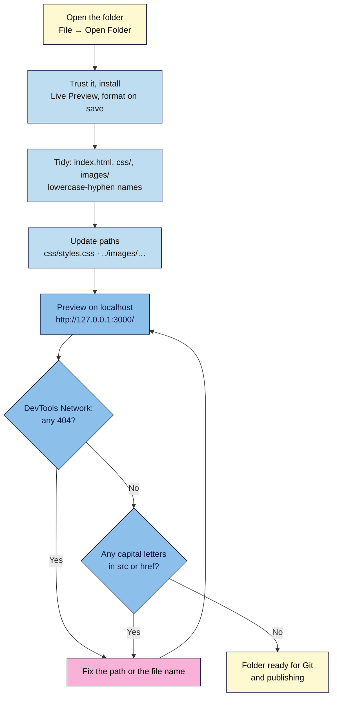

# M04.L01 — Your Toolkit: VS Code, Files & Folders
> After this lesson you can open your launch page as a proper project in a real code editor, keep its files in a tidy folder that will work unchanged on a web server, and preview it on a local server exactly the way a visitor's browser will load it.

**Time:** ~17 min reading + ~30 min exercise · **Level:** L2 Practitioner · **Prereqs:** M01.L05, M03 capstone · **Remediate to:** M01.L05
**Verified against:** VS Code docs ("Setting up Visual Studio Code", "Basic editing", "Workspace Trust", "Emmet", "Extension Marketplace", "Integrated browser"); VS Code stable release list (1.144.0 current on the check date); Microsoft "Live Preview" extension README and settings (`livePreview.portNumber` default 3000, `useIntegratedBrowser` default on, marked "still under development"); VS Code Marketplace listing (publisher, version and update date); MDN "Dealing with files" and "What is a URL?" (relative paths); a headless Chrome 156 run of the three path styles in Parts B–C, from `file://` and from a local server, on 2026-11-02.

> ⚠️ **Freshness flag:** VS Code ships a new version every month and Live Preview is still labelled "under development", so menu names and the preview window may look slightly different from the screenshots described here. The steps (open a folder, install one extension, preview on `localhost`) have been stable for years.

## Learning objectives
1. **Set up** VS Code with a project folder, one trusted extension and format-on-save, and open, edit and save files from it. *(O1)*
2. **Organise** a site folder (`index.html`, `css/`, `images/`) with web-safe file names and **fix** broken relative paths. *(O2)*
3. **Preview** the site on a local server and **explain** why `http://localhost` behaves more like a live site than opening the file directly. *(O3)*

## Why it matters
Leila has built her launch page in Notepad over three modules. Her folder holds `Launch Page FINAL v2.html`, `styles (1).css`, and `Hero Photo.JPG`, plus three copies of each from email attachments. It looks fine when she double-clicks the HTML file. The day she publishes it, the photo is missing on the live site, the stylesheet sometimes loads the old version, and the web address is `.../Launch%20Page%20FINAL%20v2.html`. None of this is a coding problem. It's a **files and tools** problem, and it's the one that stops most non-developers at the moment of publishing. A real editor, a tidy folder and a local server catch these mistakes on your own computer, before any visitor does.

## Core concept
**Plain version:** a **code editor** is a text editor made for code: it colours the syntax, completes tags, formats the file and shows the whole project folder at once. **VS Code** (Visual Studio Code, free from Microsoft) is the most widely used one. You open a **folder**, not a single file, and that folder *is* your website: whatever is inside it, arranged exactly that way, is what you'll upload in Lesson 4.3. A **local server** is a tiny web server running on your own computer, so you can visit the folder at an address like `http://127.0.0.1:3000/` and test it the way a browser will see it online.

**Analogy:** your project folder is a shop's stockroom, and file paths are the shelf labels. Opening a file by double-clicking is like checking stock with the lights off and your hand on the box: you can feel it's there. A local server is opening the shop for a practice morning: you walk in through the front door like a customer, and you find out that the sign says "Images" while the shelf says "images".

### The project folder
```
nila-launch/              ← the folder you open in VS Code (the "site root")
├── index.html            ← the home page (was launch.html)
├── css/
│   └── styles.css
└── images/
    ├── logo.svg
    ├── beans.jpg
    └── share-1200x630.jpg
```
- **`index.html`** is the file a web server sends when someone visits the folder itself (`https://nila.example/`). Name your home page `index.html` and the address stays clean.
- **Web-safe names:** lowercase letters, numbers and hyphens only. No spaces (they become `%20` in the address), no capitals, no `(1)` or `FINAL`. `hero-photo.jpg`, not `Hero Photo.JPG`.
- **One copy of each file.** Version history is Lesson 4.2's job (Git), not `-v2` file names.

### Paths: how one file finds another
| Path in `index.html` | Means | Use it? |
|---|---|---|
| `css/styles.css` | "the `css` folder next to me, then `styles.css`" (**relative**) | ✅ Yes: works from a file, a local server and any host |
| `../images/beans.jpg` (inside `css/styles.css`) | "go **up** one folder, then into `images`" | ✅ Yes, when one file sits in a subfolder |
| `/css/styles.css` | "from the **root** of the website" (**root-relative**) | ⚠️ Works on a server, **fails** when opened as a file, and breaks on a GitHub Pages project address (Lesson 4.3) |
| `C:\Users\leila\Desktop\styles.css` | a place on *your* computer only | ❌ Never: no visitor has your C: drive |

### Why `localhost` beats double-clicking
| | Double-click (`file://…`) | Local server (`http://127.0.0.1:3000/`) | Live site (`https://…`) |
|---|---|---|---|
| How files are fetched | Read straight from the disk | Requested over HTTP, like the real web | Requested over HTTP(S) |
| Missing file shows as | `net::ERR_FILE_NOT_FOUND` | **404**, like the live site | **404** |
| `/css/styles.css` (root-relative) | Fails (looks at the root of your drive) | Works | Works (except GitHub Pages project addresses) |
| Visiting the folder shows `index.html` | No (you see the file or a folder list) | Yes | Yes |
| Letter case (`Beans.jpg` vs `beans.jpg`) | Ignored on Windows and Mac | Ignored on Windows and Mac | **Matters** on almost every web host |

That last row is the one to remember: **no tool on a Windows or Mac computer will show a case mismatch.** Only a habit (all lowercase) and a quick search (Part C) protect you.

## How it works



**In words:** open the whole site folder in VS Code, trust it and set up one preview extension and format-on-save. Tidy the folder into `index.html`, `css/` and `images/` with lowercase, hyphenated names, and update the paths to match. Preview it on the local server, look for 404s in the Network panel, and search for capital letters in your paths, because your own computer won't show those mistakes. When both checks are clean, the folder is ready for Git (Lesson 4.2) and publishing (Lesson 4.3).

## Hands-on walkthrough

**Part A: install and set up VS Code (8 min)**
1. Download VS Code **only** from **https://code.visualstudio.com/** (lookalike download sites bundle adware). Install it with the defaults. On Windows, tick **Add "Open with Code" action** if offered.
   **Expected (checked 2026-11-02):** **Help → About** shows version **1.144** or later.
2. Make a new folder called `nila-launch` (or `<your-project>-launch`) in your Documents folder. In VS Code: **File → Open Folder…** and choose it.
   **Expected:** a **Workspace Trust** prompt: "Do you trust the authors of the files in this folder?" It's your own empty folder, so choose **Yes, I trust the authors**. (For folders downloaded from strangers, choose "No": VS Code then opens them in Restricted Mode, where extensions and tasks can't run code.)
3. Turn on **format on save**: **File → Preferences → Settings** (Mac: **Code → Settings → Settings**), search for `format on save`, tick **Editor: Format On Save**. VS Code formats HTML and CSS with its built-in formatter; no extra extension is needed.
4. Install one extension: open the **Extensions** view (Ctrl+Shift+X / Cmd+Shift+X), search for **Live Preview**, and check the publisher is **Microsoft** with the blue verified tick before you click **Install**.
   **Expected:** "Live Preview" by Microsoft installed. (A similar, older extension called "Live Server" by Ritwick Dey also works; this course uses Microsoft's.)
   > 🖼️ **Image prompt:** Desktop screenshot (1440×900) of the VS Code Extensions view with "Live Preview" by Microsoft selected, showing the verified publisher tick, the install count and the Install button. Outline the publisher name with its verified tick. Highlight the key element with a 3px #F9B2D7 outline; blur any personal details.
   > **Alt text:** VS Code Extensions view showing Microsoft's Live Preview extension with a verified publisher tick and an Install button.
5. Try Emmet, VS Code's built-in shortcut language: create a scratch file `test.html`, type `!` and press **Tab**.
   **Expected:** a full HTML skeleton with `<!DOCTYPE html>`, `lang="en"`, the charset and the viewport tag from Lesson 2.1. Delete `test.html` afterwards.

**Part B: tidy the folder and fix the paths (10 min)**
1. Copy (don't move) your Module 3 files into `nila-launch`: `launch.html`, `styles.css` and your images. In VS Code's Explorer, right-click to create a `css` folder and an `images` folder, and drag the files into them.
2. Rename (**F2** in the Explorer): `launch.html` → `index.html`. Rename any image with capitals or spaces, e.g. `Hero Photo.JPG` → `hero-photo.jpg`.
3. Open `index.html` and update the paths:
   ```html
   <link rel="stylesheet" href="css/styles.css">
   ```
   ```html
   
   ```
   If `styles.css` itself mentions an image (for example a background), that path now starts from the `css` folder, so it needs `../`: `url("../images/texture.jpg")`.
4. Press **Ctrl+S** / **Cmd+S**. **Expected:** the file re-indents itself neatly (format on save).
5. Open the **integrated terminal** with **Ctrl+`** (backtick; Mac: **Ctrl+`** too). Just look: it's a command line already sitting in your project folder. Lesson 4.2 uses it for four Git commands; nothing to type yet. Close it with the bin icon.

**Part C: preview on a local server, then break it and fix it (10 min)**
1. With `index.html` open, click the **Show Preview** icon (a page with a magnifier, top right of the editor), or open the Command Palette (**Ctrl+Shift+P** / **Cmd+Shift+P**) and run **Live Preview: Show Preview**.
   **Expected:** your styled page in a preview pane at an address starting **`http://127.0.0.1:3000/`**. Edit a word in the `h1`: the preview updates as you type.
2. Open it in your normal browser too: Command Palette → **Live Preview: Show Preview (External Browser)**. Open DevTools → **Network**, tick **Disable cache**, reload.
   **Expected:** every file shows status **200** (or 304); nothing in red.
3. **Bug 1: the forgotten path.** In `index.html`, change the link back to `href="styles.css"` and save.
   **Symptom:** the page is unstyled. **Find it:** Network shows `styles.css` in red with status **404 Not Found**, exactly what the live site would show (compare Lesson 3.1, where the same mistake from a double-clicked file gave `ERR_FILE_NOT_FOUND`). **Fix:** `css/styles.css`.
4. **Bug 2: the root-relative path.** Change it to `href="/css/styles.css"` and save. **Expected:** on the local server it **works**. Now double-click `index.html` in your file manager to open it as a file: it's unstyled, because `/` now means the root of your whole drive. (Checked in Chrome: `net::ERR_FILE_NOT_FOUND` from the file, styles applied from the server.) Put it back to `css/styles.css`: relative paths work everywhere, including the GitHub Pages address you'll get in Lesson 4.3.
5. **Bug 3: the invisible one.** Change an image's `src` to `images/Beans.jpg` (capital B) and save. **Symptom on Windows or Mac:** none. The image still shows, because your computer's file system ignores letter case. On most web hosts it would be a **404**. **Find it:** press **Ctrl+Shift+F** / **Cmd+Shift+F** (search the whole folder), turn on **Use Regular Expression** (`.*` icon, or Alt+R) and **Match Case** (`Aa` icon, or Alt+C), and search for:
   ```
   (src|href)="[^"]*[A-Z]
   ```
   **Expected:** the `Beans.jpg` line is listed (and any other path with a capital letter). Fix each one by matching the real, lowercase file name. Run the search again: "No results found".
   > 🖼️ **Image prompt:** Desktop screenshot (1440×900) of VS Code's Search view with the regular-expression and match-case toggles switched on, the pattern `(src|href)="[^"]*[A-Z]` typed in, and one result listed: `images/Beans.jpg` in `index.html`. Outline the two toggles and the result. Highlight the key element with a 3px #F9B2D7 outline; blur any personal details.
   > **Alt text:** VS Code search with regex and match case on, finding an image path that contains a capital letter.
   (External `https://` links in `href` may contain capitals legitimately, e.g. a YouTube video ID; ignore those. The search only needs to come back clean for your own files.)

## When to use / when not to
- **VS Code vs Notepad/TextEdit:** a plain text editor is fine for one file. From now on you'll have several files, Git and a terminal; VS Code puts them in one window. **Trade-off:** it's a bigger install and has many features you'll ignore for now. That's fine.
- **Live Preview vs double-clicking:** use the local server whenever you check paths, links or anything that will matter live. Double-clicking is fine for a quick look at one change.
- **Extensions:** install only what you need, from verified publishers, and remove what you stop using. Extensions run code on your computer with your permissions. This course needs one.
- **Online editors (CodePen, StackBlitz, github.dev):** still great for quick experiments and for Chromebooks or locked work laptops. Your real project now lives in a folder you control.

## Use AI for this
**Example prompt:**
> "Here's the file list of my website folder and the `<head>` and `` tags from index.html [paste]. My stylesheet is in `css/` and images in `images/`. Check every `href` and `src`: list any path that won't match a file in the list exactly, including letter case, any root-relative path starting with `/`, and any file name with spaces or capitals. Suggest renamed file names in lowercase-hyphen style. Don't change anything else."

**What AI does well here:** spotting mismatched paths and suggesting clean, consistent file names; explaining what `../` means in a specific case.
**Where it gets it wrong:** it often "fixes" paths into root-relative `/images/…` (which then breaks from a file and on GitHub Pages project addresses), recommends a long list of extensions, and assumes the file names it sees in your HTML are the real ones on disk.
**How to check:** run the Network check and the capital-letter search yourself on the local server; trust those over the AI's answer.

## Common mistakes
- **Opening a single file instead of the folder,** so the Explorer, search and preview don't see the rest of the site.
- **Spaces and capitals in file names** (`Hero Photo.JPG`), which turn into `%20` and case mismatches.
- **Paths that point to your own computer** (`C:\Users\…` or `file:///…`), often pasted by dragging a file into the editor.
- **Root-relative paths (`/css/…`)** that work on the local server and then fail elsewhere.
- **Forgetting `../`** in a CSS file that refers to an image in a sibling folder.
- **Several copies of the same file** (`styles.css`, `styles (1).css`) and editing the wrong one.
- **Installing extensions from unknown publishers** or lookalike download sites for VS Code itself.
- **Trusting a downloaded folder** without thinking (Workspace Trust exists because projects can run code).

## Troubleshooting
| Symptom | Likely cause | Fix |
|---|---|---|
| Page unstyled in the preview | `href` doesn't match the folder (`styles.css` vs `css/styles.css`) | Network → red **404** → correct the path |
| Image missing, but the path "looks right" | A space, different extension (`.jpeg` vs `.jpg`) or a hidden `.JPG` | Turn on file extensions in your file manager; rename to lowercase; match exactly |
| Works on the local server, unstyled when double-clicked | Root-relative path (`/css/…`) | Use a relative path: `css/styles.css` |
| No **Show Preview** icon | The file isn't `.html`, or Live Preview isn't installed or enabled | Check the file extension; Extensions view → Live Preview → **Enable** |
| Preview shows an old version | Browser cache | DevTools → Network → **Disable cache** while DevTools is open; reload |
| Extensions or tasks say "Restricted Mode" | You chose not to trust the folder | Only for your own folder: Command Palette → **Workspaces: Manage Workspace Trust** → Trust |
| Port 3000 already in use | Another program uses it | Live Preview picks another port or lets you set `livePreview.portNumber`; use the address it shows |

## Exercise
**Task:** turn **your** launch page into a proper project folder.
1. VS Code installed (version noted), your project folder opened and trusted, format on save on, Live Preview installed from Microsoft.
2. The folder structure from Core concept: `index.html`, `css/styles.css`, `images/…`, with every file name lowercase and hyphenated.
3. All paths relative; the page previews correctly at `http://127.0.0.1:3000/` with no red requests in Network (cache disabled).
4. The capital-letter search returns no results for your own files.
5. One break-it-and-fix-it from Part C, recorded in your project note: what you broke, what Network or the search showed, and the fix.
6. A screenshot of the Explorer showing your folder tree.

**Expected outcome:** a single, tidy folder that previews correctly on the local server, with no 404s, no capitals or spaces in file names, and no paths pointing outside the folder. This exact folder becomes your Git repository in Lesson 4.2.
**Stretch goal:** in VS Code's Settings, turn on **Files: Auto Save** → `afterDelay`, and add `"livePreview.autoRefreshPreview": "On Changes to Saved Files"` so the preview only refreshes when you save. Note in your project note which setup you prefer and why.

## Key takeaways
- Open the **folder**, not the file: the folder is your website, arranged exactly as it will be online.
- **`index.html`** for the home page; **lowercase-hyphen** names; one copy of each file.
- **Relative paths** (`css/styles.css`, `../images/…`) work everywhere; root-relative and computer paths don't.
- A **local server** (`http://127.0.0.1:3000/`) shows real 404s and fetches files like a browser online; double-clicking doesn't.
- **Case mismatches are invisible** on Windows and Mac: keep names lowercase and search for capitals before you publish.

## Teach it back
Explain to a friend in 3 sentences why their photo shows on their laptop but not on their live site, and the two habits that would have prevented it.

## Glossary terms added
- Code editor / VS Code — added to `webdev-101/glossary.md`
- Project folder (site root) — added to `webdev-101/glossary.md`
- Workspace Trust / Restricted Mode — added to `webdev-101/glossary.md`
- Extension (VS Code) — added to `webdev-101/glossary.md`
- Format on save — added to `webdev-101/glossary.md`
- Emmet — added to `webdev-101/glossary.md`
- `index.html` (default document) — added to `webdev-101/glossary.md`
- Web-safe file name — added to `webdev-101/glossary.md`
- Relative path / root-relative path / `../` — added to `webdev-101/glossary.md`
- Local server / `localhost` / `127.0.0.1` — added to `webdev-101/glossary.md`
- `file://` URL — added to `webdev-101/glossary.md`
- Integrated terminal — added to `webdev-101/glossary.md`
- Case sensitivity (file names) — added to `webdev-101/glossary.md`

## Further reading
*All checked 2026-11-02.*
- VS Code — Download: https://code.visualstudio.com/
- VS Code docs — Getting started (overview and setup): https://code.visualstudio.com/docs/getstarted/overview
- VS Code docs — Workspace Trust: https://code.visualstudio.com/docs/editing/workspaces/workspace-trust
- VS Code docs — Emmet in Visual Studio Code: https://code.visualstudio.com/docs/languages/emmet
- VS Code docs — Extension Marketplace (verified publishers, extension safety): https://code.visualstudio.com/docs/configure/extensions/extensions
- VS Code docs — Integrated browser: https://code.visualstudio.com/docs/debugtest/integrated-browser
- VS Code docs — Extension runtime security (verified publisher check mark): https://code.visualstudio.com/docs/configure/extensions/extension-runtime-security
- Microsoft — Live Preview extension (source and README): https://github.com/microsoft/vscode-livepreview
- MDN — Dealing with files (folder structure, file names, paths): https://developer.mozilla.org/en-US/docs/Learn_web_development/Getting_started/Environment_setup/Dealing_with_files
- MDN — What is a URL? (absolute and relative URLs): https://developer.mozilla.org/en-US/docs/Learn_web_development/Howto/Web_mechanics/What_is_a_URL

## Refresher card
*Used by remediation when a learner fails a quiz twice on a later lesson that points back here.*
VS Code: **File → Open Folder** (the folder is the site), trust only your own folders, Format On Save on, one extension (Live Preview by Microsoft, verified). Structure: `index.html`, `css/styles.css`, `images/`; names lowercase-hyphen, no spaces. Paths: relative (`css/styles.css`, `../images/x.jpg` from inside `css/`); avoid `/…` root-relative and `C:\` paths. Preview at `http://127.0.0.1:3000/`: Network shows real 404s. Case mismatches don't show on Windows/Mac: search `(src|href)="[^"]*[A-Z]` with regex + match case.
