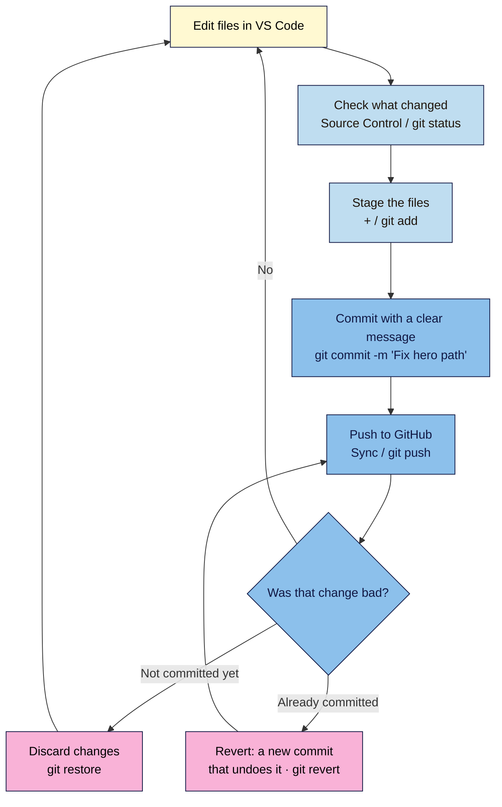

# M04.L02 — Git & GitHub Without Fear
> After this lesson your launch page has a full history: every change saved as a labelled snapshot on your computer and on GitHub, and any bad change undone in one step, without losing anything.

**Time:** ~18 min reading + ~35 min exercise · **Level:** L2 Practitioner · **Prereqs:** M04.L01 · **Remediate to:** M04.L01
**Verified against:** Pro Git book (git-scm.com) chapters 1–2 and the `git revert`, `git restore` and `gitignore` reference pages; Git for Windows 2.56 (latest release, 26 Oct 2026); VS Code docs "Source Control" overview and quickstart; GitHub Docs "About remote repositories" (personal access tokens, Git Credential Manager), "Setting your commit email address", "About mandatory two-factor authentication", "Push protection" and "What is GitHub Pages?"; every command and its output in Parts B–D run with Git 2.43 on 2026-11-02 (messages are the same in 2.56).

> ⚠️ **Freshness flag:** GitHub's sign-in and security rules change from time to time (passwords for Git were replaced by tokens in 2021, 2FA became mandatory for contributors from 2023, secret blocking for public repositories is on by default). VS Code's sign-in flow handles all of this for you; re-check these notes if a prompt looks different.

## Learning objectives
1. **Explain** repository, commit, history, branch, remote and push in plain words, and why version control comes before deploying (NN #6). *(O1)*
2. **Commit** changes with clear messages from VS Code's Source Control view (and the matching Git commands), and **push** them to a new GitHub repository. *(O2)*
3. **Undo** a bad change safely (discard, revert a commit) and **keep** secrets and junk files out with `.gitignore`. *(O3)*

## Why it matters
Kwame's agency site broke on a Friday afternoon. Someone had "tidied up" the CSS, the client's pricing table collapsed on phones, and nobody knew which of the forty edits that week caused it. The only backup was a zip file from a month ago. They spent the weekend rebuilding from memory. With **version control**, every saved change has a date, an author and a one-line reason, and going back to Thursday's working version takes one command. That's why this course's non-negotiable #6 says: **version control before you deploy.** From Lesson 4.3 onwards, publishing your site will simply mean "push to GitHub", so the history *is* the deployment record.

## Core concept
**Plain version:** **Git** is a free program that keeps a history of a folder. Each time you're happy with a change, you **commit** it: Git saves a snapshot of every file, with a message saying what changed and why. **GitHub** is a website that stores a copy of that history online (a **remote**), so it's backed up, shareable, and ready for hosting. You **push** your new commits to GitHub; you can **pull** other people's.

**Analogy:** Git is a save-game system for your website. Each commit is a save point with a label ("Before the boss fight", "Added pricing cards"). If you mess up, you load an earlier save. GitHub is the cloud save: the same save points, kept safe even if your laptop is stolen.

### The words, plainly
| Word | Means | In this course |
|---|---|---|
| **Repository (repo)** | A folder whose history Git tracks | `nila-launch/` |
| **Commit** | A saved snapshot + message + author + date | "Add pricing cards" |
| **Staging** | Choosing which changed files go into the next commit | The **+** button in VS Code; `git add` |
| **History / log** | The list of commits, newest first | Source Control Graph; `git log --oneline` |
| **Branch** | A separate line of commits; the main one is called `main` | You'll stay on `main` in this course |
| **Remote** | A copy of the repo somewhere else, usually GitHub | `origin` |
| **Push / pull** | Send your commits to the remote / fetch theirs | Sync button in VS Code |
| **Revert** | A **new** commit that undoes an earlier one, keeping the history | `git revert` |

### The everyday loop
```
edit files → stage (git add) → commit (git commit -m "…") → push (git push)
```
In VS Code these are buttons in the **Source Control** view. The four matching commands are worth knowing, because every tutorial, error message and AI answer uses them:

| VS Code | Command | What it does |
|---|---|---|
| Changes list | `git status` | Shows what's changed since the last commit |
| **+** (Stage) | `git add .` | Stages every changed file (`.` = this folder) |
| **✓ Commit** | `git commit -m "Add pricing cards"` | Saves the staged snapshot with a message |
| **Sync / Publish** | `git push` | Sends new commits to GitHub |

**Good commit messages** say *what* changed, in the imperative, in under ~50 characters: "Add pricing cards", "Fix hero image path", "Darken CTA for contrast". Not "update", "stuff" or "final final".

### Public or private repository?
GitHub Pages (Lesson 4.3) is free from **public** repositories on a free GitHub account; private repositories need a paid plan for Pages (Netlify and Cloudflare Pages can deploy from private ones for free). A public repo is fine for a launch page, because the HTML and CSS are public the moment the site goes live anyway. What must **never** be in any repo: passwords, API keys, `.env` files, client data, or personal notes.

## How it works



**In words:** edit, look at what changed, stage the files you want, commit them with a clear message, and push to GitHub. If a change turns out to be bad before you commit it, discard it. If it's already committed (and maybe pushed), don't delete history: revert it, which adds a new commit that undoes the old one, then push that.

## Hands-on walkthrough

**Part A: install Git, introduce yourself, create a GitHub account (10 min)**
1. **Install Git.** Windows: download **Git for Windows** from **https://git-scm.com/** and accept the defaults (it includes **Git Credential Manager**, which handles GitHub sign-in). Mac: open Terminal, type `git --version` and accept the prompt to install the Command Line Developer Tools. Linux: your package manager (`sudo apt install git`).
   **Expected:** in VS Code's terminal (**Ctrl+`**), `git --version` prints something like `git version 2.56.0` (any 2.4x or later is fine).
2. **Create a free GitHub account** at **https://github.com/**. Choose a professional username: it will appear in your site's free address in Lesson 4.3 (`username.github.io`). GitHub will ask you to turn on **two-factor authentication**; do it now with an authenticator app or passkey, and save the recovery codes.
3. **Keep your email private.** On GitHub: **Settings → Emails**, tick **Keep my email addresses private**, and copy the address it shows, which looks like `12345678+yourname@users.noreply.github.com`.
4. **Tell Git who you are** (once per computer). In the VS Code terminal:
   ```
   git config --global user.name "Your Name"
   git config --global user.email "12345678+yourname@users.noreply.github.com"
   ```
   **Expected:** no output. That's success. Every commit will now carry your name and the private address, not your personal email.

**Part B: your first commit (10 min)**
1. In VS Code, open your `nila-launch` folder from Lesson 4.1. Before anything else, create a file named `.gitignore` (with the dot) in the folder root containing:
   ```
   # Computer junk
   .DS_Store
   Thumbs.db
   # Secrets: never commit these
   .env
   ```
2. Open the **Source Control** view (**Ctrl+Shift+G** / **Cmd+Shift+G**) and click **Initialize Repository**.
   **Expected:** every file appears under **Changes** with a **U** (untracked). `.DS_Store` or `Thumbs.db` don't appear, because `.gitignore` excludes them. (Terminal equivalent: `git init -b main`, then `git status`.)
3. Hover **Changes** and click **+** (Stage All Changes). Type the message `Add launch page, styles and images` in the box and click **✓ Commit**.
   **Expected:** the Changes list empties. In the terminal, `git status` says `nothing to commit, working tree clean`, and `git log --oneline` shows one line: a 7-character ID and your message.
   > 🖼️ **Image prompt:** Desktop screenshot (1440×900) of VS Code's Source Control view with staged files (index.html, css/styles.css, images/beans.jpg, .gitignore), the message "Add launch page, styles and images" typed in the message box, and the Commit button. Outline the message box and the Commit button. Highlight the key element with a 3px #F9B2D7 outline; blur any personal details.
   > **Alt text:** VS Code Source Control view with staged launch-page files, a commit message, and the Commit button.

**Part C: push to GitHub (7 min)**
1. In Source Control, click **Publish Branch** (or Command Palette → **Publish to GitHub**). VS Code asks you to sign in to GitHub in your browser: allow it. Then choose **Publish to GitHub public repository** and keep the name `nila-launch`.
   **Expected:** a notification "Successfully published…" with **Open on GitHub**. On GitHub you see your files, the `.gitignore`, and "1 commit".
2. Make a real improvement: in `index.html`, change the hero paragraph's wording. Save. **Expected:** Source Control shows `index.html` with an **M** (modified); click it to see a side-by-side **diff** (red = removed, green = added).
3. Stage, commit as `Sharpen hero paragraph`, then click **Sync Changes** (the push).
   **Expected:** on GitHub, click the commit count: two commits, newest first, each with your name, the date and the message.
   (Sign-in note: Git no longer accepts your GitHub **password** for pushing. VS Code's browser sign-in and Git Credential Manager handle this; if a terminal ever asks for a password, it means a **personal access token**, not your account password.)

**Part D: break it and fix it: undo safely (8 min)**
1. **Undo before committing.** Delete a whole section of `index.html` by mistake and save. In Source Control, right-click the file → **Discard Changes** (terminal: `git restore index.html`).
   **Expected:** the section is back, exactly as in your last commit.
2. **Undo after committing.** In `css/styles.css`, change `--color-cta` to the failing caramel `#e0a458` from Lesson 3.2. Commit as `Change CTA colour to caramel` and push. Your page now has a 2.18:1 button.
3. Revert it. In the terminal:
   ```
   git log --oneline
   git revert HEAD --no-edit
   git push
   ```
   **Expected (checked 2026-11-02):** `git revert` prints `[main 9c43a37] Revert "Change CTA colour to caramel"` (your ID will differ) and `1 file changed, 1 insertion(+), 1 deletion(-)`. `styles.css` has `#b45309` again, and `git log --oneline` now shows **three** lines: the revert on top, the bad commit, and the ones before it. Nothing was deleted; the mistake and its fix are both on record. (`HEAD` means "the latest commit". To undo an older one, use its ID: `git revert 36ac67c`.)
   > 🖼️ **Image prompt:** Desktop screenshot (1440×900) of a GitHub repository's commit history page listing "Revert "Change CTA colour to caramel"", "Change CTA colour to caramel", "Sharpen hero paragraph" and "Add launch page, styles and images", each with author and date. Outline the revert commit. Highlight the key element with a 3px #F9B2D7 outline; blur any personal details.
   > **Alt text:** GitHub commit history with a revert commit at the top undoing the caramel CTA colour change.
4. **The file that shouldn't be there.** Create `notes.txt` with "client phone: …", commit it and **don't push**. Now add `notes.txt` to `.gitignore` and run `git status`.
   **Symptom:** Git still tracks `notes.txt`; `.gitignore` only stops **new** files being added. **Fix:** `git rm --cached notes.txt` (stops tracking, keeps the file on your disk), then commit `Stop tracking notes`.
   **The lesson:** the old commit still contains the notes (`git show HEAD~1:notes.txt` prints them; checked). That's why secrets must never be committed at all. If a password or key ever reaches GitHub, **change the password or key** first; deleting the file isn't enough. GitHub blocks many recognisable secrets from being pushed to public repositories by default, but it can't recognise everything (a client's phone number, for example).

## When to use / when not to
- **Commit often, in small steps:** one commit per finished idea ("Add FAQ section"), not one per day. Small commits are easy to read and easy to revert. **Trade-off:** a few more clicks; far less pain when something breaks.
- **Revert vs going back in time (`reset`, force-push):** once commits are pushed, use **revert**. Commands that rewrite history (`git reset --hard`, `git push --force`) can destroy work and confuse anyone else using the repo; leave them until you know exactly what they do.
- **Branches:** useful for trying a redesign without touching the live version, and essential in teams. On a one-person launch page, staying on `main` is fine; Lesson 4.3's deploy previews are the next step up.
- **GitHub Desktop vs VS Code vs terminal:** all three use the same Git. This course uses VS Code's buttons plus four commands; GitHub Desktop is a friendly alternative if you prefer a separate app.

## Use AI for this
**Example prompt:**
> "I'm a beginner using Git with VS Code on a static website, one branch (main), already pushed to GitHub. I committed and pushed a bad change to css/styles.css two commits ago. Give me the safest way to undo just that change while keeping history, as numbered terminal commands with a one-line explanation each. Don't use reset or force-push."

**What AI does well here:** explaining an error message, translating what you want into the right Git command, and writing clear commit messages from a diff.
**Where it gets it wrong:** it often suggests `git reset --hard` or `git push --force` (which can delete work), mixes up `master` and `main`, tells you to "just delete the file" after a secret was pushed, or invents command options.
**How to check:** before running anything, ask "does this rewrite history?" Prefer `revert`, `restore` and `rm --cached`, run `git status` and `git log --oneline` before and after, and look at the GitHub commit list.

## Common mistakes
- **No `.gitignore` before the first commit,** so `.DS_Store`, `Thumbs.db` or `.env` end up in history.
- **Committing secrets** (passwords, API keys, client data) and thinking that deleting the file later removes them.
- **Vague messages** ("update", "changes", "asdf") that make history useless.
- **Giant commits** that mix ten unrelated changes, so one can't be undone without the others.
- **Using your personal email** in `user.email` on a public repo.
- **Force-pushing or `reset --hard`** to "fix" a mistake that a revert would have handled.
- **Initialising Git in the wrong folder** (your whole Documents folder), so it tracks thousands of unrelated files.
- **Typing your GitHub password** when a terminal asks for one; it expects a token (or use VS Code's sign-in).

## Troubleshooting
| Symptom | Likely cause | Fix |
|---|---|---|
| `git: command not found` / `'git' is not recognized` | Git not installed, or VS Code opened before installing | Install Git, then restart VS Code |
| `Author identity unknown` / "Please tell me who you are" | `user.name` / `user.email` not set | Run the two `git config --global` lines from Part A |
| Thousands of files in Changes | Repository started in the wrong folder (e.g. Documents) | Delete the hidden `.git` folder **in that wrong folder only**, then initialise inside `nila-launch` |
| `Authentication failed` / password rejected | Account password used instead of a token | Sign in through VS Code (Accounts icon) or let Git Credential Manager open the browser |
| `rejected … (fetch first)` when pushing | GitHub has commits you don't (e.g. you edited on github.com) | **Sync** (or `git pull`), then push |
| `.gitignore` "doesn't work" | The file was committed before being ignored | `git rm --cached <file>`, commit |
| Push blocked: "secret detected" | GitHub push protection found a key or token | Remove it from the commit, **rotate the secret**, commit again |

## Exercise
**Task:** put **your** launch page under version control.
1. Git installed and configured with your name and GitHub's no-reply email; GitHub account with two-factor authentication on.
2. A `.gitignore` committed in the **first** commit, covering junk files and `.env`.
3. The project pushed to a GitHub repository (public, so Lesson 4.3 can use free GitHub Pages).
4. At least **four** commits with clear messages, including one **revert** of a deliberately bad change, all pushed.
5. In your project note: the output of `git log --oneline`, and one sentence on the difference between **discard**, **revert** and `rm --cached`.

**Expected outcome:** a GitHub repository whose commit list tells the story of your launch page in plain sentences, with a bad change and its revert both visible, and no junk or secret files in it.
**Stretch goal:** create a branch called `try-dark-hero` (Source Control → **…** → **Branch → Create Branch**), change the hero to dark roast, commit, then switch back to `main`. Watch the file change back. Write one sentence on when a branch would be useful for a client site.

## Key takeaways
- **Commit** = snapshot + message; **push** = send it to GitHub. History is your undo button and your backup.
- Everyday loop: `git status` → `git add .` → `git commit -m "Clear message"` → `git push` (or the same buttons in VS Code).
- **Discard** undoes uncommitted edits; **revert** undoes a commit with a new commit, keeping history.
- **`.gitignore` first.** It only stops new files; a secret that was committed stays in history, so **rotate** it.
- Version control **before** you deploy (NN #6): from Lesson 4.3, every push publishes.

## Teach it back
Explain to a friend in 3 sentences why "I'll just keep a backup zip" isn't version control, and what they'd do if Friday's CSS change broke the site.

## Glossary terms added
- Git — added to `webdev-101/glossary.md`
- GitHub — added to `webdev-101/glossary.md`
- Repository (repo) — added to `webdev-101/glossary.md`
- Commit / commit message — added to `webdev-101/glossary.md`
- Staging (`git add`) — added to `webdev-101/glossary.md`
- History / `git log` — added to `webdev-101/glossary.md`
- Branch / `main` — added to `webdev-101/glossary.md`
- Remote / `origin` — added to `webdev-101/glossary.md`
- Push / pull — added to `webdev-101/glossary.md`
- Diff — added to `webdev-101/glossary.md`
- Revert (`git revert`) / discard (`git restore`) — added to `webdev-101/glossary.md`
- `.gitignore` — added to `webdev-101/glossary.md`
- Personal access token / Git Credential Manager — added to `webdev-101/glossary.md`
- Push protection (secret scanning) — added to `webdev-101/glossary.md`

## Further reading
*All checked 2026-11-02.*
- Pro Git book (free), ch. 1 "Getting Started" and ch. 2 "Git Basics": https://git-scm.com/book/en/v2
- Git reference — `git revert`: https://git-scm.com/docs/git-revert
- Git reference — `gitignore`: https://git-scm.com/docs/gitignore
- Git downloads (Git for Windows, macOS, Linux): https://git-scm.com/downloads
- VS Code docs — Source Control overview: https://code.visualstudio.com/docs/sourcecontrol/overview
- VS Code docs — Source Control quickstart: https://code.visualstudio.com/docs/sourcecontrol/quickstart
- GitHub Docs — About remote repositories (HTTPS, tokens, Git Credential Manager): https://docs.github.com/en/get-started/git-basics/about-remote-repositories
- GitHub Docs — Setting your commit email address: https://docs.github.com/en/account-and-profile/how-tos/email-preferences/setting-your-commit-email-address
- GitHub Docs — About mandatory two-factor authentication: https://docs.github.com/en/authentication/securing-your-account-with-two-factor-authentication-2fa/about-mandatory-two-factor-authentication
- GitHub Docs — Push protection: https://docs.github.com/en/code-security/concepts/secret-security/push-protection
- GitHub Docs — Ignoring files: https://docs.github.com/en/get-started/git-basics/ignoring-files
- GitHub Docs — What is GitHub Pages? (plans and public repositories): https://docs.github.com/en/pages/getting-started-with-github-pages/what-is-github-pages

## Refresher card
*Used by remediation when a learner fails a quiz twice on a later lesson that points back here.*
Git = history of a folder; GitHub = online copy (remote `origin`). Setup once: `git config --global user.name "…"` and `user.email` (GitHub no-reply address); 2FA on. `.gitignore` before the first commit (`.DS_Store`, `Thumbs.db`, `.env`). Loop: `git status` → `git add .` → `git commit -m "Add pricing cards"` → `git push` (VS Code: + → ✓ → Sync). Undo: uncommitted → Discard / `git restore file`; committed → `git revert HEAD` (new commit, history kept), then push. `.gitignore` doesn't untrack committed files: `git rm --cached file`. Committed a secret? Rotate it. Free GitHub Pages needs a public repo.
