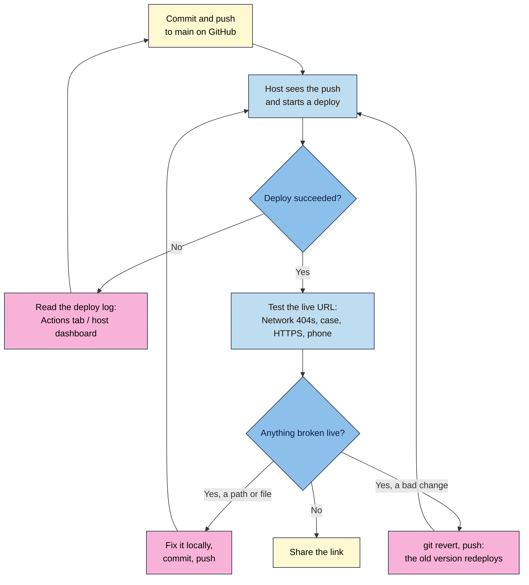

# M04.L03 — Deploy to Free Hosting
> After this lesson your launch page is on the real web at a free HTTPS address, it republishes itself every time you push to GitHub, and you know how to test it live and roll back a bad change in minutes.

**Time:** ~18 min reading + ~35 min exercise (plus up to 10 min waiting for the first deploy) · **Level:** L2 Practitioner · **Prereqs:** M04.L02 · **Remediate to:** M04.L02
**Verified against:** GitHub Docs "What is GitHub Pages?", "GitHub Pages limits", "Creating a GitHub Pages site", "Configuring a publishing source" and "Creating a custom 404 page"; Netlify pricing page (credit-based Free plan); Cloudflare Pages "Limits" (last updated 5 Sep 2026) and the "Migrate to Workers" guide; live checks of a GitHub Pages project site with `curl` (letter case, 404s, `http` → `https` and missing-slash redirects, `cache-control: max-age=600`), on 2026-11-02.

> ⚠️ **Freshness flag:** free hosting plans change often. In 2025–26 Netlify moved new accounts to a **credit-based** Free plan (each production deploy uses credits, and the site pauses when the month's credits run out), and Cloudflare now points **new** projects to **Workers** rather than Pages (Pages keeps working). GitHub Pages' rules have been stable for years. Check each host's pricing page before you recommend it to a client.

## Learning objectives
1. **Compare** GitHub Pages, Netlify and Cloudflare Pages on free-tier limits, commercial-use terms, private repositories and deploy previews. *(O1)*
2. **Publish** the launch page from its GitHub repository so every push redeploys automatically. *(O2)*
3. **Test** the live site (real 404s, case-sensitive paths, HTTPS, phone check) and **roll back** a bad deploy. *(O3)*

## Why it matters
Sofia finished her portfolio page in March and emailed it to a recruiter as a zip file. The recruiter's laptop blocked the attachment. In April she paid a cheap host ₹2,400 for a year, uploaded the files by FTP, overwrote her stylesheet with an old copy, and couldn't remember which version was right. Static sites like your launch page don't need any of that. A free host can publish straight from your GitHub repository: you push, and a minute later the live site matches your latest commit, over HTTPS, served from computers around the world. Undoing a mistake is the same `git revert` you learned in Lesson 4.2.

## Core concept
**Plain version:** a **static host** stores your files (HTML, CSS, images) and sends them to any browser that asks, exactly as they are. With **Git-based deployment**, the host watches your GitHub repository: every push to `main` triggers a **deploy**, a fresh copy of the site going live. You get a free address on the host's domain, such as `yourname.github.io/nila-launch/`, with HTTPS already on. Lesson 4.4 swaps that for your own domain.

**Analogy:** your GitHub repository is the master copy of a menu in the café's back office. Git-based hosting is a printer that reprints every menu on every table the moment the master copy changes. Nobody walks round with a pen correcting menus by hand (that's FTP).

### Three free static hosts (checked 2026-11-02)
| | **GitHub Pages** | **Netlify** (Free) | **Cloudflare Pages** (Free) |
|---|---|---|---|
| Free address | `username.github.io/repo/` | `name.netlify.app` | `name.pages.dev` |
| Deploy from | A branch of a **public** repo (private needs a paid GitHub plan) | Public or private GitHub repo | Public or private GitHub repo |
| Key limits | Site ≤ 1 GB; soft 100 GB bandwidth/month; soft 10 builds/hour | **300 credits/month**: a production deploy costs 15, bandwidth 20 per GB; the site **pauses** when credits run out | 500 builds/month; 20,000 files; 25 MiB per file; static requests free |
| Deploy previews for branches | No (not built in) | Yes | Yes |
| Commercial use | **Not** for online shops or sites mainly for commercial transactions or SaaS | Allowed (paid plans for more usage) | Allowed |
| Good for | Portfolios, docs, launch and personal pages | Sites that need forms, previews or private repos | Sites that need private repos and lots of traffic |

**This lesson uses GitHub Pages:** your repo is already there, it's public, and there's nothing new to sign up for. If your launch page sells something directly (a checkout), use Netlify or Cloudflare instead; the Git workflow is the same.

### What changes when you go live
| | On your computer | Live on the host |
|---|---|---|
| Letter case in paths | Ignored (Windows, Mac) | **Matters**: `Beans.jpg` ≠ `beans.jpg` (checked on a live GitHub Pages site: wrong case = 404) |
| Missing file | `ERR_FILE_NOT_FOUND` or local 404 | Real **404**, and visitors see the host's 404 page |
| `/css/styles.css` (root-relative) | Works on the local server | **Breaks** on a GitHub Pages project address, because `/` means `username.github.io/`, not your repo folder |
| `http://` address | — | Redirected to `https://` (301) |
| Updates | Instant | After the deploy finishes (often under a minute; GitHub allows up to 10), and browsers may cache files for 10 minutes |

## How it works



**In words:** you push to `main`; the host notices and deploys. If the deploy fails, read its log, fix and push again. If it succeeds, test the live address: Network for 404s, letter case, HTTPS and a real phone. A broken path is fixed locally and pushed; a bad change is reverted and pushed, which redeploys the previous version. When the live checks pass, share the link.

## Hands-on walkthrough

**Part A: turn on GitHub Pages (8 min, plus waiting)**
1. On GitHub, open your `nila-launch` repository → **Settings** → **Pages** (left sidebar, under "Code and automation").
2. Under **Build and deployment** → **Source**, choose **Deploy from a branch**. Set the branch to **main** and the folder to **/(root)**. Click **Save**.
   **Expected:** a message that your site is being built. (If the repository is private, GitHub asks you to upgrade instead: go back to Lesson 4.2 and make it public, or use Netlify.)
3. Open the repository's **Actions** tab. **Expected:** a workflow run called **pages build and deployment**, yellow while running, then a green tick. This runs automatically on every push to `main` from now on.
4. Back in **Settings → Pages**, the top now says "Your site is live at `https://yourname.github.io/nila-launch/`". Click **Visit site**.
   **Expected:** your styled launch page at a real HTTPS address. If you see a 404, wait a few minutes: GitHub says changes can take **up to 10 minutes** to publish.
   > 🖼️ **Image prompt:** Desktop screenshot (1440×900) of a GitHub repository's Settings → Pages screen showing "Your site is live at https://yourname.github.io/nila-launch/", the Source set to "Deploy from a branch", branch "main" and folder "/(root)", and the Visit site button. Outline the live URL and the branch settings. Highlight the key element with a 3px #F9B2D7 outline; blur any personal details.
   > **Alt text:** GitHub Pages settings showing the site is live, deployed from the main branch root folder, with a Visit site button.

**Part B: test it like a visitor (10 min)**
1. On the live page, open DevTools → **Network**, tick **Disable cache**, reload.
   **Expected:** every file **200**, nothing red. Click `index.html` → **Headers**: `server: GitHub.com` and a `cache-control: max-age=600` header (browsers may keep files for 10 minutes; that's why you disable the cache while testing).
2. Type the address with `http://` instead of `https://`. **Expected:** you land on `https://…` (a 301 redirect). Click the padlock or site-information icon: "Connection is secure".
3. Visit a page that doesn't exist: `https://yourname.github.io/nila-launch/nope.html`. **Expected:** GitHub's own 404 page ("File not found"), and status **404** in Network.
4. Open the page on your **phone**: in Chrome on your computer, use the address bar's share or QR-code option, or just type the address. **Expected:** the mobile layout from Lesson 3.4, fonts loaded, nothing scrolling sideways.
5. Make the address official. In `index.html`, replace the placeholder `https://nilacoffee.example/` addresses from Lesson 2.5 with the live address (or wait until Lesson 4.4 if you'll use your own domain):
   ```html
   <link rel="canonical" href="https://yourname.github.io/nila-launch/">
   <meta property="og:url" content="https://yourname.github.io/nila-launch/">
   <meta property="og:image" content="https://yourname.github.io/nila-launch/images/share-1200x630.jpg">
   ```
   Commit as `Set canonical and Open Graph URLs to live address` and push. **Expected:** a new **pages build and deployment** run in Actions, and the change live within a minute or two.

**Part C: break it and fix it (12 min)**
1. **The case that only breaks live.** In `index.html`, change the hero image's `src` to `images/Beans.jpg` (leave the file itself as `beans.jpg`), commit, push.
   **Symptom on Windows/Mac:** the local preview still shows the image. **Live:** after the deploy, the hero image is missing and Network shows **404** for that file. **Find it:** the red request names the exact path; compare its letter case with the file list on GitHub. **Fix:** make the name and the `src` match in lowercase, commit `Fix hero image case`, push. (Lesson 4.1's capital-letter search would have caught it before you pushed.)
   **Why change the `src`, not the file name?** On Windows and Mac, Git usually doesn't notice a rename that only changes letter case, so renaming `beans.jpg` to `Beans.jpg` in VS Code can leave GitHub with the old name and nothing to commit. If you ever must change a file name's case, use `git mv -f images/Beans.jpg images/beans.jpg` in the terminal, which Git records as a rename.
2. **The root-relative trap.** Change the stylesheet link to `href="/css/styles.css"`, commit, push.
   **Symptom:** the live page is unstyled, though it worked on your local server. Network shows a 404 for `https://yourname.github.io/css/styles.css`: the `/` jumped to the root of `yourname.github.io`, outside your repo folder. **Fix:** `href="css/styles.css"`, commit, push.
3. **Roll back a bad deploy.** Commit and push a change you'll regret: delete the whole pricing section. Check it's gone live. Then in the VS Code terminal:
   ```
   git revert HEAD --no-edit
   git push
   ```
   **Expected:** a new deploy in Actions; when it finishes (and after a reload with cache disabled), the pricing section is back. The repo's history shows the deletion *and* its revert; the live site always matches the latest commit.
   > 🖼️ **Image prompt:** Desktop screenshot (1440×900) of a GitHub repository's Actions tab listing several "pages build and deployment" runs with green ticks, the newest triggered by the commit "Revert "Remove pricing section"". Outline the newest run. Highlight the key element with a 3px #F9B2D7 outline; blur any personal details.
   > **Alt text:** GitHub Actions list of Pages deployments, the newest one triggered by a revert commit.

**Part D (optional): the same site on Netlify or Cloudflare (5 min to read, 10 to try)**
- **Netlify:** sign up with GitHub → **Add new project → Import an existing project → GitHub** → choose `nila-launch` → leave the build command empty and the publish directory as the root → **Deploy**. You get a random `something.netlify.app` name; change it in the project's configuration (**Change project name**). Every pull request gets a **deploy preview** link (deploys for other branches can be switched on). Watch the credits meter: on the credit-based Free plan each production deploy costs 15 of your 300 monthly credits, so about 20 deploys a month use them all, before any bandwidth is counted.
- **Cloudflare:** Cloudflare's dashboard now steers new projects to **Workers** with static assets; Pages projects still work and show up under **Workers & Pages**. Connect GitHub, pick the repo, no build command, output directory `/`. You get `name.pages.dev` (or `name.workers.dev`).
- Only keep **one** host as the official address. If you try a second, note it as a test copy, or delete it, so search engines don't find two versions of your page.

## When to use / when not to
- **GitHub Pages:** best default for this course: free, no extra account, public repo, solid uptime. Not for shops, checkouts or private repos on a free account.
- **Netlify / Cloudflare:** choose them for a private repo, deploy previews you can send to a client before going live, or a site that sells directly. **Trade-off:** another account and another set of limits to watch (Netlify's credits pause the site rather than charge you).
- **Shared hosting with FTP or cPanel:** needed for WordPress and PHP (WordPress 101), not for a static launch page. Uploading by hand loses the history and the instant rollback you have now.
- **Drag-and-drop deploys** (dropping a folder onto Netlify): fine for a 5-minute demo; for anything you'll update, connect the repo so the live site always matches a commit.

## Use AI for this
**Example prompt:**
> "My static site (index.html, css/, images/) is in a public GitHub repo called nila-launch and deploys with GitHub Pages from main, root folder, to https://yourname.github.io/nila-launch/. Here's my index.html head [paste]. List every path or URL that will break at that address (root-relative paths, letter case, absolute file paths, wrong canonical or og:url), and explain why for each. Don't suggest moving hosts."

**What AI does well here:** spotting root-relative paths, outdated canonical URLs and mismatched names; explaining a deploy log error in plain words.
**Where it gets it wrong:** plans and limits (it often quotes old Netlify "100 GB bandwidth" figures or says GitHub Pages can't use custom domains), settings menus that have moved, and suggestions to add build tools or frameworks a static page doesn't need.
**How to check:** test the live URL yourself (Network, phone, `http://`, a missing page), and check limits on the host's own pricing or docs page, not in the AI's answer.

## Common mistakes
- **Testing only on your own computer,** where letter case and some paths can't fail.
- **Root-relative paths (`/css/…`)** on a GitHub Pages project address.
- **Home page not called `index.html`,** so the address shows a 404 or a file list.
- **A private repo on a free GitHub account,** then wondering why Pages wants an upgrade.
- **Editing files directly on github.com and locally at the same time,** then a rejected push (pull first, or edit in one place).
- **Judging a fix too soon:** the deploy is still running, or the browser shows a cached copy. Check Actions and reload with cache disabled.
- **Publishing secrets or drafts** because "only I know the URL". Anything in a public repo or on a live address is public.
- **Two live copies** (GitHub Pages and Netlify) left running with no canonical tag.

## Troubleshooting
| Symptom | Likely cause | Fix |
|---|---|---|
| 404 right after turning Pages on | First deploy still running (up to 10 minutes) | Watch the Actions tab; reload when it's green |
| Site shows the README instead of the page | No `index.html` at the root (e.g. it's `launch.html` or inside a folder) | Rename to `index.html` at the repo root, or choose the folder in Pages settings |
| Page unstyled live, fine locally | Root-relative `/css/…` path, or letter case | Network → red 404 → read the requested URL; use `css/styles.css` and lowercase |
| Image missing live only | Letter case, or the image was never committed (ignored or not staged) | Compare with the file list on GitHub; commit the file; match the `src` to the real name (case-only renames need `git mv -f`) |
| Change not showing | Deploy not finished, or browser cache (`max-age=600`) | Actions tab; DevTools → Disable cache → reload |
| Red ✗ on the Actions run | Build failed (often a huge file or a broken submodule) | Open the run → read the first error line; remove the cause and push |
| Netlify site "paused" | Free plan credits used up for the month | Wait for the next cycle, reduce deploys (batch commits), or move to GitHub Pages / Cloudflare |

## Exercise
**Task:** put **your** launch page on the live web.
1. Your repo deployed to GitHub Pages (or Netlify / Cloudflare Pages, with one sentence on why), with the live HTTPS address in your project note.
2. A live test log: Network all 200 with cache disabled, `http://` redirects to `https://`, a missing page returns 404, and the page checked on a real phone (note the phone and browser).
3. `canonical`, `og:url` and `og:image` updated to the live address (or clearly marked TODO for your Lesson 4.4 domain).
4. One break-it-and-fix-it from Part C done live, with the red request URL you saw and the fixing commit.
5. One rollback: a deliberately bad commit, its revert, and the two Actions runs that deployed them.
6. A three-row comparison in your own words: which host you'd pick for (a) your launch page, (b) a client who wants a private repo, (c) a small online shop.

**Expected outcome:** a live HTTPS address that always matches your latest commit, a test log showing no broken files on desktop or phone, and a history that shows you can break, fix and roll back the live site.
**Stretch goal:** add a custom `404.html` at the repo root, styled with your `styles.css` (use relative paths and a link back to the home page). GitHub Pages serves it for any missing page. Push it and test `nope.html` again.

## Key takeaways
- **Git-based hosting:** push to `main` → the host deploys → the live site matches your latest commit.
- **GitHub Pages** (public repo, `username.github.io/repo/`) is the simplest free option; **Netlify** and **Cloudflare** add private repos and deploy previews, with their own limits.
- **Live is stricter than local:** letter case matters, root-relative paths break on project addresses, and missing files are real 404s.
- **Test like a visitor:** Network with cache disabled, `http://` → `https://`, a missing page, a real phone.
- **Rollback = `git revert` + push.** No FTP, no guessing which copy is right.

## Teach it back
Explain to a friend in 3 sentences how their site gets from VS Code to the live web without FTP, and what they'd do if Tuesday's change broke the live page.

## Glossary terms added
- Static hosting — added to `webdev-101/glossary.md`
- Deploy / deployment — added to `webdev-101/glossary.md`
- Git-based (continuous) deployment — added to `webdev-101/glossary.md`
- GitHub Pages (user site vs project site) — added to `webdev-101/glossary.md`
- GitHub Actions (Pages build and deployment) — added to `webdev-101/glossary.md`
- Deploy preview — added to `webdev-101/glossary.md`
- Rollback — added to `webdev-101/glossary.md`
- Netlify / Cloudflare Pages — added to `webdev-101/glossary.md`
- Usage credits (Netlify) — added to `webdev-101/glossary.md`
- Custom 404 page — added to `webdev-101/glossary.md`
- `cache-control` / `max-age` — added to `webdev-101/glossary.md`

## Further reading
*All checked 2026-11-02.*
- GitHub Docs — What is GitHub Pages? (plans, usage limits, commercial use): https://docs.github.com/en/pages/getting-started-with-github-pages/what-is-github-pages
- GitHub Docs — GitHub Pages limits: https://docs.github.com/en/pages/getting-started-with-github-pages/github-pages-limits
- GitHub Docs — Creating a GitHub Pages site: https://docs.github.com/en/pages/getting-started-with-github-pages/creating-a-github-pages-site
- GitHub Docs — Configuring a publishing source: https://docs.github.com/en/pages/getting-started-with-github-pages/configuring-a-publishing-source-for-your-github-pages-site
- GitHub Docs — Creating a custom 404 page: https://docs.github.com/en/pages/getting-started-with-github-pages/creating-a-custom-404-page-for-your-github-pages-site
- Netlify — Pricing (credit-based plans, what pauses a site): https://www.netlify.com/pricing/
- Cloudflare Docs — Pages limits: https://developers.cloudflare.com/pages/platform/limits/
- Cloudflare Docs — Migrate from Pages to Workers (static assets, feature comparison): https://developers.cloudflare.com/workers/static-assets/migration-guides/migrate-from-pages/
- Netlify Docs — Deploy from a repository: https://docs.netlify.com/start/quickstarts/deploy-from-repository/

## Refresher card
*Used by remediation when a learner fails a quiz twice on a later lesson that points back here.*
GitHub Pages: repo **Settings → Pages → Deploy from a branch → main, /(root) → Save**; public repo on a free account; address `https://username.github.io/repo/`; Actions tab shows "pages build and deployment" (up to 10 min). Every push to `main` redeploys. Live is case-sensitive; `/css/…` breaks on project addresses (use `css/styles.css`); missing files are real 404s; `http://` → `https://`; cache `max-age=600`. Test: Network (cache disabled), `http://`, `nope.html`, a real phone. Rollback: `git revert HEAD` + `git push`. Netlify Free = 300 credits/month (15 per production deploy, pauses when used up); Cloudflare points new projects to Workers; GitHub Pages isn't for shops.
