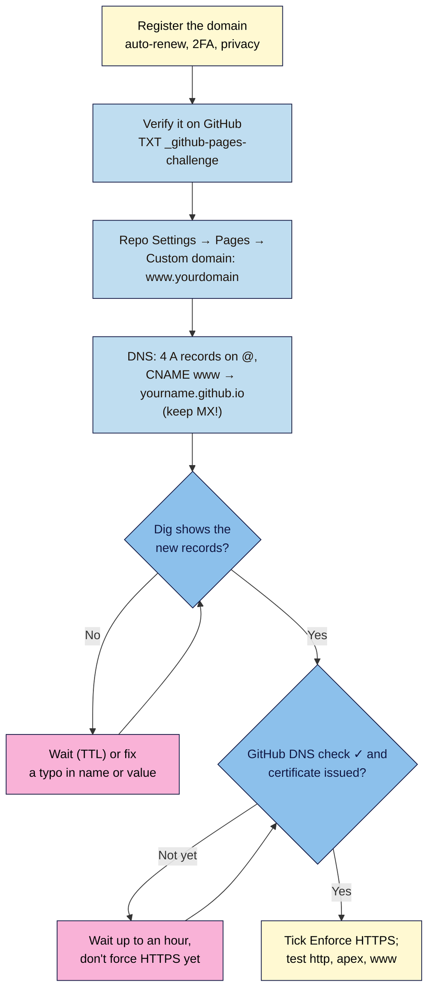

# M04.L04 — Custom Domains, DNS Records & HTTPS
> After this lesson your launch page can live at your own address, such as `https://www.nilacoffee.in/`, with a free certificate that renews itself, every `http://` and non-`www` visit sent to one canonical address, and your email left untouched.

**Time:** ~18 min reading + ~40 min exercise (plus DNS and certificate waiting time, from minutes to 24 hours) · **Level:** L2 Practitioner · **Prereqs:** M04.L03, M01.L02 · **Remediate to:** M01.L02
**Verified against:** GitHub Docs "Managing a custom domain for your GitHub Pages site" (A/AAAA addresses, `www` CNAME, the wildcard warning, "up to 24 hours"), "Verifying your custom domain for GitHub Pages" (`_github-pages-challenge-` TXT record), "Troubleshooting custom domains" (HTTPS "up to an hour", CAA and `letsencrypt.org`), "Securing your GitHub Pages site with HTTPS"; ICANN registrant guidance; live checks on 2026-11-02 with `dig`, `curl` and `openssl` against a real GitHub Pages custom domain (its four A records, Let's Encrypt certificate valid 90 days, `www` → apex redirect, `http://` served without forcing HTTPS), a mistyped `*.github.io` target ("Site not found · GitHub Pages", 404) and the `*.github.io` certificate GitHub serves before a domain's own certificate exists.

> ⚠️ **Freshness flag:** GitHub's IP addresses for Pages have been stable since 2018, but always copy them from GitHub's docs, never from a blog. Certificate lifetimes are shrinking across the industry (a 200-day maximum since March 2026, falling to 47 days by 2029), which is why you must use an **auto-renewing** certificate. Domain prices change every year; check the **renewal** price, not the first-year offer.

## Learning objectives
1. **Choose** and register a domain sensibly (registrar vs DNS host, renewal price, privacy, auto-renew, account security), or justify keeping the free subdomain. *(O1)*
2. **Connect** the domain to the host with the right records (apex A/AAAA, `www` CNAME, verification TXT) and **verify** them with a DNS lookup tool, without touching email (MX) records. *(O2)*
3. **Enable** HTTPS with a free auto-renewing certificate, force HTTP → HTTPS and choose one canonical host (`www` or not) (NN #7). *(O3)*

## Why it matters
Rahul's bakery site sat at `rahulbakes.github.io/site/` for a year; flyers with that address looked like a hobby. When he finally bought `rahulbakes.in`, he followed a forum post, deleted "all the old records" at his registrar to start clean, and pointed the domain at GitHub. The website worked by evening. His **email** stopped the same afternoon, because the MX records he deleted were the ones routing orders to his inbox. Two days later Chrome showed "Your connection is not private" because he'd ticked a box before the certificate was ready. A custom domain is ten minutes of typing and a lot of waiting. This lesson is about typing the right ten minutes, and knowing what the waiting looks like.

## Core concept
**Plain version:** you **rent** a domain name from a **registrar** for a year at a time. The domain's **DNS records** (Lesson 1.2) say where things live: **A/AAAA** records point the bare domain (`nilacoffee.in`, the **apex**) at the host's IP addresses; a **CNAME** points `www.nilacoffee.in` at another name (`yourname.github.io`); **MX** records route email; **TXT** records prove ownership. Once the records point to GitHub, GitHub asks a certificate authority (Let's Encrypt) for a free certificate for your domain and renews it automatically. You then **enforce HTTPS** and pick one **canonical** address that all the others redirect to.

**Analogy:** the domain is a shop's street address that you lease yearly. DNS is the listing in the town directory: "Nila Coffee: shop at 185.199.108.153; post goes to the mail office." Changing the shop's listing must not erase the line for the post. The certificate is the trading licence in the window, renewed by the council automatically, as long as the address is listed correctly.

### Registrar, DNS host, web host: three different jobs
| Job | Who | What you do there |
|---|---|---|
| **Registrar** | Where you bought the domain | Pay yearly, auto-renew, privacy, transfer lock |
| **DNS host** | Usually the registrar (or e.g. Cloudflare DNS) | Edit the A, AAAA, CNAME, MX and TXT records |
| **Web host** | GitHub Pages (Lesson 4.3) | Enter the custom domain; enforce HTTPS |

### Choosing and registering a domain
- **Short, spellable, yours:** `nilacoffee.in` beats `nila-coffee-beans-online.store`. Say it aloud once; if you have to spell it, think again.
- **Ending (TLD):** `.com` is understood everywhere; a country ending (`.in`, `.co.uk`) signals where you trade. A domain costs roughly **$10–15 / ₹800–1,200 a year** for `.com`; many endings are cheaper the first year and much dearer on **renewal**: always compare renewal prices.
- **Privacy:** most registrars hide your name and address from public lookups (RDAP/WHOIS) for free; make sure it's on.
- **Security:** turn on two-factor authentication at the registrar, keep **auto-renew** on with a card that won't expire, and register the domain **in your own account**, not a freelancer's.
- **Free alternative:** keep `yourname.github.io/nila-launch/`. It's HTTPS, fast and free. A custom domain is the course's only optional cost.

### The records for GitHub Pages (copy from GitHub's docs)
| Type | Name (host) | Value | Why |
|---|---|---|---|
| A | `@` (the apex) | `185.199.108.153` | GitHub Pages servers (IPv4) |
| A | `@` | `185.199.109.153` | |
| A | `@` | `185.199.110.153` | |
| A | `@` | `185.199.111.153` | |
| AAAA (optional) | `@` | `2606:50c0:8000::153` … `8003::153` | The same servers over IPv6 |
| CNAME | `www` | `yourname.github.io` | `www` follows GitHub; **no** repo name, **no** `https://` |
| TXT | `_github-pages-challenge-yourname` | the code GitHub gives you | Proves you own the domain (stops takeovers) |
| MX, other TXT | (whatever is there) | **leave alone** | Email and other services |

Two warnings from GitHub's docs: **don't** create wildcard records (`*.nilacoffee.in`), which expose you to subdomain takeovers, and **remove** any default "parking" A record your registrar added, or some visitors will see the parking page.

## How it works

**In words:** register the domain safely, prove to GitHub that you own it with a TXT record, then tell your repository its custom domain. Create the four apex A records and a `www` CNAME, leaving email records alone. Check with Dig until the records appear, fixing any typo. Once GitHub's DNS check passes and the certificate is issued, enforce HTTPS and test every variant of the address.

## Hands-on walkthrough
> **No domain?** Do Parts A and D with your free `github.io` address and read Parts B–C as a walkthrough; the exercise has a no-domain version. Don't buy a domain just for this lesson.

**Part A: look before you touch (5 min)**
1. Open **https://toolbox.googleapps.com/apps/dig/** (Google Admin Toolbox Dig, from Lesson 1.2). Look up **A** for `jekyllrb.com`, a real site hosted on GitHub Pages.
   **Expected (checked 2026-11-02):** four answers, `185.199.108.153`, `.109.153`, `.110.153`, `.111.153`: exactly the table above.
2. Look up **MX** for `jekyllrb.com`. **Expected:** mail servers that have nothing to do with GitHub. Websites and email are separate records; changing one must not delete the other.
3. If you own a domain, look up **A**, **CNAME** (for `www`), **MX** and **TXT** for it now and **save a screenshot**. This is your "before" record: if anything goes wrong, you can put it back.

**Part B: verify and add the domain on GitHub (10 min)**
1. On GitHub: your profile picture → **Settings** → **Pages** (under "Code, planning, and automation") → **Add a domain**. Type `nilacoffee.in` (your domain) → **Add domain**.
   **Expected:** GitHub shows a TXT record to create: a name like `_github-pages-challenge-yourname.nilacoffee.in` and a random value.
2. At your registrar's DNS page, add that **TXT** record exactly (many registrars want only the part before your domain in the Name box: `_github-pages-challenge-yourname`). Save.
3. Back on GitHub, click **Verify**. If it fails, wait a few minutes (or up to 24 hours) and try again; check it with Dig (type **TXT**, name `_github-pages-challenge-yourname.nilacoffee.in`).
   **Expected:** "Successfully verified". From now on, nobody else can attach your domain to their GitHub Pages site.
4. In your **repository**: **Settings → Pages → Custom domain**, type **`www.nilacoffee.in`** and **Save**.
   **Expected:** GitHub runs a DNS check (it will fail until Part C) and commits a file called `CNAME` containing your domain to the repo. Pull it in VS Code (**Sync**) so your local copy matches.

**Part C: create the records and wait well (10 min + waiting)**
1. At your DNS host, delete only a registrar **parking** A record on `@` if one exists. **Don't** touch MX or unrelated TXT records.
2. Add the four **A** records on `@` from the table (optionally the four AAAA records), and one **CNAME**: name `www`, value `yourname.github.io` (no `https://`, no `/nila-launch`).
3. Check with Dig: **A** for `nilacoffee.in` and **CNAME** for `www.nilacoffee.in`. **Expected:** the GitHub addresses and `yourname.github.io.`. If you still see old values, the old record's **TTL** hasn't run out yet (Lesson 1.2); GitHub's docs allow **up to 24 hours**.
4. On GitHub's Pages settings, the DNS check turns into a green tick, and a note says the certificate is being provisioned. **Expected:** within about an hour, **Enforce HTTPS** becomes clickable. Tick it.
   > 🖼️ **Image prompt:** Desktop screenshot (1440×900) of GitHub repository Settings → Pages with the custom domain "www.nilacoffee.in", a green "DNS check successful" tick, and the "Enforce HTTPS" checkbox ticked. Outline the DNS check and the Enforce HTTPS checkbox. Highlight the key element with a 3px #F9B2D7 outline; blur any personal details.
   > **Alt text:** GitHub Pages settings showing a custom domain with a successful DNS check and Enforce HTTPS turned on.
5. Update your page to its new home: change `canonical`, `og:url` and `og:image` to `https://www.nilacoffee.in/…`, commit, push. (Your relative paths from Lesson 4.1 keep working unchanged.)

**Part D: test HTTPS and the canonical address (8 min)**
1. Visit all four variants and watch the address bar:
   `http://nilacoffee.in` · `http://www.nilacoffee.in` · `https://nilacoffee.in` · `https://www.nilacoffee.in`
   **Expected:** every one ends at **`https://www.nilacoffee.in/`**, with the padlock. GitHub creates the apex ↔ `www` redirect itself when both records exist. (Free-subdomain learners: test `http://yourname.github.io/nila-launch/` → `https://…`.)
2. Click the padlock → **Connection is secure** → **Certificate is valid**. **Expected:** issued **to** your domain, **by** Let's Encrypt, valid for about **90 days**. You'll never renew it by hand: GitHub does, as long as your DNS records still point at GitHub.
   > 🖼️ **Image prompt:** Desktop screenshot (1280×800) of Chrome's certificate viewer for www.nilacoffee.in showing "Issued to: www.nilacoffee.in", "Issued by: Let's Encrypt" and a validity period of about 90 days. Outline the issued-to, issued-by and validity fields. Highlight the key element with a 3px #F9B2D7 outline; blur any personal details.
   > **Alt text:** Chrome certificate viewer showing a Let's Encrypt certificate for the custom domain, valid for about 90 days.
3. In the DevTools **Network** tab, load `http://nilacoffee.in` with **Preserve log** ticked. **Expected:** a **301** to `https://…`, then **200**. One address, one secure version: NN #7 done.
4. Send yourself an email at your domain (if you use one). **Expected:** it still arrives. MX untouched.

**Break it and fix it (read, then try one if you have a domain)**
| Plant this | Symptom (checked 2026-11-02) | Find it | Fix |
|---|---|---|---|
| CNAME value `yuorname.github.io` (typo) | The page loads GitHub's **"Site not found · GitHub Pages"** page: "There isn't a GitHub Pages site here." (status 404) | Dig the `www` CNAME; compare letter by letter with your username | Correct the value; wait for the TTL |
| CNAME **name** `ww` instead of `www` | `www.nilacoffee.in` gives `DNS_PROBE_FINISHED_NXDOMAIN` | Dig `www`: no answer (NXDOMAIN) | Rename the record to `www` |
| Ticking Enforce HTTPS (or visiting `https://`) before the certificate exists | `NET::ERR_CERT_COMMON_NAME_INVALID`: GitHub is still showing its own `*.github.io` certificate, not one for your domain | Padlock → certificate "Issued to: *.github.io" | Wait up to an hour after the DNS check passes; remove and re-add the custom domain if it's stuck |
| Deleting "all old records" | Website fine, **email bounces** | Dig **MX**: empty | Restore MX (and email TXT) from your "before" screenshot |

## When to use / when not to
- **Custom domain vs free subdomain:** a domain is worth it for anything you print, advertise or hand to clients. For a portfolio draft or a test page, `github.io` is fine. **Trade-off:** a yearly bill and one more account to secure, in exchange for an address you keep if you change hosts.
- **`www` or the bare domain as canonical:** either is fine; pick one and redirect the other. `www` (a CNAME) is slightly more flexible if you later move to a CDN; this lesson uses it, matching GitHub's own recommendation to set up both.
- **Registrar DNS vs a separate DNS host:** keep DNS at the registrar unless you have a reason to move (some hosts, such as Cloudflare, need their own DNS for extra features). Fewer moving parts, fewer places to make mistakes.
- **Subdomains for campaigns** (`launch.nilacoffee.in`): one CNAME each to your host. Never a wildcard.

## Use AI for this
**Example prompt:**
> "I own nilacoffee.in at [registrar]. My site is on GitHub Pages at yourname.github.io/nila-launch and should be https://www.nilacoffee.in. Here are my current DNS records [paste]. List exactly which records to add, change or keep, as a table (type, name, value, why), keeping all MX and email TXT records. Don't suggest wildcard records. Point out anything that would break email."

**What AI does well here:** turning your records into a clear change list, explaining what each record type does, and decoding a registrar's confusing DNS screen.
**Where it gets it wrong:** it often gives **old GitHub IP addresses** (from before 2018), puts `https://` or the repo path in the CNAME value, suggests deleting existing records "to avoid conflicts" (there go your MX records), or claims DNS changes are instant.
**How to check:** copy IP addresses only from GitHub's docs page, keep your "before" screenshot, and confirm every change with Dig before you tick Enforce HTTPS.

## Common mistakes
- **Deleting MX or email TXT records** while "cleaning up" DNS.
- **`https://` or a path in a CNAME value** (`https://yourname.github.io/nila-launch`). A CNAME is only a name.
- **Old IP addresses** copied from tutorials, or only one of the four A records.
- **Wildcard records** (`*.yourdomain`), a subdomain-takeover risk.
- **Skipping domain verification** on GitHub.
- **Ticking Enforce HTTPS too early,** then panicking at a certificate warning.
- **Buying on a first-year price** without checking the renewal price, or letting the domain lapse because auto-renew was off or the card expired.
- **Registering the domain in someone else's account** (an agency's or a former freelancer's).
- **Forgetting to update** `canonical` and `og:url` to the new address.

## Troubleshooting
| Symptom | Likely cause | Fix |
|---|---|---|
| GitHub DNS check fails | Records not created yet, typo, or old TTL still cached | Dig A and CNAME; fix typos; wait (up to 24 h) |
| "Site not found · GitHub Pages" on your domain | CNAME points at the wrong `*.github.io` name, or no custom domain set in the repo | Fix the CNAME value; set the custom domain in Settings → Pages |
| `DNS_PROBE_FINISHED_NXDOMAIN` | No record for that name (typo like `ww`), or the domain lapsed | Dig the exact name; check the registrar's renewal status |
| `NET::ERR_CERT_COMMON_NAME_INVALID` | Certificate not issued yet (GitHub's `*.github.io` certificate shows) | Wait up to an hour after DNS passes; remove and re-add the custom domain |
| Enforce HTTPS greyed out | Certificate still being provisioned | Wait (GitHub: up to 24 hours for the option) |
| HTTPS never provisions | A CAA record that doesn't allow Let's Encrypt | Add a CAA record with `letsencrypt.org`, or remove restrictive CAA records |
| Some visitors see a parking page | Registrar's default A record still on `@` | Delete the parking A record |
| Email stopped arriving | MX records deleted or changed | Restore them from your "before" screenshot or your email provider's setup page |
| Custom domain keeps disappearing from settings | The `CNAME` file was deleted from the repo (e.g. an old local copy pushed over it) | Pull before pushing; keep the `CNAME` file in the repo root |

## Exercise
**Task (with a domain):** move **your** launch page to your own address.
1. A note on your domain choice: name, ending, registrar, first-year and **renewal** price, privacy on, auto-renew on, 2FA on.
2. Your "before" DNS screenshot and an "after" table of the records you added (type, name, value).
3. The domain verified on GitHub, the custom domain set in your repo, and the `CNAME` file pulled into your local copy.
4. Enforce HTTPS ticked; all four address variants end at your canonical `https://` address (screenshot of Network showing the 301 → 200).
5. Certificate details: issuer and expiry date.
6. `canonical`, `og:url` and `og:image` updated, committed and pushed; email still working (if you use it on this domain).

**Task (no domain):** keep `yourname.github.io/nila-launch/` and: (1) Dig the A records of `yourname.github.io`; (2) confirm `http://` → `https://` with a 301 in Network; (3) read the certificate (issuer and expiry); (4) write the exact DNS table you **would** create for a domain you'd like to own, with its renewal price from two registrars.

**Expected outcome:** one canonical HTTPS address with a valid, auto-renewing certificate, every other variant redirecting to it, no email disruption, and a written record of your DNS that someone else could follow.
**Stretch goal:** add a campaign subdomain plan: which record you'd create for `launch.yourdomain` pointing to a second repo, and why a wildcard record would be the wrong shortcut.

## Key takeaways
- **Registrar** (rent the name), **DNS host** (edit records), **web host** (serve the site): three jobs, often two companies.
- GitHub Pages needs **four A records** on the apex and a **`www` CNAME** to `yourname.github.io`, plus a **TXT** record to verify the domain. Never wildcards.
- **Leave MX and email TXT records alone;** screenshot DNS before you change it.
- **Wait, then enforce:** DNS can take up to 24 hours, the certificate up to an hour; tick **Enforce HTTPS** only when it's ready.
- One **canonical** `https://` address; everything else 301-redirects to it (NN #7). The certificate renews itself.

## Teach it back
Explain to a friend in 3 sentences what they need to change at their registrar to point their domain at GitHub Pages, and the one thing they must not delete.

## Glossary terms added
- Registrar — added to `webdev-101/glossary.md`
- DNS host — added to `webdev-101/glossary.md`
- Apex domain (root, `@`) — added to `webdev-101/glossary.md`
- Custom domain — added to `webdev-101/glossary.md`
- Domain verification (TXT challenge) — added to `webdev-101/glossary.md`
- Subdomain takeover / wildcard record — added to `webdev-101/glossary.md`
- Parking page — added to `webdev-101/glossary.md`
- Certificate authority / Let's Encrypt — added to `webdev-101/glossary.md`
- Enforce HTTPS — added to `webdev-101/glossary.md`
- Canonical host (`www` vs apex) — added to `webdev-101/glossary.md`
- CAA record — added to `webdev-101/glossary.md`
- Renewal price / auto-renew — added to `webdev-101/glossary.md`

## Further reading
*All checked 2026-11-02.*
- GitHub Docs — Managing a custom domain for your GitHub Pages site: https://docs.github.com/en/pages/configuring-a-custom-domain-for-your-github-pages-site/managing-a-custom-domain-for-your-github-pages-site
- GitHub Docs — Verifying your custom domain for GitHub Pages: https://docs.github.com/en/pages/configuring-a-custom-domain-for-your-github-pages-site/verifying-your-custom-domain-for-github-pages
- GitHub Docs — Troubleshooting custom domains and GitHub Pages: https://docs.github.com/en/pages/configuring-a-custom-domain-for-your-github-pages-site/troubleshooting-custom-domains-and-github-pages
- GitHub Docs — Securing your GitHub Pages site with HTTPS: https://docs.github.com/en/pages/getting-started-with-github-pages/securing-your-github-pages-site-with-https
- Google Admin Toolbox — Dig: https://toolbox.googleapps.com/apps/dig/
- ICANN — Registrant educational materials (your rights and responsibilities as a domain holder): https://www.icann.org/registrants
- ICANN Lookup (RDAP) — who holds a domain and when it expires: https://lookup.icann.org/
- Let's Encrypt — How it works: https://letsencrypt.org/how-it-works/

## Refresher card
*Used by remediation when a learner fails a quiz twice on a later lesson that points back here.*
Registrar = rent the name (check renewal price, auto-renew, privacy, 2FA, your own account). GitHub Pages DNS: A `@` → `185.199.108.153`, `.109.153`, `.110.153`, `.111.153` (AAAA optional); CNAME `www` → `yourname.github.io` (no https, no path); TXT `_github-pages-challenge-yourname` to verify. No wildcards; remove parking A; **keep MX**. Repo **Settings → Pages → Custom domain** (writes a `CNAME` file). Check with Dig; DNS up to 24 h, certificate up to 1 h; then **Enforce HTTPS**. Test `http`/`https` × apex/`www` → one canonical `https://` address (301). Errors: wrong CNAME value → "Site not found · GitHub Pages"; wrong name → NXDOMAIN; too early → `ERR_CERT_COMMON_NAME_INVALID`.
