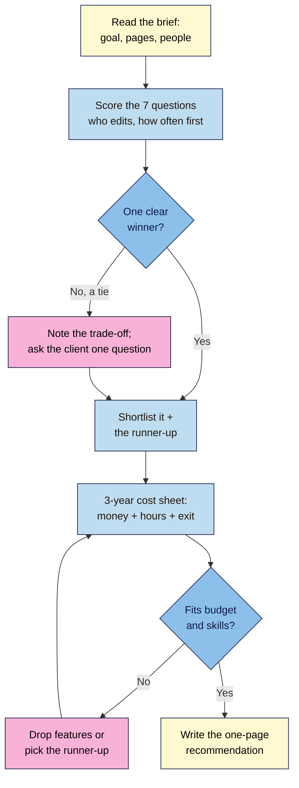

# M04.L05 — Choosing How to Build: Code, CMS or No-Code
> After this lesson you can take any website brief, score it with a seven-question checklist, estimate what each way of building it really costs over three years, and write a one-page recommendation a client (or you) can act on.

**Time:** ~16 min reading + ~30 min exercise · **Level:** L2 Practitioner · **Prereqs:** M01.L04, M04.L03 · **Remediate to:** M01.L04
**Verified against:** 2026 price comparisons for WordPress.com, Wix, Squarespace, Webflow and Shopify (third-party, mostly affiliate-funded: the vendors' own pricing pages load prices with JavaScript and couldn't be read automatically, so figures are rounded starting prices to be checked by hand); Framer's pricing page (read directly); GitHub Pages and Netlify limits from Lesson 4.3; WordPress.org Tools → Export documentation and Webflow's help centre on code export; checked 2026-11-02.

> ⚠️ **Freshness flag:** builder prices and plan names change several times a year, and most "comparison" articles are affiliate-funded. The prices below are **starting prices billed yearly, in USD, rounded**, to show the method. In the exercise you'll look up today's prices for your own country on each vendor's own pricing page.

## Learning objectives
1. **Apply** a decision checklist (who edits, how often, features, budget, skills, ownership and exit) to a project brief. *(O1)*
2. **Estimate** the three-year cost and effort of hand-coded, WordPress and no-code options, including hidden costs (plugins, themes, time, migration). *(O2)*
3. **Write** a one-page recommendation for your next project, and know where WordPress 101 picks up. *(O3)*

## Why it matters
In Lesson 1.4 you learned to *recognise* how a site is built. Now you have to *choose*. The wrong choice rarely fails on day one; it fails in month nine. A coach picks a $0 hand-coded site, then pays a developer for every blog post. A café picks a $40-a-month shop builder for a one-page menu it updates twice a year. A shop with 200 products squeezes them into a portfolio template and spends weekends copying prices. Each choice looked cheap on the day. This lesson gives you a checklist and a three-year cost sheet, so the decision is made on evidence, written down, and easy to explain.

## Core concept
**Plain version:** the right way to build depends less on technology than on **people and change**. Who will edit the site, how often, and what it must do decide almost everything. Then compare options on **total cost over three years**: money *and* hours, including the costs nobody puts on the pricing page, and on **how hard it is to leave**.

**Analogy:** choosing how to build is like choosing between cooking at home (hand-coded: cheapest, most control, you do the work), a shared kitchen with equipment (WordPress: flexible, you maintain the equipment), and a meal-kit subscription (no-code builder: fast and easy, a monthly fee, and you cook only their recipes).

### The seven-question checklist
| # | Question | Points towards **code** | Points towards **CMS (WordPress)** | Points towards **no-code builder** |
|---|---|---|---|---|
| 1 | **Who edits?** | You, comfortable with VS Code and Git | Several non-technical people, with roles | One non-technical owner |
| 2 | **How often?** | Rarely (a few times a year) | Weekly posts, many pages | Monthly small changes |
| 3 | **Features?** | Static pages, links, an embedded form | Blog, categories, search, memberships via plugins | Bookings, simple shop, forms built in |
| 4 | **Budget (money)?** | ~Domain only | Hosting + domain + some paid plugins | Monthly plan, every month |
| 5 | **Skills and time?** | You have them, or want to learn | Someone can update and back up monthly | Nobody wants to touch anything technical |
| 6 | **Ownership?** | Your files, any host | Your files + database, any host | Their platform; your content inside it |
| 7 | **Exit?** | Copy the folder | Full export (WordPress tools) to any host | Limited: content may export; design usually doesn't |

**How to score:** for each question, write which column the brief points to and one reason. The column with most answers is the starting recommendation; questions 1 and 2 count double because they decide daily life. A tie means: write down the trade-off and ask the client.

### Three-year cost: what to count
| Cost | Hand-coded (static) | WordPress (self-hosted) | No-code builder | Shop platform |
|---|---|---|---|---|
| Platform / hosting | $0 (GitHub Pages, Lesson 4.3) | ~$3–35 a month | ~$15–40 a month (Wix, Squarespace, Webflow Basic ~$14–23) | ~$29+ a month (Shopify Basic) + card fees |
| Domain | ~$10–15 a year | ~$10–15 a year (sometimes free year 1) | Often free year 1, then ~$20 a year | Often bought through the platform |
| Theme / template | $0 (yours) | $0–100 one-off or yearly | Included | $0–400 one-off |
| Plugins / apps | Free form service, maybe paid | $0–300 a year (forms, backups, SEO, security) | Some add-ons paid | Apps often $5–50 a month each |
| **Your time** | Every change in code | Monthly updates and backups (~1 hour) | Very little | Product and order admin |
| **Paid help** | A developer for each change if you can't | Occasional fixes | Rare | Occasional |
| Migration at exit | Near zero | Low | Rebuild the design elsewhere | Export products/customers; rebuild theme |

Put a value on time: if the client's hour is worth $20, a "free" site needing two hours of developer help a month at $40 an hour costs **$2,880 over three years**.

## How it works

**In words:** read the brief, then score the seven questions, starting with who edits and how often. If there's no clear winner, note the trade-off and ask the client the one question that decides it. Shortlist the winner and a runner-up, and build a three-year cost sheet for both, counting hours and the cost of leaving. If the winner doesn't fit the budget or skills, cut features or switch to the runner-up. Then write the recommendation.

## Hands-on walkthrough

**Part A: score three briefs (12 min)**
Copy this into a new file `decision-notes.md` in your repo, then fill in the scoring for each brief.

1. **Brief 1: Lakeside Café.** One-page menu, opening hours, a map and a phone number. The owner changes the menu twice a year. Budget: "as little as possible". The owner's nephew knows some HTML.
   **Expected:** code wins most questions (rare edits, static features, tiny budget, someone with skills). Recommendation: **hand-coded on GitHub Pages**, runner-up a cheap builder if the nephew moves away. Three-year cost ≈ **$30–45** (domain) + a few hours a year.
2. **Brief 2: Coach with a blog.** Life coach, posts weekly, wants categories, an email sign-up and a booking link; may add an assistant writer next year. Budget ~$25 a month. Not technical but willing to learn a dashboard.
   **Expected:** CMS wins questions 1–3 (two editors, weekly posts, blog features), and ownership and exit favour WordPress. Recommendation: **WordPress** on managed hosting, runner-up a builder with a blog. Three-year cost ≈ $108–1,260 hosting ($3–35 a month × 36) + ~$40 domain + ~$0–300 plugins, plus ~1 hour a month of updates. This is where **WordPress 101** picks up.
3. **Brief 3: Spice shop, 200 products.** Sells online with stock levels, shipping rates and discount codes; two staff process orders daily.
   **Expected:** none of the three columns fits well: this is a **shop platform** job (Shopify, or WordPress + WooCommerce if they want to own everything and have help). Recommendation: **Shopify**, runner-up WooCommerce. Three-year cost ≈ $1,044+ for the Basic plan alone, plus card fees and apps. Hand-coding a cart is the wrong tool.
   > 🖼️ **Image prompt:** Desktop screenshot (1440×900) of VS Code with `decision-notes.md` open in Markdown preview, showing the seven-question table filled in for "Coach with a blog", with the WordPress column winning. Outline the winning column count. Highlight the key element with a 3px #F9B2D7 outline; blur any personal details.
   > **Alt text:** A decision checklist in VS Code preview, with WordPress scoring highest for a coach's blog.

**Part B: build a three-year cost sheet (10 min)**
1. Pick **Brief 2**. Open two vendors' **own** pricing pages (e.g. a WordPress host you'd use, and one builder). Note the yearly-billing price, what's **not** included (domain after year 1, email, backups, extra editors), and the **renewal** price.
2. Fill this sheet (in your notes or a spreadsheet):
   | | Year 1 | Year 2 | Year 3 | 3-year total |
   |---|---|---|---|---|
   | Platform / hosting | | | | |
   | Domain | | | | |
   | Theme, plugins, apps | | | | |
   | Hours × hourly value | | | | |
   | **Total** | | | | |
   **Expected:** year 1 is often cheapest (introductory offers); years 2–3 show the true cost. Hours usually change the ranking more than the subscription.
3. Add one line on **exit:** "If we leave in year 3, we take ___ and must rebuild ___."
   > 🖼️ **Image prompt:** Desktop screenshot (1440×900) of a spreadsheet comparing three-year costs for WordPress and a no-code builder, rows for hosting, domain, plugins and hours, with the totals row highlighted. Highlight the key element with a 3px #F9B2D7 outline; blur any personal details.
   > **Alt text:** A three-year cost spreadsheet comparing WordPress and a website builder, with the totals row highlighted.

**Part C: your own decision (8 min)**
Write `decision-notes.md` → **"My next project"**: the brief in two sentences, the seven answers, the winner and runner-up, the three-year totals, the exit line, and a final sentence: "I'll revisit this when ___" (for example, "when I need a second editor"). Commit it as `Add build decision for next project` and push. This note is part of the Module 4 capstone.

## When to use / when not to
- **Hand-coded static:** few pages, rare changes, someone who can edit code, and a wish for speed, control and near-zero cost. **Not** when non-technical people must publish often.
- **WordPress (self-hosted):** blogs and content sites, several editors, the need to own and move your site. **Trade-off:** you (or someone) must update, back up and secure it every month.
- **Hosted WordPress (WordPress.com):** WordPress without managing a server, from about $4 a month; plugins and custom themes need a higher plan. A middle path for Brief 2 if nobody will do updates.
- **No-code builders (Wix, Squarespace, Webflow, Framer):** a non-technical owner who wants it done fast and won't maintain anything. **Trade-off:** monthly fees forever and limited exit; Webflow and Framer suit design-led sites.
- **Shop platforms (Shopify, WooCommerce):** real stock, carts, taxes and shipping. Don't hand-code commerce.
- **Mix and match is normal:** a hand-coded launch page plus a hosted shop on `shop.yourdomain`, or WordPress for the blog with a builder for a one-off campaign page.

## Use AI for this
**Example prompt:**
> "Here's a website brief [paste]. Score it on these seven questions: who edits, how often, features, budget, skills, ownership, exit. For each, say whether it points to hand-coded static, WordPress or a no-code builder, and why. Then list the hidden costs I should price for the top two options over three years. Don't quote prices; I'll look them up."

**What AI does well here:** spotting needs hidden in a brief ("may add a writer" = roles), listing hidden costs, and turning your notes into a clear one-page recommendation.
**Where it gets it wrong:** prices and plan names (often a year or more out of date), confident claims about export features, and a bias towards whatever is most written about online.
**How to check:** prices and export rules only from the vendor's own pricing and help pages; ask the client to confirm who will really edit and how often.

## Common mistakes
- **Choosing on the year-1 price** and ignoring renewal, add-ons and hours.
- **Choosing the tool you know** instead of the one that fits who edits.
- **Forgetting the exit:** no plan for moving content if prices rise or the platform changes.
- **Over-building:** WordPress or a shop for a one-page menu.
- **Under-building:** hand-coding a weekly blog for a non-technical owner.
- **Not writing it down,** so nobody remembers why the choice was made.
- **Letting someone else own the account** (domain, builder or hosting).

## Troubleshooting
| Symptom | Likely cause | Fix |
|---|---|---|
| Every question points somewhere different | Brief is vague about people and frequency | Ask "Who will update it, and how often?" first |
| The cheap option ends up most expensive | Hours or paid help weren't counted | Add hours × hourly value to the cost sheet |
| Client loves a builder but needs to leave later | Exit not checked | Read the builder's export help page before signing up |
| Costs jump in year 2 | Introductory pricing or a free domain ended | Use renewal prices in years 2–3 |
| Plugins pile up on WordPress | Each feature solved with a new plugin | List must-haves; one plugin per job; review yearly |

## Exercise
**Task:** decide how **your next project** should be built.
1. Your scored checklist for Briefs 1–3 (winner, runner-up, one reason per question).
2. A three-year cost sheet for your top two options for Brief 2, with prices from vendor pages (name the pages and the date you checked).
3. Your one-page recommendation for your own next project: brief, seven answers, winner and runner-up, three-year totals, exit line, "revisit when" trigger.
4. Committed and pushed as `decision-notes.md` in your repo.

**Expected outcome:** a recommendation another person could read in two minutes and understand what you chose, what it costs over three years, and what would make you change your mind.
**Stretch goal:** score a real site you admire (from your Module 1 capstone) and decide whether its owners chose well.

## Key takeaways
- **Who edits and how often** decide most of the choice; features and budget come next.
- Compare **three-year totals**, counting hours and renewals, not year-1 prices.
- Always write the **exit** line: what you keep and what you'd rebuild.
- Hand-coded for rare-change static sites, **WordPress** for content and several editors (WordPress 101), builders for no-maintenance owners, shop platforms for commerce.
- Write the decision down, with a "revisit when" trigger.

## Teach it back
Explain to a friend in 3 sentences why the cheapest way to build a website on day one can be the most expensive by year three.

## Glossary terms added
- Decision checklist (seven questions) — added to `webdev-101/glossary.md`
- Total cost of ownership (three-year cost) — added to `webdev-101/glossary.md`
- Introductory vs renewal pricing — added to `webdev-101/glossary.md`
- Lock-in / exit cost — added to `webdev-101/glossary.md`
- Managed WordPress hosting — added to `webdev-101/glossary.md`
- Shop platform (Shopify, WooCommerce) — added to `webdev-101/glossary.md`

## Further reading
*All checked 2026-11-02. Prices: use vendors' own pages.*
- WordPress.com — Pricing: https://wordpress.com/pricing/
- Wix — Plans: https://www.wix.com/plans
- Squarespace — Pricing: https://www.squarespace.com/pricing
- Webflow — Pricing: https://webflow.com/pricing
- Framer — Pricing: https://www.framer.com/pricing
- Shopify — Pricing: https://www.shopify.com/pricing
- WordPress.org — Tools: Export (moving your content): https://wordpress.org/documentation/article/tools-export-screen/
- Webflow Help Center — search "Code export" (what exports and what doesn't): https://help.webflow.com/
- GrandAppStudio — WordPress 101 for Content Creators (the next course for Brief 2)

## Refresher card
*Used by remediation when a learner fails a quiz twice on a later lesson that points back here.*
Seven questions: who edits, how often, features, budget, skills, ownership, exit (1 and 2 count double). Code = rare changes + someone who codes; WordPress = blog, several editors, own your site; builder = non-technical owner, no maintenance, monthly fee, limited exit; shop platform = real commerce. Compare three-year totals: platform + domain (renewal) + themes/plugins/apps + hours × value + exit cost. Write it down with a "revisit when" trigger.
