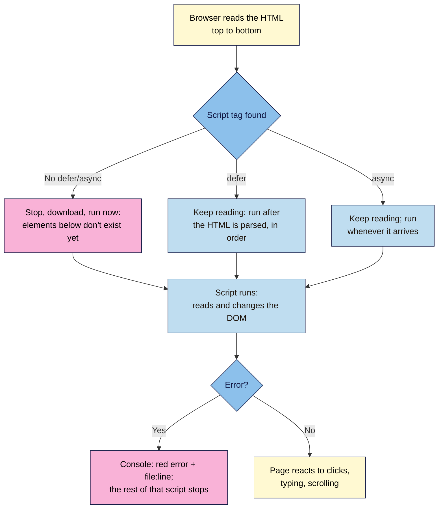

# M05.L01 — What JavaScript Does (and Breaks)
> After this lesson you can add your own script file to the launch page the right way, read the Console's red lines to find which script broke a page, and audit the scripts a marketing site loads: what each one does, what it costs, and what happens when it fails.

**Time:** ~16 min reading + ~30 min exercise · **Level:** L2 Practitioner · **Prereqs:** M01.L05, M04 capstone · **Remediate to:** M01.L05
**Verified against:** MDN "The script element" (`defer`, `async`, `type="module"`), MDN "JavaScript" overview and "What went wrong? Troubleshooting JavaScript"; Chrome DevTools docs (Console overview, Network reference: filters incl. **More filters → 3rd-party requests**, "Request conditions" (right-click → Block request, `blocked:devtools`), Coverage, "Disable JavaScript"); every error message below reproduced in headless Chrome 156 on 2026-11-02 (`Cannot read properties of null (reading 'addEventListener')` from a script in `<head>` without `defer`; `Failed to load resource: the server responded with a status of 404` for a missing script; the page's HTML still readable with JavaScript disabled).

> ⚠️ **Freshness flag:** DevTools menus move a little with each Chrome release (about every four weeks). If a menu below isn't where the lesson says, open the **Command Menu** (Ctrl+Shift+P / Cmd+Shift+P) and type its name.

## Learning objectives
1. **Explain** what JavaScript adds to HTML and CSS (changing the DOM, reacting to events, talking to servers) and how a `<script>` loads (`defer`, `async`, inline vs external). *(O1)*
2. **Read** the Console (errors, warnings, the red line and its file:line link) and the Network panel's JS requests to **identify** which script broke a page or slowed it down. *(O2)*
3. **Audit** the third-party scripts on a marketing page (chat widget, pixel, tag manager) for what they do, their weight and whether the page still works with JavaScript turned off. *(O3)*

## Why it matters
Leila runs ads for a skincare brand. One Monday, sign-ups dropped to zero. The page looked perfect: same hero, same form. The cause was one line in the Console: a newly added chat widget threw an error before the form's own script ran, so the **Join** button did nothing. Nobody on the marketing team had opened DevTools; the developer was on holiday. Marketing pages run on JavaScript you didn't write: analytics, pixels, chat, pop-ups, A/B tests. You don't need to be a programmer to manage them, but you do need to see them, read their errors, and know what the page does when one of them fails.

## Core concept
**Plain version:** HTML is the content, CSS is the look, and **JavaScript (JS)** is the behaviour. JavaScript runs in the visitor's browser and can do three things your HTML and CSS can't: **change the page after it loads** (open an FAQ answer, show a pop-up), **react to what people do** (clicks, typing, scrolling), and **talk to servers without reloading** (send a form, load prices, report an analytics event). In Lesson 1.5 you saw that the page on screen is the **DOM**, the browser's live copy of your HTML; JavaScript is what changes it.

**Analogy:** your page is a shop. HTML is the stock on the shelves, CSS is the shop fit-out, and JavaScript is the staff: they open doors, answer questions and ring up sales. Third-party scripts are agency staff you let in: useful, but each one takes space, and if one blocks the till, nobody can pay.

### How a script gets onto the page
| Code | What happens | Use it for |
|---|---|---|
| `<script src="js/main.js" defer></script>` in `<head>` | Downloads alongside the HTML; runs **after** the HTML is parsed, in order | **Your own scripts.** The default for this course |
| `<script src="…" async></script>` | Downloads alongside; runs **as soon as it arrives**, in any order | Independent third-party tags (analytics) that don't touch your elements |
| `<script src="…"></script>` in `<head>` (no attribute) | **Stops** reading the HTML until the script downloads and runs | Avoid: slows the page and can't find elements below it yet |
| `<script>…code…</script>` (inline) | Runs where it sits, immediately | Small snippets vendors give you (often a tag manager loader) |
| `<script type="module" src="…">` | Deferred automatically; can import other files | Later, when your scripts grow (Module 8) |

**Progressive enhancement:** build the page so the content and the main action work with HTML alone, then let JavaScript make them nicer. If a script fails (blocked, slow, broken), the visitor still gets the essentials. Your launch page from Modules 2–4 already works this way: no JS at all.

### Where JavaScript problems show up
| Panel | What you see | What it tells you |
|---|---|---|
| **Console** | Red **errors**, yellow **warnings**, plain logs | Which script failed, with a **file:line** link to the exact line |
| **Network** → **JS** filter | Every script, its size, time and status | Missing scripts (404), heavy scripts, who they come from |
| **Network** → right-click a request → **Block request** | The page reloaded without that script (shown as `blocked:devtools`) | What breaks (or doesn't) when a script fails |
| **Coverage** (Command Menu → "Show Coverage") | How much of each script was actually used | Weight you pay for and don't use |
| **Disable JavaScript** (Command Menu) | The page with no scripts at all | Whether content and forms survive a failure |

## How it works



**In words:** the browser reads your HTML from the top. A plain script tag makes it stop and run the script immediately, before the elements below exist. `defer` lets it keep reading and runs the script once the whole page is parsed; `async` runs it whenever it arrives. When the script runs, it can read and change the DOM. If it hits an error, the Console shows a red line with the file and line number, and **that script stops at the error**; other scripts carry on.

## Hands-on walkthrough

**Part A: your first script file (8 min)**
1. In VS Code, in your `nila-launch` folder, create `js/main.js` containing:
   ```js
   console.log('main.js loaded');
   ```
2. In `index.html`, add this inside `<head>`, after the stylesheet link:
   ```html
   <script src="js/main.js" defer></script>
   ```
3. Start Live Preview (Lesson 4.1), open it in Chrome and open DevTools → **Console**.
   **Expected:** `main.js loaded`, with `main.js:1` on the right. Click `main.js:1`: DevTools opens the file at that line in the **Sources** panel.
4. In the Console, type `document.querySelector('h1').textContent` and press Enter. **Expected:** your page's heading text. Now type `document.querySelector('h1').textContent = 'Testing'`. **Expected:** the heading changes on screen, but not in your file. Reload: it's back. That's the DOM (Lesson 1.5): JavaScript changes the live page, not your HTML.
5. Commit `Add main.js with defer` and push (Lesson 4.2). The live site now loads it too.

**Part B: break it and fix it (10 min)**
1. **The script that runs too early.** Replace the contents of `main.js` with:
   ```js
   const button = document.querySelector('.button');
   button.addEventListener('click', () => console.log('CTA clicked'));
   ```
   Then remove `defer` from the script tag. Save and reload.
   **Symptom:** the Console shows **`Uncaught TypeError: Cannot read properties of null (reading 'addEventListener')`** with `main.js:2` (checked in Chrome 156). **Why:** without `defer`, the script ran while the browser was still in `<head>`; the button didn't exist yet, so `querySelector` returned `null` ("nothing"). **Fix:** put `defer` back. Reload and click your CTA: `CTA clicked`.
   > 🖼️ **Image prompt:** Desktop screenshot (1440×900) of Chrome DevTools Console showing the red error "Uncaught TypeError: Cannot read properties of null (reading 'addEventListener')" with the "main.js:2" link on the right. Outline the error message and the file:line link. Highlight the key element with a 3px #F9B2D7 outline; blur any personal details.
   > **Alt text:** Chrome Console showing a red TypeError about reading addEventListener of null, with the main.js:2 link.
2. **The script that isn't there.** Change the tag to `src="js/mian.js"` (typo). Reload.
   **Symptom:** nothing happens on click; the Console shows `Failed to load resource: the server responded with a status of 404` and Network (filter **JS**) shows `mian.js` in red with **404**. **Fix:** correct the path. (Same lesson as Module 4: read the red request's URL.)
3. **Same name, wrong element.** Change `.button` to `.buton`. **Symptom:** the same `null` error as step 1, even with `defer`. `null` means "I looked and found nothing": check the selector before blaming the timing.

**Part C: audit a marketing page's scripts (12 min)**
Pick a brand site from your Module 1 capstone (one with a chat bubble, cookie banner or pop-up works best).
1. DevTools → **Network** → filter **JS** → reload with **Disable cache** ticked. Sort by **Size**.
   **Expected:** a list of scripts. Note the five largest: file name, domain, size (transferred), and a guess at the job from the domain (`googletagmanager.com` = tag manager, `connect.facebook.net` = Meta pixel, `intercom`, `hotjar`, `clarity.ms`…). In the filter bar, choose **More filters → 3rd-party requests** (or compare the domain with the site's own) to separate theirs from the site's own.
2. **Console:** count red errors and yellow warnings on load. Any errors from third-party domains?
3. **Coverage:** Command Menu → **Show Coverage** → click reload in the Coverage panel. **Expected:** each script with a red/blue bar; red is code downloaded but not run yet. Many marketing scripts are more than half unused on first load.
4. **Turn JavaScript off:** Command Menu → **Disable JavaScript** → reload. **Expected:** depends on the site. Note whether the content is readable, the navigation works, and the main form or **Buy** button still does anything. Then **Enable JavaScript** again (it stays off while DevTools is open otherwise).
   > 🖼️ **Image prompt:** Desktop screenshot (1440×900) of Chrome DevTools Network panel filtered to JS, sorted by size, with third-party domains such as googletagmanager.com and a chat widget visible in the list. Outline the JS filter and the Size column. Highlight the key element with a 3px #F9B2D7 outline; blur any personal details.
   > **Alt text:** Network panel filtered to JavaScript files, sorted by size, showing several third-party marketing scripts.
5. Optional: right-click the chat widget's main script → **Block request** → reload. The **Request conditions** drawer opens with the pattern listed, and Network shows the script as `(blocked:devtools)` in red. Does the rest of the page still work? Afterwards, untick **Enable blocking and throttling** in that drawer.
6. Do the same quick check on **your** live launch page: one script, `main.js`, a few hundred bytes, and the page works with JavaScript off.

## When to use / when not to
- **Use JavaScript** for behaviour HTML and CSS can't do: remembering a choice, sending a form without reloading, a countdown, showing a pop-up after a delay.
- **Don't use it** for what HTML already does: links, plain forms, `<details>` for show/hide (Lesson 5.3), or what CSS does: hover effects, layout, simple animations. Less script = faster, fewer things to break.
- **`defer` for your own scripts, `async` for independent tags,** and nothing blocking in `<head>`.
- **Every third-party script is a trade-off:** data or features versus weight, privacy and a new way for the page to fail. Ask "what do we use it for, and who checks it?" before adding one. Consent for tracking scripts comes in Module 6.

## Use AI for this
**Example prompt:**
> "Here's the red error from Chrome's Console on my static site, with the line it points to and my script tag [paste]. I'm a beginner. Explain in plain words what went wrong, the most likely cause, and the smallest fix. Don't rewrite the whole file or add libraries."

**What AI does well here:** translating error messages, spotting `null` from a misspelt selector or a missing `defer`, and explaining what an unknown third-party script domain belongs to.
**Where it gets it wrong:** it may "fix" an error by wrapping everything in try/catch (hiding the problem), suggest jQuery or a framework for a two-line job, invent what a script does, or give code that breaks keyboard access.
**How to check:** reproduce the error, apply the smallest fix, reload, and confirm the Console is clean and the feature works with mouse **and** keyboard. Look up unknown script domains on the vendor's own site.

## Common mistakes
- **A script in `<head>` without `defer`,** so it runs before the elements exist.
- **Never opening the Console,** so errors go unnoticed for weeks.
- **Hiding errors** instead of fixing them (empty try/catch, deleting the line that reports it).
- **Pasting vendor snippets in the wrong place,** or twice (two analytics tags = double-counted visits).
- **Making the main action depend on JavaScript,** so a blocked or failed script means no sign-ups.
- **Adding scripts nobody owns:** an old A/B test tool or pixel still loading years later.
- **Testing only with extensions on:** ad blockers hide some third-party failures (and some errors). Check once in a private window.

## Troubleshooting
| Symptom | Likely cause | Fix |
|---|---|---|
| `Cannot read properties of null (reading '…')` | The element wasn't found: wrong selector, or the script ran before the HTML (no `defer`) | Check the selector in the Console (`document.querySelector('…')`); add `defer` |
| `Failed to load resource: … 404` for a `.js` file | Wrong path or letter case | Network → read the red URL; fix the `src` |
| `Uncaught ReferenceError: x is not defined` | Typo in a name, or code that depends on a script that hasn't loaded yet | Check spelling; check script order (`defer` keeps order, `async` doesn't) |
| `Uncaught SyntaxError` | A missing bracket, quote or comma; the **whole file** doesn't run | Click the file:line link; VS Code underlines the mistake in red |
| Works locally, not live | File not committed, wrong case, or cached old version | Check GitHub's file list; reload with cache disabled |
| No error, nothing happens | The listener is on a different element, or the code never runs | Add `console.log` at the top of the file and inside the function |
| Errors only from third-party domains | A vendor script is failing or blocked | Note it, tell the vendor or the tag owner; check your own features still work |

## Exercise
**Task:** give **your** launch page a script and audit someone else's.
1. `js/main.js` loaded with `defer`, logging one line; committed and pushed; live Console shows no errors.
2. Break-it-and-fix-it log for Part B's three bugs: the exact Console or Network message, the file:line, and the fix.
3. A script audit of one marketing site: a table of its five largest scripts (file, domain, size, likely job, first-party or third-party), the number of Console errors, the Coverage of the two biggest scripts, and what still works with JavaScript disabled.
4. One recommendation for that site: a script to remove, delay or replace, and why.

**Expected outcome:** you can open any page, say which scripts it runs and what each one costs, and point at the exact line when something breaks.
**Stretch goal:** in your audit, block one third-party script with **Block request** and record what changed on the page.

## Key takeaways
- **JavaScript = behaviour:** it changes the DOM, reacts to people and talks to servers.
- **Load your scripts with `defer`;** a plain script in `<head>` runs before the page exists.
- **The Console is the first place to look:** a red error with a file:line link, and that script stops at the error.
- **`null` means "not found":** check the selector, then the timing.
- **Audit third-party scripts:** size, job, owner, and what happens when they fail. Keep the main action working without JavaScript.

## Teach it back
Explain to a friend in 3 sentences why a marketing page can look perfect and still lose every sign-up, and the first two things they should check in DevTools.

## Glossary terms added
- JavaScript (JS) — added to `webdev-101/glossary.md`
- Script tag (`<script>`), inline vs external — added to `webdev-101/glossary.md`
- `defer` / `async` — added to `webdev-101/glossary.md`
- Render-blocking script — added to `webdev-101/glossary.md`
- Console error / warning, file:line link — added to `webdev-101/glossary.md`
- `null` (in JavaScript) — added to `webdev-101/glossary.md`
- TypeError / ReferenceError / SyntaxError — added to `webdev-101/glossary.md`
- Third-party script — added to `webdev-101/glossary.md`
- Coverage (DevTools) — added to `webdev-101/glossary.md`
- Request blocking (DevTools Request conditions) — added to `webdev-101/glossary.md`
- Progressive enhancement — added to `webdev-101/glossary.md`

## Further reading
*All checked 2026-11-02.*
- MDN — The script element (`defer`, `async`, `type="module"`): https://developer.mozilla.org/en-US/docs/Web/HTML/Reference/Elements/script
- MDN — What is JavaScript?: https://developer.mozilla.org/en-US/docs/Learn_web_development/Core/Scripting/What_is_JavaScript
- MDN — What went wrong? Troubleshooting JavaScript: https://developer.mozilla.org/en-US/docs/Learn_web_development/Core/Scripting/What_went_wrong
- Chrome DevTools — Console overview: https://developer.chrome.com/docs/devtools/console
- Chrome DevTools — Network features reference (filters, blocking): https://developer.chrome.com/docs/devtools/network/reference
- Chrome DevTools — Request conditions (block or throttle a request): https://developer.chrome.com/docs/devtools/request-conditions
- Chrome DevTools — Coverage: https://developer.chrome.com/docs/devtools/coverage
- Chrome DevTools — Disable JavaScript: https://developer.chrome.com/docs/devtools/javascript/disable
- web.dev — Efficiently load third-party JavaScript: https://web.dev/articles/efficiently-load-third-party-javascript

## Refresher card
*Used by remediation when a learner fails a quiz twice on a later lesson that points back here.*
HTML = content, CSS = look, JS = behaviour (changes the DOM, reacts to events, talks to servers). Load your own scripts with `<script src="js/main.js" defer></script>` in `<head>`; `async` for independent tags; never a plain blocking script in `<head>`. Console: red error + file:line; the script stops at the error. `Cannot read properties of null` = element not found (selector typo, or no `defer`). Script 404 = wrong path or case. Audit: Network → JS (size, domain), Console errors, Coverage (unused code), Disable JavaScript (does the page still work?), Block request (what if one fails?).
