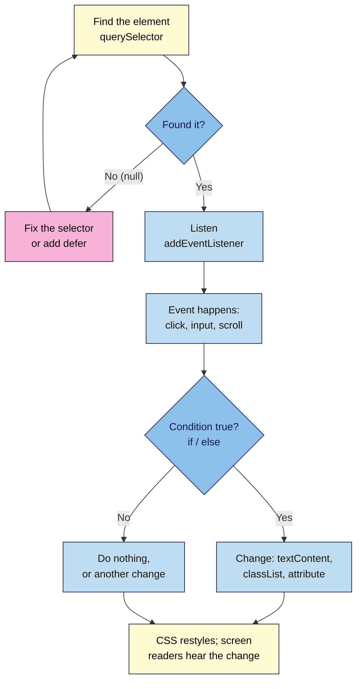

# M05.L02 — JS Basics: Variables, Functions, Events
> After this lesson you can read and write the small scripts marketing pages actually need: store a value, make a decision, find an element, change it safely, and react when someone clicks, types or scrolls, in a way that works for keyboard and screen-reader users too.

**Time:** ~20 min reading + ~40 min exercise · **Level:** L2 Practitioner · **Prereqs:** M05.L01 · **Remediate to:** M05.L01
**Verified against:** MDN "JavaScript first steps" (variables, strings, numbers, conditionals, functions), `Document.querySelector()` / `querySelectorAll()`, `Element.classList`, `EventTarget.addEventListener()` (the `passive` option), "Event bubbling" and event delegation, `Clipboard.writeText()` (secure contexts only), ARIA `status` role; every snippet in Parts A–D run in headless Chrome 156 on 2026-11-02 (copy button announces "Copied NILA10", and a refused clipboard shows the "Couldn't copy" fallback; counter shows "195 characters left" after typing "Hello"; `buttons.addEventListener is not a function` on a NodeList; `if (plan = 'monthly')` runs and changes `plan`).

## Learning objectives
1. **Write** small scripts with `const`/`let`, strings, numbers, booleans, arrays, `if` statements and functions, and run them in the Console. *(O1)*
2. **Select** elements (`querySelector`, `querySelectorAll`) and **change** them safely (`textContent`, `classList`, attributes such as `aria-expanded`) instead of rewriting HTML. *(O2)*
3. **Attach** event listeners (click, input, submit, scroll with a cheap check) and **use** event delegation, with keyboard users in mind. *(O3)*

## Why it matters
Tomás wanted a "Copy discount code" button on a launch page. He found a 60-line snippet online, pasted it in, and it worked: on his laptop, with a mouse. Keyboard users couldn't reach it (it was a `<div>`), screen readers heard nothing when it copied, and on scroll it re-measured the page hundreds of times a second, so the page stuttered on cheap phones. Six lines of plain JavaScript would have done the job properly. You don't need to become a developer; you need enough JavaScript to write those six lines, read AI-generated code critically, and spot when a snippet is doing far more than it should.

## Core concept
**Plain version:** almost every marketing script follows the same four-step pattern:
1. **Find** an element on the page (`document.querySelector('.copy-button')`).
2. **Listen** for something to happen to it (`addEventListener('click', …)`).
3. **Decide** what to do (`if` the field is empty…, otherwise…).
4. **Change** the page (`textContent`, `classList`, an attribute), and let CSS do the styling.

**Analogy:** a script is a doorman with instructions. "Watch **this** door (find). When someone **knocks** (listen), **if** they have a ticket (decide), **open the door and say welcome** (change)." The doorman doesn't rebuild the door; he opens it.

### The building blocks
| Block | Example | Plain meaning |
|---|---|---|
| `const` | `const code = 'NILA10';` | A labelled value that won't be reassigned (use by default) |
| `let` | `let clicks = 0; clicks = clicks + 1;` | A labelled value that will change |
| String | `'Copied'`, `` `${left} characters left` `` | Text; backticks let you insert values with `${}` |
| Number | `200`, `4.99` | Maths without quotes (`'2' + 2` is `'22'`, `2 + 2` is `4`) |
| Boolean | `true`, `false` | Yes or no |
| Array | `const plans = ['monthly', 'yearly'];` | A list; `plans.length` is 2, `plans[0]` is `'monthly'` |
| `if` / `else` | `if (left < 20) { … } else { … }` | Decide; compare with `===` (equal), `!==`, `<`, `>` |
| Function | `function updateCount() { … }` or `() => { … }` | A named (or nameless) set of steps you can run again |
| `console.log()` | `console.log('clicked', clicks);` | Print to the Console to check what's happening |

### Changing the page safely
| Do this | Not this | Why |
|---|---|---|
| `el.textContent = 'Copied'` | Setting the element's `innerHTML` to the text | `textContent` treats input as plain text; `innerHTML` turns it into HTML, a security risk (cross-site scripting) with anything typed by users |
| `el.classList.add('is-stuck')`, `.remove()`, `.toggle()` | `el.style.background = '#b45309'` | Keep looks in CSS (your M03 tokens); JS only switches the class |
| `btn.setAttribute('aria-expanded', 'true')` | Changing only the look | Screen readers read the attribute, not the colour (Lesson 5.3) |
| Listeners on a `<button>` | Listeners on a `<div>` | Buttons get keyboard focus, Enter/Space and a role for free |

## How it works



**In words:** find the element; if you get `null`, fix the selector or the timing (Lesson 5.1). Listen for the event you care about. When it happens, check any condition, then change the text, a class or an attribute. CSS handles the look, and screen readers pick up text and attribute changes.

## Hands-on walkthrough

**Part A: warm up in the Console (8 min)**
Open your launch page in Live Preview → DevTools → **Console**. Type each line and press Enter.
1. `const code = 'NILA10';` then `code` → **Expected:** `'NILA10'`.
2. `let left = 200; left = left - 5; left` → **Expected:** `195`.
3. `'2' + 2` and `2 + 2` → **Expected:** `'22'` and `4`. Text and numbers behave differently; form fields always give you text.
4. `const plans = ['monthly', 'yearly']; plans.length` → **Expected:** `2`.
5. `function greet(name) { return 'Hi ' + name; }` then `greet('Asha')` → **Expected:** `'Hi Asha'`.
6. `document.querySelectorAll('a').length` → **Expected:** the number of links on your page.

**Part B: three small features for the launch page (22 min)**
All code goes in `js/main.js` (loaded with `defer`, Lesson 5.1). Commit after each feature.

1. **Copy the discount code.** In `index.html`, near your offer:
   ```html
   <p>Use code <code>NILA10</code> for 10% off your first box.
     <button type="button" class="copy-button" data-code="NILA10" hidden>Copy code</button>
     <span class="copy-status" role="status"></span>
   </p>
   ```
   In `main.js`:
   ```js
   const copyButton = document.querySelector('.copy-button');
   const copyStatus = document.querySelector('.copy-status');

   copyButton.hidden = false;   // show the button only when JavaScript runs

   copyButton.addEventListener('click', async () => {
     try {
       await navigator.clipboard.writeText(copyButton.dataset.code);
       copyStatus.textContent = `Copied ${copyButton.dataset.code}`;
     } catch (error) {
       copyStatus.textContent = "Couldn't copy. Select the code and press Ctrl+C (Cmd+C on Mac).";
     }
   });
   ```
   **Expected:** click (or Tab to it and press Enter): the text "Copied NILA10" appears, and pasting gives `NILA10`. `role="status"` makes screen readers announce the change politely without moving focus. `data-code` keeps the value in the HTML, so marketing can change it without touching JavaScript. (The Clipboard API only works on secure pages: `https://`, `localhost` or a local file, so it works on your live site from Module 4.) The button starts `hidden` and the script shows it, so visitors without JavaScript never see a button that does nothing; the code itself stays visible in the sentence. If the browser refuses clipboard access, `catch` shows a plain instruction instead of failing silently (checked: a refused copy shows "Couldn't copy…").
   > 🖼️ **Image prompt:** Desktop screenshot (1280×800) of the launch page offer line "Use code NILA10 for 10% off your first box" with a focused "Copy code" button showing a visible focus ring and the text "Copied NILA10" beside it. Outline the button and the status text. Highlight the key element with a 3px #F9B2D7 outline; blur any personal details.
   > **Alt text:** Launch page offer with a focused Copy code button and the confirmation "Copied NILA10" next to it.
2. **A live character counter.** On the M02 form's message field (add one if you don't have it):
   ```html
   <label for="message">Anything we should know?</label>
   <textarea id="message" name="message" maxlength="200" aria-describedby="message-count"></textarea>
   <p id="message-count">200 characters left</p>
   ```
   ```js
   const message = document.querySelector('#message');
   const messageCount = document.querySelector('#message-count');

   message.addEventListener('input', () => {
     const left = message.maxLength - message.value.length;
     messageCount.textContent = `${left} characters left`;
     messageCount.classList.toggle('is-low', left < 20);
   });
   ```
   Add to `styles.css`: `.is-low { color: var(--color-cta); font-weight: 700; }`.
   **Expected:** type "Hello" → "195 characters left" (checked). `message.maxLength` reads the limit from the HTML, so the number lives in one place. Below 20 the text turns bold in your CTA colour. `maxlength` (HTML) still enforces the limit if JavaScript fails; the script only adds feedback. `aria-describedby` links the hint to the field (Lesson 2.4).
3. **A header that changes after the hero.** In `main.js`:
   ```js
   const header = document.querySelector('.site-header');
   const hero = document.querySelector('.hero');

   window.addEventListener('scroll', () => {
     header.classList.toggle('is-stuck', window.scrollY > hero.offsetHeight);
   }, { passive: true });
   ```
   In `styles.css`: `.site-header { position: sticky; top: 0; }` and `.site-header.is-stuck { box-shadow: 0 2px 6px rgb(0 0 0 / 0.15); }` (use your own class names if your header and hero differ). The header is always sticky; the script only adds the shadow, so nothing jumps or re-lays out while scrolling.
   **Expected (checked):** the header stays at the top as you scroll; past the hero it gets a shadow; scroll back up and the shadow goes. The check inside is one comparison and one class toggle, so it's cheap, and `{ passive: true }` tells the browser the listener won't block scrolling. (Lesson 5.3 shows `IntersectionObserver`, the even lighter way.)
4. Commit each feature separately: `Add copy-code button`, `Add message character counter`, `Add header shadow after hero`. Push, and test all three on the live site, with a mouse **and** with the keyboard.

**Part C: event delegation (5 min)**
When many similar elements need the same listener (FAQ questions, plan cards), listen **once** on their parent:
```js
const planList = document.querySelector('.plans');

planList.addEventListener('click', (event) => {
  const button = event.target.closest('button');
  if (!button) return;              // the click wasn't on a button
  console.log('Plan chosen:', button.dataset.plan);
});
```
**Expected:** clicking any plan's button logs its `data-plan` value (add `data-plan="monthly"` etc. to your plan buttons). Clicks **bubble** up from the button to the list, so one listener handles every card, including cards added later.

**Part D: break it and fix it (5 min)**
| Plant this | Symptom (checked in Chrome 156) | Find it | Fix |
|---|---|---|---|
| `document.querySelectorAll('.copy-button').addEventListener(…)` | `TypeError: … .addEventListener is not a function` | Console; `querySelectorAll` returns a **list** (NodeList) | Use `querySelector` for one element, `forEach` over the list, or delegation (Part C) |
| `if (plan = 'monthly')` | No error; the `if` **always** runs and `plan` becomes `'monthly'` | `console.log(plan)` before and after | Compare with `===`: `if (plan === 'monthly')` |
| `classList.add('is-stcuk')` (typo) | No error; nothing changes on screen | Elements panel: the header has `is-stcuk`, and no CSS rule matches it | Match the class name in CSS and JS exactly |
| Listener on `<div class="copy-button">` | Mouse works; Tab skips it; Enter does nothing | Keyboard test | Use `<button type="button">` |

## When to use / when not to
- **Use `textContent`** for anything that comes from users or data; reserve `innerHTML` for HTML you wrote yourself, and use it rarely.
- **Use a class toggle** instead of setting styles in JS, so your tokens and media queries still apply.
- **Use delegation** for lists of similar items; a single listener per element is fine for one-off buttons.
- **Scroll listeners:** keep the work tiny (one comparison, one class) and passive; for "is this in view?" prefer `IntersectionObserver` (Lesson 5.3).
- **Don't** rebuild in JavaScript what HTML gives you: `maxlength`, `required`, links, `<details>`.

## Use AI for this
**Example prompt:**
> "Write plain JavaScript (no libraries) for a static page: a `<button type="button" class="copy-button" data-code="NILA10">` copies its data-code to the clipboard and writes 'Copied NILA10' into a `<span class="copy-status" role="status">`. The script is loaded with defer. Keep it under 10 lines, use textContent (never innerHTML), and explain each line in one sentence."

**What AI does well here:** short, explainable snippets when you name the exact HTML, and explaining someone else's code line by line.
**Where it gets it wrong:** adding jQuery or a library for a two-line job, writing user input into `innerHTML`, attaching listeners to `<div>`s, heavy scroll handlers, inventing class names that don't match your CSS, and code that only works with a mouse.
**How to check:** read every line (you should be able to say what it does); test with mouse, keyboard (Tab, Enter, Space) and a cleared Console; search the code for `innerHTML`, `div` listeners and libraries before you paste.

## Common mistakes
- **`=` instead of `===`** in an `if`.
- **Forgetting form values are text:** `'2' + 2` is `'22'`; convert with `Number(value)` before maths.
- **Calling `.addEventListener` on a NodeList** from `querySelectorAll`.
- **Mismatched class names** between JS and CSS (no error, nothing happens).
- **Putting anything a user typed into `innerHTML`.**
- **Clickable `<div>`s and `<span>`s** instead of buttons.
- **Heavy work on every scroll event.**
- **Hard-coding content in JS** (`'NILA10'` in three places) instead of reading it from the HTML (`data-code`).

## Troubleshooting
| Symptom | Likely cause | Fix |
|---|---|---|
| `… is not a function` | Calling a method on the wrong thing (a NodeList, `undefined`, a typo like `addEventListner`) | `console.log` the variable; check spelling |
| `Cannot read properties of null` | Selector found nothing | Test it in the Console; check the class/ID and `defer` |
| Maths gives `'20010'` | Adding a string and a number | `Number(field.value)` |
| `if` always runs | `=` instead of `===` | Use `===` |
| Copy button shows "Couldn't copy…" or does nothing | Page not on HTTPS, the browser denied clipboard access, or no `try`/`catch` | Use the HTTPS address; keep the `catch` message; check the Console for `NotAllowedError` |
| Works with mouse, not keyboard | Listener on a non-button element | Use `<button type="button">` |
| Page stutters while scrolling | Heavy scroll handler | One comparison, `{ passive: true }`, or `IntersectionObserver` |

## Exercise
**Task:** add **three** small behaviours to **your** launch page.
1. A copy-code (or copy-link) button with a `role="status"` confirmation, using `data-` attributes for the value.
2. A live counter or hint on one form field, with the HTML limit (`maxlength`) still in place.
3. One scroll or click behaviour that toggles a class (e.g. a header change or a "back to top" link that appears).
4. Each as its own commit, pushed, tested live with mouse and keyboard, Console clean.
5. A break-it-and-fix-it log for two of Part D's bugs (symptom, how you found it, fix).

**Expected outcome:** a live page with three working, keyboard-friendly behaviours in under 40 lines of `main.js`, and the page still fully usable with JavaScript off.
**Stretch goal:** convert one feature to event delegation (e.g. copy buttons on several plan cards handled by one listener).

## Key takeaways
- **Find → listen → decide → change.** Almost every marketing script is this pattern.
- **`const` by default, `let` when it changes, `===` to compare;** form values are text.
- **Change text with `textContent`, looks with `classList`, meaning with attributes;** keep styling in CSS.
- **Buttons, not divs;** test with the keyboard.
- **Delegate** for lists; keep scroll handlers tiny and passive.

## Teach it back
Explain to a friend in 3 sentences what happens, step by step, when a visitor clicks a "Copy code" button, and why it should be a `<button>`.

## Glossary terms added
- Variable (`const` / `let`) — added to `webdev-101/glossary.md`
- String / number / boolean — added to `webdev-101/glossary.md`
- Array — added to `webdev-101/glossary.md`
- Function / arrow function — added to `webdev-101/glossary.md`
- `===` (strict equality) — added to `webdev-101/glossary.md`
- `querySelector` / `querySelectorAll` (NodeList) — added to `webdev-101/glossary.md`
- `textContent` vs `innerHTML` — added to `webdev-101/glossary.md`
- `classList` — added to `webdev-101/glossary.md`
- `data-` attribute — added to `webdev-101/glossary.md`
- Event / event listener — added to `webdev-101/glossary.md`
- Event bubbling / event delegation — added to `webdev-101/glossary.md`
- Passive listener — added to `webdev-101/glossary.md`
- `role="status"` (live region) — added to `webdev-101/glossary.md`

## Further reading
*All checked 2026-11-02.*
- MDN — JavaScript first steps: https://developer.mozilla.org/en-US/docs/Learn_web_development/Core/Scripting
- MDN — `Document.querySelector()`: https://developer.mozilla.org/en-US/docs/Web/API/Document/querySelector
- MDN — `Element.classList`: https://developer.mozilla.org/en-US/docs/Web/API/Element/classList
- MDN — `EventTarget.addEventListener()` (incl. `passive`): https://developer.mozilla.org/en-US/docs/Web/API/EventTarget/addEventListener
- MDN — Event bubbling (and delegation): https://developer.mozilla.org/en-US/docs/Learn_web_development/Core/Scripting/Event_bubbling
- MDN — `Clipboard.writeText()`: https://developer.mozilla.org/en-US/docs/Web/API/Clipboard/writeText
- MDN — ARIA `status` role: https://developer.mozilla.org/en-US/docs/Web/Accessibility/ARIA/Reference/Roles/status_role

## Refresher card
*Used by remediation when a learner fails a quiz twice on a later lesson that points back here.*
Pattern: find (`querySelector`) → listen (`addEventListener('click' | 'input' | 'scroll', fn)`) → decide (`if (a === b)`) → change (`textContent`, `classList.toggle('is-x', condition)`, `setAttribute('aria-expanded', 'true')`). `const` by default, `let` if it changes; strings vs numbers (`'2' + 2 = '22'`, use `Number()`). `querySelectorAll` returns a list: loop, or delegate on the parent with `event.target.closest('button')`. Buttons, not divs. `role="status"` announces changes. Scroll: tiny work, `{ passive: true }`.
