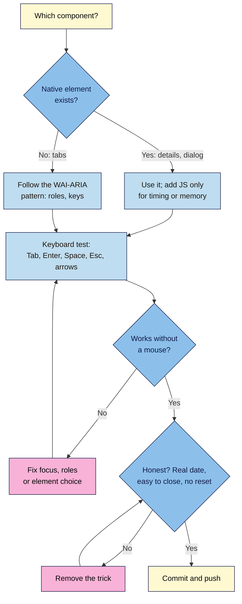

# M05.L03 — Interactive Components
> After this lesson your launch page has four interactive pieces that marketing pages use everywhere: an FAQ accordion, plan tabs, a newsletter pop-up and a launch countdown. Each one works with a keyboard and a screen reader, and none of them tricks visitors.

**Time:** ~22 min reading + ~50 min exercise · **Level:** L2 Practitioner · **Prereqs:** M05.L02, M03.L05 · **Remediate to:** M05.L02
**Verified against:** MDN `<details>` (incl. the `name` attribute for exclusive accordions, Baseline 2024), `<dialog>` (`showModal()`, `show()`, `method="dialog"`, Escape to close), `IntersectionObserver`, `Window.sessionStorage`, `<time>`; WAI-ARIA Authoring Practices Guide "Tabs pattern" and "Dialog (Modal) pattern"; WCAG 2.2 SC 2.2.2 Pause, Stop, Hide and 2.1.2 No Keyboard Trap; FTC and EU guidance on fake urgency (as in Lesson 3.5). Every component below run in headless Chrome 156 on 2026-11-02: two `<details name="faq">` → opening one closes the other; `show()` lets Tab reach links behind the pop-up, `showModal()` keeps Tab inside it and Escape closes it; ArrowRight moves to the next tab and shows its panel; the countdown prints days, hours and minutes to a fixed date, its Pause button toggles to Resume, and a past date shows "Boxes are on sale now!".

## Learning objectives
1. **Build** an FAQ accordion with native `<details>`/`<summary>` first, and **explain** when a scripted version with `aria-expanded` is worth it. *(O1)*
2. **Build** a newsletter modal with the native `<dialog>` element (focus, Escape, a visible close button, shown once per visit after a delay, never blocking content on load) and accessible tabs following the WAI-ARIA tabs pattern. *(O2)*
3. **Build** a countdown timer to a real launch date that stays honest (time zone, what happens at zero, no fake resets) and **test** every component with keyboard only and a screen reader quick check. *(O3)*

## Why it matters
Mira's skincare launch page had everything the agency's template offered: a pop-up that appeared the instant the page loaded, a "Sale ends in 14:59" timer, and a slick FAQ. Results: the pop-up covered the hero on phones and couldn't be closed with Escape; screen-reader users heard nothing when FAQ answers opened; and a customer noticed the timer restarted every time she reloaded, posted a screenshot, and the comments turned to "scam". Interactive pieces are where pages most often fail people: keyboard users get stuck, screen-reader users get silence, and "urgency" tricks break trust (and, in many countries, consumer law, Lesson 3.5). The good news: the browser now gives you most of the hard parts for free.

## Core concept
**Plain version:** start with the **native HTML element** that already does the job (`<details>` for show/hide, `<dialog>` for pop-ups), because it comes with keyboard support, focus handling and screen-reader meaning built in. Add JavaScript only for what HTML can't do (timing, remembering, tabs). When there is no native element (tabs), follow the **WAI-ARIA pattern** exactly, so assistive technology knows what's going on.

**Analogy:** native elements are flat-pack furniture with the screws included. You can carve your own chair from a log (a `<div>` and 80 lines of script), but you'll probably forget a leg (Escape, focus, the role), and someone will fall off it.

### The four components
| Component | Native first | JavaScript adds | Must work with keyboard |
|---|---|---|---|
| FAQ accordion | `<details><summary>` (+ `name` to keep one open) | Nothing needed | Tab to a question, Enter/Space opens it |
| Newsletter pop-up | `<dialog>` + `showModal()` | When to open (delay or scroll), once per visit | Focus moves in, Tab stays inside, Escape and a button close it |
| Plan tabs | No native element: buttons + ARIA roles | Switching panels, arrow keys | Tab to the tab list, arrows between tabs, Tab into the panel |
| Launch countdown | `<time datetime="…">` with the real date | Ticking text, the end state, a Pause button | Pause button reachable; must not distract or trap |

### Honest by design
| Honest | Dark pattern (Lesson 3.5) |
|---|---|
| Countdown to a **real** date the same for everyone, with the time zone | A timer that starts at 15:00 for each visitor and resets on reload |
| Pop-up after the visitor has read something, once per visit, easy to close | Pop-up on load that hides the page, with a tiny or missing close button |
| "No thanks" as a normal button | "No, I don't like saving money" (confirmshaming) |
| At zero: "We're live: order now" or "Offer ended" | At zero: restarts, or nothing changes |

## How it works



**In words:** for each component, use the native element if there is one and add JavaScript only for timing or memory. If there isn't one, follow the WAI-ARIA pattern. Then test with the keyboard; fix focus, roles or the element until it works without a mouse. Finally check it's honest (real date, easy to close, no reset) before committing.

## Hands-on walkthrough
All JavaScript goes in `js/main.js` (deferred); commit after each part.

**Part A: FAQ accordion with `<details>` (8 min, no JavaScript)**
1. Replace your FAQ markup with:
   ```html
   <section aria-labelledby="faq-title">
     <h2 id="faq-title">Questions</h2>
     <details name="faq">
       <summary>When does my first box ship?</summary>
       <p>Within 3 working days of your order, from Bengaluru.</p>
     </details>
     <details name="faq">
       <summary>Can I pause or cancel?</summary>
       <p>Yes, any time before the 25th, from your account page.</p>
     </details>
   </section>
   ```
2. Style the question so it looks clickable and keeps a focus ring:
   ```css
   summary { cursor: pointer; font-weight: 700; padding-block: var(--space-2, 0.5rem); }
   summary:focus-visible { outline: 3px solid var(--color-focus); outline-offset: 2px; }
   ```
3. **Test:** Tab to a question, press Enter (or Space). **Expected:** the answer opens; open the second and the first closes (the shared `name="faq"`; checked in Chrome 156; browsers without `name` support just allow both open). Screen readers announce each question as a button with "collapsed/expanded" for free. Ctrl+F (find in page) also finds text inside closed answers in Chrome and opens them.
   **When a scripted accordion is worth it:** only if you need an animation or a design `<details>` can't give you. Then use `<button aria-expanded="false" aria-controls="answer-1">` and toggle `aria-expanded` and the panel's `hidden` attribute in JS (Lesson 5.2's pattern).
4. Commit `Add FAQ accordion with details`.

**Part B: a polite newsletter pop-up with `<dialog>` (14 min)**
1. Add the dialog at the end of `<body>` (it's hidden until opened):
   ```html
   <dialog class="newsletter" aria-labelledby="newsletter-title">
     <h2 id="newsletter-title">Get the launch email</h2>
     <p>One email when boxes go on sale. No spam.</p>
     <a class="button" href="#signup">Take me to the sign-up form</a>
     <form method="dialog">
       <button>No thanks</button>
     </form>
   </dialog>
   ```
2. In `main.js`, open it **once per visit**, after the visitor reaches the pricing section, never on page load:
   ```js
   const newsletter = document.querySelector('.newsletter');
   const pricing = document.querySelector('#pricing');

   if (!sessionStorage.getItem('newsletterShown')) {
     const observer = new IntersectionObserver((entries) => {
       if (entries[0].isIntersecting) {
         newsletter.showModal();
         sessionStorage.setItem('newsletterShown', 'yes');
         observer.disconnect();
       }
     });
     observer.observe(pricing);
   }

   newsletter.querySelector('a').addEventListener('click', () => newsletter.close());
   ```
   (`IntersectionObserver` tells you when an element scrolls into view, without a scroll listener: lighter than Lesson 5.2's approach. Use your own pricing section's `id`.)
3. **Test with the keyboard:** reload, scroll to pricing.
   **Expected (checked):** the dialog opens and focus moves to its first focusable item (the sign-up link); Tab cycles only through the dialog's link and button, plus the browser's own address bar (never the page behind); **Escape** closes it; **No thanks** closes it (`method="dialog"` closes without sending anything). When it closes, Chrome puts focus back where it was before the dialog opened (checked), so keyboard users don't lose their place; the sign-up link closes the dialog and jumps to `#signup`. Reload: it doesn't come back this visit. To test again, close the tab or run `sessionStorage.clear()` in the Console.
   > 🖼️ **Image prompt:** Phone-size screenshot (390×844) of the launch page with the "Get the launch email" dialog open over a dimmed page, showing the "Take me to the sign-up form" link and a clearly visible "No thanks" button with a focus ring. Outline the No thanks button. Highlight the key element with a 3px #F9B2D7 outline; blur any personal details.
   > **Alt text:** A newsletter dialog over a dimmed launch page on a phone, with a focused No thanks button.
4. Style the backdrop with your tokens: `.newsletter::backdrop { background: rgb(0 0 0 / 0.5); }` and give the dialog a `max-width` so it never covers a whole phone screen edge to edge.
5. Commit `Add once-per-visit newsletter dialog`.

**Part C: plan tabs, WAI-ARIA pattern (12 min)**
1. HTML for two plans (keep your existing card content inside the panels):
   ```html
   <div class="tabs">
     <div role="tablist" aria-label="Subscription plans">
       <button role="tab" id="tab-monthly" aria-selected="true" aria-controls="panel-monthly">Monthly</button>
       <button role="tab" id="tab-yearly" aria-selected="false" aria-controls="panel-yearly" tabindex="-1">Yearly</button>
     </div>
     <div role="tabpanel" id="panel-monthly" aria-labelledby="tab-monthly" tabindex="0">…monthly card…</div>
     <div role="tabpanel" id="panel-yearly" aria-labelledby="tab-yearly" tabindex="0" hidden>…yearly card…</div>
   </div>
   ```
2. JavaScript:
   ```js
   const tabs = [...document.querySelectorAll('[role="tab"]')];

   function selectTab(tab) {
     tabs.forEach((t) => {
       const selected = t === tab;
       t.setAttribute('aria-selected', selected);
       t.tabIndex = selected ? 0 : -1;
       document.getElementById(t.getAttribute('aria-controls')).hidden = !selected;
     });
     tab.focus();
   }

   tabs.forEach((tab, i) => {
     tab.addEventListener('click', () => selectTab(tab));
     tab.addEventListener('keydown', (event) => {
       if (event.key === 'ArrowRight') selectTab(tabs[(i + 1) % tabs.length]);
       if (event.key === 'ArrowLeft') selectTab(tabs[(i - 1 + tabs.length) % tabs.length]);
     });
   });
   ```
3. **Test:** Tab once into the tab list (it's one stop, the selected tab), press **→**. **Expected (checked):** focus and selection move to **Yearly** and its panel shows; Tab again goes **into the panel**, not to the other tab. (The WAI-ARIA pattern also suggests **Home**/**End** to jump to the first/last tab; optional with two tabs.) Style `[aria-selected="true"]` in CSS so the selected tab looks selected, and keep a visible focus ring.
   **No-JS check:** with JavaScript disabled, the yearly panel stays `hidden`. If both plans matter, consider showing both cards side by side instead of tabs: tabs are best when panels are alternatives, not when visitors need to compare.
4. Commit `Add accessible plan tabs`.

**Part D: an honest launch countdown (10 min)**
1. HTML, with the real date and time zone in the text itself (this is what everyone sees if JavaScript fails):
   ```html
   <p class="launch-note">Boxes go on sale in <time class="countdown" datetime="2026-12-01T09:00:00+05:30">1 December 2026, 9:00 IST</time>.
     <button type="button" class="countdown-pause" hidden>Pause countdown</button></p>
   ```
2. JavaScript:
   ```js
   const countdown = document.querySelector('.countdown');
   const pauseButton = document.querySelector('.countdown-pause');
   const launch = new Date(countdown.getAttribute('datetime'));
   let timer;

   function tick() {
     const ms = launch - Date.now();
     if (ms <= 0) {
       countdown.closest('p').textContent = 'Boxes are on sale now!';
       clearInterval(timer);
       return;
     }
     const days = Math.floor(ms / 86400000);
     const hours = Math.floor(ms / 3600000) % 24;
     const minutes = Math.floor(ms / 60000) % 60;
     countdown.textContent = `${days} days ${hours} hours ${minutes} minutes`;
   }

   function start() { tick(); timer = setInterval(tick, 60000); }

   pauseButton.hidden = false;   // only show the button when JS runs
   pauseButton.addEventListener('click', () => {
     if (pauseButton.textContent === 'Resume countdown') {
       start();
       pauseButton.textContent = 'Pause countdown';
     } else {
       clearInterval(timer);
       pauseButton.textContent = 'Resume countdown';
     }
   });

   start();
   ```
   **Expected (checked):** something like "Boxes go on sale in 28 days 11 hours 17 minutes" (on 2 November 2026), the same for every visitor and on every reload, because it counts to a fixed moment (the `+05:30` makes it 9:00 India time for everyone, wherever they are). **Pause countdown** stops the updates and becomes **Resume countdown**.
   **Why a Pause button?** WCAG 2.2 SC 2.2.2 (Pause, Stop, Hide) says content that updates by itself, alongside other content, needs a way to pause, stop or hide it (or control how often it updates). Updating once a minute without seconds keeps it calm, and it's not in a live region, so screen readers aren't interrupted every tick.
3. **Test the end state:** temporarily change `datetime` to a past date. **Expected (checked):** the line becomes "Boxes are on sale now!". Change it back. After launch day, update or remove the countdown; a timer stuck at zero looks abandoned.
4. Commit `Add launch countdown to fixed date`.

**Part E: break it and fix it (5 min)**
| Plant this | Symptom (checked in Chrome 156) | Find it | Fix |
|---|---|---|---|
| `newsletter.show()` instead of `showModal()` | The pop-up appears, but Tab walks out of it to the links behind; no backdrop; Escape does nothing | Keyboard test: Tab past the last button | Use `showModal()` for pop-ups that ask for attention |
| Countdown: `const launch = Date.now() + 15 * 60000;` | "15 minutes" for every visitor, again after every reload: fake urgency | Reload twice; compare | Count to a real, fixed date from the HTML |
| Tabs built from `<div>`s with only click listeners | Mouse works; keyboard can't reach the tabs; screen readers hear plain text | Tab test; Elements panel shows no `role="tab"` | Buttons with the WAI-ARIA roles, attributes and arrow keys |
| Pop-up on `DOMContentLoaded` with no "No thanks" | Covers the page before anyone reads it; on phones there's no obvious way out | Load on a phone-sized view | Open after real interest (scroll or delay), once per visit, with a visible close button |

## When to use / when not to
- **Accordion:** for FAQs and optional detail. **Not** for key information everyone needs (price, delivery dates): put that in plain view.
- **Modal dialog:** for one focused ask at a sensible moment. **Not** on page load, not more than once a visit, not for cookie-style walls that hide content. Many sites drop pop-ups entirely and use an inline sign-up box; test whether yours earns its place.
- **Tabs:** for alternatives (monthly vs yearly). **Not** for things people compare: side-by-side cards are better.
- **Countdown:** only for a real deadline that applies to everyone. **Not** as decoration, and never one that resets.
- **Third-party pop-up and timer tools:** many inject heavy scripts and use the tricks above by default. If you use one, apply this lesson's tests (Lesson 5.1's script audit too).

## Use AI for this
**Example prompt:**
> "Using the native `<dialog>` element and `showModal()`, write plain JavaScript (no libraries) that opens `.newsletter` once per browser session when `#pricing` scrolls into view (IntersectionObserver), stores that in sessionStorage, and closes it from a 'No thanks' button using `<form method="dialog">`. Explain how focus and Escape are handled. Don't open it on page load."

**What AI does well here:** native-element code when you ask for it by name, the WAI-ARIA tabs keyboard logic, and date maths for countdowns.
**Where it gets it wrong:** building pop-ups from `<div>`s with custom focus traps (often broken), opening on load, timers that count from "now" (fake urgency), confirmshaming button text, and tabs missing `aria-selected` or arrow keys.
**How to check:** run the keyboard test on every component (Tab, Shift+Tab, Enter, Space, Escape, arrows), reload the page twice to check timers, and compare tabs with the WAI-ARIA pattern page.

## Common mistakes
- **Building an accordion or pop-up from `<div>`s** when `<details>` and `<dialog>` exist.
- **`show()` instead of `showModal()`** for a pop-up that should hold focus.
- **Pop-ups on load,** repeated on every page, or without a visible close option.
- **Fake timers** that start per visitor or reset on reload.
- **Countdown without a time zone,** without a way to pause it, or still running after the date.
- **Tabs that only work with a mouse,** or every tab in the Tab order instead of one.
- **Announcing every second** with `aria-live` on a countdown.
- **Hiding key information** (price, terms) inside closed accordions or unselected tabs.

## Troubleshooting
| Symptom | Likely cause | Fix |
|---|---|---|
| Pop-up never appears | `sessionStorage` already set, or the observed `id` doesn't exist (`null`) | `sessionStorage.clear()`; check the selector in the Console |
| Tab leaves the pop-up | Opened with `show()` | Use `showModal()` |
| Escape doesn't close it | `show()` (non-modal), or a `<div>` pop-up | Use `<dialog>` + `showModal()` |
| Both FAQ answers stay open | Browser doesn't support `name` on `<details>`, or the names differ | Fine as a fallback; check the `name` values match |
| Arrow keys don't move between tabs | `keydown` listener missing or on the wrong element | Attach it to each `role="tab"` button |
| Countdown shows `NaN` | `datetime` value isn't a valid date format | Use `YYYY-MM-DDTHH:MM:SS+HH:MM` |
| Countdown differs between two people | Counting from "now" instead of a fixed date, or a missing time zone offset | Use the fixed `datetime` with an offset |

## Exercise
**Task:** add the four components to **your** launch page.
1. A `<details>` FAQ with at least three real questions, one open at a time, styled focus ring.
2. A `<dialog>` newsletter pop-up: opened by scroll or delay (not load), once per visit, Escape and a visible "No thanks" close it, focus stays inside.
3. Plan tabs (or side-by-side cards, with one sentence on why you chose cards).
4. A countdown to a real date with a time zone, a Pause button, and a sensible end state.
5. A keyboard-only test log for all four (keys pressed, what happened) and a screen-reader quick check of one (NVDA, VoiceOver or TalkBack: what was announced).
6. Each as its own commit, pushed and tested live.

**Expected outcome:** four components that work with mouse, keyboard and screen reader, with no fake urgency, and the content still readable with JavaScript off.
**Stretch goal:** run the Lesson 3.5 dark-pattern audit on your interactive parts and add the results to your project note.

## Key takeaways
- **Native first:** `<details>` for accordions, `<dialog>` + `showModal()` for pop-ups.
- **No native element? Follow the WAI-ARIA pattern** (tabs: roles, `aria-selected`, one Tab stop, arrow keys).
- **Pop-ups:** after interest, once per visit, focus inside, Escape and a clear close button.
- **Countdowns:** a real, fixed date with a time zone; a Pause button (WCAG 2.2.2); a clear end state; never reset.
- **Test every component with the keyboard** and one screen reader before you ship.

## Teach it back
Explain to a friend in 3 sentences why a pop-up built with `<dialog>` and `showModal()` is better than one built from a `<div>`, and what makes a countdown honest.

## Glossary terms added
- `<details>` / `<summary>` (accordion) — added to `webdev-101/glossary.md`
- Exclusive accordion (`name` on `<details>`) — added to `webdev-101/glossary.md`
- `<dialog>` / `showModal()` / `show()` — added to `webdev-101/glossary.md`
- Modal vs non-modal — added to `webdev-101/glossary.md`
- Backdrop (`::backdrop`) — added to `webdev-101/glossary.md`
- `sessionStorage` — added to `webdev-101/glossary.md`
- `IntersectionObserver` — added to `webdev-101/glossary.md`
- WAI-ARIA tabs pattern — added to `webdev-101/glossary.md`
- `<time datetime>` — added to `webdev-101/glossary.md`
- Fake urgency / countdown reset — added to `webdev-101/glossary.md`
- Confirmshaming — added to `webdev-101/glossary.md`
- Pause, Stop, Hide (WCAG 2.2.2) — added to `webdev-101/glossary.md`

## Further reading
*All checked 2026-11-02.*
- MDN — `<details>` (incl. `name` for exclusive accordions): https://developer.mozilla.org/en-US/docs/Web/HTML/Reference/Elements/details
- MDN — `<dialog>`: https://developer.mozilla.org/en-US/docs/Web/HTML/Reference/Elements/dialog
- MDN — Intersection Observer API: https://developer.mozilla.org/en-US/docs/Web/API/Intersection_Observer_API
- MDN — `Window.sessionStorage`: https://developer.mozilla.org/en-US/docs/Web/API/Window/sessionStorage
- MDN — `<time>`: https://developer.mozilla.org/en-US/docs/Web/HTML/Reference/Elements/time
- W3C WAI-ARIA Authoring Practices — Tabs pattern: https://www.w3.org/WAI/ARIA/apg/patterns/tabs/
- W3C WAI-ARIA Authoring Practices — Dialog (Modal) pattern: https://www.w3.org/WAI/ARIA/apg/patterns/dialog-modal/
- W3C — Understanding SC 2.2.2 Pause, Stop, Hide: https://www.w3.org/WAI/WCAG22/Understanding/pause-stop-hide.html
- W3C — Understanding SC 2.1.2 No Keyboard Trap: https://www.w3.org/WAI/WCAG22/Understanding/no-keyboard-trap.html

## Refresher card
*Used by remediation when a learner fails a quiz twice on a later lesson that points back here.*
Accordion: `<details name="faq"><summary>Question</summary><p>Answer</p></details>` (no JS; Enter/Space; one open at a time with a shared `name`). Pop-up: `<dialog>` + `showModal()` (focus inside, Tab stays in, Escape closes, `<form method="dialog"><button>No thanks</button></form>`); open after interest (IntersectionObserver or delay), once per visit (`sessionStorage`). Tabs: buttons with `role="tab"`, `aria-selected`, `aria-controls`, one Tab stop (`tabindex="-1"` on others), arrow keys; panels `role="tabpanel"` + `hidden`. Countdown: `<time datetime="2026-12-01T09:00:00+05:30">` real date with offset; same for everyone; Pause button (WCAG 2.2.2); clear end state; no `aria-live` ticking; never reset.
