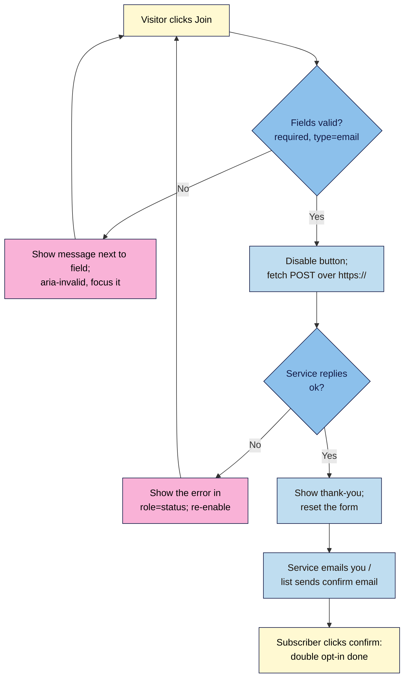

# M05.L04 — Forms That Work: Validation & Sending Data
> After this lesson your launch page's sign-up form really delivers: it checks entries kindly, sends them securely to a form service, shows a clear thank-you without reloading, keeps out most spam, and adds subscribers to an email list only after they confirm.

**Time:** ~22 min reading + ~45 min exercise · **Level:** L2 Practitioner · **Prereqs:** M02.L04, M05.L02 · **Remediate to:** M02.L04
**Verified against:** MDN "Client-side form validation", Constraint Validation API (`validationMessage`, `checkValidity()`), `FormData`, `fetch()`, `aria-describedby`/`aria-invalid`; Formspree plans page (Free: 50 submissions a month, 30-day archive; AJAX works by sending `Accept: application/json`) and help pages (honeypot field `_gotcha`); Netlify Forms docs; Brevo and Mailchimp help on double opt-in. Checked live on 2026-11-02: Chrome 156 messages "Please fill out this field." and "Please include an '@' in the email address. 'asha' is missing an '@'."; `FormData` drops a field with no `name`; `fetch()` to a non-existent Formspree form returns 404 with `{"errors":[{"code":"FORM_NOT_FOUND","message":"Form not found"}]}`; `http://formspree.io/…` answers a POST with a 301 redirect to `https://`.

> ⚠️ **Freshness flag:** free-plan limits and menu names for Formspree, Netlify, Brevo and Mailchimp change often. The steps name the screens as of November 2026; if one has moved, search the provider's help centre for "double opt-in" or "AJAX". Not legal advice: check the consent rules where your subscribers live (Lesson 2.4).

## Learning objectives
1. **Validate** inputs with built-in HTML first (`required`, `type="email"`, `pattern`), then add friendly JavaScript messages linked with `aria-describedby`, without blocking valid input. *(O1)*
2. **Send** form data to a form service (Formspree or Netlify Forms) over HTTPS with a plain `action` (works without JS) and then with `fetch()` for an inline success message; **handle** errors and double submissions. *(O2)*
3. **Deliver** leads to an email list (Brevo or Mailchimp) with double opt-in and a consent line, and **protect** the form from spam (honeypot field; the service's CAPTCHA option). *(O3)*

## Why it matters
Arjun's launch page collected 400 sign-ups in its first week. Or so the agency's dashboard said. The form's `action` had been left as a placeholder; the "Thanks!" message was pure JavaScript that appeared whatever happened. Not one email address arrived anywhere. A second client's form worked, but filled their list with 3,000 bot addresses in a month, and their email provider suspended the account for poor engagement. A form is the moment a visitor trusts you with their details. It has to really send, really confirm, and keep out the junk, and you need to test it end to end, not just look at it.

## Core concept
**Plain version:** a static site has no server of its own to receive form data, so you send it to a **form service** (Formspree, Netlify Forms) or straight to your **email tool** (Brevo, Mailchimp). Build in layers:
1. **HTML form** with a real `action` URL (`https://…`) and `method="post"`: works even if JavaScript fails.
2. **Built-in validation** (`required`, `type="email"`): the browser checks entries for free.
3. **JavaScript on top:** friendlier messages, sending with `fetch()` so the page doesn't reload, a status message, and no double submissions.
4. **Delivery:** the service emails you, and/or adds the person to a list **after they confirm** by clicking a link (double opt-in).

**Analogy:** your form is a post box. HTML is the box and the address on it; validation is the slot that only takes envelopes; JavaScript is the "Thank you, posted!" receipt; the form service is the postal service that actually carries it. A beautiful box with no postal service behind it just fills up and nobody ever reads the letters.

### Which service for which job
| Job | Easy free option (Nov 2026) | Notes |
|---|---|---|
| Contact / lead form emailed to you | **Formspree** Free: 50 submissions a month, unlimited forms, 30-day archive | Endpoint `https://formspree.io/f/<id>`; honeypot `_gotcha`; works on any host |
| Same, if you deploy with Netlify | **Netlify Forms**: add `data-netlify="true"` | Only on Netlify; submissions count against the plan (Lesson 4.3). Sending it with `fetch()` needs a different request (see Netlify's docs), so this lesson's script is written for Formspree |
| Newsletter sign-up | **Brevo** or **Mailchimp** free plans: their own embedded sign-up form | Turn on **double opt-in**; the tool sends the confirmation email |

### Validation: what HTML gives you
| Attribute | Example | Browser message (Chrome 156) |
|---|---|---|
| `required` | `<input name="email" required>` | "Please fill out this field." |
| `type="email"` | `<input type="email">` | "Please include an '@' in the email address. 'asha' is missing an '@'." |
| `pattern` + `title` | `pattern="[0-9]{6}" title="6-digit PIN code"` | "Please match the requested format." + your title |
| `maxlength`, `minlength` | `maxlength="200"` | Stops or flags the length |

Client-side checks help visitors; they're **not security**. Anyone can bypass them, so the service must check too (it does).

## How it works



**In words:** when the visitor clicks **Join**, the browser checks the fields. Invalid fields get a clear message next to them and focus moves there. Valid entries are sent over HTTPS with `fetch()` while the button is disabled. If the service replies with an error, show it and let them try again; if it's ok, thank them and reset the form. The service then emails you, or your email tool sends a confirmation email, and the person joins the list only after clicking it.

## Hands-on walkthrough

**Part A: connect the M02 form to Formspree, no JavaScript yet (10 min)**
1. Sign up at **https://formspree.io/** (free) → **+ Add New** → **New Form** → name it "Nila launch sign-up", email: your own. Copy the endpoint, e.g. `https://formspree.io/f/xyzabcd`.
2. Update your form from Lesson 2.4:
   ```html
   <form class="signup-form" action="https://formspree.io/f/xyzabcd" method="post" novalidate>
     <label for="email">Email address</label>
     <input id="email" name="email" type="email" autocomplete="email" required aria-describedby="email-error">
     <p id="email-error" class="field-error"></p>

     <label for="first-name">First name (optional)</label>
     <input id="first-name" name="first-name" type="text" autocomplete="given-name">

     <input type="text" name="_gotcha" tabindex="-1" autocomplete="off" class="visually-hidden" aria-hidden="true">

     <p class="consent">We'll email you once when boxes go on sale. Unsubscribe any time. <a href="privacy.html">Privacy</a></p>
     <button type="submit">Join the launch list</button>
     <p class="form-status" role="status"></p>
   </form>
   ```
   (`novalidate` turns off the browser's pop-up bubbles because Part B shows nicer messages; **remove it for this part** so the built-in checks work without JavaScript. `_gotcha` is Formspree's **honeypot**: a field people never see or fill, but bots often do; Formspree discards submissions where it's filled. Use your M03 `.visually-hidden` class or `display: none`.)
3. Push, open the **live** page, and submit your own email.
   **Expected:** the browser leaves your page for Formspree's thank-you page; Formspree emails you the submission (if you haven't verified your account email yet, Formspree asks you to do that first). With JavaScript **disabled** (Lesson 5.1), it still works. That's your safety net.
   > 🖼️ **Image prompt:** Desktop screenshot (1440×900) of a Formspree dashboard showing the "Nila launch sign-up" form with one submission listing an email address and a first name. Outline the submission row. Highlight the key element with a 3px #F9B2D7 outline; blur any personal details.
   > **Alt text:** Formspree dashboard with one test submission for the Nila launch sign-up form.

**Part B: friendly validation and sending with `fetch()` (20 min)**
1. Put `novalidate` back. In `main.js`:
   ```js
   const form = document.querySelector('.signup-form');
   const emailField = form.querySelector('#email');
   const emailError = form.querySelector('#email-error');
   const status = form.querySelector('.form-status');
   const submitButton = form.querySelector('[type="submit"]');

   form.addEventListener('submit', async (event) => {
     event.preventDefault();                   // we'll send it ourselves

     if (!emailField.checkValidity()) {        // uses the HTML rules
       emailError.textContent = emailField.validity.valueMissing
         ? 'Please enter your email address.'
         : 'That email address looks incomplete, e.g. name@example.com.';
       emailField.setAttribute('aria-invalid', 'true');
       emailField.focus();
       return;
     }
     emailError.textContent = '';
     emailField.removeAttribute('aria-invalid');

     submitButton.disabled = true;             // no double submissions
     status.textContent = 'Sending…';

     try {
       const response = await fetch(form.action, {
         method: 'POST',
         body: new FormData(form),
         headers: { Accept: 'application/json' },
       });
       if (response.ok) {
         status.textContent = "Thanks! You're on the list. Check your inbox.";
         form.reset();
       } else {
         const data = await response.json();
         status.textContent = data.errors
           ? data.errors.map((e) => e.message).join(', ')
           : 'Something went wrong. Please try again.';
       }
     } catch (error) {
       status.textContent = "Couldn't send. Please check your connection and try again.";
     } finally {
       submitButton.disabled = false;
     }
   });
   ```
2. **Test the messages:** submit empty, then `asha`, then a real address.
   **Expected:** "Please enter your email address." then "That email address looks incomplete…", each next to the field (screen readers hear it through `aria-describedby`, and focus returns to the field); then "Sending…" → "Thanks! You're on the list…", no page reload, and the submission in Formspree.
3. **Test the failure path:** change one letter of the endpoint ID, push, submit.
   **Expected (checked):** "Form not found": the real message from Formspree's 404 reply, not a fake "Thanks". Change it back.
4. **Test double clicks:** click **Join** several times quickly. **Expected:** one submission; the button is disabled while sending.
   > 🖼️ **Image prompt:** Phone-size screenshot (390×844) of the launch page sign-up form showing the email field with a red border and the message "That email address looks incomplete, e.g. name@example.com." directly below it. Outline the field and message. Highlight the key element with a 3px #F9B2D7 outline; blur any personal details.
   > **Alt text:** Sign-up form on a phone with an inline error message under the email field.
5. Commit `Send sign-up form with fetch and inline messages`.

**Part C: a real email list with double opt-in (12 min)**
For the newsletter itself, let your email tool own the list and the consent record.
1. **Brevo:** create a free account → **Contacts → Forms** → create a sign-up form → choose **Double confirmation** (double opt-in) and the confirmation email template → pick the list → copy the **HTML** embed code or the form's action URL. **Mailchimp:** open your audience's **Settings** and turn on double opt-in (Mailchimp's help also lists an account-wide **Opt-In Settings** page; double opt-in only applies to Mailchimp's own sign-up forms, which includes their embedded form) → **Signup forms → Embedded forms** → copy the code.
2. Either use their embedded form as your newsletter form, or keep your own HTML and point its `action` at the provider's form URL with matching field `name`s (copy them exactly from the embed code). Keep your consent line and privacy link.
3. **Test with an address you own:** sign up. **Expected:** the confirmation email arrives; you appear in the list only after clicking its link (status "pending" or "unconfirmed" until then).
4. Keep Formspree for "contact us" or lead forms that should come to your inbox; use the email tool for the list. One job each.

**Part D: break it and fix it (5 min)**
| Plant this | Symptom (checked 2026-11-02) | Find it | Fix |
|---|---|---|---|
| `action="http://formspree.io/f/…"` on your HTTPS page | Without JS, Chrome warns that the form isn't secure before sending, and the service answers the `http` POST with a 301 to `https` (checked), which browsers follow as a GET, so the data is lost. With the `fetch()` script, Chrome blocks the request as mixed content and the status shows "Couldn't send…" | Read the `action`; Network shows the 301, or the Console a "Mixed Content" error | Always `https://` (NN #7) |
| A typo in the endpoint ID | Without JS: Formspree's "Form not found" page; with your script: "Form not found" in the status | Network: the POST returns **404** | Copy the endpoint again |
| Remove `name="email"` from the input | Submission arrives **without** the email; no error anywhere | `[...new FormData(form).keys()]` in the Console doesn't list `email` (checked) | Every field you want must have a `name` |
| Delete the `if (response.ok)` check and always show "Thanks" | Visitors see thanks even when nothing was sent | Break the endpoint again: "Thanks" still appears | Only thank people after a real `ok` reply |

## When to use / when not to
- **Formspree / Netlify Forms:** contact, enquiry and lead forms that should reach an inbox. Watch the free limit (Formspree: 50 a month).
- **Your email tool's form:** newsletter lists. It records consent and confirmation for you, which you'll need under GDPR-style rules.
- **`fetch()` sending:** when an inline thank-you matters (pop-ups, one-page sites). Keep the plain `action` underneath so it works without JavaScript.
- **CAPTCHA** (Formspree, Brevo and Mailchimp offer one): only if the honeypot isn't enough; it adds friction and can be hard for some people.
- **Don't** collect more than you need (Lesson 2.4), **don't** pre-tick consent boxes, and **don't** add people to a marketing list from a contact form unless they asked.

## Use AI for this
**Example prompt:**
> "Here's my HTML sign-up form [paste], posting to a Formspree endpoint. Write plain JavaScript that: uses the built-in HTML validation (checkValidity) and writes friendly messages into the element linked by aria-describedby; sends with fetch and FormData with the header Accept: application/json; disables the button while sending; shows success only when response.ok; shows Formspree's error messages otherwise; and handles a network failure. No libraries. Explain each block."

**What AI does well here:** the fetch-and-status boilerplate, mapping validity states to friendly messages, and spotting a missing `name`.
**Where it gets it wrong:** showing "Thanks" without checking the response, sending JSON with the wrong headers, inventing a provider's API, forgetting `aria-describedby`/focus, using `innerHTML` for messages, or hard-coding API keys in front-end code (never do this: everything in `main.js` is public).
**How to check:** submit valid, invalid and broken-endpoint cases on the live site; confirm the submission really arrives; read the Network request (URL starts with `https://`, status 200); search the code for keys and `innerHTML`.

## Common mistakes
- **Placeholder or empty `action`,** so nothing is sent anywhere.
- **"Thanks" shown without checking the reply.**
- **Missing `name` attributes,** so fields silently vanish.
- **`http://` endpoints** on an HTTPS page.
- **Validation only in JavaScript,** so the form breaks or accepts anything when JS fails.
- **Error messages only in red,** not in text linked to the field.
- **No honeypot,** then a list full of bots.
- **Adding people to a newsletter without double opt-in** or a clear consent line.
- **API keys in front-end JavaScript.**

## Troubleshooting
| Symptom | Likely cause | Fix |
|---|---|---|
| Nothing arrives at Formspree | Wrong endpoint, form not confirmed yet, or limit reached | Check the dashboard; confirm the form; check the plan's monthly count |
| "Form not found" | Endpoint ID typo | Copy it again from the dashboard |
| Field missing from the submission | No `name` on that input | Add `name="…"`; check with `FormData` in the Console |
| Page reloads instead of showing the inline message | Script not loaded, or listener on the button's `click` instead of the form's `submit` | Check the Console; listen for `submit` on the form; `event.preventDefault()` |
| Two submissions per click | Button not disabled while sending | `submitButton.disabled = true` until the reply |
| Confirmation email never arrives | In spam, double opt-in off, or a typo in the address | Check spam; check the list's settings; test with another address |
| Lots of junk sign-ups | No honeypot or spam protection | Add `_gotcha` (Formspree) or the tool's honeypot/CAPTCHA |

## Exercise
**Task:** make **your** launch page's form really deliver.
1. The form posts to a real `https://` endpoint (Formspree, Netlify Forms, or your email tool) and works with JavaScript off.
2. JavaScript validation with friendly messages linked by `aria-describedby`, focus moving to the first error, and `aria-invalid`.
3. Sending with `fetch()`: a status message in `role="status"`, success only on `response.ok`, the service's error shown otherwise, and no double submissions.
4. A honeypot field, a consent line with a privacy link, and (for the newsletter) double opt-in tested with your own address.
5. A test log: empty, invalid, valid, broken-endpoint and JavaScript-off submissions, with what happened and whether the data arrived.
6. Committed, pushed and tested live.

**Expected outcome:** a form that a real visitor can complete with mouse, keyboard or screen reader, whose data verifiably arrives, with consent recorded and bots mostly kept out.
**Stretch goal:** add a second field with `pattern` (e.g. a 6-digit PIN or postcode) and a friendly message for `validity.patternMismatch`.

## Key takeaways
- **Layers:** a real HTML `action` over HTTPS first, built-in validation second, JavaScript polish third.
- **Every field needs a `name`;** test what actually arrives.
- **Only say "Thanks" after an `ok` reply;** show real errors otherwise; disable the button while sending.
- **Honeypot against bots; double opt-in and a consent line for lists.**
- Nothing secret in front-end code: `main.js` is public.

## Teach it back
Explain to a friend in 3 sentences why a form can look perfect and still lose every lead, and the three tests that prove it really works.

## Glossary terms added
- Form service (Formspree, Netlify Forms) — added to `webdev-101/glossary.md`
- Form endpoint — added to `webdev-101/glossary.md`
- Constraint validation (`checkValidity`, `validity`, `validationMessage`) — added to `webdev-101/glossary.md`
- `novalidate` — added to `webdev-101/glossary.md`
- `aria-invalid` — added to `webdev-101/glossary.md`
- `fetch()` — added to `webdev-101/glossary.md`
- `FormData` — added to `webdev-101/glossary.md`
- `event.preventDefault()` — added to `webdev-101/glossary.md`
- Honeypot field — added to `webdev-101/glossary.md`
- Double opt-in — added to `webdev-101/glossary.md`
- CAPTCHA — added to `webdev-101/glossary.md`

## Further reading
*All checked 2026-11-02.*
- MDN — Client-side form validation: https://developer.mozilla.org/en-US/docs/Learn_web_development/Extensions/Forms/Form_validation
- MDN — Constraint validation: https://developer.mozilla.org/en-US/docs/Web/HTML/Guides/Constraint_validation
- MDN — `FormData`: https://developer.mozilla.org/en-US/docs/Web/API/FormData
- MDN — Using the Fetch API: https://developer.mozilla.org/en-US/docs/Web/API/Fetch_API/Using_Fetch
- Formspree — Plans: https://formspree.io/plans
- Formspree Help — Honeypot spam filtering: https://help.formspree.io/hc/en-us/articles/360013580813-Honeypot-spam-filtering
- Formspree Help — Submit forms with JavaScript (AJAX): https://help.formspree.io/hc/en-us/articles/360013470814-Submit-forms-with-JavaScript-AJAX
- Netlify Docs — Forms setup: https://docs.netlify.com/manage/forms/setup/
- W3C WAI — Forms tutorial: user notifications: https://www.w3.org/WAI/tutorials/forms/notifications/

## Refresher card
*Used by remediation when a learner fails a quiz twice on a later lesson that points back here.*
Layers: `<form action="https://formspree.io/f/<id>" method="post">` (works without JS) → `required`, `type="email"`, `pattern` → JS: `submit` listener, `event.preventDefault()`, `field.checkValidity()`, message in the `aria-describedby` element + `aria-invalid` + focus, disable the button, `fetch(form.action, { method: 'POST', body: new FormData(form), headers: { Accept: 'application/json' } })`, thanks only if `response.ok`, show `errors` otherwise, `catch` for no connection. Every field needs `name`. Honeypot `_gotcha`. Newsletter: the email tool's form with double opt-in + consent line. Always `https://`; no secrets in `main.js`. Formspree Free: 50 submissions a month.
