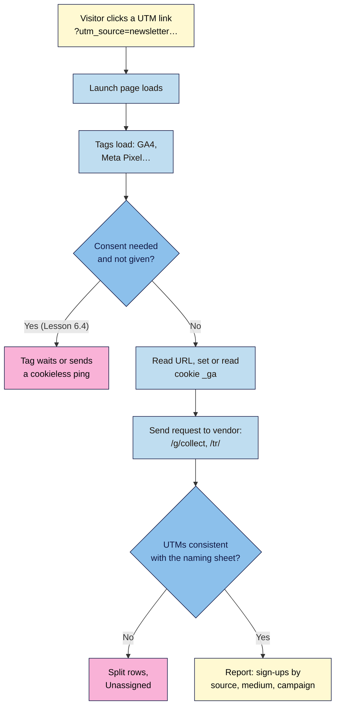

# M06.L01 — Tags, Pixels & UTMs
> After this lesson you can see exactly what a tracking tag sends and to whom, build campaign links that land in the right report every time, and list every tag on your launch page so you know what needs consent.

**Time:** ~22 min reading + ~35 min exercise · **Level:** L2 Practitioner · **Prereqs:** M05.L01 · **Remediate to:** M05.L01
**Verified against:** Google Analytics Help "Collect campaign data with custom URLs" (answer 10917952), "Default channel group" (answer 9756891), "Cookie usage on websites" (answer 11397207); Google's Campaign URL Builder; Meta Pixel base code; all read 2026-11-03. Live check the same day in headless Chrome 156: a page with the Google tag (test ID `G-TEST123456`) and a Meta Pixel (test ID) opened with `?utm_source=newsletter&utm_medium=email&utm_campaign=launch-2026`: GA4 sent `POST https://www.google-analytics.com/g/collect?v=2&tid=G-TEST123456&…&en=page_view&dl=…utm_campaign=launch-2026` (status 204) and set the cookies `_ga` and `_ga_TEST123456`; the Pixel sent `GET https://www.facebook.com/tr/?id=…&ev=PageView&dl=<the full page URL, UTMs included>` (status 200). A link with a second `?` (`?ref=bio?utm_source=instagram&…`) lost `utm_source` (it became part of `ref`).

> ⚠️ **Freshness flag:** request URLs, parameter names and cookie names belong to Google and Meta and change without notice; GA4's channel rules are updated from time to time. Re-check in DevTools and the help pages above before you rely on an exact value.
> Note: you add tracking to your own page from Lesson 6.2. Until the consent banner in Lesson 6.4, keep it to testing with your own visits.

## Learning objectives
1. **Explain** how a tag or pixel works (a script or image that sends a request with parameters, often setting cookies; first- vs third-party) and **observe** one firing in the Network panel. *(O1)*
2. **Build** consistent UTM links (`utm_source`, `utm_medium`, `utm_campaign`, optional `utm_content` and `utm_term`) from a naming convention, and **decide** where not to use them (internal links). *(O2)*
3. **Audit** the tags on a page (what each collects, who receives it, whether it sets cookies) as the input to the consent work in Lesson 6.4. *(O3)*

## Why it matters
Nila Coffee's founder posted the launch everywhere: newsletter, Instagram, WhatsApp, a small paid ad. A week later GA4 said most sign-ups came from "Direct" and "Unassigned", Instagram appeared three times (`Instagram`, `instagram`, `IG`), and the paid ad's clicks were mixed in with free posts. Nobody could answer the only question that mattered: *which channel brought sign-ups, and is the ad worth renewing?* At the same time, a customer asked what data the site sends to Facebook, and nobody knew. Tags decide what gets measured and what gets shared; UTMs decide whether the measurement is readable. Both are cheap to get right on day one and impossible to fix afterwards (old data stays split forever).

## Core concept
**Plain version:** a **tag** is a small piece of code from a tool (Google Analytics, Meta, LinkedIn, a heatmap tool) that, when the page loads or something happens, **sends a message** to that tool's server: "page X was viewed by browser Y, who arrived from Z." A **pixel** is the same idea; the name comes from the old trick of loading an invisible 1×1 image whose address carried the data. Most tags also store an ID in a **cookie** so the tool can recognise the same browser next time.

A **UTM link** is your normal URL plus labels that tell analytics where the visit came from: `?utm_source=newsletter&utm_medium=email&utm_campaign=launch-2026`. Nothing about the page changes; the tag reads the labels from the address and files the visit under that campaign.

**Analogy:** a tag is a postcard the page sends home ("someone's here, page 3, came via the newsletter"). The UTM is the return address written on the envelope the visitor arrived in. If everyone writes the return address differently ("Newsletter", "news-letter", "email blast"), the sorting office can't group the post.

### First-party vs third-party
| | First-party | Third-party |
|---|---|---|
| Who receives the data | You (your domain or a service acting only for you) | Another company (Google, Meta, an ad network) |
| Example on the launch page | Your form going to Formspree for you | GA4, Meta Pixel, an embedded chat widget |
| Cookies | Set on your domain (GA4's `_ga` is a first-party cookie, but the data still goes to Google) | Set on their domain (blocked or partitioned by default in Safari and Firefox) |
| Why it matters | You control it | It's another company's script on your page (Lesson 5.1) and usually needs consent in the EU/UK (Lesson 6.4) |

### The UTM parameters
| Parameter | Answers | Nila Coffee example | Rule |
|---|---|---|---|
| `utm_source` | **Who** sent them? | `newsletter`, `instagram`, `whatsapp`, `google` | Always; lowercase |
| `utm_medium` | **What kind** of channel? | `email`, `social`, `paid-social`, `cpc`, `referral` | Always; use values GA4's channel rules recognise |
| `utm_campaign` | **Which** campaign? | `launch-2026` | Always; one name per campaign |
| `utm_content` | Which link or creative? | `bio-link`, `story-1`, `header-button` | Optional: tells two links in the same email apart |
| `utm_term` | Which paid keyword? | `coffee-subscription` | Optional, mostly for search ads |
| `utm_id` | Campaign ID | `nila-0001` | Optional; Google recommends it if you import ad cost data |

Google: "Parameter values are case sensitive, e.g. `utm_source=google` is different from `utm_source=Google`," and recommends "lowercase as a standard practice". (GA4's *channel* grouping ignores case, but the Source, Medium and Campaign rows don't, so `Instagram` and `instagram` show as two rows.)

### How GA4 turns `utm_medium` into a channel (default channel group, simplified)
| If… | Channel |
|---|---|
| source or medium is `email` (or `e-mail`, `e_mail`) | Email |
| medium is `social`, `social-network`, `social-media`, `sm`, or the source is a known social site | Organic Social |
| source is a known social site **and** medium matches `cpc`, `ppc`, `paid…`, `retargeting` | Paid Social |
| medium is `referral`, `app` or `link` | Referral |
| medium is `affiliate` | Affiliates |
| nothing matches | **Unassigned** |

Invent your own medium (`utm_medium=newsletter`, `utm_medium=insta-post`, `utm_medium=print`) and, unless the source happens to match a rule, the visit lands in **Unassigned**.

## How it works



**In words:** a visitor clicks a UTM link and the page loads its tags. Where consent is required and hasn't been given, tags must wait (Lesson 6.4). Otherwise each tag reads the address and its cookie and sends a request to its vendor. In the reports, visits group neatly by source, medium and campaign only if every link followed the same naming sheet; otherwise they split into duplicate rows or fall into Unassigned.

## Hands-on walkthrough

**Part A: watch tags fire on a real site (10 min)**
1. Open a well-known brand's website in Chrome (any large retailer or news site) → DevTools (**F12**) → **Network** → tick **Preserve log** → reload.
2. In the filter box, type `collect`. **Expected:** one or more requests to `google-analytics.com/g/collect` (or a regional address such as `region1.google-analytics.com`), usually with status **204** (GA4 replies with no content). Click one → **Payload** (or **Headers → Query String Parameters**).
   **Read:** `tid` = the site's Measurement ID (`G-…`), `en` = event name (`page_view`), `dl` = the page address, `dt` = the page title, `cid` = the browser's random client ID (also stored in the `_ga` cookie).
   > 🖼️ **Image prompt:** Desktop screenshot (1440×900) of Chrome DevTools Network panel filtered by "collect", one GA4 request selected, Payload tab open showing `tid`, `en=page_view`, `dl` and `cid` lines. Outline the `en` and `dl` lines. Highlight the key element with a 3px #F9B2D7 outline; blur any personal details.
   > **Alt text:** Chrome Network panel showing a GA4 collect request with its event name and page address parameters.
3. Change the filter to `facebook.com/tr` (Meta Pixel), then `linkedin`, `tiktok`, `clarity`, `hotjar`. **Expected:** on many brand sites, several vendors; each request carries the page address (`dl` for Meta), so **anything in your URL, UTMs included, is shared with every vendor**. Never put emails, names or order numbers in URLs.
4. **Application** tab → **Cookies** → the site. Find `_ga` and `_ga_<ID>` (GA4) and `_fbp` (Meta). GA4's help page says these last 2 years by default; Chrome caps cookies at 400 days, and Safari at 7 days for some script-set cookies.
5. Optional: open the same site with an ad blocker on. Many tags vanish, which is one reason analytics numbers are always an undercount.

**Part B: a UTM naming sheet for the launch (15 min)**
1. Create a Google Sheet (or Excel) called `Nila launch UTMs` with columns: **Base URL · source · medium · campaign · content · Final URL · Where used · Date**.
2. Fill the rules row first (freeze it): *lowercase, hyphens not spaces, campaign `launch-2026`, medium only from: `email`, `social`, `paid-social`, `cpc`, `referral`, `qr`*.
3. Add the rows:
   | source | medium | content | Where used |
   |---|---|---|---|
   | `newsletter` | `email` | `header-button` | Launch email, top button |
   | `newsletter` | `email` | `footer-link` | Launch email, footer |
   | `instagram` | `social` | `bio-link` | Instagram bio |
   | `whatsapp` | `social` | `broadcast` | WhatsApp broadcast |
   | `instagram` | `paid-social` | `ad-a` | Paid Instagram ad, creative A |
4. Final URL formula (row 2, Google Sheets):
   ```
   =A2&"?utm_source="&LOWER(B2)&"&utm_medium="&LOWER(C2)&"&utm_campaign="&LOWER(D2)&IF(E2="","","&utm_content="&LOWER(E2))
   ```
   **Expected:** `https://nilacoffee.in/?utm_source=newsletter&utm_medium=email&utm_campaign=launch-2026&utm_content=header-button`. Cross-check one row with Google's **Campaign URL Builder** (https://ga-dev-tools.web.app/ga4/campaign-url-builder/): same result.
   (If your base URL already has a `?`, the first UTM must start with `&`; Part D shows what happens otherwise.)
5. Check the channels against the table above: `newsletter`/`email` → Email; `instagram`/`social` → Organic Social; `instagram`/`paid-social` → Paid Social (matches `paid…`); `whatsapp`/`social` → Organic Social. A QR code on a flyer with `utm_medium=qr` will show as **Unassigned** in the default channels; that's acceptable as long as the Source/Medium row (`flyer / qr`) is consistent, and you can add a custom channel group later.
6. Rule for **internal links:** never add UTMs to links from one page of your site to another (e.g. a "Join" button pointing to `/?utm_source=homepage#signup`). The visitor already has a real source. Your label adds a made-up campaign (`homepage / button`) to the reports, and GA4 attributes a visitor's later direct visits to the last campaign it saw for them (Google's "Scopes of traffic-source dimensions" page), so those visits and their sign-ups can be credited to your own button instead of Instagram or the newsletter. Google's help pages don't spell out every case, so the safe rule is simply: no UTMs inside your own site. To measure clicks on your own buttons, use a GA4 event (Lesson 6.2).
   > 🖼️ **Image prompt:** Desktop screenshot (1280×800) of a Google Sheet named "Nila launch UTMs" with the rules row frozen at the top and five rows of source, medium, campaign, content and a generated Final URL column. Outline the Final URL column. Highlight the key element with a 3px #F9B2D7 outline; blur any personal details.
   > **Alt text:** A UTM naming sheet with consistent lowercase values and generated campaign URLs.

**Part C: inventory the tags on your own page (5 min)**
Make a table in your project note (it becomes the consent table in Lesson 6.4):

| Tag / script | Vendor | What it sends | Cookies | Purpose | Needs consent? (Lesson 6.4) |
|---|---|---|---|---|---|
| `js/main.js` | You | Nothing (runs in the browser) | None (`sessionStorage` for the pop-up) | Function | — |
| Form → Formspree | Formspree | Form fields on submit | None | Function (the visitor asked) | — |
| GA4 (from Lesson 6.2) | Google | Page address, title, client ID, events | `_ga`, `_ga_<ID>` | Analytics | ? |
| Any widget, font or embed | … | … | … | … | ? |

Use Network (filter **3rd-party requests**, Lesson 5.1) and **Application → Cookies** on your live page to fill it honestly.

**Part D: break it and fix it (5 min)**
| Plant this | Symptom | Find it | Fix |
|---|---|---|---|
| Two links: `utm_source=Instagram` and `utm_source=instagram` | Two Instagram rows in Traffic acquisition (values are case sensitive, per Google's help page) | Sort the Session source column; look for near-duplicates | Lowercase everything (`LOWER()` in the sheet); fix the link at the source; old data stays split |
| `https://nilacoffee.in/?ref=bio?utm_source=instagram&utm_medium=social` (a second `?`) | The source is lost (checked: `utm_source` becomes part of the `ref` value) and the visit shows `(not set)` or the wrong source | Paste it into the Console: `new URL('…').searchParams.get('utm_source')` → `null` | Only the first separator is `?`; every other is `&` |
| `utm_medium=newsletter` with `utm_source=launch-mail` | Visits land in **Unassigned** instead of Email | Reports → Traffic acquisition → Session default channel group | Use `utm_medium=email` (a value the channel rules know) |
| A UTM on an internal "Join" button | A campaign you never posted anywhere (`homepage / button`) appears in Traffic acquisition and can take credit for visits and sign-ups | Look for sources and mediums that aren't in your naming sheet | Remove UTMs from internal links; measure button clicks with an event (Lesson 6.2) |

## When to use / when not to
- **UTMs:** on every link **you** place outside your site that you want to measure: emails, social bios and posts, ads (unless the ad platform auto-tags, such as Google Ads), QR codes, partner sites.
- **Not** on internal links, not on links others share organically (they'll strip or mangle them), and never with personal data in the values.
- **Tags:** add one only when it answers a question you'll act on. Each tag is weight (Lesson 5.1), a privacy obligation (Lesson 6.4) and another company's code on your page. "Install the Pixel just in case" is how pages end up with 15 trackers and a 3-second delay.
- **Trade-off:** more tags give richer data but slower pages, longer consent banners and more legal exposure. For a launch page, GA4 (plus one ad pixel only if you really run ads) is usually enough.

## Use AI for this
**Example prompt:**
> "Here's my UTM naming convention [paste the rules row] and a list of 8 places I'll post my launch link [paste]. Create a table with source, medium, campaign and content for each, using only my allowed medium values and lowercase with hyphens, and generate the final URLs for https://nilacoffee.in/. Flag any place where you think UTMs shouldn't be used, and tell me which GA4 default channel each row should land in."

**What AI does well here:** filling a consistent table fast, generating URLs, and spotting near-duplicates in an existing list of campaign values.
**Where it gets it wrong:** inventing mediums outside your list (`influencer`, `story`), mixing case, adding UTMs to internal links, double `?`, guessing GA4 channel rules from Universal Analytics days, and stating what a vendor's pixel collects without evidence.
**How to check:** compare every value with your rules row, paste two or three URLs into the Campaign URL Builder or the Console (`new URL(…).searchParams`), check channels against Google's default channel group page, and check any "this tag collects…" claim in the Network panel.

## Common mistakes
- **Mixed case and spellings** (`Email`, `email`, `e-mail-blast`) splitting one channel into many rows.
- **Invented mediums** that fall into Unassigned.
- **UTMs on internal links,** adding fake campaigns that can take credit from the real source.
- **A second `?`** in the URL.
- **Personal data in URLs** (emails, names), which every tag on the page then receives.
- **Installing tags "just in case"** without knowing what they send.
- **Expecting analytics to count everyone:** ad blockers, privacy browsers and declined consent all reduce the numbers.

## Troubleshooting
| Symptom | Likely cause | Fix |
|---|---|---|
| No `collect` request in Network | Ad blocker, tag not installed, or consent not given | Test in a clean profile; check the page source; Lesson 6.4 |
| Campaign shows `(not set)` | Missing `utm_campaign`, or lost behind a second `?` | Check the link with `searchParams` |
| Visits in Unassigned | `utm_medium` value not in GA4's rules | Use `email`, `social`, `cpc`, `referral`, `affiliate`… or accept Unassigned for offline mediums |
| Same source appears twice | Case or spelling difference | Lowercase, one spelling, fix at the source |
| Social visits show source `l.instagram.com` or `lm.facebook.com` with no campaign | Link posted without UTMs (GA4 still calls it Organic Social, but you can't tell the bio link from a post or an ad) | Add UTMs to every link you post |
| UTMs ignored (`(not set)` or `(direct)`) though the link has them | A `#` before the `?`: everything after `#` stays in the browser and isn't read as parameters | Put `?utm_…` before any `#section`: `/?utm_source=x#signup` |

## Exercise
**Task:** prepare **your** launch page for measurement.
1. A UTM naming sheet with a frozen rules row and at least **five** real links (at least three channels: email, organic social and one more), generated by formula, with one row cross-checked in the Campaign URL Builder.
2. A note on each row of which GA4 default channel it should land in.
3. A tag inventory of your live page (scripts, vendors, what they send, cookies, purpose), filled from Network and Application, not from memory.
4. Screenshots: one tag request on a brand site with `en` and `dl` visible, and your sheet (personal details blurred).
5. Commit the sheet export (CSV) to your repo's `docs/` folder with the message `Add UTM naming sheet and tag inventory`. Your repo and site are public (Lesson 4.3), so keep nothing private in it (no ad budgets or personal details), or keep the sheet outside the repo and commit only the naming rules.

**Expected outcome:** every campaign link you'll post in Lesson 6.2's tests and the capstone comes from one sheet, and you can say what every tag on your page sends and to whom.
**Stretch goal:** on a brand site, compare the number of tracking vendors with and without an ad blocker, and note which ones remain.

## Key takeaways
- **A tag sends a request** (page, event, client ID) to a vendor and usually sets a cookie; see it in Network → `collect`.
- **Everything in the URL is shared** with every tag on the page: no personal data in URLs.
- **UTMs:** always `utm_source`, `utm_medium`, `utm_campaign`; lowercase; one naming sheet.
- **Use mediums GA4 recognises,** or expect Unassigned; never UTMs on internal links.
- **Inventory every tag** before adding consent (Lesson 6.4).

## Teach it back
Explain to a friend in 3 sentences what happens when someone clicks your newsletter link and lands on your page, and why `Instagram` and `instagram` are a problem.

## Glossary terms added
- Tag (tracking tag) — added to `webdev-101/glossary.md`
- Pixel (tracking pixel) — added to `webdev-101/glossary.md`
- First-party vs third-party (data and cookies) — added to `webdev-101/glossary.md`
- UTM parameters — added to `webdev-101/glossary.md`
- Campaign URL Builder — added to `webdev-101/glossary.md`
- Default channel group — added to `webdev-101/glossary.md`
- Unassigned (channel) — added to `webdev-101/glossary.md`
- Measurement ID (`G-…`) — added to `webdev-101/glossary.md`
- Client ID (`cid`, `_ga` cookie) — added to `webdev-101/glossary.md`
- Tag inventory — added to `webdev-101/glossary.md`

## Further reading
*All checked 2026-11-03.*
- Google Analytics Help — Collect campaign data with custom URLs: https://support.google.com/analytics/answer/10917952
- Google Analytics Help — [GA4] Default channel group: https://support.google.com/analytics/answer/9756891
- Google Analytics Help — Scopes of traffic-source dimensions: https://support.google.com/analytics/answer/11080067
- Google Analytics Help — [GA4] Cookie usage on websites: https://support.google.com/analytics/answer/11397207
- Google — Campaign URL Builder: https://ga-dev-tools.web.app/ga4/campaign-url-builder/
- Meta for Developers — Meta Pixel: https://developers.facebook.com/docs/meta-pixel/
- Chrome for Developers — Network features reference: https://developer.chrome.com/docs/devtools/network/reference
- MDN — Third-party cookies: https://developer.mozilla.org/en-US/docs/Web/Privacy/Guides/Third-party_cookies

## Refresher card
*Used by remediation when a learner fails a quiz twice on a later lesson that points back here.*
Tag/pixel = code that sends a request to a vendor (GA4: `POST …google-analytics.com/g/collect` with `tid`, `en`, `dl`, `cid`; Meta: `facebook.com/tr/` with `id`, `ev`, `dl`) and usually sets cookies (`_ga`, `_ga_<ID>`, `_fbp`). Every tag sees the full URL: no personal data in URLs. UTMs: `?utm_source=newsletter&utm_medium=email&utm_campaign=launch-2026` (+ `utm_content`); values are case sensitive → lowercase, hyphens, one naming sheet; mediums GA4 knows (`email`, `social`, `cpc`, `referral`, `affiliate`, `paid…`) or Unassigned; one `?` then `&`; `?…` before `#`; never on internal links. Inventory every tag (vendor, data, cookies, purpose) before consent (Lesson 6.4).
