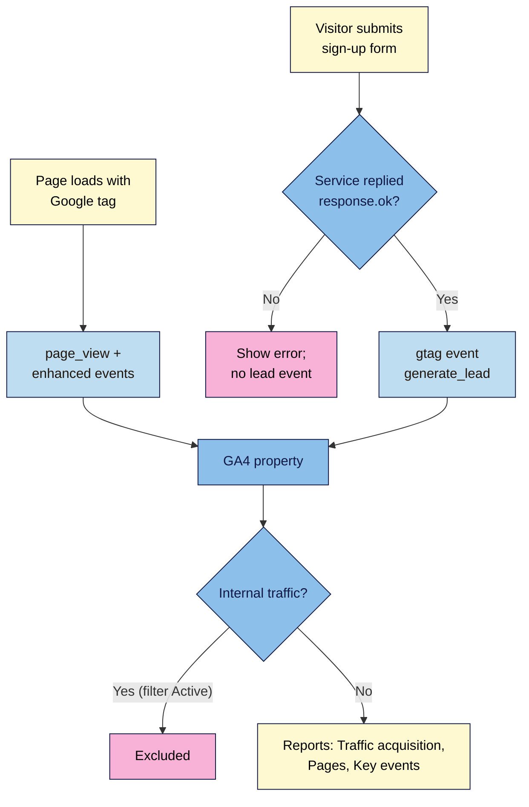

# M06.L02 — Google Analytics 4 & Key Events
> After this lesson your launch page is measured in Google Analytics 4: every page view, every real sign-up counted as a key event, your own visits filtered out, and a report that answers "which channel brought sign-ups?".

**Time:** ~22 min reading + ~45 min exercise · **Level:** L2 Practitioner · **Prereqs:** M06.L01 · **Remediate to:** M06.L01
**Verified against:** Google Analytics Help "Set up Analytics for a website and/or app" (9304153), "Enhanced measurement events" (9216061), "Key event" glossary (9355848), "About key events" (9267568), "Traffic acquisition report" (12923437), "Mark events as key events" (13128484), "Create or modify key events" (12844695), "DebugView" (7201382), "Filter out internal traffic" (10104470), "Data retention" (7667196), "Data freshness" (11198161); Google Tag Platform "Install the Google tag" and "Configure the Google tag"; GA4 events reference (`generate_lead`); all read 2026-11-03. Live check the same day in headless Chrome 156: with a made-up ID (`G-ZZTYPO9999`), `gtag/js` still loaded (200) and hits were still sent, with no error anywhere on the page; `gtag('event', 'generate_lead', { currency: 'INR', value: 0, lead_source: 'launch-list' })` sent `en=generate_lead`, `cu=INR`, `epn.value=0`, `ep.lead_source=launch-list`.

> ⚠️ **Freshness flag:** GA4's Admin menus are reorganised every year or so. Paths below are as of November 2026; if a name has moved, search the Admin page or the help article named in each step.
> Note: until you add the consent banner in Lesson 6.4, keep this to testing: your own visits, the internal-traffic filter in **Testing** state, and no campaign links sent to real visitors in the EU/UK. Lesson 6.4 turns the same tag into a consent-aware one.

## Learning objectives
1. **Set up** a GA4 property and web data stream, review Enhanced measurement, and **verify** data arriving in Realtime and DebugView. *(O1)*
2. **Define** key events: send `generate_lead` from the M05 form's success branch only (after `response.ok`), mark it as a key event, and **filter** internal traffic. *(O2)*
3. **Read** the core reports (Traffic acquisition by session source/medium and campaign, Pages and screens, Key events) and **answer** a business question ("which channel brought sign-ups?") from them. *(O3)*

## Why it matters
Two weeks after launch, Nila Coffee's GA4 dashboard showed 212 "conversions" and the founder was delighted, until the email list showed 61 subscribers. The agency had marked `form_submit` (an automatic event that fires whenever someone presses the button, even if the email is invalid or the request fails) as the conversion, and the team's own test sign-ups and daily visits were mixed in. Decisions about the ad budget were being made on numbers three times too high. Analytics is only useful if the thing you count is the thing you care about, counted once, at the right moment.

## Core concept
**Plain version:** GA4 records **events**. Every interaction is an event with a name and some details (parameters): `page_view` with the page address, `scroll`, `generate_lead` with a lead source. Some events GA4 collects automatically; others you send yourself. A **key event** is an event you tell GA4 matters to your business (Google's definition: "an event that measures an action that's particularly important to the success of your business"). Older GA4 tutorials (before 2024) call them *conversions*; Google Ads still uses "conversions" for its own measurement, and you can import a GA4 key event into Google Ads as one.

**Analogy:** GA4 is a shop's visitor log. Every footstep is written down (events). You put a gold star next to the entries that pay the rent: "signed up for the launch list" (key events). The reports then tell you which doors (channels) the gold-star visitors came in by.

### The pieces
| Piece | What it is | Nila Coffee example |
|---|---|---|
| Account → **property** | The container for one website's (or app's) data, with a time zone and currency | "Nila Coffee launch", India time, INR |
| **Web data stream** | The connection from one site to the property; has the **Measurement ID** | `nilacoffee.in`, `G-AB12CD34EF` |
| **Google tag (gtag.js)** | The snippet on every page that sends events | In `<head>` of every page |
| **Enhanced measurement** | Events GA4 collects with no code: `page_view`, `scroll`, outbound `click`, `view_search_results`, video events, `file_download`, `form_start`/`form_submit` | Switched on when you create a web stream; review the form events |
| **Your event** | An event you send with code | `generate_lead` after a successful sign-up |
| **Key event** | An event you've starred | `generate_lead` (not `form_submit`) |

### Why `generate_lead`, and why only after `response.ok`
- `generate_lead` is Google's documented event name for "a lead has been generated (for example, through a form)", with optional parameters `currency`, `value` and `lead_source`. Using Google's name means GA4 and Google Ads understand it without extra set-up.
- Enhanced measurement's `form_submit` fires "when the user submits a form", which with your Lesson 5.4 script can include submissions that the form service then rejects or that never arrive. Count leads where you *know* the lead exists: in the `if (response.ok)` branch, exactly where the real "Thanks" message is.

### How long until you see data
| Where | Delay (Google's data freshness page) |
|---|---|
| Realtime and DebugView | A few minutes (data collection can take up to 30 minutes to start after set-up) |
| Standard reports | Usually 12+ hours; "data processing can take 24–48 hours" |
| A newly starred key event | "Up to 24 hours" to show in standard reports |
| A data filter | "24–36 hours" to apply |

## How it works



**In words:** the Google tag on every page sends `page_view` and the enhanced-measurement events. When someone submits the form, your script sends `generate_lead` only if the form service replied OK; failures send nothing. GA4 receives both, drops your own visits once the internal-traffic filter is active, counts `generate_lead` as a key event, and shows it all in the reports, grouped by the source, medium and campaign from your UTM links.

## Hands-on walkthrough

**Part A: create the property and data stream (10 min)**
1. Go to https://analytics.google.com/ and sign in with the Google account the business will own (not a personal one you might lose; you can add others later under **Admin → Property access management**).
2. **Admin → Create → Property** (for a brand-new account, **Create → Account** first). Name: `Nila Coffee launch`; reporting time zone and currency: yours (India, INR). **Next** → answer the business questions → **Create**.
3. Under **Data collection and modification → Data streams → Add stream → Web**: website URL `https://nilacoffee.in` (yours), stream name `Launch site` → **Create stream**.
   **Expected:** the stream details page with a **Measurement ID** starting `G-`. Copy it.
   > 🖼️ **Image prompt:** Desktop screenshot (1440×900) of GA4 Admin, Web stream details for "Launch site" showing the stream URL, the Measurement ID beginning "G-", and the Enhanced measurement section switched on. Outline the Measurement ID. Highlight the key element with a 3px #F9B2D7 outline; blur any personal details.
   > **Alt text:** GA4 web stream details with the Measurement ID and enhanced measurement turned on.
4. On the same page, open **Enhanced measurement** (gear icon) and review the list. Leave page views, scrolls and outbound clicks on. **Form interactions** can stay on, but you will **not** star `form_submit` as a key event.
5. **Admin → Data collection and modification → Data retention** (older layouts: **Data settings → Data retention**): change event and user data retention from 2 months to **14 months** (the maximum for standard properties), so you can compare this launch with next year's in explorations and funnel reports. (Google: retention "does not affect standard aggregated reports", only explorations and funnels.) The change applies after 24 hours.

**Part B: install the Google tag (10 min)**
1. Paste Google's snippet **immediately after `<head>`** on **every page** (your launch page, privacy page, thank-you page), with your own ID:
   ```html
   <!-- Google tag (gtag.js) -->
   <script async src="https://www.googletagmanager.com/gtag/js?id=G-AB12CD34EF"></script>
   <script>
     window.dataLayer = window.dataLayer || [];
     function gtag(){dataLayer.push(arguments);}
     gtag('js', new Date());
     gtag('config', 'G-AB12CD34EF');
   </script>
   ```
   (`async` lets it download without blocking the page, Lesson 5.1. In Lesson 6.3 you'll replace this snippet with Google Tag Manager, so don't spend time customising it.)
2. Commit `Add GA4 Google tag`, push, and wait for the deploy (Lesson 4.3).
3. Open the **live** page with a UTM link from your Lesson 6.1 sheet (e.g. `…/?utm_source=newsletter&utm_medium=email&utm_campaign=launch-2026`).
   **Expected:** DevTools → Network → filter `collect` → a request with `tid=` **your** ID and `en=page_view` (status 204). In GA4, **Reports → Realtime**: "Users in last 30 minutes" ≥ 1, and your page, source `newsletter` and medium `email` appear in the cards (allow a few minutes; up to 30 the first time).

**Part C: send `generate_lead` and make it a key event (12 min)**
1. In `js/main.js`, inside the M05 form's success branch:
   ```js
   if (response.ok) {
     status.textContent = "Thanks! You're on the list. Check your inbox.";
     form.reset();
     if (typeof gtag === 'function') {
       gtag('event', 'generate_lead', { lead_source: 'launch-list' });
     }
   }
   ```
   (The `typeof` check means pages without the tag don't throw an error. Add `currency` and `value` only if you've agreed what a lead is worth; GA4 then reports a value per channel.)
2. Turn on debug mode for your own browser: open https://tagassistant.google.com/ → **Add domain** → your live URL → **Connect**. A new tab opens your page in debug mode. In GA4: **Admin → Data display → DebugView**.
3. In the debug tab, submit a real test sign-up with your own address, then a broken one (empty email).
   **Expected:** DebugView's timeline shows `page_view`, maybe `form_start`/`form_submit` for both attempts, and **one** `generate_lead` (only for the successful sign-up). Click it: parameter `lead_source = launch-list`. In Network you'll see `en=generate_lead&ep.lead_source=launch-list` (checked).
   > 🖼️ **Image prompt:** Desktop screenshot (1440×900) of GA4 DebugView timeline showing page_view, form_start, form_submit and one generate_lead event, with the generate_lead parameters panel open showing lead_source = launch-list. Outline the generate_lead event. Highlight the key element with a 3px #F9B2D7 outline; blur any personal details.
   > **Alt text:** GA4 DebugView timeline with a single generate_lead event and its lead_source parameter.
4. **Admin → Data display → Events:** once `generate_lead` appears in the list (can take up to a day), click its **star** to mark it as a key event. Don't want to wait? **Admin → Data display → Events → Create event**, name it `generate_lead` exactly, switch on **Mark as key event**, and save. (Google allows up to 30 key events per standard property.)
   **Expected:** `generate_lead` listed under **Key events**. Do **not** star `form_submit` or `page_view`.
5. Commit `Send generate_lead after confirmed sign-up`.

**Part D: filter out your own visits (5 min)**
1. **Admin → Data streams → Launch site → Configure tag settings → Show more → Define internal traffic → Create:** rule name `Nila team`, `traffic_type` value `internal`, IP address **equals** your public IP (search "what is my IP"; add your team's too).
2. **Admin → Data collection and modification → Data filters:** **Create filter → Internal Traffic**, choose **Exclude** and the state **Testing** (if a filter for `traffic_type = internal` is already listed, use that one). Leave it in **Testing** for now.
   **Expected:** in reports, add the comparison or dimension **Test data filter name** and your visits are labelled with it. Switch the filter to **Active** only when you've confirmed it matches only you: Google warns "the effect on the data is permanent".
   (Home and mobile IPs change; if yours does, update the rule. For a small launch, also simply keep test sign-ups to a few, with addresses you can recognise.)

**Part E: answer the business question (5 min)**
After at least a day of test visits from different UTM links (Lesson 6.1's sheet):
1. **Reports → Acquisition → Traffic acquisition.** Change the table's first column to **Session source / medium** (then try **Session campaign**). Use the menu on the **Key events** column (it starts as **All events**) to choose `generate_lead`.
   **Read:** which source/medium has the most `generate_lead` key events, and the **Session key event rate** (Google: "the percentage of sessions in which a user triggered a key event").
2. **Reports → Engagement → Pages and screens:** which pages are viewed, and for how long.
3. **Reports → Engagement → Events** → click `generate_lead`: its count over time and its parameters. (Report collections can be customised, so your menu may differ slightly.)
4. Write the answer in one sentence: *"In test data, `newsletter / email` brought 3 of 5 sign-ups at a 30% key event rate; Instagram brought visits but no sign-ups."* Real conclusions need real traffic; the capstone asks for this sentence again.

**Part F: break it and fix it (5 min)**
| Plant this | Symptom (checked where marked) | Find it | Fix |
|---|---|---|---|
| A typo in the Measurement ID (`G-AB12CD34FE`) | **No error anywhere:** the script loads and requests are sent (checked: 200 and 204 for a made-up ID), but Realtime stays at 0 | Network → `collect` → compare `tid` with the stream's ID | Copy the ID again from the stream page |
| `gtag('event', 'generate_lead', …)` on the button's `click` instead of in `if (response.ok)` | Empty and failed submissions count as leads; key events exceed real subscribers | DebugView: `generate_lead` appears for a failed submission | Move it into the success branch |
| The tag only on `index.html` | Visits to the privacy or thank-you page missing; a visitor who lands there shows no source | Pages and screens lists only one page; view source of each page | Snippet on every page (Lesson 6.3's GTM makes this one place) |
| `form_submit` starred as a key event | Key events far above real sign-ups | Compare key events with the email list | Unstar `form_submit`; star `generate_lead` |

## When to use / when not to
- **GA4:** free, the default for most marketing sites, connects to Google Ads and Search Console. Use it when you need channel and campaign reports and Google Ads integration.
- **Privacy-first alternatives** (Plausible, Fathom, Matomo, Cloudflare Web Analytics, Pirsch): simpler reports, often no cookies and lighter scripts; some are paid. Worth considering for a small site with mostly EU visitors, or if you don't run Google Ads. Check each one's consent position yourself (Lesson 6.4).
- **One key event per real goal.** A launch page usually needs one (`generate_lead`); maybe a second for a purchase later. Starring many events makes "conversion rate" meaningless.
- **Trade-off:** hard-coded gtag.js is fine for one page and one event; once you add more tags or events, managing them in GTM (Lesson 6.3) is safer than editing code each time.

## Use AI for this
**Example prompt:**
> "Here's my form script [paste the fetch block]. Add a GA4 `generate_lead` event using gtag that fires only when the form service replies OK (inside the response.ok branch), with lead_source 'launch-list', and safe if gtag isn't defined. Don't send any of the form's field values to GA4. Explain where in the code the event goes and why."

**What AI does well here:** placing the event in the right branch when asked, writing the `gtag` call, and explaining report names.
**Where it gets it wrong:** firing on `click` or `submit` (counting failures), sending the email or name as a parameter (personal data is against Google's policies), inventing event names instead of `generate_lead`, describing Universal Analytics menus ("Goals", "Views", "Bounce rate" as the main metric), and claiming instant data in standard reports.
**How to check:** submit a failed and a successful sign-up in DebugView (exactly one `generate_lead`), read the Network request to confirm no personal data in the parameters, and check menu names against the help pages above.

## Common mistakes
- **Starring `form_submit`** (or `page_view`) as a key event.
- **Sending the event before the reply** (on click or submit).
- **Personal data in event parameters** (email, name, phone): never.
- **Tag on one page only,** or two copies on the same page (double page views).
- **Not filtering your own visits,** or activating the filter before testing it.
- **Leaving data retention at 2 months.**
- **Judging results on day one:** standard reports lag by hours; small numbers swing wildly.

## Troubleshooting
| Symptom | Likely cause | Fix |
|---|---|---|
| Realtime shows 0 users | Wrong Measurement ID, ad blocker, tag missing on the live site, deploy not finished | Network → `collect` → check `tid`; test in a clean profile; hard-reload after the deploy |
| Nothing in DebugView | Debug mode not on, or consent blocking analytics | Connect via Tag Assistant; Lesson 6.4 for consent |
| `generate_lead` not in the Events list | It's been less than a day, or it never fired | Create the key event by name; check DebugView |
| Key events higher than subscribers | Event fired on click/submit, `form_submit` starred, or test sign-ups counted | Success branch only; unstar; internal filter |
| Every visit is "Direct" | Links posted without UTMs, or apps that strip referrers | Use the Lesson 6.1 sheet for every link |
| Page views doubled | Two Google tags on the page (theme + yours, or gtag + GTM) | View source; keep one (Lesson 6.3) |

## Exercise
**Task:** measure **your** launch page in GA4.
1. A property and web data stream, data retention set to 14 months, and enhanced measurement reviewed.
2. The Google tag on every page of the live site, verified in Network and Realtime with a UTM link from your sheet.
3. `generate_lead` sent only from the success branch, verified in DebugView (one event for a good sign-up, none for a failed one), and marked as a key event.
4. An internal-traffic rule with the filter in Testing state, and evidence (the Test data filter name dimension) that it matches your visits.
5. One sentence answering "which channel brought sign-ups?" from your test data, with a screenshot of Traffic acquisition.
6. Commits for the tag and the event, pushed and live.

**Expected outcome:** GA4 counts page views and real sign-ups once, by channel and campaign, without your own visits muddying the numbers.
**Stretch goal:** create a **Funnel exploration** (Explore → Funnel) with steps `page_view` → `form_start` → `generate_lead` and note where people drop off.

## Key takeaways
- **Events record everything; key events are the few that matter** (`generate_lead` for a launch list).
- **Send the lead event only after `response.ok`;** never star `form_submit`.
- **Verify in three places:** Network (`collect`, `tid`, `en`), Realtime, DebugView.
- **Filter internal traffic in Testing first;** set retention to 14 months.
- **No personal data in GA4,** and keep it to testing until consent is in place (Lesson 6.4).

## Teach it back
Explain to a friend in 3 sentences the difference between an event and a key event, and why the sign-up event belongs after the form service replies.

## Glossary terms added
- Google Analytics 4 (GA4) — added to `webdev-101/glossary.md`
- Property / web data stream — added to `webdev-101/glossary.md`
- Google tag (gtag.js) — added to `webdev-101/glossary.md`
- Event / event parameter (GA4) — added to `webdev-101/glossary.md`
- Enhanced measurement — added to `webdev-101/glossary.md`
- Key event — added to `webdev-101/glossary.md`
- `generate_lead` — added to `webdev-101/glossary.md`
- Realtime report — added to `webdev-101/glossary.md`
- DebugView — added to `webdev-101/glossary.md`
- Internal traffic filter — added to `webdev-101/glossary.md`
- Data retention — added to `webdev-101/glossary.md`
- Key event rate — added to `webdev-101/glossary.md`

## Further reading
*All checked 2026-11-03.*
- Google Analytics Help — Set up Analytics for a website and/or app: https://support.google.com/analytics/answer/9304153
- Google Analytics Help — [GA4] Enhanced measurement events: https://support.google.com/analytics/answer/9216061
- Google Analytics Help — [GA4] Key event (glossary): https://support.google.com/analytics/answer/9355848
- Google Analytics Help — [GA4] About key events: https://support.google.com/analytics/answer/9267568
- Google Analytics Help — [GA4] Traffic acquisition report: https://support.google.com/analytics/answer/12923437
- Google Analytics Help — [GA4] Mark events as key events: https://support.google.com/analytics/answer/13128484
- Google Analytics Help — [GA4] Monitor events in DebugView: https://support.google.com/analytics/answer/7201382
- Google Analytics Help — [GA4] Filter out internal traffic: https://support.google.com/analytics/answer/10104470
- Google Analytics Help — [GA4] Data retention: https://support.google.com/analytics/answer/7667196
- Google Analytics Help — [GA4] Data freshness: https://support.google.com/analytics/answer/11198161
- Google for Developers — Install the Google tag: https://developers.google.com/tag-platform/gtagjs/install
- Google for Developers — GA4 events reference (`generate_lead`): https://developers.google.com/analytics/devguides/collection/ga4/reference/events

## Refresher card
*Used by remediation when a learner fails a quiz twice on a later lesson that points back here.*
Account → property (time zone, currency) → web data stream (Measurement ID `G-…`). Google tag right after `<head>` on every page. Enhanced measurement: `page_view`, `scroll`, outbound `click`, `file_download`, `form_start`/`form_submit` (don't star these). Lead: `gtag('event', 'generate_lead', { lead_source: 'launch-list' })` inside `if (response.ok)`, no personal data. Star it: Admin → Data display → Events (or Key events → New key event). Verify: Network `collect` (`tid`, `en`), Realtime (minutes), DebugView (Tag Assistant). Internal traffic: data stream → Configure tag settings → Define internal traffic; Data filters → Testing first, Active is permanent. Retention 14 months. Reports: Acquisition → Traffic acquisition (Session source/medium, Key events column → choose `generate_lead`), Engagement → Pages and screens / Events; standard reports lag 12–48 h.
