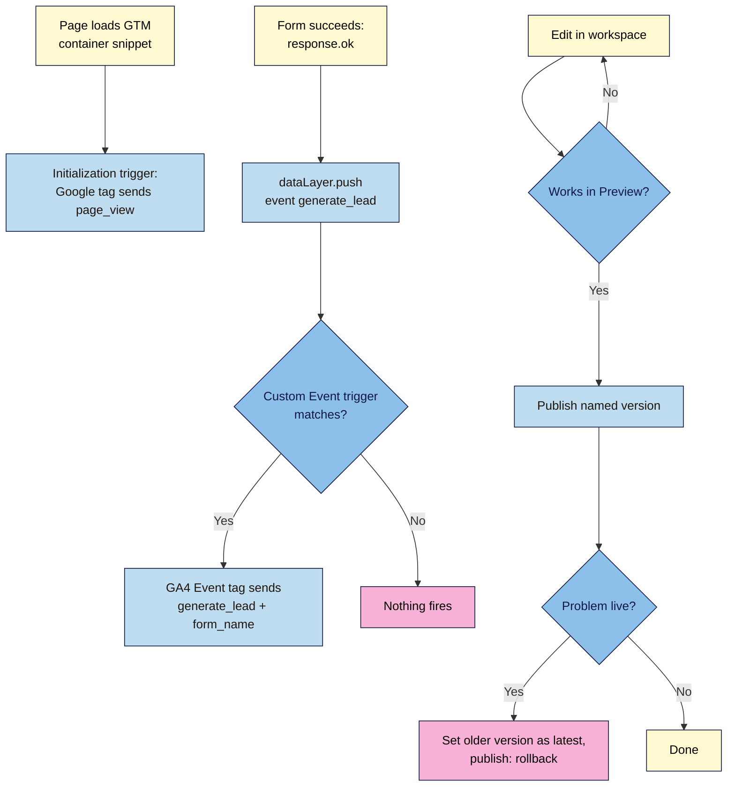

# M06.L03 — Google Tag Manager
> After this lesson your launch page's tracking lives in one place: Google Tag Manager loads GA4, your form tells it when a real sign-up happens, you test every change in Preview before it goes live, and you can undo a bad change in two clicks.

**Time:** ~22 min reading + ~45 min exercise · **Level:** L2 Practitioner · **Prereqs:** M06.L02 · **Remediate to:** M06.L02
**Verified against:** Google Tag Manager Help "Create an account and container" (14842164), "Install a web container" (14847097), "Set up Google Analytics in Tag Manager" (9442095), "Set up Google Analytics events in Tag Manager" (13034206), "Page view triggers" (7679319), "Custom event trigger" (7679219), "Form submission trigger" (7679217), "User-defined variable types for web" (7683362), "Preview and debug containers" (6107056), "Publishing, versions, and approvals" (6107163); Google Tag Platform "The data layer"; all read 2026-11-03. Live check the same day: `gtm.js?id=` with a made-up container ID returned **200** and an **empty container** (`"tags":[]`), so a mistyped ID fails silently.

> ⚠️ **Freshness flag:** GTM's tag templates and the Tag Assistant debug screen are redesigned from time to time; labels below are as of November 2026. Google's help pages describe the tag types and triggers but not every panel name, so if a button has moved, look for the same idea nearby.
> Note: as in Lesson 6.2, keep tracking to your own test visits until Lesson 6.4 adds the consent banner (which you'll also install through GTM).

## Learning objectives
1. **Explain** GTM's model (tags, triggers, variables, the `dataLayer`, workspaces and versions) and **install** the container snippet, replacing the hard-coded gtag.js from Lesson 6.2. *(O1)*
2. **Configure** the Google tag and a GA4 event tag for `generate_lead`, fired by a custom `dataLayer.push` event from the form's success branch, with a variable for the form name. *(O2)*
3. **Test** in Preview mode (Tag Assistant), **publish** a named version, and **roll back** a bad version. *(O3)*

## Why it matters
Six months after launch, Nila Coffee's page had GA4, a Meta Pixel, a LinkedIn tag, a heatmap script and two chat widgets, each pasted into the HTML by a different person. Every change meant a developer, a commit and a deploy; nobody knew which script fired on which page; and when a new ad pixel broke the sign-up form on a Friday evening, there was no quick way back. Google Tag Manager (GTM) puts all tags behind one snippet, with a test mode, a change history and an undo button. It also means the marketing team can add or fix a tag without touching the site's code, which is exactly why it needs discipline (Lesson 5.1's script audit still applies to everything you put in it).

## Core concept
**Plain version:** you install **one** GTM snippet on every page. Inside GTM (a web app), you decide which **tags** run (GA4, an ad pixel), **when** they run (**triggers**: every page, a click, a custom event from your code) and **what details** they send (**variables**). Your site talks to GTM through the **data layer**, a list your code adds messages to: `dataLayer.push({ event: 'generate_lead', form_name: 'launch-list' })`. Every change is drafted in a **workspace**, tested in **Preview**, and goes live only when you **publish** a **version**.

**Analogy:** GTM is a stage manager with a cue sheet. The site doesn't operate the lights itself; it just calls out what's happening ("the curtain is up", "someone signed up"). The cue sheet (triggers) says which crew (tags) acts on which call, and each night's cue sheet is saved (versions), so if tonight's show goes wrong, you bring back last night's.

### The pieces
| Piece | What it is | Nila Coffee example |
|---|---|---|
| Account → **container** | One container per site; ID starts `GTM-` | `Nila launch site`, `GTM-AB12CDE` |
| **Tag** | Code that runs | **Google tag** (loads GA4), **Google Analytics: GA4 Event** (`generate_lead`) |
| **Trigger** | When a tag fires | **Initialization – All Pages** (built in), **Custom Event** `generate_lead` |
| **Variable** | A value a tag or trigger reads | Data layer variable `form_name`; built-in **Page URL**, **Event** |
| **Data layer** | `window.dataLayer`, the message list between your site and GTM | `dataLayer.push({ event: 'generate_lead', form_name: 'launch-list' })` |
| **Workspace / version** | Draft changes; each publish saves a numbered, named version | "v2 – lead event via dataLayer" |

### Why a custom event, not GTM's "Form Submission" trigger
GTM's built-in **Form Submission** trigger listens for the browser's form submit. Your Lesson 5.4 form stops that with `event.preventDefault()` and sends with `fetch()`. Google's own help suggests a **Custom Event** trigger "when you want to track form submissions, but the default behavior for the form has been altered". Your code knows when a sign-up really succeeded (`response.ok`), so it pushes the event at exactly that moment.

## How it works



**In words:** when the page loads, the GTM snippet runs the Google tag on the Initialization trigger, which sends `page_view`. When the form succeeds, your script pushes `generate_lead` into the data layer; the Custom Event trigger matches it and the GA4 Event tag sends the event with the form name. Every change starts in a workspace, gets tested in Preview, and only then is published as a named version; if something breaks live, you make an older version the latest one and publish it.

## Hands-on walkthrough

**Part A: create the container (5 min)**
1. Go to https://tagmanager.google.com/ → **Create account**. Account name: the business (`Nila Coffee`); country; container name: your domain (`nilacoffee.in`); target platform **Web** → **Create**, accept the terms.
   **Expected:** the workspace opens and shows the **Install Google Tag Manager** box with two snippets and your container ID `GTM-…` (top bar).

**Part B: swap gtag.js for GTM (10 min)**
1. On **every page**, delete the Lesson 6.2 Google tag snippet (both `<script>` blocks). This matters: if you leave it **and** add GA4 in GTM, every page view is counted twice.
2. Paste GTM's first snippet "as high in the `<head>` as possible" and the second "immediately after the opening `<body>` tag" (Google's wording), with your ID:
   ```html
   <head>
     <!-- Google Tag Manager -->
     <script>(function(w,d,s,l,i){w[l]=w[l]||[];w[l].push({'gtm.start':
     new Date().getTime(),event:'gtm.js'});var f=d.getElementsByTagName(s)[0],
     j=d.createElement(s),dl=l!='dataLayer'?'&l='+l:'';j.async=true;j.src=
     'https://www.googletagmanager.com/gtm.js?id='+i+dl;f.parentNode.insertBefore(j,f);
     })(window,document,'script','dataLayer','GTM-AB12CDE');</script>
     <!-- End Google Tag Manager -->
     …
   </head>
   <body>
     <!-- Google Tag Manager (noscript) -->
     <noscript><iframe src="https://www.googletagmanager.com/ns.html?id=GTM-AB12CDE"
     height="0" width="0" style="display:none;visibility:hidden"></iframe></noscript>
     <!-- End Google Tag Manager (noscript) -->
   ```
   (Copy the snippets from **your** container's install box rather than this page, so the ID and any updates are right. The first snippet loads `gtm.js` asynchronously, Lesson 5.1; the `<noscript>` part only matters for visitors without JavaScript.)
3. In `js/main.js`, replace the Lesson 6.2 `gtag('event', …)` lines in the success branch with a data layer push:
   ```js
   if (response.ok) {
     status.textContent = "Thanks! You're on the list. Check your inbox.";
     form.reset();
     window.dataLayer = window.dataLayer || [];
     window.dataLayer.push({ event: 'generate_lead', form_name: 'launch-list' });
   }
   ```
   (`window.dataLayer = window.dataLayer || []` keeps the existing list if GTM created it and makes an empty one if not; never write `dataLayer = [...]` after GTM loads, which would wipe its list.)
4. Commit `Replace gtag.js with GTM container`, but **don't push until Part C is built**. A new container is empty until you publish it, so between pushing (Part D) and publishing (Part E) the live page sends nothing to GA4. That's fine while you're only testing; on a site with real traffic, keep the gap short.

**Part C: the Google tag, the event tag, a trigger and a variable (15 min)**
In GTM's workspace:
1. **Tags → New → Tag Configuration → Google Analytics → Google tag** (or choose **Google Tag** directly). **Tag ID:** your `G-…` Measurement ID from Lesson 6.2. **Triggering → Initialization – All Pages**. Name it `Google tag – GA4` → **Save**.
2. **Variables → User-Defined Variables → New → Variable Configuration → Data Layer Variable.** Data layer variable name: `form_name` (exactly as in your push); version 2. Name it `DLV – form_name` → **Save**.
3. **Triggers → New → Trigger Configuration → Custom Event.** Event name: `generate_lead` (exact, case sensitive). This trigger fires on **All Custom Events** with that name. Name it `CE – generate_lead` → **Save**.
4. **Tags → New → Google Analytics: GA4 Event.** Measurement ID: your `G-…`. Event Name: `generate_lead`. Event parameters: add `lead_source` with the value `{{DLV – form_name}}` (click the brick icon to pick the variable). **Triggering:** `CE – generate_lead`. Name it `GA4 event – generate_lead` → **Save**.
   > 🖼️ **Image prompt:** Desktop screenshot (1440×900) of the GTM tag editor for "GA4 event – generate_lead": tag type Google Analytics: GA4 Event, Measurement ID field, Event Name "generate_lead", an event parameter row "lead_source" = {{DLV – form_name}}, and the trigger "CE – generate_lead" below. Outline the event parameter row and the trigger. Highlight the key element with a 3px #F9B2D7 outline; blur any personal details.
   > **Alt text:** GTM GA4 Event tag sending generate_lead with lead_source from a data layer variable, fired by a custom event trigger.

**Part D: test in Preview (8 min)**
1. Push your code (Part B) so the live page has the GTM snippet and the new push; wait for the deploy.
2. In GTM click **Preview** (top right) → enter your live URL → **Connect**. Your site opens in a new tab in debug mode; Tag Assistant opens in another.
   **Expected (Tag Assistant):** a list of events on the left (Consent Initialization, Initialization, Container Loaded, DOM Ready, Window Loaded). Click **Initialization**: `Google tag – GA4` under the tags that fired.
3. In the debug tab, submit a real test sign-up. **Expected:** a new `generate_lead` event appears in the list; click it: `GA4 event – generate_lead` **fired**; its **Data Layer** view shows `{ event: 'generate_lead', form_name: 'launch-list' }`; **Variables** show `DLV – form_name = launch-list`. Then submit an empty form: **no** new `generate_lead` event.
4. Cross-check in GA4 **DebugView** (Lesson 6.2): `page_view` once per page load and one `generate_lead` with `lead_source = launch-list`.
   > 🖼️ **Image prompt:** Desktop screenshot (1440×900) of Tag Assistant connected to the launch page, with the event "generate_lead" selected in the left list and the tag "GA4 event – generate_lead" shown as fired. Outline the event and the fired tag. Highlight the key element with a 3px #F9B2D7 outline; blur any personal details.
   > **Alt text:** Tag Assistant debug view showing the generate_lead event and the GA4 event tag that fired for it.

**Part E: publish, then roll back (7 min)**
1. **Submit** (top right) → **Publish and Create Version** → Version Name `v1 – GA4 via GTM + lead event`, Description: what changed and why → **Publish**.
   **Expected:** a version number and your name in **Versions**; your live page now sends GA4 data through GTM (check Network → `collect`: `tid` is your `G-…`, **one** `page_view` per load).
2. Practise an undo. Make a deliberately bad change: edit the GA4 event tag's Event Name to `generate_lead_test`, then **Submit → Publish** as `v2 – broken name (practice)`. In DebugView the event now arrives under the wrong name.
3. Roll back: **Versions** → the **Actions** menu (⋮) next to `v1` → **Set as Latest Version** (this replaces your draft with v1) → **Submit → Publish** as `v3 – rollback to v1`. (Or use **Publish To…** from v1's Actions menu.)
   **Expected:** `generate_lead` arrives with its correct name again; Versions shows the full history.
4. In your repo, delete nothing: your code didn't change for the rollback. That's the point of GTM: tag changes are versioned in GTM, code changes in Git (Lesson 4.2).

**Part F: break it and fix it (5 min)**
| Plant this | Symptom | Find it | Fix |
|---|---|---|---|
| Leave the Lesson 6.2 gtag.js snippet in **and** publish the GTM Google tag | Two `collect` requests with `en=page_view` per load; page views double in GA4 | Network → `collect`; View Source shows both `gtag/js` and `gtm.js` | One installation only: delete the gtag.js snippet |
| A typo in the container ID (`GTM-AB12CED`) | No error anywhere (checked: `gtm.js` for a made-up ID returns 200 with an empty container); no tags fire | Tag Assistant can't connect; Network → `gtm.js?id=` doesn't match your container | Copy the snippet again from **Admin → Install Google Tag Manager** |
| Trigger the GA4 event on **Click – All Elements** with Click Text "Join" | Every click on Join counts, including empty and failed submissions | Preview: the tag fires on an empty submit | Use the Custom Event trigger from the success-branch push |
| Test in Preview, never publish | Everything works in Preview; nothing changes for real visitors | Versions: the latest published version doesn't contain the tag; your workspace shows unpublished changes | **Submit → Publish** |

## When to use / when not to
- **GTM:** when you have (or will have) more than one tag, marketers who need to change tags without a deploy, or events you want to manage centrally. It's free.
- **Hard-coded gtag.js (Lesson 6.2):** fine for a single site with GA4 only and no plans for more tags; one less tool to learn and secure.
- **Not:** pasting large Custom HTML tags (old pixels, gtag.js code) into GTM; Google's data layer guide says to use GTM's built-in templates instead of Custom HTML for gtag.js-based code. Every Custom HTML tag is unreviewed code on your page.
- **Trade-off:** GTM makes adding tags easy, which is also its risk. Give **Publish** permission to as few people as possible (Admin → User Management) and keep Lesson 5.1's script audit and Lesson 6.1's tag inventory up to date.

## Use AI for this
**Example prompt:**
> "I use Google Tag Manager with a GA4 Google tag. My form script pushes `dataLayer.push({ event: 'generate_lead', form_name: 'launch-list' })` only after the form service replies OK. List, step by step, the GTM trigger, variable and tag I need so GA4 receives `generate_lead` with a `lead_source` parameter from `form_name`. Use GTM's built-in tag types only, no Custom HTML, and tell me how to test it in Preview."

**What AI does well here:** listing the trigger–variable–tag recipe, explaining the data layer, and suggesting naming conventions.
**Where it gets it wrong:** recommending the Form Submission trigger for a `fetch()` form, Custom HTML tags with pasted gtag.js, old Universal Analytics tag types ("Universal Analytics", "Tracking ID UA-…"), mismatched event names (`generateLead` vs `generate_lead`), and skipping Preview and publishing.
**How to check:** every name must match exactly between the push, the trigger and the tag; test in Preview (one `generate_lead` per real sign-up, none for failures); confirm in GA4 DebugView; check that only one GA4 installation exists.

## Common mistakes
- **Two GA4 installations** (gtag.js plus GTM, or a theme plugin plus GTM).
- **Pushing the code before publishing** the container, so tracking stops in between.
- **Name mismatches:** `form_name` vs `formName`, `generate_lead` vs `Generate_Lead`.
- **Overwriting the data layer** (`dataLayer = [...]`) instead of `push`.
- **Testing only in Preview,** never publishing; or publishing without testing.
- **Unnamed versions** ("Version 14"): you won't know which one to roll back to.
- **Custom HTML tags** for things GTM has templates for.

## Troubleshooting
| Symptom | Likely cause | Fix |
|---|---|---|
| Tag Assistant won't connect | Wrong container on the page, snippet missing, ad blocker, or deploy not finished | View source for `gtm.js?id=`; disable blockers; wait for the deploy |
| `generate_lead` event appears but the tag doesn't fire | Trigger event name doesn't match exactly | Compare the push and the trigger letter by letter |
| `lead_source` is `undefined` | Variable name doesn't match the push key | Data layer variable name must be `form_name` |
| Page views doubled | gtag.js still on the page, or two containers | Keep one installation |
| Changes work in Preview but not live | Not published, or published to a different environment | Submit → Publish; check Versions |
| Data stopped after a publish | A bad change in the new version | Versions → Set as Latest Version on the last good one → Publish |

## Exercise
**Task:** move **your** tracking into GTM.
1. A GTM container installed on every page (both snippets) and the old gtag.js removed.
2. The Google tag (Initialization – All Pages), a Data Layer Variable `form_name`, a Custom Event trigger `generate_lead`, and a GA4 Event tag sending `generate_lead` with `lead_source`.
3. Your form's success branch pushing `{ event: 'generate_lead', form_name: '…' }`.
4. Preview evidence: screenshots of the tag firing for a real sign-up and **not** for an empty one, plus GA4 DebugView.
5. Published version `v1` with a description, a practice bad version, and a rollback version, all visible in Versions.
6. A note in your project file: one page view per load confirmed in Network, and your updated tag inventory (Lesson 6.1).

**Expected outcome:** one GTM container controls GA4 on your page, sign-ups are counted only when they really happen, and you can undo a tag change without touching code.
**Stretch goal:** add a GA4 event for clicks on your "Copy code" button (Lesson 5.2) using a data layer push and a second custom event, and decide whether it deserves to be a key event (it probably doesn't).

## Key takeaways
- **One snippet, many tags:** tags (what), triggers (when), variables (details), the data layer (your site's messages).
- **Push a custom event from the success branch;** don't rely on the Form Submission trigger for a `fetch()` form.
- **Preview → publish a named version → roll back** with Set as Latest Version.
- **One GA4 installation only:** remove gtag.js when you move to GTM.
- **GTM makes adding tags easy,** so limit who can publish and keep the tag inventory current.

## Teach it back
Explain to a friend in 3 sentences what happens between a successful sign-up and the `generate_lead` event arriving in GA4, naming the data layer, the trigger and the tag.

## Glossary terms added
- Google Tag Manager (GTM) / container — added to `webdev-101/glossary.md`
- Trigger (GTM) — added to `webdev-101/glossary.md`
- Variable (GTM) / Data Layer Variable — added to `webdev-101/glossary.md`
- Data layer (`dataLayer.push`) — added to `webdev-101/glossary.md`
- Custom Event trigger — added to `webdev-101/glossary.md`
- Initialization – All Pages — added to `webdev-101/glossary.md`
- Preview mode / Tag Assistant — added to `webdev-101/glossary.md`
- Workspace / container version — added to `webdev-101/glossary.md`
- Rollback (Set as Latest Version) — added to `webdev-101/glossary.md`
- Custom HTML tag — added to `webdev-101/glossary.md`

## Further reading
*All checked 2026-11-03.*
- Tag Manager Help — Install a web container: https://support.google.com/tagmanager/answer/14847097
- Tag Manager Help — Set up Google Analytics in Tag Manager: https://support.google.com/tagmanager/answer/9442095
- Tag Manager Help — Set up Google Analytics events in Tag Manager: https://support.google.com/tagmanager/answer/13034206
- Tag Manager Help — Custom event trigger: https://support.google.com/tagmanager/answer/7679219
- Tag Manager Help — Page view triggers (incl. Initialization): https://support.google.com/tagmanager/answer/7679319
- Tag Manager Help — Form submission trigger: https://support.google.com/tagmanager/answer/7679217
- Tag Manager Help — User-defined variable types for web: https://support.google.com/tagmanager/answer/7683362
- Tag Manager Help — Preview and debug containers: https://support.google.com/tagmanager/answer/6107056
- Tag Manager Help — Publishing, versions, and approvals: https://support.google.com/tagmanager/answer/6107163
- Google for Developers — The data layer: https://developers.google.com/tag-platform/tag-manager/datalayer

## Refresher card
*Used by remediation when a learner fails a quiz twice on a later lesson that points back here.*
GTM: one container (`GTM-…`): head snippet as high in `<head>` as possible, `<noscript>` iframe right after `<body>`, every page; remove gtag.js (else double page views). Tags = what (Google tag with `G-…` on **Initialization – All Pages**; **Google Analytics: GA4 Event** `generate_lead`); triggers = when (**Custom Event** `generate_lead`); variables = details (**Data Layer Variable** `form_name`). Site → GTM: `window.dataLayer = window.dataLayer || []; dataLayer.push({ event: 'generate_lead', form_name: 'launch-list' })` in the `response.ok` branch (not the Form Submission trigger for a `fetch()` form). Names must match exactly. **Preview** (Tag Assistant) → **Submit → Publish** a named version → roll back with **Versions → Actions → Set as Latest Version → Publish**. A typo'd container ID loads an empty container silently. Limit publish rights; no Custom HTML for gtag.js.
