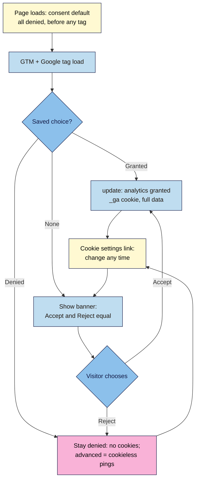

# M06.L04 — Privacy, Cookies & Consent Around the World
> After this lesson your launch page asks before it measures (where the law requires it), offers Accept and Reject as equals, remembers the choice, lets people change their mind, and you can prove in DevTools that no analytics cookie appears before someone says yes.

**Time:** ~25 min reading + ~50 min exercise · **Level:** L2 Practitioner · **Prereqs:** M06.L01, M06.L03, M02.L04 · **Remediate to:** M06.L01
**Verified against:** GDPR Art. 4(11) and 7(3) (gdpr-info.eu); EDPB "Report of the work undertaken by the Cookie Banner Taskforce" (published 18 January 2023); California Privacy Protection Agency FAQ and the Attorney General's CCPA page (updated 28 August 2026); Google "Set up consent mode on websites", "Consent mode overview", Analytics Help "About consent mode" (9976101), Tag Manager Help "Consent overview" (10718549) and "Updates to consent mode for traffic in the EEA" (13695607); Google EU user consent policy; all read 2026-11-03. India's DPDP Rules 2025, the UK's Data (Use and Access) Act 2025 and Brazil's ANPD cookie guide come from news and law-firm summaries; the DPDP s. 6(1) and LGPD Art. 5 XII wording was cross-checked against several law-firm reproductions (official sites blocked automated reading); check them before relying on them. Live check the same day in headless Chrome 156 with the banner code below and a test GA4 ID: before any choice and after **Reject**, GA4 sent cookieless pings (`gcs=G100`, a new random `cid` each load) and set **no** cookies; after **Accept**, `_ga` and `_ga_<ID>` appeared; with the consent default placed **after** GA4's config, `_ga` was set on the first load.

> ⚠️ **Not legal advice, and laws change.** This lesson gives the basics so you can build sensibly and ask good questions. If you collect data from many countries, sell to EU/UK customers at scale, or run ads, check with a privacy professional. Freshness flag: India's DPDP Rules and the UK's new cookie exceptions are being phased in during 2026–2027.

## Learning objectives
1. **Compare** the basics of GDPR + ePrivacy (EU/UK), CCPA/CPRA (California), DPDP Act 2023 and Rules 2025 (India) and LGPD (Brazil): opt-in vs opt-out, what counts as consent, rights to withdraw, with a "check a lawyer" boundary. *(O1)*
2. **Add** a consent banner with equal "Accept" and "Reject" choices, a way to change one's mind later, and keyboard and screen-reader access, and **update** the privacy page to list the tags from Lesson 6.1. *(O2)*
3. **Configure** Google Consent Mode v2 (default `denied` before any tag, `update` on choice; basic vs advanced) with your GTM set-up, and **verify** in DevTools that no analytics cookie is set before consent. *(O3)*

## Why it matters
Nila Coffee's launch page went live with GA4 and a Meta Pixel firing on every visit and a banner that said "We use cookies to improve your experience. [Got it]". A customer in Germany complained to her data protection authority; a journalist writing about small brands' privacy screenshotted the banner; and the founder discovered that "Got it" isn't consent in the EU, that California visitors needed a different kind of link, and that India's new rules would soon apply to her home market. The fix took an afternoon: one honest banner, Consent Mode, and a privacy page that lists what's actually on the site. Building it in from the start costs far less than retrofitting it after a complaint, and visitors notice when a brand treats their data with respect.

## Core concept
**Plain version:** different places use two basic models.
- **Opt-in (ask first):** no non-essential cookies or tracking until the person says yes. The EU and UK work this way for cookies on devices (the ePrivacy rules, applied with GDPR's definition of consent).
- **Opt-out (allowed until they say no):** you may collect, but you must tell people and let them stop it easily. California works this way for "selling" or "sharing" personal data.

Strictly necessary storage (keeping a cart, remembering the consent choice itself, security) doesn't need consent anywhere. Analytics and advertising usually do in the EU.

**Analogy:** opt-in is knocking before entering; opt-out is walking in but leaving the moment you're asked. A good banner is a door with two equally sized handles, "Come in" and "No thanks", and a doorbell people can ring later to change their answer.

### Four laws in one table
| | EU / UK (GDPR + ePrivacy / PECR) | California (CCPA as amended by CPRA) | India (DPDP Act 2023 + Rules 2025) | Brazil (LGPD) |
|---|---|---|---|---|
| Model for analytics/ad cookies | **Opt-in** consent before setting them | **Opt-out** of "sale" or "sharing" (incl. cross-context ads) | **Consent** (or a listed "legitimate use") for processing personal data, with notice; no cookie-specific rule, so treat identifying analytics/ad cookies as needing consent | Consent or another legal basis; the ANPD cookie guide (October 2022) sees consent as the best fit for non-essential cookies, allows legitimate interest for some analytics after a balancing test, and rarely for advertising |
| What consent means | "freely given, specific, informed and unambiguous… by a statement or by a clear affirmative action" (GDPR Art. 4(11)) | Not the main model; clear notice and an easy opt-out | "free, specific, informed, unconditional and unambiguous with a clear affirmative action" (DPDP Act s. 6(1)) | "free, informed and unambiguous" agreement for a specific purpose (LGPD Art. 5 XII) |
| Withdrawing | "As easy to withdraw as to give consent" (GDPR Art. 7(3)) | Must honour opt-out preference signals such as **Global Privacy Control** (CPPA) | Withdraw as easily as given; consent managers can help | Can be revoked at any time, free and easy |
| Website must-haves | Banner with Accept **and** Reject on the first layer; no pre-ticked boxes; a way to change later | "Do Not Sell or Share My Personal Information" or "Your Privacy Choices" link (if the law applies to you) | Clear notice in plain language; most duties (notice, consent) apply from about May 2027 | Privacy notice; consent for non-essential cookies |
| Who it applies to | Anyone targeting or monitoring people in the EU/UK | Businesses above revenue or data-volume thresholds | Processing personal data of people in India, or offering them goods/services | Processing data of people in Brazil |
| Notes (Nov 2026) | UK: the Data (Use and Access) Act 2025 (in force from 5 Feb 2026, per law-firm summaries) allows some statistics cookies with clear information and an easy opt-out instead of prior consent; conditions apply and ICO guidance is the reference | Many other US states have similar opt-out laws | Rules notified 13–14 November 2025 (sources differ); consent-manager provisions from about November 2026, most data-fiduciary duties about 18 months after notification; check the current status | ANPD "Cookies e Proteção de Dados Pessoais" guide (October 2022, per law-firm summaries) |

*The DPDP and LGPD wording comes from the Acts as published; the official sites blocked automated reading on 2026-11-03, so check the quotes against the official text before citing them.*

**The EDPB on banners:** in the EU cookie banner taskforce report, "a vast majority of authorities considered that the absence of refuse/reject/not consent options on any layer with a consent button… constitutes an infringement". Pre-ticked boxes "do not lead to valid consent", and deceptive button colours and contrast are called out too.

### Google Consent Mode v2 in one minute
Consent Mode lets Google tags **read the visitor's choice** and behave accordingly. Four signals matter for most sites:
| Signal | Controls |
|---|---|
| `analytics_storage` | Analytics cookies (`_ga`) |
| `ad_storage` | Advertising cookies |
| `ad_user_data` | Sending user data to Google for ads |
| `ad_personalization` | Personalised advertising (remarketing) |

You set a **default** (usually `denied`) **before any tag runs**, then send an **update** when the visitor chooses. Google: "The order of the code here is vital. If your consent code is called out of order, consent defaults won't work."
- **Basic consent mode:** Google tags don't load until the visitor agrees; if they decline, "no data is transferred to Google at all".
- **Advanced consent mode:** tags load straight away; while consent is denied they send **cookieless pings** (no cookies read or written; coarse data such as the consent state and a random number per page load), which Google uses for modelling.

Google requires consent signals for its ads and measurement features for visitors in the EEA, UK and Switzerland (its EU user consent policy). If you run Google Ads to Europe, use a CMP from Google's partner list; for a small site without ads, the hand-built banner below is a good way to learn and is enough for analytics only.

## How it works



**In words:** the first thing on the page sets every consent signal to denied. Then GTM and the Google tag load. If the visitor chose before, that choice is applied; if not, the banner appears with Accept and Reject as equals. Accept updates analytics to granted and the `_ga` cookie appears; Reject keeps everything denied (no cookies; in advanced mode Google still receives cookieless pings). A "Cookie settings" link lets the visitor reopen the banner and change their answer at any time.

## Hands-on walkthrough

**Part A: turn your tag inventory into a consent table (8 min)**
From Lesson 6.1's inventory, add two columns:
| Tag | Purpose | Cookies | EU/UK: needs consent? | Consent signal |
|---|---|---|---|---|
| `js/main.js` | Function | `sessionStorage` (pop-up) | No (strictly necessary for the feature) | — |
| Form → Formspree | Function, the visitor asked | None | No (they submitted it) | — |
| GA4 via GTM | Analytics | `_ga`, `_ga_<ID>` | **Yes** | `analytics_storage` |
| Meta Pixel (if any) | Advertising | `_fbp` | **Yes** | `ad_storage`, `ad_user_data`, `ad_personalization` |
| Consent choice | Remembering the answer | `localStorage: nila-consent` | No (needed to respect the choice) | — |

**Expected:** a short table, and probably the realisation that a launch page without ads needs only `analytics_storage`.

**Part B: the consent default, first in `<head>` (7 min)**
On **every page**, paste this **above** the GTM snippet from Lesson 6.3 (order matters):
```html
<script>
  window.dataLayer = window.dataLayer || [];
  function gtag(){dataLayer.push(arguments);}
  gtag('consent', 'default', {
    ad_storage: 'denied',
    ad_user_data: 'denied',
    ad_personalization: 'denied',
    analytics_storage: 'denied',
    wait_for_update: 500
  });
  if (localStorage.getItem('nila-consent') === 'granted') {
    gtag('consent', 'update', { analytics_storage: 'granted' });
  }
</script>
<!-- Google Tag Manager snippet from Lesson 6.3 comes next -->
```
(`wait_for_update: 500` gives the saved choice or a CMP half a second before tags send data. Use your own storage key name. Not targeting only the EU? Google's `region` option lets you set different defaults per country; denying everywhere is the simplest honest start.)

**Part C: an honest, accessible banner (15 min)**
1. Put the banner **near the start of `<body>`** (right after the GTM `<noscript>`), so keyboard and screen-reader users meet it early, and a **Cookie settings** button in your footer:
   ```html
   <section class="consent" aria-labelledby="consent-title" hidden>
     <h2 id="consent-title">Can we measure your visit?</h2>
     <p>With your OK, we use Google Analytics cookies to see which pages and links work.
        No ads, no selling your data. <a href="privacy.html#cookies">Privacy and cookies</a></p>
     <button type="button" data-consent="denied">Reject</button>
     <button type="button" data-consent="granted">Accept</button>
   </section>
   …
   <footer> … <button type="button" class="consent-open">Cookie settings</button> </footer>
   ```
2. In `js/main.js`:
   ```js
   const consentBanner = document.querySelector('.consent');

   if (!localStorage.getItem('nila-consent')) consentBanner.hidden = false;

   consentBanner.addEventListener('click', (event) => {
     const button = event.target.closest('[data-consent]');
     if (!button) return;
     const choice = button.dataset.consent;           // 'granted' or 'denied'
     localStorage.setItem('nila-consent', choice);
     gtag('consent', 'update', { analytics_storage: choice });
     consentBanner.hidden = true;
   });

   document.querySelector('.consent-open').addEventListener('click', () => {
     consentBanner.hidden = false;
     consentBanner.querySelector('button').focus();
   });
   ```
3. Style both buttons **the same** (same size, same colours or both outlined, your focus ring from M03). Don't make Accept bright and Reject a faint link: the EDPB report lists deceptive button colours and contrast as problems.
   > 🖼️ **Image prompt:** Phone-size screenshot (390×844) of the launch page with the consent banner at the bottom: heading "Can we measure your visit?", one sentence, a "Privacy and cookies" link, and two equally styled buttons "Reject" and "Accept", with a visible focus ring on Reject. Outline both buttons. Highlight the key element with a 3px #F9B2D7 outline; blur any personal details.
   > **Alt text:** A consent banner on a phone with equally styled Reject and Accept buttons and a privacy link.
4. Test with the keyboard: Tab reaches the banner's link and both buttons; Enter on either closes it; **Cookie settings** reopens it with focus on the first button (checked: focus lands on **Reject**). Screen reader: the heading and text are read in order.
5. Why not a `<dialog>` with `showModal()` (Lesson 5.3)? A modal blocks the page until people choose, which pressures them; a non-blocking banner lets them read first. If you do block, both choices must still be equally easy.

**Part D: make GA4 respect it in GTM, and choose basic or advanced (8 min)**
1. Your Google tag and GA4 event tag in GTM have **built-in consent checks**: they read `analytics_storage` automatically. With Part B's default, that gives you **advanced** consent mode: tags load and send cookieless pings while denied.
2. Want **basic** instead (no data at all to Google until Accept)? On each Google tag in GTM: **Advanced Settings → Consent Settings → Require additional consent for tag to fire → `analytics_storage`**. Google: the tag "will only fire if the status of all specified consent types are 'granted'".
3. Decide and write down your choice and reason in your project note. Many small EU-facing sites choose basic as the cautious option; advanced gives Google modelled data for visitors who decline. Discuss it with whoever is responsible for privacy.
4. Publish a GTM version: `v4 – consent settings`.
   (Google's consent guide recommends managing consent **inside** GTM with a consent template, a CMP's or a community one, on the **Consent Initialization – All Pages** trigger. The page-level `gtag('consent', …)` commands in Part B also reach GTM's Google tags through the shared data layer; Part E's checks are how you confirm they work on your page. If you move to a CMP template later, remove Part B's code so consent isn't set twice.)

**Part E: verify, don't trust (7 min)**
1. Open the live page in a **new private window** → DevTools → **Application → Cookies** (your domain): **Expected:** no `_ga` cookies. **Network → `collect`**: with advanced mode, requests with `gcs=G100` (analytics denied) and a different `cid` on each reload (checked); with basic mode, **no** `collect` requests.
2. Click **Reject**, reload: **Expected:** the banner stays hidden, still no `_ga` cookies (checked).
3. **Cookie settings → Accept**: **Expected:** `_ga` and `_ga_<ID>` appear (checked), and later `collect` requests carry a consistent `cid`.
4. In GTM **Preview** (Tag Assistant), select an event and look at its consent information: each signal's default and update state. In GA4 **DebugView**, events appear only once analytics is granted.
   > 🖼️ **Image prompt:** Desktop screenshot (1440×900) of Chrome DevTools Application tab, Cookies for the launch page in a private window before any choice (no _ga cookies), next to the Network panel showing a collect request with gcs=G100. Outline the empty cookie list and the gcs value. Highlight the key element with a 3px #F9B2D7 outline; blur any personal details.
   > **Alt text:** DevTools showing no analytics cookies and a GA4 request marked as consent denied before the visitor chooses.

**Part F: update the privacy page (5 min)**
Add a `#cookies` section to `privacy.html` (Lesson 2.4) with: what you measure and why (GA4, analytics only), the cookies and how long they last (`_ga`, `_ga_<ID>`: Google's default 2 years, limited by browsers), that the form data goes to Formspree and your email tool (and why), how long you keep it (GA4 retention: 14 months, Lesson 6.2), how to change consent (the **Cookie settings** button), and a contact for privacy questions. If California's law applies to you and you ever add ad pixels, add the "Your Privacy Choices" link and honour Global Privacy Control.

**Part G: break it and fix it (5 min)**
| Plant this | Symptom (checked in Chrome 156 where marked) | Find it | Fix |
|---|---|---|---|
| Consent default **after** the GTM/Google tag snippet | `_ga` cookies set on the very first load, before any choice (checked); hits carry no consent state | Private window → Application → Cookies on first load | Default code first in `<head>`, before any tag |
| Banner with "Accept" and "Settings", no "Reject" | Rejecting takes several clicks; the EDPB calls missing reject options an infringement | Look at the first layer | Reject as a first-layer button, styled like Accept |
| No way to reopen the banner | Visitors who clicked Accept can't withdraw (GDPR Art. 7(3)) | Look for Cookie settings in the footer | Add the button; test it reopens with focus |
| Saved choice never re-applied (`update` missing from `<head>`) | After Accept, every new page is treated as denied again: data loss and the banner reappears or tags misbehave | Accept, reload, check cookies and `collect` | Re-apply the saved choice right after the default |

## When to use / when not to
- **Hand-built banner + Consent Mode (this lesson):** a small site, analytics only, no ads, a few tags. You understand every line.
- **A consent management platform (CMP):** ads to the EU/UK (Google expects consent signals; its partner list is at cmppartnerprogram.withgoogle.com), many tags or vendors, IAB TCF, several languages, consent records and reports for audits. Most install as a GTM template on the **Consent Initialization – All Pages** trigger, which "will always fire before all other tags".
- **No banner at all:** only if you use nothing that needs consent (e.g. a cookieless analytics tool, checked against the rules where your visitors are). It's a legitimate design choice, and the lightest page of all.
- **Trade-off:** honest consent means less data (many visitors click Reject). Plan for it: Consent Mode's modelling (advanced), cookieless analytics, or simply accepting that your numbers are a sample.

## Use AI for this
**Example prompt:**
> "Review this cookie banner HTML, CSS and JavaScript [paste] against these rules: Accept and Reject on the first layer, equally prominent; no pre-ticked choices; Google Consent Mode v2 default 'denied' set before any Google tag; the saved choice re-applied on every page; a footer link to change consent; keyboard and screen-reader accessible. List every problem with the line it's on. Don't give legal conclusions; flag where I should check the law for my countries."

**What AI does well here:** spotting missing reject buttons, order problems in `<head>`, unequal styling, and missing `update` calls; drafting a plain-language cookie section for the privacy page.
**Where it gets it wrong:** confident legal statements ("you're GDPR compliant now"), outdated law (pre-2024 Consent Mode without `ad_user_data`/`ad_personalization`, DPDP before the 2025 Rules, UK before the 2025 Act), "implied consent by scrolling", dark-pattern wording, and code that loads tags before the default.
**How to check:** verify in a private window (cookies and `collect`), compare banner wording with the EDPB report's list of bad practices, and check any legal claim against the regulator's own guidance.

## Common mistakes
- **Tags before the consent default,** so cookies are set before anyone chooses.
- **"Got it" / "OK" banners** with no real choice.
- **Reject hidden** in a second layer, a tiny link or a low-contrast grey.
- **No way to change your mind** later.
- **Pre-ticked boxes** or "legitimate interest" toggles switched on for analytics or ads.
- **Not re-applying the saved choice** on each page.
- **A privacy page that doesn't match** the tags actually on the site.
- **Treating one country's rules as global:** the same visitor flow can be fine in California and unlawful in Germany.

## Troubleshooting
| Symptom | Likely cause | Fix |
|---|---|---|
| `_ga` cookie before any choice | Default after the tag, or a second GA4 install outside GTM | Put the default first; remove extra installs |
| No GA4 data even after Accept | `update` not sent, or basic mode requiring a signal that's never granted | Check `localStorage` and the `update` call; check the tag's consent settings |
| Banner reappears on every page | Choice not saved, or saved under a different key | Same `localStorage` key everywhere |
| Banner never appears | `hidden` never removed (script error), or a saved choice from testing | Console; `localStorage.clear()` |
| Keyboard can't reach the buttons | Banner placed at the very end of a long page, or built from `<div>`s | Near the start of `<body>`; real `<button>`s |
| Tag Assistant shows consent "denied" after Accept | Update used a different signal name (`analytics_store`) | Exact names: `analytics_storage` |

## Exercise
**Task:** make **your** launch page consent-aware.
1. A consent table built from your tag inventory.
2. The consent default first in `<head>` on every page, with the saved choice re-applied.
3. A banner with equal Accept and Reject, a privacy link, keyboard and screen-reader access, and a Cookie settings button that reopens it.
4. Your basic vs advanced decision written down with a reason, implemented in GTM, and published as a named version.
5. Evidence from a private window: no `_ga` before a choice and after Reject; `_ga` after Accept; the `collect` requests in each state.
6. An updated privacy page (`#cookies` section) that matches the tags on the site.
7. A short table for **your** audience: which of the four laws in this lesson might apply, and one question you'd ask a privacy adviser.

**Expected outcome:** nothing that needs consent runs before the visitor agrees; agreeing and refusing are equally easy; the visitor can change their mind; and your privacy page tells the truth.
**Stretch goal:** set a different default for visitors outside the EEA/UK with Consent Mode's `region` option, and explain in one paragraph why you would (or wouldn't) do that.

## Key takeaways
- **EU/UK: ask first; California: let people opt out; India and Brazil: consent with clear notice.** Not legal advice; check for your case.
- **Accept and Reject equal, on the first layer;** withdrawing as easy as giving.
- **Consent default `denied` before any tag,** then `update` on choice; re-apply it on every page.
- **Basic = no data until yes; advanced = cookieless pings while denied.** Choose and document it.
- **Verify in a private window:** cookies and `collect` before and after each choice.

## Teach it back
Explain to a friend in 3 sentences why "We use cookies. [Got it]" isn't enough for EU visitors, and what your banner and Consent Mode do differently.

## Glossary terms added
- Consent (GDPR) — added to `webdev-101/glossary.md`
- Opt-in vs opt-out — added to `webdev-101/glossary.md`
- ePrivacy rule (cookie consent) — added to `webdev-101/glossary.md`
- CCPA / CPRA — added to `webdev-101/glossary.md`
- Global Privacy Control (GPC) — added to `webdev-101/glossary.md`
- DPDP Act 2023 / DPDP Rules 2025 — added to `webdev-101/glossary.md`
- LGPD — added to `webdev-101/glossary.md`
- Consent banner — added to `webdev-101/glossary.md`
- Consent management platform (CMP) — added to `webdev-101/glossary.md`
- Google Consent Mode v2 — added to `webdev-101/glossary.md`
- Basic vs advanced consent mode — added to `webdev-101/glossary.md`
- Cookieless ping — added to `webdev-101/glossary.md`
- Consent Initialization trigger — added to `webdev-101/glossary.md`

## Further reading
*All checked 2026-11-03 unless marked.*
- GDPR Art. 4 (definitions, incl. consent): https://gdpr-info.eu/art-4-gdpr/
- GDPR Art. 7 (conditions for consent, withdrawal): https://gdpr-info.eu/art-7-gdpr/
- EDPB — Report of the work undertaken by the Cookie Banner Taskforce (January 2023): https://www.edpb.europa.eu/our-work-tools/our-documents/other/report-work-undertaken-cookie-banner-taskforce_en
- California Privacy Protection Agency — FAQ: https://cppa.ca.gov/faq.html
- California Attorney General — CCPA: https://oag.ca.gov/privacy/ccpa
- UK ICO — Guidance on the use of storage and access technologies (couldn't be read automatically on 2026-11-03; check it directly): https://ico.org.uk/for-organisations/direct-marketing-and-privacy-and-electronic-communications/guidance-on-the-use-of-storage-and-access-technologies/
- India MeitY — Digital Personal Data Protection Act and Rules (official site; dates in this lesson come from press coverage of the November 2025 notification): https://www.meity.gov.in/
- Brazil — LGPD (Lei 13.709/2018): https://www.planalto.gov.br/ccivil_03/_ato2015-2018/2018/lei/l13709.htm
- Google for Developers — Set up consent mode on websites: https://developers.google.com/tag-platform/security/guides/consent
- Google for Developers — Consent mode overview (basic vs advanced): https://developers.google.com/tag-platform/security/concepts/consent-mode
- Google Analytics Help — About consent mode: https://support.google.com/analytics/answer/9976101
- Tag Manager Help — Consent overview: https://support.google.com/tagmanager/answer/10718549
- Google — EU user consent policy: https://www.google.com/about/company/user-consent-policy/
- Google — CMP Partner Program: https://cmppartnerprogram.withgoogle.com/

## Refresher card
*Used by remediation when a learner fails a quiz twice on a later lesson that points back here.*
EU/UK: opt-in for non-essential cookies (GDPR consent = "freely given, specific, informed and unambiguous… clear affirmative action"; withdraw "as easy" as give; EDPB: no Reject on the first layer = infringement). UK 2025 Act: some statistics cookies with notice + opt-out (check ICO). California: opt-out of sale/sharing, "Do Not Sell or Share" / "Your Privacy Choices" link, honour GPC. India DPDP: consent "free, specific, informed, unconditional and unambiguous", Rules Nov 2025, phased to ~2027. Brazil LGPD: "free, informed and unambiguous". Build: `gtag('consent','default',{ad_storage, ad_user_data, ad_personalization, analytics_storage: 'denied'})` **first** in `<head>`, re-apply saved choice, then GTM; banner with equal Accept/Reject + privacy link; `gtag('consent','update',{analytics_storage: choice})`; Cookie settings to reopen. Basic = tags wait; advanced = cookieless pings (`gcs=G100`). Verify in a private window: no `_ga` before Accept. Not legal advice.
