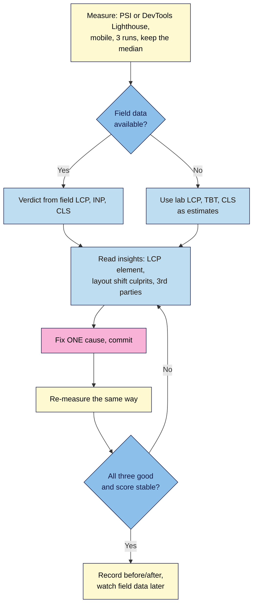

# M07.L01 — Performance & Core Web Vitals
> After this lesson you can read a Lighthouse or PageSpeed Insights report for your launch page, find what makes it slow or jumpy, fix the biggest causes, and prove the fix with a fair before/after measurement.

**Time:** ~20 min reading + ~45 min exercise · **Level:** L3 Advanced · **Prereqs:** M04.L03, M06.L03 · **Remediate to:** M03.L04
**Verified against:** web.dev "Web Vitals", "Largest Contentful Paint", "Interaction to Next Paint" and "Cumulative Layout Shift" (thresholds, 75th percentile); web.dev "Interaction to Next Paint becomes a Core Web Vital on March 12" (INP replaced FID on 12 March 2024); Google for Developers "About PageSpeed Insights" (field data from the Chrome UX Report, previous 28 days); Lighthouse 13.6.0 source code (performance score weights and insight names), all read 2026-11-03. Live check the same day with Lighthouse 13.6.0 (mobile, simulated throttling) against a local test page: **Render-blocking requests** listed a 280-byte, completely empty script that the server delayed by 1 second (about 780 ms of blocking: the wait for the file, not its size, is the problem), and **LCP breakdown** named the `<h1>`, not the hero image, as the LCP element. The test server was too heavily loaded for its timings (score, LCP, TBT) to mean anything, so this lesson quotes no measured before/after numbers.

> ⚠️ **Freshness flag:** the three Core Web Vitals and their thresholds have been stable since INP replaced FID in March 2024. Lighthouse renames and regroups its advice more often: Lighthouse 13 (October 2025) replaced many older audits ("Eliminate render-blocking resources", "Properly size images") with **insights** such as **Render-blocking requests** and **Improve image delivery**. If your report uses different names, match them by what they describe.

## Learning objectives
1. **Explain** LCP, INP and CLS (what each measures, the "good" thresholds at the 75th percentile) and the difference between lab data (Lighthouse) and field data (Chrome UX Report, shown in PageSpeed Insights and Search Console). *(O1)*
2. **Read** a Lighthouse and PageSpeed Insights report for the launch page (mobile): find the LCP element, layout-shift culprits and long tasks, and **rank** the fixes by impact. *(O2)*
3. **Fix** at least two causes (render-blocking scripts, missing image dimensions, content that pushes the page down, heavy third-party tags from M06) and **verify** each with a before/after Lighthouse run under the same conditions. *(O3)*

## Why it matters
Nila Coffee's launch page looked instant on the founder's laptop on office Wi-Fi. On a mid-range phone on mobile data, the hero photo took four seconds to appear, the "Join the launch list" button jumped down just as people tapped it (the consent banner from Lesson 6.4 had pushed everything below it), and the newsletter partner's readers bounced before the offer even loaded. Google's own research summary on web.dev is blunt: the Core Web Vitals reflect what real visitors feel, and Search Central says good page experience "aligns with what our core ranking systems seek to reward". You don't need a perfect score. You need the page to be fast, stable and responsive **for the people who actually visit**, and the habit of measuring before you change anything.

## Core concept
**Plain version:** three numbers describe how a page feels.
| Metric | Question it answers | Good | Needs improvement | Poor |
|---|---|---|---|---|
| **LCP** — Largest Contentful Paint | How long until the main content (usually the hero image or headline) appears? | **≤ 2.5 s** | 2.5–4 s | > 4 s |
| **INP** — Interaction to Next Paint | When someone taps, clicks or types, how long until the page visibly responds? (the slowest interactions across the visit) | **≤ 200 ms** | 200–500 ms | > 500 ms |
| **CLS** — Cumulative Layout Shift | How much does content jump around unexpectedly? (a score, not seconds) | **≤ 0.1** | 0.1–0.25 | > 0.25 |

A page **passes** when at least **75%** of real visits are "good" on each metric (web.dev). INP replaced the older First Input Delay (FID) on 12 March 2024; tutorials that still mention FID are out of date.

**Analogy:** a shop opening its doors. LCP is how long until you can see the shelves; INP is how long the shop assistant takes to look up when you ask a question; CLS is whether the shelves move while you reach for something.

### Field data vs lab data
| | **Field data** | **Lab data** |
|---|---|---|
| What | Real Chrome users' visits (Chrome UX Report, previous **28 days**) | One simulated visit by **Lighthouse** |
| Where you see it | Top of PageSpeed Insights ("Discover what your real users are experiencing"), Search Console's Core Web Vitals report | Lower in PageSpeed Insights ("Diagnose performance issues"), Chrome DevTools → **Lighthouse** |
| Good for | The verdict: is the page good for real people? | Finding causes and testing fixes today |
| Catch | New or low-traffic pages usually have **no field data** | Can't tap your page, so it shows **Total Blocking Time (TBT)** instead of INP; varies between runs |

New launch pages almost never have field data, so you'll work in the lab and treat its numbers as **estimates**. Lighthouse 13.6's **Performance score** (0–100) is a weighted mix of lab metrics: **TBT 30%, LCP 25%, CLS 25%, First Contentful Paint 10%, Speed Index 10%** (from its source code). That's why a long-running script can drag the score down even when the page looks fast.

### The usual causes on a small static page
| Symptom | Usual cause | Lighthouse 13 insight that points to it | Fix (this lesson) | Deeper fix |
|---|---|---|---|---|
| Slow LCP | A `<script>` or font file in `<head>` the browser must fetch before drawing anything | **Render-blocking requests** | `defer` on scripts; keep critical CSS small | — |
| Slow LCP | Hero image huge, discovered late or lazy-loaded | **LCP request discovery**, **LCP breakdown**, **Improve image delivery** | `fetchpriority="high"`, never `loading="lazy"` on the hero | Formats, sizes, `srcset` (Lesson 7.2) |
| High CLS | Images without `width`/`height`; a banner or embed inserted above content | **Layout shift culprits** | Add dimensions; reserve space or overlay the banner | Font fallbacks (Lesson 7.2) |
| High TBT / poor INP | Long JavaScript tasks: tag managers, chat widgets, embeds | **3rd parties**, **INP breakdown** (field), **Forced reflow** | Remove tags you don't use; load late; `defer` | — |

## How it works



**In words:** measure on mobile three times and keep the middle result. If PageSpeed Insights has field data, that's your verdict; if not, use the lab numbers as estimates. Read the insights to find the biggest cause, fix **one** thing, commit it, and measure again exactly the same way. Repeat until all three are good, then record the before/after and check the field data in a few weeks.

## Hands-on walkthrough

**Part A: a fair "before" measurement (10 min)**
1. Open your **live** launch page in a **Chrome Incognito window** (extensions can slow pages and skew results).
2. DevTools (F12) → **Lighthouse** tab → Mode **Navigation**, Device **Mobile**, Categories: **Performance** → **Analyze page load**.
   > 🖼️ **Image prompt:** Desktop screenshot (1440×900) of Chrome DevTools Lighthouse panel set to Navigation mode, Mobile device and Performance category, with the "Analyze page load" button. Outline the Mobile option and the button. Highlight the key element with a 3px #F9B2D7 outline; blur any personal details.
   > **Alt text:** Chrome DevTools Lighthouse panel set to test mobile performance, with the Analyze page load button.
3. Run it **three times** and write down the **median** (middle) run's Performance score, LCP, TBT and CLS. Lab results vary from run to run; one run proves nothing.
4. Also run **PageSpeed Insights** (pagespeed.web.dev) on the live URL. **Expected:** for a new page, "The Chrome User Experience Report does not have sufficient real-world speed data for this page" (or similar), and lab results below it. Note the field data if there is any.
5. Save the evidence: in DevTools, the **⋮** menu on the report → **Save as JSON** (or a screenshot), named `before-YYYY-MM-DD.json`. Keep the same device setting, network and page for every later run.

**Part B: read the report (10 min)**
1. Under **Diagnostics/Insights**, open **LCP breakdown**: it names the **LCP element** (often your hero `` or the `<h1>`) and splits the time into phases (time to first byte, load delay, load duration, render delay). A large **load delay** means the browser found the image late; a large **render delay** usually means something was blocking it.
2. Open **Render-blocking requests**: any `<script>` without `defer`/`async` in `<head>`, and large CSS or font files, are listed with estimated savings.
3. Open **Layout shift culprits**: it lists elements that moved and why (an image without dimensions, injected content, a web font).
4. Open **3rd parties**: your GTM container and GA4 from Module 6 appear here with their transfer size and main-thread time.
5. Rank the fixes in a small table: **cause → metric affected → estimated saving → effort**. Start with the biggest saving that's quick.

**Part C: fix the common causes, one at a time (20 min)**
Commit after each fix, and re-run Lighthouse (median of three) after each one so you know which change helped.
1. **Scripts: `defer` them.** In `<head>`:
   ```html
   <!-- before: blocks drawing until downloaded and run -->
   <script src="js/main.js"></script>
   <!-- after: downloads in parallel, runs after the HTML is parsed, in order -->
   <script src="js/main.js" defer></script>
   ```
   Keep the **consent default** and **GTM** snippets from Module 6 exactly as they are (they're small and must run first; GTM's snippet already loads `gtm.js` asynchronously).
2. **Images: give every `` its `width` and `height`** (the file's real pixel size, Lesson 2.2) and keep `max-width: 100%; height: auto` in CSS (Lesson 3.4). The browser reserves the right-shaped box before the file arrives, so nothing jumps.
3. **The hero image: tell the browser it matters.**
   ```html
   
   ```
   Never put `loading="lazy"` on it. (File size, formats and responsive sizes are Lesson 7.2.)
4. **The consent banner: don't push content.** A banner inserted into the normal flow at the top of `<body>` (as in Lesson 6.4) shifts everything below it the moment it appears. Make it overlay the page instead:
   ```css
   .consent { position: fixed; inset: auto 0 0 0; z-index: 10; }
   ```
   Then check that it doesn't cover the focused element when you Tab through the page (WCAG 2.4.11, Lesson 7.3) and that Accept/Reject still work.
5. **Third parties: keep only what you use.** If **3rd parties** shows tags you no longer need (an old pixel, a chat widget, a second analytics tool), remove them in GTM and publish a named version. Don't remove GTM, GA4 or the consent code to win points: measurement is a requirement (NN #10), and consent must still work (NN #9).

**Part D: prove it (5 min)**
1. Re-run Lighthouse three times with the **same settings** and save `after-YYYY-MM-DD.json`.
2. Fill in your before/after table:
   | | Score | LCP | TBT | CLS | Fix applied |
   |---|---|---|---|---|---|
   | Before (median of 3) | | | | | — |
   | After fix 1 | | | | | `defer` on main.js |
   | After fix 2 | | | | | dimensions + `fetchpriority` |
3. **Expected:** CLS drops close to 0 once images have dimensions and the banner overlays; LCP improves when nothing blocks rendering and the hero is fetched early. Your numbers depend on your page, host and connection; what matters is the direction of change across medians, not one run.
4. In a few weeks, check PageSpeed Insights' field data or Search Console → **Core Web Vitals** (once your page has enough traffic) for the real verdict.

**Part E: break it and fix it (5 min)**
| Plant this | Symptom | Find it with | Fix |
|---|---|---|---|
| Remove `width`/`height` from the hero `` | CLS rises **if the image arrives after the first paint** (usual on mobile; in our test the blocked page painted only after the image had arrived, so CLS stayed 0, which is why you test on mobile settings) | Layout shift culprits names the image | Put the real dimensions back |
| Move `<script src="js/main.js">` into `<head>` without `defer` | LCP and FCP get later; Render-blocking requests lists it (checked: even an empty script was listed, because the browser waits for the download) | Render-blocking requests | Add `defer` |
| Put `loading="lazy"` on the hero image | LCP gets later (the browser waits until layout to fetch it) | LCP request discovery flags lazy loading on the LCP image | Remove `lazy`; add `fetchpriority="high"` |

## When to use / when not to
- **Use Lighthouse in DevTools** for quick checks while you work (local or live) and for testing one fix at a time.
- **Use PageSpeed Insights** for the live URL: same Lighthouse lab test on Google's servers, plus field data when it exists.
- **Use Search Console's Core Web Vitals report** once the site has traffic: it groups real-user data by page type.
- **Use the DevTools Performance panel** when you need to see what a slow interaction actually does (it shows live LCP, CLS and INP for your own clicks).
- **Don't chase 100.** A score of 90+ with good field data is excellent. Removing analytics, consent or accessibility features to gain points makes the page worse for the business and for visitors.

## Use AI for this
**Example prompt:**
> "Here's my Lighthouse mobile result for a static landing page: score [x], LCP [x] s, TBT [x] ms, CLS [x]. LCP element: [paste]. Insights with savings: [paste names and numbers]. My `<head>`: [paste]. Rank the three fixes most likely to help, explain each in one sentence, and show the exact HTML/CSS change. Don't suggest removing analytics or the consent banner."

**What AI does well:** explaining insight names in plain language, spotting a missing `defer`, writing the CSS to overlay a banner.
**Where it gets it wrong:** advice for FID or old audit names, lazy-loading everything (including the hero), `async` on scripts that depend on order, adding preload hints for files that aren't critical, and promising a score.
**How to check:** apply one suggestion at a time and re-measure; if the median doesn't improve, undo it (git makes that easy).

## Common mistakes
- **Testing once, on desktop, on fast Wi-Fi,** and calling the page fast.
- **Comparing runs with different settings** (mobile vs desktop, extensions on vs off, local vs live).
- **Reading lab TBT as INP** or lab LCP as the field verdict.
- **Lazy-loading the hero image.**
- **Images without `width`/`height`,** or banners and embeds that push content down.
- **Changing five things at once,** so you don't know which one helped or hurt.
- **Score-chasing** by removing measurement, consent or accessibility features.

## Troubleshooting
| Symptom | Likely cause | Fix |
|---|---|---|
| Score jumps 15 points between runs | Normal lab variance, background tabs, extensions | Incognito, close other tabs, median of three |
| PSI says "no field data" | Too few real visits in the last 28 days | Use lab data; check again after launch traffic |
| LCP element is the `<h1>`, not the image | The text paints first and is the largest element at that moment | Fine; make sure fonts and blocking scripts don't delay it |
| CLS still above 0.1 after adding dimensions | Injected banner, embed or web font swap | Layout shift culprits; overlay the banner; Lesson 7.2 for fonts |
| TBT high, only GTM and GA4 on the page | Several tags in GTM, or a heavy Custom HTML tag | GTM Preview: list the tags firing on page load; remove unused ones |

## Exercise
**Task:** make **your** live launch page measurably faster and more stable.
1. A "before" set: three mobile Lighthouse runs (median recorded) and a PSI report for the live URL, with the field-data status noted.
2. A ranked fix list from the report's insights (cause → metric → estimated saving → effort).
3. At least **two** fixes from Part C, each as its own commit, each followed by a re-measurement.
4. An "after" set under the same conditions, and the before/after table.
5. A check that consent, tracking (Lesson 6.4 Part E checks) and keyboard access still work after your changes.

**Expected outcome:** LCP ≤ 2.5 s and CLS ≤ 0.1 in the lab (median of three, mobile), TBT as low as your tags allow, and evidence for each claim.
**Stretch goal:** in the DevTools **Performance** panel, click your FAQ accordion and the consent buttons with CPU throttling at 4× slowdown, and note the INP value it shows for your own interactions.

## Key takeaways
- **LCP ≤ 2.5 s, INP ≤ 200 ms, CLS ≤ 0.1** at the 75th percentile of real visits.
- **Field data is the verdict; lab data finds causes.** New pages rarely have field data.
- **Measure fairly:** mobile, Incognito, median of three, same settings before and after.
- **The big three fixes on a static page:** `defer` scripts, `width`/`height` on images, nothing that pushes content down.
- **One fix, one commit, one re-measure.**

## Teach it back
Explain to a friend in 3 sentences why a page can feel fast on your laptop but fail Core Web Vitals, and what you'd check first.

## Glossary terms added
- Core Web Vitals — added to `webdev-101/glossary.md`
- Largest Contentful Paint (LCP) — added to `webdev-101/glossary.md`
- Interaction to Next Paint (INP) — added to `webdev-101/glossary.md`
- Cumulative Layout Shift (CLS) — added to `webdev-101/glossary.md`
- Total Blocking Time (TBT) — added to `webdev-101/glossary.md`
- Field data vs lab data — added to `webdev-101/glossary.md`
- Chrome UX Report (CrUX) — added to `webdev-101/glossary.md`
- Lighthouse — added to `webdev-101/glossary.md`
- PageSpeed Insights — added to `webdev-101/glossary.md`
- Render-blocking resource — added to `webdev-101/glossary.md`
- `defer` (script attribute) — added to `webdev-101/glossary.md`
- `fetchpriority` — added to `webdev-101/glossary.md`

## Further reading
*All checked 2026-11-03.*
- web.dev — Web Vitals: https://web.dev/articles/vitals
- web.dev — Largest Contentful Paint (LCP): https://web.dev/articles/lcp
- web.dev — Interaction to Next Paint (INP): https://web.dev/articles/inp
- web.dev — Cumulative Layout Shift (CLS): https://web.dev/articles/cls
- web.dev — Interaction to Next Paint becomes a Core Web Vital on March 12: https://web.dev/blog/inp-cwv-march-12
- Google for Developers — About PageSpeed Insights: https://developers.google.com/speed/docs/insights/v5/about
- Chrome for Developers — Lighthouse performance scoring: https://developer.chrome.com/docs/lighthouse/performance/performance-scoring
- Chrome for Developers — Performance insights reference: https://developer.chrome.com/docs/performance/insights
- Google Search Central — Understanding page experience in Google Search results: https://developers.google.com/search/docs/appearance/page-experience
- Search Console Help — Core Web Vitals report: https://support.google.com/webmasters/answer/9205520
- MDN — `<script>`: the `defer` attribute: https://developer.mozilla.org/en-US/docs/Web/HTML/Element/script#defer

## Refresher card
*Used by remediation when a learner fails a quiz twice on a later lesson that points back here.*
Core Web Vitals: LCP (main content shows, ≤ 2.5 s), INP (responds to taps, ≤ 200 ms; replaced FID 12 Mar 2024), CLS (doesn't jump, ≤ 0.1); pass = 75% of real visits good. Field data (CrUX, 28 days, PSI top / Search Console) = verdict; lab (Lighthouse) = causes, TBT stands in for INP. Lighthouse 13.6 score weights: TBT 30, LCP 25, CLS 25, FCP 10, SI 10. Measure mobile, Incognito, median of 3, same settings. Fixes: `defer` scripts; `width`/`height` on every image; `fetchpriority="high"` and no `lazy` on the hero; overlay banners (`position: fixed`) instead of pushing content; remove unused third-party tags. One fix → commit → re-measure.
