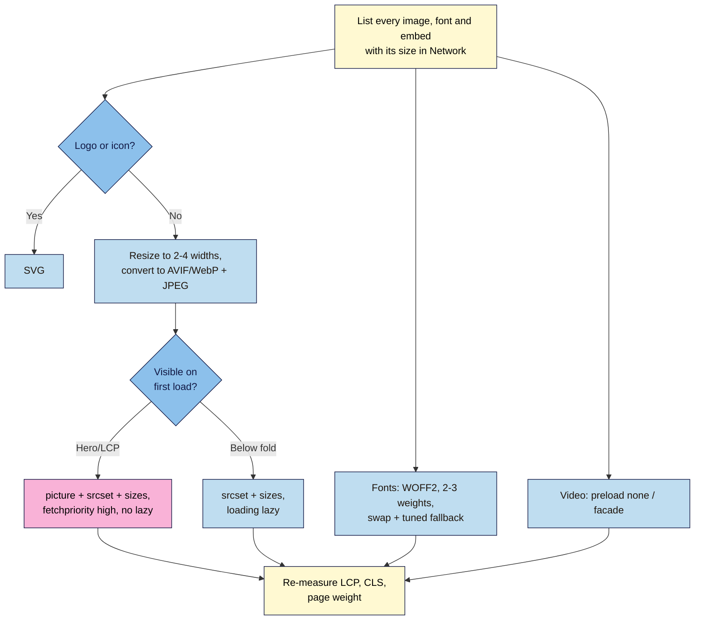

# M07.L02 — Images, Fonts & Media Optimization
> After this lesson your launch page sends each visitor an image the right size for their screen, in a modern format, loads fonts without invisible or jumping text, and keeps heavy video embeds off the page until someone actually wants to watch.

**Time:** ~20 min reading + ~45 min exercise · **Level:** L3 Advanced · **Prereqs:** M07.L01, M02.L02, M03.L02 · **Remediate to:** M02.L02
**Verified against:** web.dev "Learn Images" (AVIF and WebP chapters, responsive images), "Lazy load third-party resources with facades" and "CSS size-adjust for @font-face"; MDN `` (`srcset`, `sizes`, `loading`, `decoding`), `<picture>`, `fetchpriority` (Baseline 2024, newly available since October 2024), `<video>` `preload` and `font-display`; all read 2026-11-03. No live browser tests were run for this lesson; the `srcset`/`sizes` behaviour described is from MDN's documentation.

> ⚠️ **Freshness flag:** image-format support and Lighthouse's advice change. In November 2026 AVIF and WebP work in all current major browsers (AVIF: Chrome since 2020, Firefox since 2021, Safari since 2022, per web.dev), but older devices still exist, so keep a JPEG or PNG fallback. Lighthouse 13 removed the old "Lazy load third-party resources with facades" audit; the technique still works, and **Improve image delivery** is the insight to watch for images.

## Learning objectives
1. **Convert** and compress images to modern formats (AVIF/WebP with a fallback via `<picture>`) at the right dimensions, and **serve** responsive sizes with `srcset` and `sizes`. *(O1)*
2. **Apply** loading hints correctly: `loading="lazy"` below the fold only, `fetchpriority="high"` (and no lazy loading) on the LCP image, `decoding`, and preloading only what is critical. *(O2)*
3. **Load** fonts and media efficiently: self-hosted WOFF2, `font-display: swap`, a limited set of weights, a fallback font tuned to reduce layout shift, and video/embeds as lightweight facades or `preload="none"`. *(O3)*

## Why it matters
Nila Coffee's hero photo came straight off the photographer's camera: 4000 pixels wide and several megabytes, shown in a box 390 pixels wide on most phones. Every visitor on mobile data paid for 10 times more pixels than they could see, and that one file was the page's LCP (Lesson 7.1). The page also loaded nine font weights "just in case" and a YouTube player that downloads hundreds of kilobytes before anyone presses play. Images, fonts and embeds are usually the **heaviest** parts of a landing page and the easiest to fix: none of these changes alter how the page looks.

## Core concept
**Plain version:** send the **smallest file that still looks right** on each screen, and **only when it's needed**.

**Analogy:** posting a poster. You don't post the billboard-sized print to someone with a postcard-sized frame. You ask what frame they have (`srcset` + `sizes`), you pick the lightest paper that looks good (AVIF/WebP), and you only send the photo album (the video player) when they ask to see it.

### Image formats in one table
| Format | Use for | Notes |
|---|---|---|
| **AVIF** | Photos, often the smallest file | All current major browsers; slower to encode |
| **WebP** | Photos and graphics with transparency | All current major browsers; a good default |
| **JPEG** | Fallback for photos | Works everywhere |
| **PNG** | Fallback for transparency, screenshots | Big for photos |
| **SVG** | Logos, icons, simple illustrations | Scales to any size; tiny; text-based |

Typical savings (web.dev): WebP and AVIF are often much smaller than JPEG at similar visual quality. The exact saving depends on the photo, so **compare file size and look at the result** (Part A).

### Responsive images: let the browser choose
```html

```
- `srcset` lists the files and their real widths (`480w` = 480 pixels wide).
- `sizes` tells the browser how wide the image will be **displayed**: here half the window on screens 800 px and wider, full width below. Without `sizes`, the browser assumes **`100vw`** (full window width).
- The browser multiplies the display width by the screen's pixel density and picks the smallest file that's big enough. (Browsers are allowed to weigh other things too, such as a larger file already in the cache, so treat this as the browser's decision, not an exact rule.)
- `width`/`height` still give the aspect ratio, so nothing jumps (Lesson 7.1).

### Modern format with a fallback
```html
<picture>
  <source type="image/avif" srcset="images/hero-800.avif 800w, images/hero-1600.avif 1600w" sizes="(min-width: 800px) 50vw, 100vw">
  <source type="image/webp" srcset="images/hero-800.webp 800w, images/hero-1600.webp 1600w" sizes="(min-width: 800px) 50vw, 100vw">
  
</picture>
```
The browser uses the first `<source>` whose `type` it supports; otherwise the ``. The `alt`, `width`, `height`, `loading` and `fetchpriority` always go on the **``**.

### Loading hints
| Hint | Put it on | Don't put it on |
|---|---|---|
| `loading="lazy"` | Images and iframes **below the fold** (gallery, testimonials, footer logos) | The hero / LCP image, or anything visible on first load |
| `fetchpriority="high"` | The **one** LCP image | Several images ("everything is important" = nothing is) |
| `decoding="async"` | Large images below the fold (lets the browser decode off the critical path) | Not worth worrying about on the hero; the effect is small |
| `<link rel="preload" as="image">` | Only an LCP image the HTML can't reveal early (e.g. a CSS background) | Images already in an `` near the top; preloading too much delays everything else |

### Fonts without invisible or jumping text
From Lesson 3.2 you already use `font-display: swap` and few weights. Now:
- **Self-host WOFF2** files (one less third-party connection; better for privacy, Lesson 3.2) and load **only the weights you use** (often 400 and 700).
- **Tune the fallback** so the swap doesn't shift text: a fallback `@font-face` with `size-adjust` makes the system font take up about the same space as your web font.
  ```css
  @font-face { font-family: "Lora"; src: url("../fonts/lora-700.woff2") format("woff2");
               font-weight: 700; font-display: swap; }
  @font-face { font-family: "Lora Fallback"; src: local("Georgia"); size-adjust: 104%; }
  h1, h2 { font-family: "Lora", "Lora Fallback", Georgia, serif; }
  ```
  The `104%` is an example: find your value by switching between the two fonts in DevTools until the line lengths match. Support (web.dev): `size-adjust` in Chrome/Edge/Firefox 92+ and Safari 17+; the related `ascent-override`/`descent-override` aren't supported in Safari, so treat them as a bonus.

### Video and embeds
- **Your own video:** `<video controls preload="none" poster="images/video-poster.jpg">` downloads nothing until play (the poster image is a normal small image).
- **YouTube/Vimeo:** an embedded player loads hundreds of kilobytes of scripts on page load. A **facade** shows a thumbnail and a play button and loads the real player only on click; web.dev's example: about **3 KB** facade vs about **540 KB** player.

## How it works



**In words:** list every image, font and embed with its transfer size. Logos and icons become SVG. Photos are resized to a few widths and converted to AVIF/WebP with a JPEG fallback. The hero gets `<picture>`, `srcset`, `sizes` and `fetchpriority="high"`; images further down get `loading="lazy"`. Fonts shrink to WOFF2 in two or three weights with a tuned fallback; video waits for a click. Then re-measure the same way as Lesson 7.1.

## Hands-on walkthrough

**Part A: find the heavy files (5 min)**
1. DevTools → **Network** → reload with **Disable cache** ticked → sort by **Size**.
2. Note the top five files: name, type, transfer size. **Expected:** on most launch pages the hero image, a font file or two, and any video embed are at the top.
3. Note your Lesson 7.1 "after" numbers (score, LCP, CLS) as this lesson's "before".

**Part B: resize and convert the hero (10 min)**
1. Open **Squoosh** (squoosh.app, free from Google Chrome Labs; its README says it "does not send your image to a server" and compresses locally, though it records basic Google Analytics data and before/after file sizes) and drop in your hero photo.
2. Resize the largest version to about **twice the widest size it's ever displayed** (for a hero shown up to 800 CSS px wide, that's **1600 px**, enough for 2× screens), choose **AVIF**, and adjust quality until you can't see a difference in the side-by-side view. Download. Repeat for **WebP** and **MozJPEG**, then make **800 px** and **480 px** versions.
   > 🖼️ **Image prompt:** Desktop screenshot (1440×900) of Squoosh comparing an original JPEG photo (left) with an AVIF version (right) at 1600 px wide, showing both file sizes at the bottom. Outline the two file-size labels. Highlight the key element with a 3px #F9B2D7 outline; blur any personal details.
   > **Alt text:** Squoosh side-by-side comparison showing the original photo and a much smaller AVIF version.
3. Write the sizes in a table: original, AVIF, WebP, JPEG at each width. **Expected:** the AVIF and WebP files are clearly smaller than the original; your exact numbers depend on the photo.
4. Name files predictably: `hero-480.avif`, `hero-800.webp`, `hero-1600.jpg`. Commit them to `images/`.

**Part C: serve the right file (10 min)**
1. Replace the hero `` with the `<picture>` pattern above, using **your** files and a `sizes` value that matches your layout (full width on phones? half width on desktop?).
2. Keep `fetchpriority="high"` and **no** `loading="lazy"` on the hero.
3. Add `loading="lazy"` (and the real `width`/`height`) to every image below the fold.
4. Check which file loaded: DevTools → **Elements** → select the `` → **Properties** → `currentSrc`, or hover the `src` in Elements. Test with the device toolbar at 390 px (DPR 2 or 3) and at 1440 px. **Expected:** a smaller file on the phone view, a larger one on desktop.
5. Logos and icons: export as **SVG** from your design tool, or use the SVG your brand already has.

**Part D: fonts (10 min)**
1. In Network, filter **Font**. Count the font files and note their sizes.
2. Remove weights you don't use (check your CSS for every `font-weight`).
3. If you still use the Google Fonts link (Lesson 3.2), self-host: download the WOFF2 files for your weights, put them in `fonts/`, write `@font-face` rules with `font-display: swap`, and remove the Google Fonts `<link>` and `preconnect` tags.
4. Add a fallback `@font-face` with `size-adjust`, and tune it: in DevTools, temporarily remove `"Lora",` from the font stack and compare line breaks with and without it. Adjust the percentage until they match closely.
5. **Expected:** fewer, smaller font requests, and in Lighthouse no **Font display** warning and fewer font entries under **Layout shift culprits**.

**Part E: video and embeds (5 min)**
1. Own video: add `preload="none"` and a `poster` image.
2. YouTube: replace the `<iframe>` with a facade. The simplest no-library version is a link that looks like the player:
   ```html
   <a class="video-facade" href="https://www.youtube.com/watch?v=VIDEO_ID">
     
   </a>
   ```
   Visitors who click go to YouTube; nothing from YouTube loads on your page until then. (Want it to play in place? Use an open-source facade such as the ones listed in web.dev's facades article, and check its licence and size first, Lesson 3.5.)
3. **Expected:** no `youtube.com` or `googlevideo.com` requests in Network on page load. Bonus: if you use YouTube's `youtube-nocookie.com` domain for a real embed later, note it in your privacy page's tag inventory (Lesson 6.4).

**Part F: re-measure (5 min)**
1. Lighthouse mobile, Incognito, median of three (Lesson 7.1). Record score, LCP, CLS and the total page weight from Network.
2. Fill in your before/after table. **Expected:** lower page weight; LCP improves when the hero was the LCP element; **Improve image delivery** shows smaller or no savings.

**Part G: break it and fix it (5 min)**
| Plant this | Symptom | Find it with | Fix |
|---|---|---|---|
| `loading="lazy"` on the hero image | LCP later; Lighthouse's **LCP request discovery**: "LCP resources shouldn't use loading=lazy" | Lighthouse | Remove `lazy`; add `fetchpriority="high"` |
| Hero as a single 1600 px `src`, no `srcset` | Phones download the full desktop file | Network: same large file at 390 px and 1440 px; **Improve image delivery** | `srcset` with 480/800/1200/1600 versions and a matching `sizes` |
| Google Fonts link loading nine weights | Many font requests; slower text and more shifting | Network → Font | Only the weights you use; self-host WOFF2 |

## When to use / when not to
- **`<picture>` with AVIF/WebP:** for photos that matter (hero, product shots). For a tiny thumbnail a single WebP is enough.
- **`srcset` + `sizes`:** any image wider than about 400 px that's shown at different sizes on different screens.
- **SVG:** logos, icons and simple illustrations. Not for photos.
- **Lazy loading:** below the fold. Not for the hero, the logo or anything in the first screen.
- **Preload:** rarely; only when the LCP image isn't in the HTML (e.g. a CSS background). Measure before and after.
- **An image CDN** (Cloudinary, imgix, Cloudflare Images, Netlify Image CDN) can resize and convert automatically. Useful at scale or for many products; check free-tier limits. For one launch page, Squoosh and a few files are enough.

## Use AI for this
**Example prompt:**
> "Here is my hero image markup and CSS [paste]. The image is shown full-width on phones and at 600 px wide in a two-column layout above 900 px. I have hero-480, -800, -1200 and -1600 in AVIF, WebP and JPEG. Write the `<picture>` element with correct `srcset` and `sizes`, keeping `alt`, `width`, `height` and `fetchpriority` on the ``. Explain the `sizes` value in one sentence."

**What AI does well:** writing long `srcset` lists without typos, turning a layout description into a `sizes` value, writing `@font-face` blocks.
**Where it gets it wrong:** lazy-loading the hero, putting `alt` on `<source>`, inventing file names you don't have, `sizes` that don't match your CSS, preloading everything, and quoting old format-support tables.
**How to check:** test `currentSrc` at phone and desktop widths, compare Network sizes, and re-run Lighthouse.

## Common mistakes
- **Uploading camera-sized photos** and letting CSS shrink them.
- **Lazy-loading the hero.**
- **`srcset` without `sizes`** when the image isn't full width, so desktops download a bigger file than they show.
- **Putting `alt`, `width`, `height` or `loading` on `<source>`** instead of the ``.
- **No fallback** for AVIF/WebP.
- **Too many font weights,** or Google Fonts plus self-hosted copies of the same font.
- **Preloading many files,** which delays the ones that matter.
- **Auto-playing video** or a full YouTube embed in the first screen.

## Troubleshooting
| Symptom | Likely cause | Fix |
|---|---|---|
| Phone still downloads the 1600 px file | No `srcset`, or wrong `w` values (they must be the file's real width) | Check the files' real widths; add `srcset` |
| Desktop downloads a larger file than shown | `sizes` missing or says `100vw` for a half-width image | Write `sizes` from your layout |
| Image looks blurry on a phone | Largest candidate too small for a high-density screen | Add a larger candidate (e.g. 1200w) |
| `<picture>` always shows the JPEG | `type` mistyped (`image/avif`), or the AVIF file path is wrong (404 in Network) | Fix `type` and paths |
| Text jumps when the font arrives | No tuned fallback, or `size-adjust` far off | Tune `size-adjust`; check Layout shift culprits |
| Font 404 after self-hosting | Path in `src: url()` is relative to the **CSS file**, not the page | Fix the path (e.g. `../fonts/`) |

## Exercise
**Task:** make **your** launch page's images, fonts and media lean.
1. A Network "top five heaviest files" list, before and after.
2. Your hero in AVIF, WebP and JPEG at three or four widths, served with `<picture>`, `srcset`, a `sizes` value that matches your layout, `fetchpriority="high"` and no lazy loading.
3. Every other image with real `width`/`height`, `srcset` where useful, and `loading="lazy"` below the fold; logos as SVG.
4. Fonts: WOFF2, self-hosted, only the weights you use, `font-display: swap`, and a tuned fallback.
5. Video/embeds: `preload="none"` or a facade.
6. A before/after table (Lighthouse median of three, mobile: score, LCP, CLS, total page weight), with each change as its own commit.

**Expected outcome:** the phone view downloads a phone-sized hero, total page weight drops, LCP and CLS stay in or move into the "good" range, and the page looks the same.
**Stretch goal:** measure how much your hero's AVIF saves over WebP and over JPEG at 800 px, and decide whether AVIF is worth the extra encoding step for your images.

## Key takeaways
- **Right size, right format, right time:** resize, convert (AVIF/WebP + JPEG fallback), and load only when needed.
- **`srcset` + `sizes`** let the browser pick; without `sizes` it assumes full width.
- **Hero: `fetchpriority="high"`, never `lazy`. Everything below the fold: `lazy`.**
- **Fonts:** WOFF2, few weights, `swap`, a tuned fallback.
- **Video:** nothing loads until play.

## Teach it back
Explain to a friend in 3 sentences how a browser chooses which image file to download from `srcset` and `sizes`, and why the hero image should never be lazy-loaded.

## Glossary terms added
- AVIF — added to `webdev-101/glossary.md`
- WebP — added to `webdev-101/glossary.md`
- `srcset` / `sizes` — added to `webdev-101/glossary.md`
- `<picture>` element — added to `webdev-101/glossary.md`
- Lazy loading (`loading="lazy"`) — added to `webdev-101/glossary.md`
- Device pixel ratio (DPR) — added to `webdev-101/glossary.md`
- WOFF2 — added to `webdev-101/glossary.md`
- `size-adjust` (font fallback) — added to `webdev-101/glossary.md`
- Facade (embed) — added to `webdev-101/glossary.md`
- Page weight — added to `webdev-101/glossary.md`

## Further reading
*All checked 2026-11-03.*
- web.dev — Learn Images (course): https://web.dev/learn/images
- web.dev — Image formats: AVIF: https://web.dev/learn/images/avif
- web.dev — Responsive images: https://web.dev/learn/design/responsive-images
- web.dev — Lazy load third-party resources with facades: https://web.dev/articles/third-party-facades
- web.dev — CSS size-adjust for @font-face: https://web.dev/articles/css-size-adjust
- MDN — `` (`srcset`, `sizes`, `loading`, `decoding`): https://developer.mozilla.org/en-US/docs/Web/HTML/Element/img
- MDN — `<picture>`: https://developer.mozilla.org/en-US/docs/Web/HTML/Element/picture
- MDN — `fetchpriority`: https://developer.mozilla.org/en-US/docs/Web/HTML/Reference/Attributes/fetchpriority
- MDN — `<video>` (`preload`, `poster`): https://developer.mozilla.org/en-US/docs/Web/HTML/Element/video
- Squoosh (free image compressor in the browser): https://squoosh.app/ · README (privacy): https://github.com/GoogleChromeLabs/squoosh

## Refresher card
*Used by remediation when a learner fails a quiz twice on a later lesson that points back here.*
Resize photos to the widths you need (e.g. 480/800/1200/1600), convert to AVIF/WebP with a JPEG fallback in `<picture>` (`alt`, `width`, `height`, `loading`, `fetchpriority` on the ``). `srcset` = files + real widths (`800w`); `sizes` = displayed width (default `100vw`); the browser picks the smallest file ≥ display width × pixel density. Hero: `fetchpriority="high"`, never `loading="lazy"`; below the fold: `lazy`. Preload only an LCP image hidden from the HTML. Fonts: self-hosted WOFF2, only used weights, `font-display: swap`, fallback `@font-face` with `size-adjust`. Video: `preload="none"` + `poster`; YouTube as a facade (≈3 KB vs ≈540 KB). SVG for logos/icons. Re-measure like Lesson 7.1.
