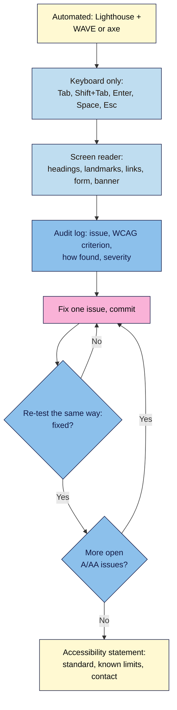

# M07.L03 — Accessibility in Practice (WCAG 2.2)
> After this lesson you can audit your launch page three ways (automated tools, keyboard only, and a screen reader), fix the failures you find, re-test them, and publish an honest accessibility statement.

**Time:** ~20 min reading + ~50 min exercise · **Level:** L3 Advanced · **Prereqs:** M02.L03, M03.L02, M05.L03 · **Remediate to:** M02.L03
**Verified against:** W3C "Web Content Accessibility Guidelines (WCAG) 2.2" (W3C Recommendation, first published October 2023) and its "What's New in WCAG 2.2" and Understanding pages for 2.4.11 Focus Not Obscured (Minimum) and technique C43 (`scroll-padding`); W3C WAI "Easy Checks", "Developing an Accessibility Statement" and the WCAG 3 Working Draft status page (latest draft I found: 3 March 2026); Deque's 2021 coverage study (automated testing found 57% of issues by volume in their own audit data); all read 2026-11-03. No live browser tests were run for this lesson.

> ⚠️ **Freshness flag:** WCAG 2.2 is the current W3C standard; **WCAG 3.0 is still a Working Draft** and W3C says it won't be a finished standard for a few more years, so don't build to it yet. Laws that point to WCAG (the European Accessibility Act, applying since 28 June 2025 to many consumer products and services sold in the EU, including e-commerce; ADA cases in the US; India's Rights of Persons with Disabilities Act 2016 and its rules) change and have exemptions: under the EAA, for example, micro-enterprises (fewer than 10 staff and no more than €2 million turnover or balance sheet) that provide **services** are exempt, per law-firm summaries. This lesson isn't legal advice; check what applies to you.

## Learning objectives
1. **Explain** the WCAG 2.2 level AA structure (POUR principles, success criteria, conformance) and what automated tools can and cannot find. *(O1)*
2. **Audit** the launch page three ways: automated (Lighthouse accessibility + WAVE or axe), keyboard only (focus order, visible focus, no traps, WCAG 2.4.11 Focus Not Obscured) and with a screen reader (headings, landmarks, link names, form labels and errors, the consent banner and dialog). *(O2)*
3. **Fix** and **re-test** the common failures (missing or poor alt text, unlabelled inputs, low contrast, empty links/buttons, skipped heading levels, focus hidden by a sticky header, small targets), and **record** the results in an accessibility statement. *(O3)*

## Why it matters
Nila Coffee's page scored 100 for accessibility in Lighthouse. Then a customer who uses a screen reader emailed: the newsletter pop-up's close button was announced as just "button", the testimonial carousel's arrows said nothing at all, and when she tabbed to "Join the launch list" the sticky header hid it. None of that cost much to fix. The WHO estimates that 1.3 billion people, about 1 in 6 worldwide, experience significant disability, and many more have temporary or situational ones: a broken arm, bright sunlight, a slow phone, a noisy train. Accessible pages also tend to be clearer for everyone and easier for search and AI engines to understand, because both read structure, labels and text rather than looks.

## Core concept
**Plain version:** WCAG (Web Content Accessibility Guidelines) is the W3C's checklist of things a page must do so people with disabilities can use it. It has four **principles** (**POUR**):
| Principle | Means | Examples on a launch page |
|---|---|---|
| **Perceivable** | People can see or hear the content in some form | Alt text, captions, contrast, text that resizes |
| **Operable** | People can use it with keyboard, mouse, touch or voice | Everything works with Tab/Enter/Space, visible focus, big enough targets |
| **Understandable** | Content and behaviour make sense | Labels, clear errors, consistent navigation, page language |
| **Robust** | Works with assistive technology | Real HTML elements, every control has a name and role |

Under the principles are **success criteria** (numbered, e.g. **1.4.3 Contrast (Minimum)**), each at level **A**, **AA** or **AAA**. Most laws and contracts ask for **level AA**, which means meeting all A and AA criteria. **Conformance** is per page: one failing criterion means the page doesn't conform.

**What WCAG 2.2 added** (W3C, "What's New"): 2.4.11 **Focus Not Obscured (Minimum)** (AA): the focused item can't be completely hidden by something like a sticky header or cookie banner; 2.5.8 **Target Size (Minimum)** (AA, Lesson 3.4); 2.5.7 **Dragging Movements** (AA); 3.3.8 **Accessible Authentication (Minimum)** (AA); 3.2.6 **Consistent Help** and 3.3.7 **Redundant Entry** (A). 4.1.1 Parsing was removed.

**Analogy:** a building inspection. The automated tool is the inspector's checklist of measurable things (door widths, handrail heights). The keyboard and screen-reader tests are actually walking through the building in a wheelchair and with eyes closed. You need both: the checklist can't tell you the ramp leads to a locked door.

### What tools can and can't find
| Automated tools (Lighthouse, axe, WAVE) find well | Only a human can judge |
|---|---|
| Missing `alt`, empty links and buttons, missing form labels | Whether alt text actually describes the image's purpose |
| Low contrast on plain text | Contrast on text over images or gradients |
| Missing `lang`, duplicate IDs, ARIA misuse | Whether focus order makes sense and focus is visible |
| Skipped heading levels | Whether headings describe their sections |
| | Keyboard traps, focus hidden by sticky elements, whether errors are understandable |

Deque's own audit data (2021) found its automated rules caught about **57%** of issues by volume; other estimates based on success criteria are lower. Either way, **a perfect Lighthouse accessibility score doesn't mean the page is accessible.** (Lighthouse's accessibility audits run Deque's open-source axe-core rules; checked in Lighthouse 13.6's source.)

## How it works



**In words:** run the automated tools first to catch the easy, measurable problems. Then put the mouse away and use the page with the keyboard only, then with a screen reader. Log every issue with the WCAG criterion it fails. Fix one at a time, commit, and re-test the same way. When no level A or AA issues are open, publish an accessibility statement that says what you tested and how people can report problems.

## Hands-on walkthrough
Start a file `a11y-audit.md` in your repo with this table:
| # | Issue | WCAG criterion | Found by | Fix | Re-tested |
|---|---|---|---|---|---|

**Part A: automated pass (10 min)**
1. Chrome DevTools → **Lighthouse** → Mobile, category **Accessibility** → Analyze. Note every failed audit.
2. Install **WAVE** (WebAIM, free) or **axe DevTools** (Deque, free version) and run it on the same page. WAVE marks errors (red), contrast errors and alerts on the page itself; axe lists issues with the failing element.
   > 🖼️ **Image prompt:** Desktop screenshot (1440×900) of the launch page with the WAVE extension panel open on the left, showing a summary of errors, contrast errors and alerts, and red error icons placed on the page next to an icon-only button and an unlabelled input. Outline the error icons. Highlight the key element with a 3px #F9B2D7 outline; blur any personal details.
   > **Alt text:** WAVE extension showing accessibility errors marked directly on the launch page next to the failing elements.
3. Add each issue to your log with its criterion (the tools name it, e.g. "1.1.1 Non-text Content", "4.1.2 Name, Role, Value").
4. **Expected** on a typical first audit: an image with missing or useless alt (`alt="image"`), an icon-only button with no name, a contrast failure on a light grey caption, a skipped heading level. Your page may have none of these, thanks to Modules 2–5; tools may also list "alerts" that need a human decision, not a fix.

**Part B: keyboard-only pass (10 min)**
Unplug or ignore the mouse. Reload and press **Tab** repeatedly from the top.
1. **Is there a skip link?** The first Tab should show "Skip to main content" (2.4.1 Bypass Blocks). If not, add one:
   ```html
   <a class="skip-link" href="#main">Skip to main content</a>
   …
   <main id="main">
   ```
   ```css
   .skip-link { position: absolute; left: -9999px; }
   .skip-link:focus { left: 1rem; top: 1rem; z-index: 20; }
   ```
2. **Can you see where you are every time?** (2.4.7 Focus Visible.) Your focus ring from Module 3 should be on every link, button and field.
3. **Is focus hidden by the sticky header** (Lesson 5.2) **or the consent banner** (Lessons 6.4, 7.1)? Tab down to a link near the top of a section and watch. If the item disappears under the header, that fails **2.4.11 Focus Not Obscured (Minimum)**. Fix with W3C technique C43:
   ```css
   html { scroll-padding-top: 5rem; }   /* at least the sticky header's height */
   /* while the bottom consent banner is showing, keep focus above it too */
   html:has(.consent:not([hidden])) { scroll-padding-bottom: 8rem; }
   ```
4. **Order:** does Tab move in reading order (2.4.3 Focus Order)? **Traps:** can you always Tab away, and can **Esc** close the pop-up and FAQ dialog (Lesson 5.3, 2.1.2 No Keyboard Trap)?
5. **Everything works:** Enter on links and buttons, Space on buttons and checkboxes, the form submits, the consent banner's Accept/Reject work, Cookie settings reopens it (2.1.1 Keyboard).

**Part C: screen-reader pass (15 min)**
Use the free screen reader on your system: **NVDA** (Windows), **VoiceOver** (Mac: Cmd+F5; iPhone: Settings → Accessibility), or **TalkBack** (Android). Follow this 5-minute script, the same every time:
| Step | NVDA (Windows) | VoiceOver (Mac) | Listen for |
|---|---|---|---|
| 1. Page title and language | Starts reading on load | VO = Ctrl+Option; VO+A reads all | A meaningful `<title>`; correct pronunciation (`lang="en"`) |
| 2. Headings list | **H** = next heading; NVDA+F7 = elements list | VO+U → Headings | One H1; a logical outline that describes the page (Lesson 2.3) |
| 3. Landmarks | **D** = next landmark | VO+U → Landmarks | header/banner, navigation ("Main"), main, contentinfo |
| 4. Links and buttons | **K** = next link; **B** = next button | VO+U → Links / Form controls | Each one makes sense alone: no "click here", no plain "button" |
| 5. Images | **G** = next graphic | VO+Cmd+G | Alt describes the purpose; decorative images are skipped (`alt=""`) |
| 6. Form | **F** = next field; submit empty, then with a bad email | VO+Cmd+J | Every field has its label; errors are announced and say how to fix |
| 7. Banner and dialogs | Tab to them | Tab to them | Consent banner heading and both buttons; pop-up dialog name; Esc closes it |

Log every issue. **Expected:** you'll hear things the automated tools passed, such as a heading that only makes sense visually, or a link that reads "Learn more" five times.

**Part D: fix and re-test the common failures (10 min)**
| Failure | WCAG | Fix |
|---|---|---|
| Image without alt, or `alt="image"` | 1.1.1 | Describe the purpose ("Nila Coffee subscription box with three bags of beans"); `alt=""` for decoration |
| Icon-only button (×, ☰, ▶) with no name | 4.1.2 | Visible text, or `aria-label="Close"`; the icon gets `aria-hidden="true"` |
| Input without a label | 1.3.1, 3.3.2 | `<label for="email">Email</label>` (Lesson 2.4); a placeholder is not a label |
| Error shown only in red, or only on submit with no text | 1.4.1, 3.3.1 | Text that says what's wrong and how to fix it, linked with `aria-describedby`; don't rely on colour alone |
| Low contrast | 1.4.3, 1.4.11 | Change the token (Lesson 3.2): 4.5:1 for text, 3:1 for large text and UI parts |
| "Read more" ×5 | 2.4.4 | Descriptive link text ("Read how we roast"), or visually hidden extra text |
| Skipped heading levels | 1.3.1 | Fix the outline, then style with CSS (Lesson 2.3) |
| Focus hidden by sticky header/banner | 2.4.11 | `scroll-padding-top`/`-bottom` (Part B) |
| Tiny tap targets | 2.5.8 | At least 24 × 24 CSS px or enough spacing (Lesson 3.4) |
| Missing `lang` | 3.1.1 | `<html lang="en">` |

After each fix: commit, re-run the check that found it (tool, keyboard or screen reader), and tick **Re-tested** in your log.

**Part E: accessibility statement (5 min)**
Create `accessibility.html` (link it in the footer next to Privacy) using W3C WAI's guidance or its free statement generator:
- the standard you aim for: "WCAG 2.2 level AA";
- how you checked (tools, keyboard, screen reader, date);
- known limitations and what you're doing about them (be honest: "the embedded YouTube video's own player is outside our control");
- how to report a problem (email) and how quickly you'll reply.
> **Expected:** a short, plain page, dated, that matches your audit log.

**Part F: break it and fix it (5 min)**
| Plant this | Symptom | Find it with | Fix |
|---|---|---|---|
| Change the pop-up's `<button>Close</button>` to an icon only: `<button><svg>…</svg></button>` | Screen reader says just "button"; Lighthouse: "Buttons do not have an accessible name" | Lighthouse, WAVE, screen reader **B** key | `aria-label="Close"`; `aria-hidden="true"` on the SVG |
| Remove `scroll-padding-top` | Tabbing to a section link hides it under the sticky header | Keyboard pass | Put it back, at least the header's height |
| Show the email error only by turning the border red | Screen reader users and colour-blind visitors don't know what went wrong | Screen reader form pass; WAVE may not flag it | Error text + `aria-describedby`; red is extra, not the only signal |

## When to use / when not to
- **Automated tools:** every time you change the page; in a pre-launch checklist.
- **Keyboard pass:** after any change to navigation, pop-ups, banners or forms.
- **Screen-reader pass:** before launch and after major changes; it takes 5 minutes with a script.
- **Testing with disabled users** (paid or through a community): the best evidence, especially for important flows such as checkout or sign-up.
- **Don't use "accessibility overlay" widgets** that promise one-line compliance. They don't fix the underlying HTML, can interfere with users' own assistive technology, and many disabled users and accessibility professionals object to them (*observed practice*).

## Use AI for this
**Example prompt:**
> "Here is my launch page HTML and CSS [paste] and my audit log [paste]. For each open issue, give the WCAG 2.2 success criterion, a fix as a code change, and how I should re-test it (tool, keyboard or screen reader). Don't add ARIA where a native HTML element would do. Don't claim the page is 'fully compliant'."

**What AI does well:** naming the criterion for an issue, writing accessible names and error text, suggesting alt text you then edit for purpose.
**Where it gets it wrong:** adding ARIA everywhere (`role="button"` on a `<div>` instead of a `<button>`), generic alt text ("image of coffee"), invented criterion numbers, and declaring a page "WCAG compliant" from code alone.
**How to check:** re-run the same keyboard and screen-reader script; check criterion numbers against the WCAG 2.2 quick reference.

## Common mistakes
- **Trusting a 100 Lighthouse accessibility score** as proof.
- **Alt text that describes pixels, not purpose,** or alt on decorative images.
- **Icon buttons without names.**
- **Placeholder instead of label.**
- **Removing focus outlines** (`outline: none`) without a replacement.
- **Sticky headers or banners covering the focused item.**
- **ARIA where HTML would do** ("No ARIA is better than bad ARIA").
- **No way to report problems,** or a statement that claims more than you tested.

## Troubleshooting
| Symptom | Likely cause | Fix |
|---|---|---|
| Screen reader reads the icon's file name or "graphic" | SVG/`` icon inside a named button isn't hidden | `aria-hidden="true"` on the icon; name on the button |
| Focus disappears completely after closing the pop-up | Focus not returned to the opener (Lesson 5.3) | Use `<dialog>` `showModal()`/`close()`, which restore focus |
| Skip link never appears | It's `display: none` (also hidden from keyboard) | Off-screen positioning, shown on `:focus` |
| Contrast passes in the tool but text is hard to read | Text over an image or gradient | Solid or semi-opaque background behind text; check by eye |
| NVDA reads in the wrong accent | Missing or wrong `lang` | `<html lang="en">`; `lang="hi"` on a Hindi phrase |

## Exercise
**Task:** audit and fix **your** launch page.
1. An `a11y-audit.md` log with at least the automated, keyboard and screen-reader passes (date, tools, screen reader and browser used).
2. Every issue mapped to a WCAG 2.2 criterion, with severity.
3. Fixes as separate commits, each re-tested with the method that found it.
4. A skip link, visible focus everywhere, and no focus hidden by the sticky header or consent banner.
5. `accessibility.html` linked in the footer, matching your log.

**Expected outcome:** no open level A or AA issues you could find; Lighthouse accessibility 90+ (mobile); a screen-reader user can find the H1, the offer, the form and the consent buttons, and understand any error.
**Stretch goal:** ask someone who uses a screen reader or keyboard every day to try your sign-up flow (offer to pay for their time), and add what they found to your log.

## Key takeaways
- **WCAG 2.2 AA:** four principles (POUR), success criteria at A/AA/AAA; most laws ask for AA.
- **Automated tools catch only part of it;** keyboard and screen-reader checks find the rest.
- **The big fixes:** alt for purpose, names on icon buttons, labels on inputs, visible and unobscured focus, text errors, contrast.
- **Log, fix one, re-test the same way.**
- **Publish an honest accessibility statement** with a way to report problems.

## Teach it back
Explain to a friend in 3 sentences why a page with a Lighthouse accessibility score of 100 can still be unusable for a screen-reader user, and what you'd test by hand.

## Glossary terms added
- WCAG 2.2 — added to `webdev-101/glossary.md`
- POUR principles — added to `webdev-101/glossary.md`
- Success criterion (WCAG) — added to `webdev-101/glossary.md`
- Conformance level (A, AA, AAA) — added to `webdev-101/glossary.md`
- Screen reader — added to `webdev-101/glossary.md`
- Accessible name — added to `webdev-101/glossary.md`
- Skip link — added to `webdev-101/glossary.md`
- Focus Not Obscured (WCAG 2.4.11) — added to `webdev-101/glossary.md`
- `scroll-padding` — added to `webdev-101/glossary.md`
- Accessibility statement — added to `webdev-101/glossary.md`
- Accessibility overlay — added to `webdev-101/glossary.md`

## Further reading
*All checked 2026-11-03.*
- W3C — Web Content Accessibility Guidelines (WCAG) 2.2: https://www.w3.org/TR/WCAG22/
- W3C WAI — What's New in WCAG 2.2: https://www.w3.org/WAI/standards-guidelines/wcag/new-in-22/
- W3C WAI — How to Meet WCAG (Quick Reference): https://www.w3.org/WAI/WCAG22/quickref/
- W3C WAI — Understanding SC 2.4.11 Focus Not Obscured (Minimum): https://www.w3.org/WAI/WCAG22/Understanding/focus-not-obscured-minimum.html
- W3C WAI — Technique C43: Using CSS scroll-padding to un-obscure content: https://www.w3.org/WAI/WCAG22/Techniques/css/C43
- W3C WAI — Easy Checks: https://www.w3.org/WAI/test-evaluate/easy-checks/
- W3C WAI — Developing an Accessibility Statement (and generator): https://www.w3.org/WAI/planning/statements/
- W3C WAI — WCAG 3 Introduction (Working Draft status): https://www.w3.org/WAI/WCAG3/
- WebAIM — WAVE Web Accessibility Evaluation Tools: https://wave.webaim.org/
- Deque — axe DevTools browser extension: https://www.deque.com/axe/devtools/
- Deque — Automated testing study identifies 57 percent of digital accessibility issues (2021, vendor research): https://www.deque.com/blog/automated-testing-study-identifies-57-percent-of-digital-accessibility-issues
- NV Access — NVDA screen reader (free) and its User Guide (browse-mode single-letter navigation): https://www.nvaccess.org/ · https://download.nvaccess.org/documentation/userGuide.html
- Apple — VoiceOver User Guide for Mac (incl. "Find the next control" VO-Command-J, next graphic VO-Command-G): https://support.apple.com/guide/voiceover/welcome/mac
- WHO — Disability (fact sheet): https://www.who.int/news-room/fact-sheets/detail/disability-and-health

## Refresher card
*Used by remediation when a learner fails a quiz twice on a later lesson that points back here.*
WCAG 2.2 = W3C standard; POUR (Perceivable, Operable, Understandable, Robust); criteria at A/AA/AAA; aim for AA. 2.2 added 2.4.11 Focus Not Obscured, 2.5.8 Target Size, 2.5.7 Dragging, 3.3.8 Accessible Authentication (AA), 3.2.6, 3.3.7 (A); removed 4.1.1. WCAG 3 = draft. Audit three ways: automated (Lighthouse uses axe-core; WAVE/axe), keyboard (skip link, visible focus, logical order, no traps, focus not hidden: `scroll-padding-top`), screen reader (title, headings H, landmarks D, links K, buttons B, graphics G, form F, banner and dialogs). Fixes: alt for purpose (`alt=""` decorative), names on icon buttons (`aria-label`, icon `aria-hidden`), `<label>` not placeholder, text errors + `aria-describedby`, contrast 4.5:1 / 3:1, `lang`. Log → fix one → re-test → accessibility statement with contact. No overlays.
