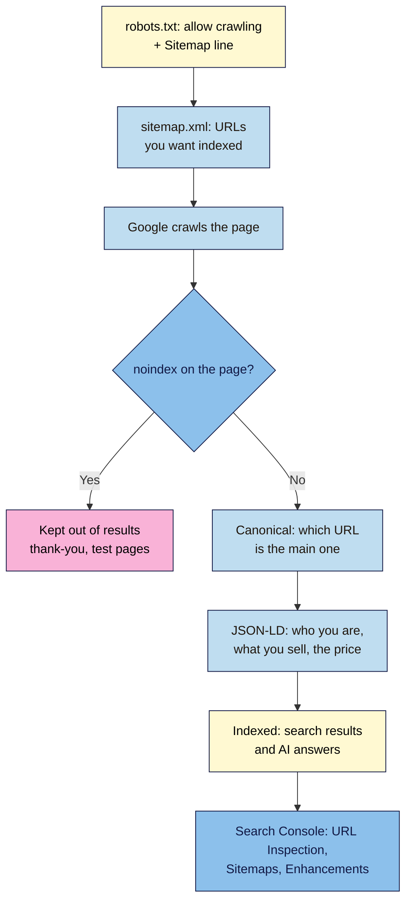

# M07.L04 — Technical SEO Foundations
> After this lesson search engines (and the AI answers built on them) can find, read and correctly describe your launch page: it has valid structured data, a sitemap, a sensible `robots.txt`, canonical URLs, the right pages kept out of the index, and it's verified in Google Search Console.

**Time:** ~20 min reading + ~45 min exercise · **Level:** L3 Advanced · **Prereqs:** M02.L05, M04.L04, M07.L01 · **Remediate to:** M02.L05
**Verified against:** Google Search Central "Introduction to robots.txt" ("not a mechanism for keeping a web page out of Google"), "Organization structured data" (no required properties; `logo`, `sameAs` and others recommended), "Introduction to Product structured data" and "Merchant listing (Product, Offer)", "AI features and your website" (no special schema.org markup needed for AI Overviews/AI Mode; structured data should match visible text), and the August 2023 Search Central blog post on HowTo and FAQ rich results; all read 2026-11-03. Reports that Google stopped showing FAQ rich results for all sites on 7 May 2026 come from several SEO news sites; I couldn't open Google's own changelog to confirm the date. No live browser tests were run for this lesson.

> ⚠️ **Freshness flag:** Google changes which rich results it shows (HowTo and FAQ rich results were cut back in 2023, and FAQ rich results reportedly ended for all sites in May 2026) and how AI features use pages. The foundations in this lesson (crawlable, indexable, accurately described pages) have been stable for years. Check Google's documentation before adding any markup for a specific rich result.

## Learning objectives
1. **Add** structured data in JSON-LD (`Organization` with `logo` and `sameAs`, plus `Product`/`Offer` or `Person`/`ProfessionalService` for your page) that matches visible content, and **validate** it with the Rich Results Test and the Schema Markup Validator. *(O1)*
2. **Create** an XML sitemap and `robots.txt`, set self-referencing canonical URLs, and **decide** what should be `noindex` (thank-you page, test pages) without blocking crawling of what should be indexed. *(O2)*
3. **Verify** the domain in Google Search Console, submit the sitemap, inspect the launch URL (indexing, rendered page, detected structured data), and **explain** how search and AI answers use the same signals (bridge to the Modern SEO course). *(O3)*

## Why it matters
Two weeks after launch, Nila Coffee's founder searched for her own brand and found nothing. The site was live, fast and accessible, but the staging copy's `robots.txt` (`Disallow: /`) had been deployed with it, so Google wasn't crawling the page at all. Once that was fixed, Google showed the `http://` address in results, and an AI assistant described the box as "₹999 per month" because an old price was still in the page's structured data. Technical SEO is the plumbing that lets search engines and AI systems **find, read and trust** your page. It won't make weak content rank, but getting it wrong can make good content invisible.

## Core concept
**Plain version:** a search engine has to **crawl** your page (fetch it), **index** it (store and understand it), and then **rank or cite** it. Each file in this lesson helps one step:
| Tool | Helps with | One-line rule |
|---|---|---|
| `robots.txt` | Crawling | Tells crawlers what **not to fetch**. It does **not** keep a page out of results |
| `sitemap.xml` | Discovery | Lists the URLs you **want** indexed |
| `<link rel="canonical">` | Indexing | "This is the main address for this content" |
| `<meta name="robots" content="noindex">` | Indexing | "Don't show this page in results" (the crawler must be able to fetch it to see this) |
| Structured data (JSON-LD) | Understanding | Facts about the page in a machine-readable format (who you are, what you sell, the price) |
| Search Console | Checking | Google's own view of your site: indexing, errors, structured data, Core Web Vitals |

**Analogy:** a library. `robots.txt` is the "staff only" sign on some doors; the sitemap is your list of books for the catalogue; the canonical tag says "this copy is the original"; `noindex` says "don't put this one on the shelves"; structured data is the catalogue card (author, title, price). Search Console is the librarian telling you what they actually catalogued.

### The `robots.txt` trap
Google: robots.txt "is not a mechanism for keeping a web page out of Google". If you block a page in `robots.txt`, Google can't fetch it, so it **can't see a `noindex` tag on it**, and the URL may still appear in results if other sites link to it. To keep a page out of results: **allow crawling and add `noindex`** (or password-protect it).

### Structured data that tells the truth
Use **JSON-LD** (a `<script type="application/ld+json">` block). Two rules matter more than any property list:
1. **It must match what's visible on the page** (Google says so for rich results and for AI features). Never mark up a price, rating or review the visitor can't see.
2. **Markup makes you eligible, not guaranteed.** Google decides whether to show any rich result.

For a launch page, the useful types are:
| Page | Types | Key properties |
|---|---|---|
| Any brand or business | `Organization` | `name`, `url`, `logo`, `sameAs` (your social profiles), `contactPoint` or `email` |
| A product you sell, with a visible price | `Product` + `Offer` | `name`, `image`, `description`, `offers.price`, `offers.priceCurrency`, `offers.availability` |
| A personal brand (creator, consultant) | `Person` (+ `ProfessionalService` for a local service) | `name`, `url`, `image`, `jobTitle`, `sameAs` |
| A waitlist with no price yet | `Organization` only | Add `Product` once the price is on the page |

FAQ markup: don't add it for rich results; Google no longer shows FAQ rich results for ordinary sites (cut back in 2023; reportedly ended for all sites in May 2026). Your FAQ content still helps readers, search and AI answers as plain HTML.

### Search, AI answers and the same signals
Google's guidance for AI Overviews and AI Mode: there's **no special markup** to add; the same basics apply. Pages must be crawlable and indexable, content should be in text, internal links should help discovery, and structured data should match the visible text. Other AI assistants that search the web rely on similar signals. The **Modern SEO** course goes deeper (answer-ready content, AI visibility, citations).

## How it works



**In words:** `robots.txt` lets crawlers in and points to your sitemap; the sitemap lists the pages you want in search. When Google fetches a page, a `noindex` tag keeps it out of results; otherwise the canonical tag says which address is the main one, and JSON-LD describes the facts. Search Console shows what Google actually did.

## Hands-on walkthrough

**Part A: structured data (15 min)**
1. Add an `Organization` block to the `<head>` of your home page (Nila Coffee's example; use **your** details):
   ```html
   <script type="application/ld+json">
   {
     "@context": "https://schema.org",
     "@type": "Organization",
     "name": "Nila Coffee",
     "url": "https://nilacoffee.in/",
     "logo": "https://nilacoffee.in/images/logo-512.png",
     "email": "hello@nilacoffee.in",
     "sameAs": [
       "https://www.instagram.com/nilacoffee",
       "https://www.linkedin.com/company/nilacoffee"
     ]
   }
   </script>
   ```
   JSON doesn't allow comments, so keep notes out of the block. Use a logo image that looks right on a white background; SEO guides commonly cite a 112 × 112 px minimum (check Google's Organization page for the current rule).
2. If your page shows a **price**, add a `Product` with an `Offer` that matches it exactly:
   ```html
   <script type="application/ld+json">
   {
     "@context": "https://schema.org",
     "@type": "Product",
     "name": "Nila Coffee Monthly Box",
     "image": "https://nilacoffee.in/images/hero-1600.jpg",
     "description": "Two 250 g bags of single-origin Indian coffee, roasted to order, every month.",
     "brand": { "@type": "Brand", "name": "Nila Coffee" },
     "offers": {
       "@type": "Offer",
       "price": "1299.00",
       "priceCurrency": "INR",
       "availability": "https://schema.org/PreOrder",
       "url": "https://nilacoffee.in/"
     }
   }
   </script>
   ```
   A personal-brand page uses `Person` instead (`name`, `url`, `image`, `jobTitle`, `sameAs`). No price on the page yet? Leave `Product` out.
3. Commit, deploy, then test the **live URL** in Google's **Rich Results Test** (search.google.com/test/rich-results). **Expected:** "Page is eligible for rich results" listing **Product snippets** or **Merchant listings** if you added a product (a page where people can buy is a merchant listing; otherwise product snippets), `Organization` is validated there too (Google moved its logo and organization checks into the Rich Results Test in November 2023), so expect an **Organization** item. The exact wording on Google's tools changes; what matters is **0 errors**.
   > 🖼️ **Image prompt:** Desktop screenshot (1440×900) of Google's Rich Results Test showing the launch page URL tested, the result "Page is eligible for rich results", and the detected Product item with no errors. Outline the eligibility message and the item count. Highlight the key element with a 3px #F9B2D7 outline; blur any personal details.
   > **Alt text:** Google Rich Results Test showing the launch page is eligible, with a Product item detected and no errors.
4. Check **all** types (including `Organization`) at **validator.schema.org**. **Expected:** your items listed with 0 errors. Fix every error; read warnings and add recommended properties where they're true.

**Part B: robots.txt and sitemap (10 min)**
1. Create `robots.txt` at the site root:
   ```
   User-agent: *
   Allow: /

   Sitemap: https://nilacoffee.in/sitemap.xml
   ```
2. Create `sitemap.xml` listing only the pages you want in search (not the thank-you page):
   ```xml
   <?xml version="1.0" encoding="UTF-8"?>
   <urlset xmlns="http://www.sitemaps.org/schemas/sitemap/0.9">
     <url><loc>https://nilacoffee.in/</loc><lastmod>2026-11-03</lastmod></url>
     <url><loc>https://nilacoffee.in/privacy.html</loc><lastmod>2026-11-03</lastmod></url>
     <url><loc>https://nilacoffee.in/accessibility.html</loc><lastmod>2026-11-03</lastmod></url>
   </urlset>
   ```
   Use the exact URLs visitors land on (`https://`, with or without `www` as you chose in Lesson 4.4). Update `lastmod` only when the main content, structured data or links really change: Google uses it only when it's consistently accurate, and ignores `<priority>` and `<changefreq>` (Search Central blog, June 2023).
3. Deploy, then open `https://<your-domain>/robots.txt` and `/sitemap.xml` in a browser. **Expected:** both load (no 404), the sitemap shows as XML.

**Part C: canonical and noindex (5 min)**
1. In the `<head>` of every indexable page, a **self-referencing** canonical with the full preferred URL:
   ```html
   <link rel="canonical" href="https://nilacoffee.in/">
   ```
2. On the thank-you page, test pages and anything else that shouldn't be in results:
   ```html
   <meta name="robots" content="noindex">
   ```
   Keep these pages **crawlable** (not in `robots.txt`) so Google can see the tag.
3. Check the other versions of your address redirect to the canonical one: `http://` → `https://` and `www` ↔ apex (Lesson 4.4). **Expected:** each redirects (301) to the same final URL as your canonical tag.

**Part D: Google Search Console (15 min)**
1. Go to search.google.com/search-console → **Add property** → **Domain** → enter your domain. Google gives you a **TXT record**; add it at your DNS provider (Lesson 4.4) and click **Verify**. (DNS can take a while; the **URL prefix** property with an HTML file or meta tag is the alternative if you can't edit DNS.)
2. **Sitemaps** → enter `sitemap.xml` → **Submit**. **Expected:** status "Success" (it may show "Couldn't fetch" for a short while on a new property; check again later).
3. **URL Inspection** → paste your home page URL. On a new site it will probably say the URL isn't on Google yet. Click **Test live URL**. **Expected:** a verdict such as "URL is available to Google" (wording may differ), the page's rendered screenshot and HTML, and any detected structured data. A passing live test doesn't guarantee indexing (Google's help page says so). If the page is ready, click **Request indexing**.
   > 🖼️ **Image prompt:** Desktop screenshot (1440×900) of Google Search Console URL Inspection after "Test live URL", showing "URL is available to Google", the "View tested page" button and a detected structured-data item. Outline the availability message. Highlight the key element with a 3px #F9B2D7 outline; blur any personal details.
   > **Alt text:** Search Console URL Inspection showing the launch page is available to Google with structured data detected.
4. Come back in a week: **Pages** (indexing) report, **Enhancements** (structured data), and **Core Web Vitals** (once there's traffic, Lesson 7.1).

**Part E: break it and fix it (5 min)**
| Plant this | Symptom | Find it with | Fix |
|---|---|---|---|
| `Disallow: /` in `robots.txt` (copied from a staging site) | URL Inspection: "Blocked by robots.txt"; the page never appears in search | Search Console URL Inspection; open `/robots.txt` | `Allow: /` (or remove the rule); re-test the live URL |
| Canonical pointing to `http://nilacoffee.in/` or the `www` version you don't use | Search Console shows a different "Google-selected canonical" or "Alternate page with proper canonical tag" | URL Inspection → Page indexing | Canonical = the exact `https://` URL that every other version redirects to |
| `Offer` price `999` while the page shows ₹1,299 | Misleading data for search and AI answers; Google's guidelines can lead to rich results being withheld | Compare the JSON-LD with the visible page; validator shows the value | Update the markup whenever the visible price changes (or generate both from one source) |

## When to use / when not to
- **Structured data:** always `Organization` (or `Person`); `Product` only when the price and product are visible. Don't add types for features Google no longer shows just "in case".
- **Sitemap:** any site; essential when pages aren't well linked. A one-page site still benefits (Search Console reports by sitemap).
- **`robots.txt` Disallow:** for crawl-heavy, useless areas (internal search results, endless filters). Not for hiding pages: use `noindex` or a password.
- **Canonical:** on every indexable page, pointing to itself; to another URL only for true duplicates.
- **Search Console:** every site you own. **Bing Webmaster Tools** is free too and can import your sites from Search Console; Bing's index is also used by some other search and AI products (*observed practice*; check each product's own documentation).
- **AI crawler controls** (e.g. blocking particular AI bots in `robots.txt`): a business decision about content use, with trade-offs for visibility. The Modern SEO course covers it; don't block crawlers by accident with a blanket rule.

## Use AI for this
**Example prompt:**
> "Write JSON-LD for this page [paste the visible HTML]. Use only facts that appear in the visible text: Organization (name, url, logo, email, sameAs from the footer links) and Product with Offer only if a price is shown. Don't invent ratings, reviews, prices or availability. Then list what I should check in the Rich Results Test and the Schema Markup Validator."

**What AI does well:** turning visible facts into correct JSON-LD syntax, spotting missing commas and quotes, explaining validator warnings.
**Where it gets it wrong:** inventing `aggregateRating` and reviews, adding FAQ or HowTo markup "for rich results", outdated property advice, `Disallow: /` in sample `robots.txt` files, and canonical URLs with the wrong protocol or domain.
**How to check:** validate live, compare every value with the visible page, and inspect the URL in Search Console.

## Common mistakes
- **A staging `robots.txt` (`Disallow: /`) going live.**
- **Using `robots.txt` to hide pages,** then wondering why the `noindex` isn't seen.
- **Markup that doesn't match the page** (old prices, invented ratings).
- **Canonical pointing to `http://`, the wrong host, or a different page.**
- **Sitemap listing thank-you pages, redirects or 404s.**
- **Never verifying Search Console,** so nobody notices indexing problems.
- **Expecting markup to guarantee rich results** or rankings.

## Troubleshooting
| Symptom | Likely cause | Fix |
|---|---|---|
| Rich Results Test: "Unparsable structured data" | JSON syntax error (trailing comma, smart quotes from a word processor) | Validate; edit in your code editor, not a word processor |
| No rich-result items detected | A type the Rich Results Test doesn't cover (check it at validator.schema.org), a syntax error, or markup added by JavaScript after load | Check validator.schema.org; for important markup, put JSON-LD in the HTML |
| Domain verification fails | TXT record not yet visible, added to the wrong host, or quotes added | Wait and retry; check the record with a DNS lookup tool (Lesson 1.2) |
| Sitemap "Couldn't fetch" | Wrong URL, not deployed, or a very new property | Open the sitemap URL in a browser; resubmit later |
| "Discovered – currently not indexed" | Google knows the URL but hasn't crawled it yet | Usually patience on a new site; improve internal links and content |
| "Duplicate, Google chose different canonical" | Redirects, canonical and sitemap disagree | Make all three point to the same `https://` URL |

## Exercise
**Task:** make **your** launch page search-ready.
1. `Organization` (or `Person`) JSON-LD, plus `Product`/`Offer` if you show a price, matching the visible page; Rich Results Test and Schema Markup Validator results with 0 errors (screenshots).
2. `robots.txt` (with the `Sitemap:` line) and `sitemap.xml`, deployed and loading.
3. Self-referencing canonical on every indexable page; `noindex` on the thank-you and any test pages; redirects checked.
4. Search Console: Domain property verified, sitemap submitted, URL Inspection "Test live URL" result (screenshot).
5. A three-line note: what Google can now find, what you've kept out and why, and what you'll check again in a week.

**Expected outcome:** Google can crawl and render your page, knows its preferred URL, sees structured data that matches the page, and you'll be told about indexing problems.
**Stretch goal:** add the site to **Bing Webmaster Tools** (import from Search Console), and compare what each tool reports after a week.

## Key takeaways
- **Crawl → index → understand → show:** each file helps one step.
- **`robots.txt` controls crawling, not indexing;** use `noindex` (and keep it crawlable) to stay out of results.
- **One preferred `https://` URL** in canonical tags, sitemap and redirects.
- **Structured data must tell the truth** and makes you eligible, not guaranteed.
- **Search Console is Google's view of your site:** verify it on day one.

## Teach it back
Explain to a friend in 3 sentences why putting a page in `robots.txt` doesn't keep it out of Google, and what to do instead.

## Glossary terms added
- Crawling vs indexing — added to `webdev-101/glossary.md`
- `robots.txt` — added to `webdev-101/glossary.md`
- XML sitemap — added to `webdev-101/glossary.md`
- Canonical URL (`rel="canonical"`) — added to `webdev-101/glossary.md`
- `noindex` — added to `webdev-101/glossary.md`
- Structured data / JSON-LD — added to `webdev-101/glossary.md`
- Schema.org — added to `webdev-101/glossary.md`
- Rich result — added to `webdev-101/glossary.md`
- Google Search Console — added to `webdev-101/glossary.md`
- URL Inspection — added to `webdev-101/glossary.md`

## Further reading
*All checked 2026-11-03 unless marked.*
- Google Search Central — Introduction to robots.txt: https://developers.google.com/search/docs/crawling-indexing/robots/intro
- Google Search Central — Block indexing with noindex: https://developers.google.com/search/docs/crawling-indexing/block-indexing
- Google Search Central — Build and submit a sitemap: https://developers.google.com/search/docs/crawling-indexing/sitemaps/build-sitemap
- Google Search Central — How to specify a canonical URL: https://developers.google.com/search/docs/crawling-indexing/consolidate-duplicate-urls
- Google Search Central — Organization structured data: https://developers.google.com/search/docs/appearance/structured-data/organization
- Google Search Central — Introduction to Product structured data: https://developers.google.com/search/docs/appearance/structured-data/product
- Google Search Central — Merchant listing (Product, Offer) structured data: https://developers.google.com/search/docs/appearance/structured-data/merchant-listing
- Google Search Central — General structured data guidelines: https://developers.google.com/search/docs/appearance/structured-data/sd-policies
- Google Search Central — AI features and your website: https://developers.google.com/search/docs/appearance/ai-features
- Google Search Central blog — Changes to HowTo and FAQ rich results (August 2023): https://developers.google.com/search/blog/2023/08/howto-faq-changes
- Google Search Central blog — Expanding markup support for Organization details (November 2023): https://developers.google.com/search/blog/2023/11/introducing-organization-markup
- Google Search Central blog — Sitemaps ping endpoint is going away (lastmod, priority, changefreq; June 2023): https://developers.google.com/search/blog/2023/06/sitemaps-lastmod-ping
- Google — Rich Results Test: https://search.google.com/test/rich-results
- Schema.org — Schema Markup Validator: https://validator.schema.org/
- Search Console Help — Add a website property / Verify your site ownership: https://support.google.com/webmasters/answer/9008080
- Search Console Help — URL Inspection tool: https://support.google.com/webmasters/answer/9012289
- Bing Webmaster Tools: https://www.bing.com/webmasters

## Refresher card
*Used by remediation when a learner fails a quiz twice on a later lesson that points back here.*
Crawl → index → understand → show. `robots.txt` = what not to fetch (not a way to stay out of results; add `Sitemap:` line). `sitemap.xml` = URLs you want indexed (`loc`, honest `lastmod`). Canonical: `<link rel="canonical" href="https://…">`, self-referencing, same URL as redirects and sitemap. `noindex` meta to keep pages out, and keep them crawlable. JSON-LD: `Organization` (name, url, logo, sameAs), `Product` + `Offer` only with a visible price; must match the page; eligible ≠ guaranteed; FAQ/HowTo rich results no longer shown for ordinary sites. Test: Rich Results Test + validator.schema.org. Search Console: Domain property via DNS TXT, submit sitemap, URL Inspection → Test live URL. Google's AI features: no special markup, same basics.
