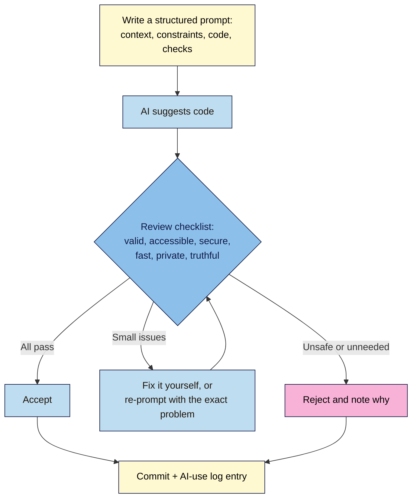

# M08.L01 — Building with AI Assistants
> After this lesson you can get useful HTML, CSS and JavaScript from an AI assistant, review it with a fixed checklist before it touches your live page, and keep a record of every AI change in Git.

**Time:** ~18 min reading + ~50 min exercise · **Level:** L3 Advanced · **Prereqs:** M05.L02, M07.L03 · **Remediate to:** M05.L02
**Verified against:** MDN `innerHTML` security considerations and `textContent`, OWASP DOM-based XSS Prevention Cheat Sheet, W3C WCAG 2.2 (2.2.2 Pause, Stop, Hide; 4.1.2 Name, Role, Value), W3C WAI-ARIA Authoring Practices (carousel pattern), the VS Code Copilot FAQ, and Spracklen et al., "We Have a Package for You!" (USENIX Security 2025, via secondary summaries); all read 2026-11-03. Copilot Free's monthly limits come from third-party summaries, not GitHub's own page; check GitHub's plans page. No live browser tests were run for this lesson.

> Note: you don't need an AI account to follow the walkthrough. Part B gives everyone the same AI-written code (with real, common mistakes in it) to review. Part C, using your own assistant, is optional but recommended.

> ⚠️ **Freshness flag:** AI tools, their free limits and their data settings change every few months. At the time of writing, GitHub Copilot Free inside VS Code is commonly reported as about 2,000 code completions and 50 chat requests a month, resetting monthly (third-party sources; GitHub's own plans page is the authority). The review checklist in this lesson doesn't depend on any tool and won't go out of date.

## Learning objectives
1. **Write** a structured prompt for HTML/CSS/JS work (context, constraints, existing code, acceptance checks) and **iterate** on the output in small, committed steps. *(O1)*
2. **Review** AI-generated code with a fixed checklist: validity, semantics and accessibility, security, performance and privacy. *(O2)*
3. **Decide** what to accept, fix or reject, and **record** it in an AI-use log so every AI change is reviewable in Git (NN #6, #12). *(O3)*

## Why it matters
Tomás asks a chatbot for "a cool countdown banner for my launch". In ten seconds he has 40 lines of code that look great in the preview, so he pastes them into his live page. A week later he finds out what was in it. The close "button" is a `<div>` that keyboard users can't reach. The script greets visitors by a name taken from the URL and puts it in the page with `innerHTML`, so anyone can send a link that runs their own script on his site. It also loads a library from a CDN address for a package that doesn't exist. Today the browser just gets an error, but if an attacker registers that name, their code runs on every visit. And the AI quietly added an analytics event that fires before consent. None of this showed up in the preview. AI makes writing code fast. It doesn't make *checking* code optional: that part is now your main job.

## Core concept
**Plain version:** an AI assistant predicts code that *looks like* good answers it has seen. Usually it's close; sometimes it's confidently wrong, out of date or unsafe, and it never knows your page, your consent setup or your users unless you tell it. So you work in a loop: **ask precisely → review with a checklist → accept, fix or reject → commit with a note.**

**Analogy:** an AI assistant is a very fast, very confident new intern. Their first drafts save you hours. But you wouldn't let an intern publish to the live site without reading their work, and you'd want to know later which changes were theirs.

### A prompt that gets reviewable code
| Part | Example for Nila Coffee |
|---|---|
| **Role and goal** | "You're helping me add a launch countdown banner to a static landing page." |
| **Context** | "Plain HTML, CSS and vanilla JS, no frameworks. Scripts load with `defer`. Here is the current `<header>`: [paste]." |
| **Constraints** | "Accessible (WCAG 2.2 AA): a real `<button>` with an accessible name, keyboard usable, no `aria-live` on anything that changes every second. Use `textContent`, never `innerHTML`, for any text. No external scripts, libraries or CDNs. No analytics or cookies." |
| **Output format** | "Give the HTML, CSS and JS as three separate blocks, then a list of every assumption you made." |
| **Acceptance checks** | "It must pass the W3C validator, work with Tab and Enter, and show 'Launching now' after the launch date." |

Small, specific asks beat "build me a landing page". One component per prompt, and paste the code it must fit into. When the answer is wrong, say exactly what's wrong ("the close control is a `div`; make it a `button` with `aria-label`") rather than starting over.

### The review checklist (use it on every AI change)
| Area | Check | How |
|---|---|---|
| **Valid and semantic** | Valid HTML; right elements (`button` for actions, `a` for links); heading levels fit your outline | W3C checker (Lesson 2.1); read the markup |
| **Accessible** | Every control has a name; keyboard reaches and operates it; focus visible; contrast; anything that moves for more than 5 seconds can be paused (WCAG 2.2.2) | Tab through it; Lighthouse/WAVE (Lesson 7.3); screen reader for 2 minutes |
| **Secure** | No `innerHTML`/`insertAdjacentHTML`/`document.write` with data from URLs, forms or APIs; no API keys or passwords in front-end code; no unknown third-party scripts; `https://` only | Search the code for `innerHTML`, `key`, `token`, `<script src`; look up every package on its official registry page |
| **Fast** | No new libraries for things a few lines can do; scripts `defer`red; no layout shift | Network panel; Lighthouse (Lesson 7.1) |
| **Private and consistent** | No tracking, cookies or third-party requests you didn't ask for; consent still works; `generate_lead` still fires once | DevTools Network and Application panels; Tag Assistant (Module 6) |
| **Truthful** | Copy, prices and claims match your real offer; no invented testimonials | Read every visible word |

### Three AI failure patterns to look for first
1. **Unsafe DOM writing.** AI often builds text with `innerHTML` because it's short. If any part comes from the URL, a form or an API, that's a cross-site scripting (XSS) hole. Use `textContent` (Lesson 5.2), or build elements with `createElement`.
2. **Hallucinated packages and URLs.** A 2025 study (Spracklen et al., USENIX Security) generated 576,000 code samples with 16 models and found that about 20% referenced packages that don't exist, and many of the same fake names came back again and again. Attackers can register those names ("slopsquatting"). Never load a script or install a package you haven't found on its official registry page (npmjs.com) and checked.
3. **Missing names and keyboard support.** Clickable `<div>`s, icon buttons with no label, carousels that rotate forever. These fail WCAG 4.1.2 and 2.2.2 even though they look fine.

## How it works



**In words:** every AI suggestion goes through the same checklist before it reaches your repo. If it passes, accept it. If something small is wrong, fix it yourself or tell the AI exactly what to change, then check again. If it's unsafe or adds something you didn't ask for, reject it. Either way, commit with a short log entry, so anyone (including future you) can see what came from AI and why it was kept.

## Hands-on walkthrough

Work in your launch-page repo from Module 4. Create a branch first: `git switch -c ai-countdown`.

**Part A: set up your AI-use log (3 min)**
1. Create `ai-log.md` in the repo root:
   ```markdown
   # AI-use log
   | Date | Tool | Prompt (short) | What it produced | Decision | Why | Commit |
   |---|---|---|---|---|---|---|
   ```
   **Expected:** a file you'll add one row to for every AI change in this module.

**Part B: review an AI-written countdown banner (20 min)**
1. This is a real-style answer to the vague prompt "make a cool countdown banner for my launch, greet the visitor by name". Paste it into a new file `countdown-ai.html` (inside a full skeleton from Lesson 2.1) and open it **locally only**:
   ```html
   <div class="countdown">
     <span id="msg"></span>
     <div class="close" onclick="this.parentNode.remove()">
       <svg width="16" height="16" viewBox="0 0 16 16"><path d="M2 2l12 12M14 2L2 14" stroke="currentColor"/></svg>
     </div>
   </div>
   <script src="https://cdn.jsdelivr.net/npm/easy-countdown-timer-pro@2/dist/countdown.min.js"></script>
   <script>
     const name = new URLSearchParams(location.search).get('name');
     const launch = new Date('2026-12-01T09:00:00+05:30');
     function tick() {
       const s = Math.floor((launch - Date.now()) / 1000);
       document.getElementById('msg').innerHTML =
         'Hi ' + name + '! Nila Coffee launches in <b>' + s + ' seconds</b>';
     }
     setInterval(tick, 1000);
     gtag('event', 'countdown_view');
   </script>
   ```
2. Run the checklist and write each finding down before reading on. Use the W3C checker, **Tab** through the page, and open DevTools → **Console** and **Network**.
   **Expected findings (at least these six):**

   | # | Problem | Checklist area | Evidence |
   |---|---|---|---|
   | 1 | Close control is a `<div>` with `onclick`: not focusable, no name, no keyboard | Accessible (4.1.2) | Tab skips it. Automated tools usually miss a plain `div` with a click handler, so the keyboard test is what catches it |
   | 2 | `innerHTML` with `name` from the URL: open `countdown-ai.html?name=` and an alert box appears | Secure (DOM XSS) | The alert proves untrusted text ran as code |
   | 3 | Script from a CDN package nobody checked | Secure (supply chain) | Network shows the request failing (404). Search npmjs.com for the name: if it doesn't exist, the AI made it up |
   | 4 | `gtag('event', …)` added without being asked; fires on load, and errors if GTM/consent isn't set up | Private | Console: `gtag is not defined`, or in the live page an event you never planned |
   | 5 | Text changes every second, counting seconds: distracting, and a screen reader reading it would announce constant changes | Accessible (2.2.2) / usability | Watch it; there's no way to pause it |
   | 6 | Shows "null" if there's no `?name=`, and goes negative after launch | Truthful / correctness | Open the file without a query string |

   > 🖼️ **Image prompt:** Desktop screenshot (1440×900) of the local countdown-ai.html page opened with `?name=` in the address bar, showing the browser's alert box, with DevTools Console and Network panels open showing a 404 for the CDN script. Outline the alert box and the 404 row. Highlight the key element with a 3px #F9B2D7 outline; blur any personal details.
   > **Alt text:** Local test page showing an alert triggered from the URL and a 404 for an AI-suggested CDN script in DevTools.
3. **Fix it.** Replace the snippet with this reviewed version, in `countdown.js` loaded with `<script src="countdown.js" defer></script>`:
   ```html
   <aside class="countdown" aria-label="Launch countdown">
     <p><span id="greeting">Hi!</span> Nila Coffee launches in <strong id="time-left">a few days</strong>.</p>
     <button type="button" class="countdown-close" aria-label="Close launch banner">
       <svg aria-hidden="true" focusable="false" width="16" height="16" viewBox="0 0 16 16"><path d="M2 2l12 12M14 2L2 14" stroke="currentColor"/></svg>
     </button>
   </aside>
   ```
   ```js
   // countdown.js — reviewed AI draft, see ai-log.md
   const launch = new Date('2026-12-01T09:00:00+05:30');
   const out = document.getElementById('time-left');

   function update() {
     const ms = launch - Date.now();
     if (ms <= 0) { out.textContent = 'now'; return; }
     const days = Math.floor(ms / 86400000);
     const hours = Math.floor(ms / 3600000) % 24;
     out.textContent = `${days} days ${hours} hours`;
   }
   update();
   setInterval(update, 60000); // once a minute, not every second

   const name = new URLSearchParams(location.search).get('name');
   if (name) document.getElementById('greeting').textContent = `Hi ${name.slice(0, 40)}!`;

   document.querySelector('.countdown-close').addEventListener('click', (e) => {
     e.currentTarget.closest('.countdown').hidden = true;
   });
   ```
   **Expected:** the same XSS test URL now shows the text `Hi !` literally, with no alert; Tab reaches **Close launch banner** and Enter closes it; the Network panel shows no third-party requests; the W3C checker is clean.
4. Add a row to `ai-log.md`, for example: `2026-11-03 | ChatGPT (free) | countdown banner, greet by name | banner + CDN lib + gtag | Fixed | div→button, innerHTML→textContent, removed fake CDN + unrequested gtag, 1-min updates | <commit>`. Commit: `git add . && git commit -m "Add launch countdown (AI draft, reviewed)"`.

**Part C: prompt your own assistant properly (15 min, optional tool)**
1. In your assistant (Copilot Chat in VS Code, or any chat assistant), ask for a **testimonial carousel** using the prompt structure table: paste your testimonials section, and add the constraints "vanilla JS, no libraries, real buttons with names, no auto-rotation (or a visible Pause button if it rotates), uses `textContent`, no analytics".
   **Expected:** code that is *closer* to right than the vague prompt gave you, but still worth checking.
   > 🖼️ **Image prompt:** Desktop screenshot (1440×900) of VS Code with the Copilot Chat panel open, showing a structured prompt for a testimonial carousel (context, constraints, acceptance checks) and the start of the AI's answer. Outline the constraints part of the prompt. Highlight the key element with a 3px #F9B2D7 outline; blur any personal details.
   > **Alt text:** VS Code Copilot Chat with a structured prompt listing context, constraints and acceptance checks for a testimonial carousel.
2. Run the full checklist on the answer. Typical leftovers: `aria-live` on the slide region (fine only if it doesn't auto-rotate), buttons labelled "<" and ">" with no name, a missing Pause button, or `innerHTML` used to build slides.
3. Re-prompt **once** with the exact problems ("the Previous/Next buttons have no accessible name; slides are built with innerHTML; use textContent"), check again, then decide: accept, fix or reject. Log it and commit.

**Part D: check nothing else broke (5 min)**
1. Open your page in a private window. Check the consent banner still appears and Reject still blocks `_ga` (Module 6), and run one mobile Lighthouse pass (Module 7).
   **Expected:** consent works as before, and no new third-party requests appear in the Network panel. If a score dropped, find the AI change responsible with `git diff main`.
2. Merge when you're happy: `git switch main && git merge ai-countdown`, then push to deploy (Lesson 4.3).

## When to use / when not to
- **Good uses:** first drafts of small components, CSS you can describe precisely, explaining unfamiliar code or error messages, writing alt text and test data, and turning your notes into a checklist. **Trade-off:** you save typing time but spend review time, which is still a large net win for small, well-specified tasks.
- **Be careful with:** anything involving user input, forms, payments, logins, tracking or consent; code you can't read yet; and "fix everything" requests across many files. Ask for one change at a time.
- **Don't:** paste secrets, API keys, customer emails or private data into an AI tool; check the tool's data and training settings first. Don't let an assistant add packages or scripts you haven't looked up yourself. Don't ship code you can't explain line by line.
- **Agents that edit files for you** (agent modes in editors): useful, but work on a branch, review the `git diff` before committing, and never give them access to production passwords.

## Use AI for this
**Example prompt (asking AI to help review, not replace, your review):**
> "Review this code for a public static landing page [paste]. List problems under: accessibility (WCAG 2.2 AA), security (XSS, secrets, third-party scripts), performance, and privacy (tracking without consent). For each, quote the exact line and give the fix. Don't rewrite the whole file. If a script URL or package name appears, tell me to verify it on its official registry; don't claim it exists."

**What AI does well here:** spotting common patterns quickly (`innerHTML`, missing labels, `div` buttons), and explaining *why* each is a problem.
**Where it gets it wrong:** it can miss issues it introduced itself, invent WCAG criteria numbers, and say a package "is a popular library" when it doesn't exist. It can't run your page or press Tab.
**How to check:** treat its review as a second opinion. Your own keyboard test, the W3C checker, Lighthouse and the Network panel are the evidence.

## Common mistakes
- **Vague prompts** ("make it better", "a cool banner"), then accepting whatever comes back.
- **Pasting straight into the live page** instead of a branch and a local test.
- **Trusting a CDN link or `npm install` line** without checking the package exists, is the one you meant, and is maintained.
- **`innerHTML` with any outside data.** URL parameters, form fields and API responses are all outside data.
- **Accepting unrequested extras:** analytics calls, cookies, fonts, icon libraries, "helpful" auto-rotation.
- **Huge AI diffs.** If you can't review it in five minutes, ask for smaller pieces.
- **No record.** Months later nobody knows which code came from AI, or why that odd workaround is there.

## Troubleshooting
| Symptom | Likely cause | Fix |
|---|---|---|
| AI keeps reintroducing `innerHTML` or `div` buttons | The constraint isn't in the prompt, or got lost in a long chat | Start a new chat with the constraints first; paste the current code |
| Console: `X is not defined` after pasting AI code | It assumed a library or a global (`gtag`, `$`, `dayjs`) you don't load | Remove the dependency, or ask for vanilla JS only |
| A CDN script returns 404 | The package or version doesn't exist (possibly hallucinated) | Delete it; find a real, maintained package or write the few lines yourself |
| Lighthouse score dropped after an AI change | New library, unoptimised image or layout shift | `git diff` to see what changed; remove or fix that part (Lesson 7.1) |
| Consent stopped working | AI code set cookies or loaded a tag directly instead of through GTM | Remove direct tags; route through GTM with consent checks (Lesson 6.3–6.4) |
| The assistant says it "can't" or gives a different answer each time | Normal variation | Narrow the task, give an example of the output you want, and verify whichever answer you keep |

## Exercise
**Task:** use an AI assistant (or the Part B snippet if you have none) to add **one new component** to your own launch page: a countdown, a testimonial carousel, a "back to top" button or a sticky CTA bar.
1. Write the prompt with all five parts from the table, and save it in `ai-log.md`.
2. Review the output with the full checklist; record each finding (problem, area, evidence).
3. Fix or re-prompt, then decide accept / fix / reject.
4. Commit on a branch with an `ai-log.md` row, check consent and Lighthouse, then merge.

**Expected outcome:** a merged commit with the new component, an `ai-log.md` row, and a findings list of at least three items with evidence (or a note that you checked each area and found nothing, with how you checked).
**Stretch goal:** give the same structured prompt to two different assistants. Compare their answers using the checklist and note which mistakes each made. Which one would you trust for which kind of task?

## Key takeaways
- AI drafts fast; **you** are responsible for what ships (NN #12).
- Prompt with **context, constraints, existing code, output format and acceptance checks**; ask for one component at a time.
- Review every change: **valid, accessible, secure, fast, private, truthful**.
- Watch for the big three: `innerHTML` with outside data, **hallucinated packages and URLs**, and controls without names or keyboard support.
- Work on a branch, commit with an **AI-use log** entry, and re-check consent and performance before merging.

## Teach it back
Explain to a friend in 3 sentences why "it looks right in the preview" isn't enough for AI-written code, and name two problems a preview can't show.

## Glossary terms added
- Prompt (structured prompt) — added to `webdev-101/glossary.md`
- AI-use log — added to `webdev-101/glossary.md`
- Hallucination (AI) — added to `webdev-101/glossary.md`
- Slopsquatting — added to `webdev-101/glossary.md`
- Cross-site scripting (XSS) / DOM-based XSS — added to `webdev-101/glossary.md`
- Supply-chain risk (third-party scripts and packages) — added to `webdev-101/glossary.md`
- Coding agent (agent mode) — added to `webdev-101/glossary.md`

## Further reading
*All checked 2026-11-03.*
- MDN — `Element.innerHTML` (Security considerations): https://developer.mozilla.org/en-US/docs/Web/API/Element/innerHTML
- MDN — `Node.textContent`: https://developer.mozilla.org/en-US/docs/Web/API/Node/textContent
- OWASP — DOM based XSS Prevention Cheat Sheet: https://cheatsheetseries.owasp.org/cheatsheets/DOM_based_XSS_Prevention_Cheat_Sheet.html
- W3C — Understanding WCAG 2.2: 2.2.2 Pause, Stop, Hide: https://www.w3.org/WAI/WCAG22/Understanding/pause-stop-hide.html
- W3C WAI-ARIA Authoring Practices — Carousel pattern: https://www.w3.org/WAI/ARIA/apg/patterns/carousel/
- VS Code — GitHub Copilot FAQ (Free plan limits reset monthly): https://code.visualstudio.com/docs/copilot/faq
- GitHub — Copilot plans (current free limits): https://github.com/features/copilot/plans
- Spracklen et al. — "We Have a Package for You! A Comprehensive Analysis of Package Hallucinations by Code Generating LLMs" (USENIX Security 2025): https://www.usenix.org/conference/usenixsecurity25/presentation/spracklen
- Cloud Security Alliance — Slopsquatting research note (May 2026): https://labs.cloudsecurityalliance.org/research-rb/csa-research-note-slopsquatting-ai-coding-assistant-supply-c/

## Refresher card
*Used by remediation when a learner fails a quiz twice on a later lesson that points back here.*
Loop: structured prompt (role/goal, context, constraints, existing code, output format, acceptance checks) → review checklist (valid, accessible, secure, fast, private, truthful) → accept / fix / reject → commit on a branch with an `ai-log.md` row. Big three AI mistakes: `innerHTML` with outside data (use `textContent`), made-up packages or CDN URLs (verify on the official registry), controls without names or keyboard support (`button` + `aria-label`; pause for anything moving over 5 s). Never paste secrets into AI tools; re-check consent and Lighthouse before merging.
