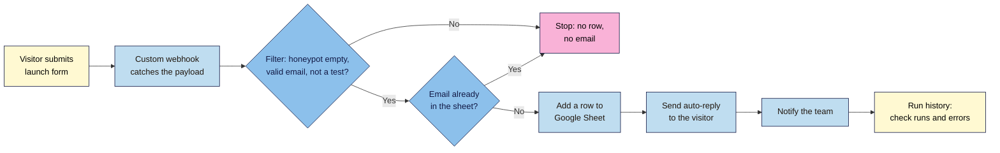

# M08.L02 — APIs, Webhooks & No-Code Automation
> After this lesson every sign-up on your launch page lands in a Google Sheet, gets a friendly auto-reply and pings your team within seconds, with no server of your own, no code you have to host, and no secret keys in your page.

**Time:** ~20 min reading + ~55 min exercise · **Level:** L3 Advanced · **Prereqs:** M05.L04, M06.L04 · **Remediate to:** M05.L04
**Verified against:** Make Help Center "Webhooks" (custom webhooks give a URL you can send any data to; instant trigger; logs kept 3 days; default reply 200 "Accepted" without a Webhook response module) and Make's integrations page (Custom webhook = instant trigger, available on the Free plan); Formspree Help "Webhooks" and "Connecting a form to Zapier" (both on Professional and Business plans only); n8n docs "Choose how to use n8n" (Community edition free to self-host; Cloud is paid with a trial); MDN `fetch()`, `URLSearchParams` and JSON. Free-plan limits for Make (1,000 credits a month, 2 active scenarios) and Zapier (100 tasks a month, two-step Zaps, no webhooks) come from third-party pricing summaries that agree with each other; check each vendor's pricing page. All read 2026-11-03. No live tests were run for this lesson; Make's module and menu names were not checked in the app, and the empty-search behaviour is from Make community answers that disagree (flagged in Part C).

> Note: the lesson uses **Make**, because its free plan includes an instant webhook trigger, so a form can send leads to it at no cost. Formspree (Lesson 5.4) only sends webhooks on its paid plans, and Zapier's free plan has no webhooks. Zapier and n8n are compared in the decision table; the method is the same in all three.

> ⚠️ **Freshness flag:** automation tools rename modules, change billing units (Make moved from "operations" to "credits") and change free limits often. The steps describe the flow and the settings to look for; if a label has moved, search the tool's help centre for "custom webhook", "add a row" or "filter". Not legal advice: check where each tool stores data and whether your privacy notice covers it (Lesson 6.4).

## Learning objectives
1. **Explain** APIs, JSON and webhooks in plain terms (request vs push, endpoint, payload, API key) and **read** a webhook payload from your form. *(O1)*
2. **Build** a lead flow in one no-code tool: form submission → Google Sheet row → auto-reply email → team notification, with field mapping and a filter for spam and test entries. *(O2)*
3. **Test, monitor and secure** the flow (test leads, run history, failures and duplicates, no API keys in the page, only the fields your privacy notice covers) and **compare** free-plan limits before choosing a tool. *(O3)*

## Why it matters
Ama runs a cooking-class launch. Sign-ups arrive by email from her form service, and every evening she copies them into a spreadsheet by hand, writes each person a welcome note and tells her co-teacher in WhatsApp. On launch day 140 people sign up. She falls behind, a few welcomes go out two days late, three people get two emails, and a typo in one address means a paying customer never hears back. A lead flow does those four jobs in seconds, the same way every time, and leaves a record of every run. The work moves from typing to **designing and checking** the flow once.

## Core concept
**Plain version:** an **API** is a door one app opens so other apps can ask it for things or tell it to do things ("add this row", "send this email"). A **webhook** is the reverse: instead of you asking again and again "anything new?", the app **pushes** a message to a web address (an **endpoint**) the moment something happens. The message is the **payload**, usually **JSON**: labelled data in a fixed shape. An automation tool sits in the middle: it **catches** the webhook, then calls other apps' APIs for you.

**Analogy:** an API is a shop counter: you go and ask. A webhook is a doorbell: the delivery rings it the moment the parcel arrives. The automation tool is the assistant who answers the door, files the parcel (sheet), sends the thank-you card (auto-reply) and texts the team.

### The words you'll see
| Word | Meaning | In this lesson |
|---|---|---|
| **Endpoint** | A URL that receives requests | Make's custom webhook URL, `https://hook.eu1.make.com/…` |
| **Payload** | The data sent | `{ "email": "kofi@example.com", "first_name": "Kofi", "utm_source": "instagram" }` |
| **JSON** | Text format for labelled data: `"key": "value"` pairs inside `{ }` | What Make shows when it "determines the data structure" |
| **Polling vs push** | Checking every few minutes vs being told instantly | Zapier's free plan polls every 15 minutes; a webhook is instant |
| **API key / token** | A password for an app's API | Lives **inside** Make's connection, **never** in your page's HTML or JS |
| **Field mapping** | Telling the tool which payload key goes into which column or email field | `email` → Sheet column B, and the auto-reply's "To" |
| **Filter** | A rule that stops a run unless conditions are met | Stop if the honeypot `_gotcha` has a value, or the email contains `+test` |
| **Run history** | The log of every time the flow ran, with its data and any errors | Make: the scenario's **History** |

### A webhook URL is an address, not a password
Your form's `action` will contain the Make webhook URL, so **anyone can read it** in View Source and send junk to it. That's normal for a public form, just like the Formspree endpoint in Lesson 5.4. The defence is **filtering what arrives** (honeypot, a valid email, required fields) and keeping real secrets (the Google connection, any API keys) **inside the automation tool**. A secret in your front-end code isn't secret: anyone can copy it and act as you.

### Only move what your privacy notice covers
Every tool in the chain (form, Make, Google Sheets, the email sender) now holds personal data. Send only the fields you need (Lesson 2.4's minimisation), name each tool in your privacy notice as a processor, and don't send emails your sign-up didn't promise. A "thanks, here's what happens next" auto-reply is part of the sign-up; extra marketing needs the consent you collected (M05.L04's double opt-in, M06.L04).

## How it works



**In words:** the form sends the visitor's answers to a webhook URL. A filter stops spam, invalid entries and your own tests before anything is stored or sent. A duplicate check stops the same person getting two emails. Then the flow adds a sheet row, sends the auto-reply and tells the team, in that order, so a failed email never means a lost lead. The run history shows every run, so you can see and fix failures.

## Hands-on walkthrough

**Part A: plan the flow and the data map (8 min)**
1. In your project note, write the trigger, the steps and a **data map**:

   | Field (form `name`) | Needed for | Goes to | Covered by privacy notice? |
   |---|---|---|---|
   | `email` | Auto-reply, list | Sheet col B, email "To" | Yes |
   | `first_name` (optional) | Greeting | Sheet col C, email body | Yes |
   | `partner_offers` | Consent record | Sheet col D | Yes |
   | `utm_source`, `utm_campaign` (hidden) | Which channel brought the lead | Sheet cols E–F | Yes (analytics) |
   | `_gotcha` | Spam check only | Nowhere: filter only | — |

2. Create a Google Sheet called **Nila launch leads** with a header row: `received_at`, `email`, `first_name`, `partner_offers`, `utm_source`, `utm_campaign`.
   **Expected:** a sheet ready for rows, and a data map you can show anyone who asks "where does my email go?".

**Part B: catch the webhook and read the payload (12 min)**
1. Sign up for **Make** (free) → **Create a new scenario** → add the **Webhooks** app → **Custom webhook** → **Add** → name it "Nila launch form" → **Save**. Copy the URL.
   **Expected:** a URL like `https://hook.eu1.make.com/abc123…` and the module waiting for data.
2. Work on a branch (`git switch -c lead-flow`). In `launch.html`, add two hidden fields to the form and point the form at the webhook:
   ```html
   <form class="signup-form" action="https://hook.eu1.make.com/abc123..." method="post">
     …your M05.L04 fields (email, first_name, partner_offers, _gotcha)…
     <input type="hidden" name="utm_source">
     <input type="hidden" name="utm_campaign">
   </form>
   ```
   ```js
   // utm-fields.js (loaded with defer): copy UTM values from the page URL into the form
   const params = new URLSearchParams(location.search);
   for (const key of ['utm_source', 'utm_campaign']) {
     const field = document.querySelector(`input[name="${key}"]`);
     if (field && params.get(key)) field.value = params.get(key).slice(0, 100);
   }
   ```
   Setting an input's `value` is safe: it's never parsed as HTML (Lesson 8.1). If your M05.L04 script parses Formspree's JSON reply, change its success check to `response.ok` only: Make's default reply is the text `Accepted` with status 200.
3. In Make, click **Run once**. Then open `launch.html?utm_source=instagram&utm_campaign=launch-nov` locally and submit a test sign-up with your own email.
   **Expected:** Make shows **Successfully determined**, and the module's output bubble lists the keys: `email`, `first_name`, `partner_offers`, `_gotcha` (empty), `utm_source: instagram`, `utm_campaign: launch-nov`. That's your payload. Written as JSON it would look like:
   ```json
   { "email": "you@example.com", "first_name": "Kofi", "partner_offers": "yes",
     "_gotcha": "", "utm_source": "instagram", "utm_campaign": "launch-nov" }
   ```
   > 🖼️ **Image prompt:** Desktop screenshot (1440×900) of a Make scenario editor with the Custom webhook module showing "Successfully determined" and its output bubble listing email, first_name, partner_offers, _gotcha, utm_source and utm_campaign. Outline the output bubble. Highlight the key element with a 3px #F9B2D7 outline; blur any personal details.
   > **Alt text:** Make custom webhook output listing the launch form's fields after a test submission.

**Part C: filter, store, reply, notify (20 min)**
1. **Duplicate check:** add **Google Sheets → Search Rows** on *Nila launch leads*, where `email` equals the webhook's email **cleaned up**: `lower(trim(email))` (Make's text functions), so `Kofi@Example.com ` and `kofi@example.com` count as the same person. Store the cleaned version in the sheet too. Connect your Google account when asked (this connection is the secret, and it stays in Make).
   ⚠️ **Check this with test 1 in Part D:** Make community answers disagree on how a search that finds **no** rows behaves. Most recommend a filter on the search's **Total number of bundles = 0**, as below; others report that the route stops when nothing is found. If a first-time sign-up produces no row, add an **Array aggregator** after Search Rows and filter on the length of its array being `0` instead. (Not checked in the app for this lesson.)
2. **Filter** (the small icon on the link between modules): name it "Real, new, not spam". Conditions, all of them (AND):
   - `_gotcha` **does not exist** or is empty;
   - `email` **contains** `@` (Lesson 5.4 already validated it; this is a second check against bots that skip your page);
   - `email` **does not contain** `+test`;
   - Search Rows' **Total number of bundles** equals `0` (not already in the sheet).
3. **Google Sheets → Add a Row**: map `received_at` to Make's `now`, `email` to the cleaned `lower(trim(email))`, and each other column to the matching payload key from the data map.
4. **Auto-reply:** add **Gmail → Send an email** (or **Brevo → Send a transactional email**). To: `email`. Subject: "You're on the Nila Coffee launch list". Body: greet with `first_name` if present, say exactly what happens next ("one email on launch day, 1 December"), and link the privacy notice. No offers unless `partner_offers` is `yes`.
5. **Team notification:** add **Email** to your own address (or **Slack → Create a message**): "New lead from {utm_source}: {first_name}".
6. **Save**, switch the scenario **ON** (scheduling: **Immediately as data arrives**).
   **Expected:** the scenario reads left to right: Webhook → Search Rows → (filter) → Add a Row → Send email → Notify.
   > 🖼️ **Image prompt:** Desktop screenshot (1440×900) of the finished Make scenario: Custom webhook → Google Sheets Search Rows → filter "Real, new, not spam" → Google Sheets Add a Row → Gmail Send an email → team notification, with the scenario toggle ON. Outline the filter icon. Highlight the key element with a 3px #F9B2D7 outline; blur any personal details.
   > **Alt text:** Make scenario with a webhook, duplicate search, spam filter, sheet row, auto-reply and team notification in sequence.

**Part D: test it like an attacker and a customer (10 min)**
Send these five test leads and record the result of each in your note:

| # | Test | Expected |
|---|---|---|
| 1 | A real sign-up with `?utm_source=newsletter` | One sheet row with `newsletter`; one auto-reply; one team alert |
| 2 | The same email again | No new row, no second email (filter stops it at the duplicate check) |
| 3 | `you+test@example.com` | Nothing stored or sent |
| 4 | A "bot": in DevTools, give the hidden `_gotcha` field a value, then submit | Nothing stored or sent |
| 5 | Sign-up with no first name | Row with an empty `first_name`; the greeting still reads naturally ("Hi there") |

Open the scenario's **History**. **Expected:** five runs, with the filter showing which ones stopped and why. Make keeps webhook logs for only a few days, so screenshot your evidence now.

**Part E: break it and fix it (5 min)**
1. **Renamed field:** in `launch.html`, change the email input's `name="email"` to `name="email_address"`, deploy to a preview (or test locally), submit.
   **Expected:** the run either stops at your `@` filter or adds a row with an **empty** email column, and no auto-reply goes out. The mapping still points at the old key. Fix: change the name back (or re-run **Redetermine data structure** and remap every module). Lesson: **renaming a form field is a breaking change** for every automation downstream.
2. **A key in the page:** someone suggests skipping Make and calling the email service directly from the browser with `fetch('https://api.brevo.com/…', { headers: { 'api-key': 'xkeysib-…' } })`.
   **Expected:** you reject it. View Source shows the key to every visitor, who could then send email as you or read your contact list. API calls with secret keys belong in the automation tool (or a server), never in front-end code.
3. Merge and deploy when the five tests pass: `git switch main && git merge lead-flow && git push`. Check that `generate_lead` still fires once per real sign-up (Lesson 6.2) and that consent behaviour hasn't changed.

## When to use / when not to
| Tool | Free plan (third-party summaries, check the vendor) | Good for | Watch out |
|---|---|---|---|
| **Make** | About 1,000 credits a month (each module run uses credits), 2 active scenarios, webhooks included | Visual, multi-step flows with filters on a free plan | Count credits per lead: this 6-module flow uses about 6 per sign-up, so roughly 150 sign-ups a month on the free plan |
| **Zapier** | 100 tasks a month, two-step Zaps only, polling every 15 minutes, **no webhooks** | Simple two-app links between apps it already supports | Webhooks and multi-step flows need a paid plan; Formspree's Zapier link needs paid Formspree too |
| **n8n** | Free to **self-host** (Community edition); n8n Cloud is paid after a trial | Full control, data on your own server, unlimited runs | You run and update the server; that's real ops work |
| **Form service + email tool only** | Formspree free + Brevo/Mailchimp (Lesson 5.4) | Small launches where an email per lead and a list are enough | No sheet or team alert; fine if you don't need them |

- **Automate** when the same steps happen for every lead and mistakes cost you (late replies, duplicates, lost leads). **Don't** automate a process you haven't done by hand a few times: you'll automate the wrong thing.
- **Trade-off:** each tool you add is one more place holding personal data and one more thing that can break silently. Keep flows short, and turn on the tool's error notifications.
- Use a real **CRM** (HubSpot free, Brevo's contacts) instead of a sheet once several people work the leads; the same webhook can feed it.

## Use AI for this
**Example prompt:**
> "I'm building a no-code lead flow in Make: custom webhook from an HTML form with fields email, first_name, partner_offers, utm_source, utm_campaign, _gotcha (honeypot). Steps: duplicate check in Google Sheets, a filter, add row, auto-reply, team alert. List the filter conditions I need, the five test cases I should run with expected results, and the ways this flow could fail silently. Don't invent module names; tell me which settings to look for."

**What AI does well here:** listing edge cases (duplicates, empty optional fields, bots), drafting the auto-reply text and turning your data map into a privacy-notice paragraph.
**Where it gets it wrong:** it invents module names and settings that don't exist in the current version of the tool, quotes old free-plan limits, and sometimes suggests putting an API key in front-end JavaScript "to keep it simple".
**How to check:** follow the tool's own help pages for module names, check limits on the vendor's pricing page, and reject any suggestion that puts a key or token in your HTML or JS.

## Common mistakes
- **Renaming form fields** after the flow is built. Every mapping that used the old name breaks.
- **No filter.** Bots and your own tests fill the sheet and get auto-replies.
- **Sending the email before saving the row.** If the email step fails, the lead is lost. Store first.
- **No duplicate check,** so double-clicks and returning visitors get two emails.
- **API keys or tokens in front-end code.** Anyone can read and reuse them.
- **Moving more data than you need** ("send everything, just in case"), or tools that aren't in your privacy notice.
- **Never opening the run history.** Flows fail silently: an expired Google connection, a full free quota, a renamed column.

## Troubleshooting
| Symptom | Likely cause | Fix |
|---|---|---|
| Make says "waiting for data" forever | Scenario not in **Run once**, or the form still posts to the old endpoint | Click **Run once**, check the form's `action`, submit again |
| Sheet column empty for one field | The form field was renamed, or the column mapping is wrong | Compare the payload keys in History with the mapping; fix the name or remap |
| Some leads missing from the sheet | The filter is too strict, the quota ran out, or the scenario turned off after errors | Open History and the scenario's status; check the credit counter |
| Two auto-replies to one person | No duplicate check, the check runs after the email, or the same address with different capitals/spaces | Put **Search Rows** and the filter before any email step |
| Auto-replies land in spam | Sending from a personal Gmail in bulk, or no SPF/DKIM on your domain | Use your email tool (Brevo) with your verified domain (Lesson 4.4's DNS records) |
| With JavaScript off, visitors land on a bare page saying `Accepted` | That's Make's default reply (status 200, body "Accepted") when there's no **Webhook response** module | Add a **Webhook response** module that redirects to your `noindex` thank-you page (status 303 with a `Location` header), or rely on the M05.L04 script for JS visitors |
| Form shows "Couldn't send…" though Make received it | Your M05 script expects Formspree's JSON reply | Check only `response.ok`, or add Make's **Webhook response** module returning JSON |
| Connection error after weeks of working | The Google or email connection expired or lost permission | Reconnect it in Make and re-run the failed runs from History |

## Exercise
**Task:** build the lead flow for **your** launch page:
1. A data map with every field, where it goes and why your privacy notice covers it; update the notice to name each tool.
2. The flow in one tool (Make, Zapier or n8n): webhook (or the tool's form trigger) → filter → duplicate check → sheet/CRM → auto-reply → team notification.
3. The five tests from Part D with results and run-history screenshots.
4. A one-line note per tool you considered: free limit, data location, why you chose or rejected it.

**Expected outcome:** five recorded test runs matching the expected results, a data map, an updated privacy notice and a merged commit; `generate_lead` still fires once per real sign-up.
**Stretch goal:** add an error route (Make: right-click a module → **Add error handler**) that emails you when the auto-reply fails, then force a failure (temporarily break the email connection) and check the alert arrives.

## Key takeaways
- **API** = you ask an app; **webhook** = the app tells you instantly by posting a **payload** (usually JSON) to an **endpoint**.
- A webhook URL in a form is **public**: protect the flow with filters, and keep secrets (connections, API keys) **inside** the automation tool, never in your page.
- Order matters: **filter → duplicate check → store → reply → notify**.
- **Test with bad data** (duplicates, tests, bots, missing fields) and read the **run history**.
- Choose tools by free limits, data location and who will maintain them; every tool you add must be in your privacy notice.

## Teach it back
Explain to a friend in 3 sentences the difference between an API and a webhook, and why their sheet suddenly stopped filling after a developer "tidied up" the form's field names.

## Glossary terms added
- API — added to `webdev-101/glossary.md`
- Webhook — added to `webdev-101/glossary.md`
- Endpoint — added to `webdev-101/glossary.md`
- Payload — added to `webdev-101/glossary.md`
- JSON — added to `webdev-101/glossary.md`
- API key / token — added to `webdev-101/glossary.md`
- Polling vs push — added to `webdev-101/glossary.md`
- Field mapping — added to `webdev-101/glossary.md`
- Run history — added to `webdev-101/glossary.md`
- Hidden field — added to `webdev-101/glossary.md`
- CRM — added to `webdev-101/glossary.md`

## Further reading
*All checked 2026-11-03.*
- Make Help Center — Webhooks: https://help.make.com/webhooks
- Make — Custom webhook (Webhooks app): https://www.make.com/en/integrations/gateway
- Make — Pricing (credits and free plan): https://www.make.com/en/pricing
- Zapier — Plans and pricing: https://zapier.com/pricing
- n8n docs — Choose how to use n8n (Community vs Cloud): https://docs.n8n.io/choose-how-to-use-n8n
- Formspree Help — Webhooks (Professional and Business plans): https://help.formspree.io/hc/en-us/articles/360015234873
- Formspree Help — Connecting a form to Zapier: https://help.formspree.io/articles/plugins/connecting-a-form-to-zapier
- MDN — Working with JSON: https://developer.mozilla.org/en-US/docs/Learn_web_development/Core/Scripting/JSON
- MDN — `URLSearchParams`: https://developer.mozilla.org/en-US/docs/Web/API/URLSearchParams

## Refresher card
*Used by remediation when a learner fails a quiz twice on a later lesson that points back here.*
API = you ask an app to do something; webhook = an app pushes a payload (JSON) to your endpoint the moment something happens. Lead flow order: webhook → filter (honeypot empty, valid email, not a test) → duplicate check → add sheet/CRM row → auto-reply → team alert → read run history. The webhook URL is public; secrets (connections, API keys) stay inside the automation tool, never in HTML/JS. Renaming a form field breaks every mapping. Move only fields your privacy notice covers. Free plans: Make has webhooks; Zapier free doesn't; n8n is free if you self-host.
