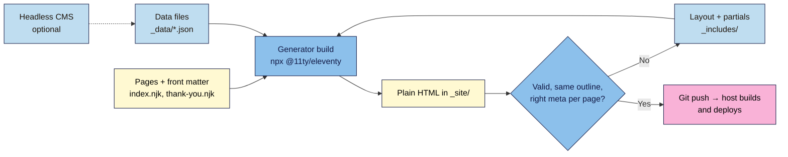

# M08.L03 — Templates, Static Site Generators & Headless CMS
> After this lesson your launch page is built from one layout, shared header and footer files and a data file, so a second page (or a second language) takes minutes, not a copy-paste afternoon. You'll also know when a generator, a headless CMS, WordPress or a no-code builder is the better choice.

**Time:** ~18 min reading + ~55 min exercise · **Level:** L3 Advanced · **Prereqs:** M04.L01, M04.L05 · **Remediate to:** M04.L05
**Verified against:** Eleventy 3.1.7 (current on npm, Node 18 or newer) and its docs (layouts, `_includes`, `_data`, passthrough file copy, `eleventy.config.js`); Astro 7.4 on npm (needs Node 22.23 or newer); Decap CMS 3.17 on npm; GitHub Docs "Using custom workflows with GitHub Pages" and the current major versions of `actions/checkout` (v7), `actions/setup-node` (v7), `actions/upload-pages-artifact` (v5) and `actions/deploy-pages` (v5) from GitHub's release API; all checked 2026-11-03. The Eleventy example in Part B, its output the `permalink` and passthrough results, and the "template not found" and config-loading errors were produced by a real Eleventy 3.1.7 build on 2026-11-03. The GitHub Actions workflow was not run. No browser tests were run.

> ⚠️ **Freshness flag:** generators release major versions about once a year, and Action versions (`@v7`, `@v5`) move on. If a command or version fails, check the project's own "Get started" page and the Action's README. The ideas (layouts, partials, data, build to plain HTML) have been stable for over a decade.

## Learning objectives
1. **Identify** repeated parts of a site (head/meta, header, footer, CTA, testimonial card) and **explain** how a static site generator turns templates, partials and data files into plain HTML at build time. *(O1)*
2. **Build** the launch page with Eleventy (Astro as the alternative): a base layout, header and footer partials, a data file, and a second page that reuses them; **deploy** it from the same Git repo. *(O2)*
3. **Choose** between hand-coding, a generator, a headless CMS, WordPress and a no-code builder for a given team and content volume, and **justify** the trade-offs. *(O3)*

## Why it matters
Lucía's agency hand-codes a launch page, then the client asks for a thank-you page, a privacy page, a Spanish version and three campaign variants. Seven copies of the same header later, the client changes the logo and the menu. Someone updates five files and misses two; one page still links to the old pricing; the privacy link in three footers is broken. Copy-paste works for one page and fails at seven. A **template** fixes it at the root: the header lives in **one** file, every page uses it, and the build writes plain HTML that's just as fast and accessible as the hand-coded version.

## Core concept
**Plain version:** a **static site generator (SSG)** is a program that runs **before** you deploy. It takes your **layouts** (the page frame), **partials** (reusable pieces such as the header), **data files** (testimonials, prices) and **content pages**, and writes finished `.html` files into an output folder. Visitors get ordinary static pages, exactly like Module 2's, with no database and no server code.

**Analogy:** a mail merge. The letter template has the letterhead and signature once; the spreadsheet holds names and addresses; "merge" prints a finished letter per row. The generator is the merge, your layout is the letterhead, and `_data/` is the spreadsheet.

### The parts in Eleventy
| Part | Where it lives | What it does | Nila Coffee example |
|---|---|---|---|
| **Layout** | `_includes/base.njk` | The page frame: `<head>`, header, footer; `{{ content }}` marks where each page goes | One `<head>` with title, description, canonical, Open Graph |
| **Partial (include)** | `_includes/header.njk` | A piece reused inside layouts or pages | Header with logo and nav; footer with privacy link |
| **Data file** | `_data/site.json`, `_data/testimonials.json` | Values every template can use, by file name | `site.name`, `site.url`; the testimonials list |
| **Page + front matter** | `index.njk`, `thank-you.njk` | The page's own content; the `---` block on top sets its layout and values | `title`, `description`, `noindex: true` |
| **Output** | `_site/` | The finished HTML you deploy (never edit it by hand) | `_site/index.html`, `_site/thank-you/index.html` |
| **Config** | `eleventy.config.js` | Settings, e.g. which folders to copy as they are | Copy `images/`, `css/`, `js/` |

**Templating language:** Eleventy works with several; this lesson uses **Nunjucks** (`.njk`): `{{ value }}` prints a value, `…` repeats, `…` decides, and `` inserts a partial. Nunjucks in Eleventy **escapes** values by default (an apostrophe becomes `&#39;`), the same safety idea as `textContent` in Lesson 8.1. `| safe` turns that off: use it only for HTML you built yourself, such as `{{ content | safe }}`.

### Where does the content come from?
| Approach | Who edits content | How | Good for |
|---|---|---|---|
| **Hand-coded HTML** | Developers | Edit files | One or two pages |
| **SSG (Eleventy, Astro, Hugo)** | Developers, or anyone comfortable with Markdown and Git | Edit templates, Markdown and data files; build on deploy | Small sites, landing pages, docs, blogs with a technical owner |
| **SSG + Git-based headless CMS** (e.g. Decap CMS) | Marketers, in a web editor | The editor saves to the Git repo; the site rebuilds | Non-technical editors on an SSG site, no database |
| **SSG + API-based headless CMS** (e.g. Contentful, Sanity, Storyblok) | Marketers, in a hosted editor | Content lives in the vendor's database; the build fetches it through an API (Lesson 8.2) | Many editors, many channels (site, app, emails) |
| **WordPress** (WordPress 101) | Anyone | Admin screen; pages built on the server | Blogs, plugins, many editors, e-commerce |
| **No-code builder** (Webflow, Framer, Carrd) | Designers, marketers | Visual editor, hosted | Fast visual work; accept the platform's limits and pricing |

"**Headless**" means the CMS manages content but has no "head" (no front-end of its own): your generator or app decides how it looks.

## How it works



**In words:** the generator combines each page with its layout, the partials and the data files, and writes plain HTML into `_site/`. A headless CMS, if you add one, just feeds the data and content. Check the output like any hand-written page (validator, outline, meta tags per page), then push: the host runs the same build and publishes `_site/`.

## Hands-on walkthrough

**Part A: find the repeats (5 min)**
1. Open your launch page and any second page you have (thank-you, privacy). List what is identical or nearly identical: `<head>` tags, header and nav, footer, CTA block, testimonial cards.
   **Expected:** a list like *head (title/description differ), header (same), footer (same), testimonials (same shape, different text)*. Identical → **partial**. Same shape, different values → **data file + loop**. Different per page → **front matter**.

**Part B: rebuild the page with Eleventy (25 min)**
1. Install **Node.js LTS** from nodejs.org if you don't have it (VS Code's terminal, Lesson 4.1: `node --version` should print v18 or newer). On a branch (`git switch -c eleventy`), in your launch-page repo:
   ```bash
   npm init -y
   npm install @11ty/eleventy
   ```
   In `package.json`, add `"type": "module",` (so the config file below works), and add `node_modules/` and `_site/` to `.gitignore`.
   **Expected:** a `package.json` listing `@11ty/eleventy` 3.x, and a `node_modules/` folder Git ignores.
2. Create `eleventy.config.js`:
   ```js
   export default function (eleventyConfig) {
     eleventyConfig.addPassthroughCopy("images");
     eleventyConfig.addPassthroughCopy("css");
     eleventyConfig.addPassthroughCopy("js");
     // Files from earlier modules that must reach the live site unchanged:
     eleventyConfig.addPassthroughCopy("robots.txt");   // Lesson 7.4
     eleventyConfig.addPassthroughCopy("sitemap.xml");  // Lesson 7.4
     eleventyConfig.addPassthroughCopy("icon.svg");     // Lesson 2.5 favicon
   }
   ```
   Anything that isn't a template and isn't listed here **won't be in `_site/`**, so it disappears from your live site.
3. Create the data files. `_data/site.json`:
   ```json
   { "name": "Nila Coffee", "url": "https://nilacoffee.example", "lang": "en", "year": 2026 }
   ```
   `_data/testimonials.json` (real quotes only, Lesson 2.2):
   ```json
   [
     { "quote": "The freshest coffee I've had outside a café.", "name": "Thandiwe M.", "city": "Johannesburg" },
     { "quote": "Pausing for a month took ten seconds.", "name": "Arjun K.", "city": "Pune" }
   ]
   ```
4. Move your `<head>`, header and footer into `_includes/`. `_includes/base.njk` (keep your M06 consent and GTM snippets at the top of `<head>`, and your M07 tags, exactly as they were):
   ```html
   <!DOCTYPE html>
   <html lang="{{ lang or site.lang }}">
   <head>
     <meta charset="utf-8">
     <meta name="viewport" content="width=device-width, initial-scale=1">
     <title>{{ title }} | {{ site.name }}</title>
     <meta name="description" content="{{ description }}">
     <link rel="canonical" href="{{ site.url }}{{ page.url }}">
     <meta name="robots" content="noindex">
     <meta property="og:title" content="{{ ogTitle or title }}">
     <meta property="og:url" content="{{ site.url }}{{ page.url }}">
     <!-- …the rest of your og:, twitter:, JSON-LD, CSS and deferred scripts… -->
   </head>
   <body>
     
     <main>
       {{ content | safe }}
     </main>
     
   </body>
   </html>
   ```
   `_includes/header.njk` gets your `<header>…</header>`, and `_includes/footer.njk` your `<footer>…</footer>`, using `{{ site.name }}` and `{{ site.year }}` where the brand name and year appear.
5. Turn `index.html` into `index.njk`: keep only what's inside `<main>`, add front matter on top, and replace the testimonial blocks with a loop:
   ```html
   ---
   layout: base.njk
   title: Fresh Coffee Beans Delivered Monthly
   description: Beans roasted this week and shipped within 3 days. Join the launch list for 10% off.
   ogTitle: Fresh beans every month, roasted this week
   ---
   <section aria-labelledby="hero-title">
     <h1 id="hero-title">Fresh beans every month</h1>
     …
   </section>
   <section aria-labelledby="proof-title">
     <h2 id="proof-title">What customers say</h2>
     
     <figure>
       <blockquote><p>{{ t.quote }}</p></blockquote>
       <figcaption>{{ t.name }}, {{ t.city }}</figcaption>
     </figure>
     
   </section>
   ```
6. Add a second page, `thank-you.njk` (your M05/M08.L02 thank-you page):
   ```html
   ---
   layout: base.njk
   title: Thanks for joining
   description: You're on the Nila Coffee launch list.
   noindex: true
   permalink: thank-you.html
   ---
   <h1>Thanks, you're on the list</h1>
   <p>One email on launch day, 1 December. <a href="/">Back to the home page</a>.</p>
   ```
   **Keep your URLs.** By default Eleventy writes `thank-you.njk` to `/thank-you/` (a folder with an `index.html`). Your Lesson 8.2 redirect, your sitemap and any analytics that use the old address expect `/thank-you.html`, so `permalink: thank-you.html` keeps it. Do the same for any other page whose URL is already live or shared; changing a URL breaks links and search results unless you also set up redirects.
7. Build and preview:
   ```bash
   npx @11ty/eleventy --serve
   ```
   **Expected (checked with Eleventy 3.1.7):** lines like `[11ty] Writing ./_site/index.html from ./index.njk`, `[11ty] Writing ./_site/thank-you.html from ./thank-you.njk`, then `Copied … Wrote 2 files in … seconds (v3.1.7)`; `_site/` also contains `robots.txt`, `sitemap.xml` and `icon.svg`, and a local address (usually `http://localhost:8080/`). Both pages share one header and footer. The thank-you page's built `<head>` contains `<title>Thanks for joining | Nila Coffee</title>` and `<meta name="robots" content="noindex">`; the home page doesn't have the `noindex` line. The description shows `You&#39;re`: that's the automatic escaping, and browsers display it as "You're".
   > 🖼️ **Image prompt:** Desktop screenshot (1440×900) of VS Code with the Eleventy project's file tree (_data, _includes, index.njk, thank-you.njk, eleventy.config.js, _site) on the left and the terminal showing "[11ty] Writing ./_site/index.html from ./index.njk" and "Wrote 2 files". Outline the _includes folder and the terminal output. Highlight the key element with a 3px #F9B2D7 outline; blur any personal details.
   > **Alt text:** VS Code showing an Eleventy project's folders and a terminal build writing two HTML pages to _site.

**Part C: prove nothing got worse (8 min)**
1. Paste `_site/index.html` (open it, copy all) into the W3C checker with **outline** ticked (Lesson 2.3).
   **Expected:** valid, with the same heading outline as your hand-coded page.
2. List every page's title from the terminal: `grep -rh "<title>" _site`.
   **Expected:** one **different** title per page.
3. Open the preview in a private window: consent banner, `generate_lead` (Module 6) and the lead flow (Lesson 8.2) behave exactly as before. Run one mobile Lighthouse pass (Lesson 7.1) if you like; plain HTML output should score the same as before.

**Part D: deploy with GitHub Actions (10 min)**
GitHub Pages served your files as they were. Now the host must **build** first.
1. In GitHub: **Settings → Pages → Build and deployment → Source: GitHub Actions**. Your custom domain (Lesson 4.4) stays set on this same page.
2. Create `.github/workflows/deploy.yml`:
   ```yaml
   name: Build and deploy
   on:
     push:
       branches: [main]
   permissions:
     contents: read
     pages: write
     id-token: write
   concurrency:
     group: pages
     cancel-in-progress: false
   jobs:
     build:
       runs-on: ubuntu-latest
       steps:
         - uses: actions/checkout@v7
         - uses: actions/setup-node@v7
           with:
             node-version: 22
         - run: npm ci
         - run: npx @11ty/eleventy
         - uses: actions/upload-pages-artifact@v5
           with:
             path: _site
     deploy:
       needs: build
       runs-on: ubuntu-latest
       environment:
         name: github-pages
         url: ${{ steps.deployment.outputs.page_url }}
       steps:
         - id: deployment
           uses: actions/deploy-pages@v5
   ```
   Commit `package-lock.json` too (`npm ci` needs it). Merge and push: `git switch main && git merge eleventy && git push`.
   **Expected:** the repo's **Actions** tab shows "Build and deploy" with two green jobs, and your live site shows the generated pages. On Netlify or Cloudflare Pages instead, set **Build command** `npx @11ty/eleventy` and **Output directory** `_site`.
   > 🖼️ **Image prompt:** Desktop screenshot (1440×900) of a GitHub repository's Actions tab showing a successful "Build and deploy" run with green "build" and "deploy" jobs and the deployed page URL. Outline the two green jobs. Highlight the key element with a 3px #F9B2D7 outline; blur any personal details.
   > **Alt text:** GitHub Actions run with successful build and deploy jobs for the Eleventy site.

**Part E: break it and fix it (7 min)** Plant each bug, rebuild, observe, fix.
1. **One title for every page:** in `base.njk`, replace `{{ title }} | {{ site.name }}` with the fixed text `Fresh Coffee Beans Delivered Monthly | Nila Coffee`.
   **Expected:** `grep -rh "<title>" _site` shows the **same** title twice. Search engines see duplicate titles (Lesson 2.5). Fix: put the variable back.
2. **A broken partial path:** change `` to ``.
   **Expected (checked):** the build stops with `[11ty] Problem writing Eleventy templates:` and `Error: template not found: heder.njk`. Nothing new is deployed, which is good: a failed build is safer than a broken page. Fix the name.
3. **`noindex` everywhere:** move `<meta name="robots" content="noindex">` out of the `` so it's always printed.
   **Expected:** `grep -rl 'name="robots"' _site` lists **every** page, including the home page. Deployed, this would drop your whole site from search (Lesson 7.4). Fix: put the `` back.

## When to use / when not to
- **Hand-code** one or two pages that rarely change. Adding a build step costs more than it saves.
- **Use an SSG** from about three pages with shared parts, or when you'll add languages or campaign variants (Lesson 8.4). **Eleventy** is close to plain HTML and needs little JavaScript knowledge. **Astro** suits component-based work (and React/Vue components if you need them), but its current version needs a newer Node (22.23 or later).
- **Add a headless CMS** when non-technical people must edit content regularly. **Git-based** (Decap CMS) keeps everything in your repo and is free to run; **API-based** (Contentful, Sanity, Storyblok) is better for many editors and channels, but the content lives with a vendor: check free-plan limits, export options and data location.
- **Choose WordPress** (WordPress 101) when you need a blog with many authors, plugins, comments or a shop, and someone to keep it updated. **Choose a no-code builder** for fast visual work if you accept its pricing and lock-in.
- **Trade-off:** every layer (build step, CMS, vendor) adds speed for editors but adds something that can break and something to maintain. Pick the simplest option your team can actually run.

## Use AI for this
**Example prompt:**
> "Here is my hand-coded landing page [paste]. Convert it to Eleventy 3 with Nunjucks: an _includes/base.njk layout with all head tags (title, description, canonical and og:url from front matter and _data/site.json), header and footer partials, a _data/testimonials.json loop, and index.njk with front matter. Keep every visible word, heading level, id, aria attribute and script tag unchanged. Don't add plugins or packages. List the files and say what moved where."

**What AI does well here:** mechanical splitting of one page into layout, partials and data, and writing the loop and front matter.
**Where it gets it wrong:** it mixes Eleventy versions (old `.eleventy.js` with `module.exports` vs v3's ESM `export default`), adds plugins you don't need, drops your consent or GTM snippet from the head, or uses `| safe` on data that should be escaped.
**How to check:** build it, diff the visible text against the old page, run the validator and outline check, `grep` the titles, and confirm consent and tracking still work (Part C).

## Common mistakes
- **Editing files in `_site/`.** They're overwritten on every build. Edit the source.
- **Committing `_site/` and `node_modules/`.** Add both to `.gitignore`; the host builds them.
- **Hard-coding per-page values** (title, description, canonical, `noindex`) in the layout.
- **Forgetting passthrough copy,** so images, CSS, JS, `robots.txt` or `sitemap.xml` are missing from `_site/` and the live site.
- **Letting URLs change** (`/thank-you.html` → `/thank-you/`) without a `permalink` or redirects.
- **`| safe` on data** (testimonials, form values). Let the template escape it.
- **Losing tracking or consent** when moving the head into a layout. Check Part C every time.
- **Choosing a stack for the CV, not the team.** An API-based CMS nobody on the team can maintain is worse than Markdown files.

## Troubleshooting
| Symptom | Likely cause | Fix |
|---|---|---|
| `Error: template not found: …` | Wrong partial or layout name, or it isn't in `_includes/` | Fix the path; names are case-sensitive |
| Images/CSS, `robots.txt` or `sitemap.xml` 404 on the built site | No `addPassthroughCopy` for that folder or file | Add it in `eleventy.config.js`, rebuild |
| Thank-you redirect or sitemap link 404s after the switch | Eleventy wrote `/thank-you/` instead of `/thank-you.html` | Add `permalink: thank-you.html` to the page's front matter |
| Links and images break only on `username.github.io/repo/` | Root-relative paths (`/images/…`) point to the domain root, not the repo folder | Use your custom domain (Lesson 4.4), or set Eleventy's `pathPrefix` and wrap links in the `url` filter |
| `Eleventy Fatal Error` … `Error in your Eleventy config file 'eleventy.config.js'`, with a Node warning "Failed to load the ES module… set \"type\": \"module\"" (checked) | `package.json` lacks `"type": "module"` | Add it, or name the file `eleventy.config.mjs` |
| `&#39;` or `&amp;` shown literally on the page | Escaped twice (e.g. you escaped the data yourself) | Store plain text in `_data`; let Nunjucks escape once |
| Raw `{{ title }}` appears in the output | The file isn't processed as a template (wrong extension, or it's passthrough-copied) | Use `.njk`; don't passthrough-copy page files |
| GitHub Action fails at `npm ci` | No `package-lock.json` committed, or lock out of date | Commit the lock file; run `npm install` locally and commit again |
| Live site shows old content after a green deploy | Browser or CDN cache | Hard-reload; check the deploy's time on the Actions run |

## Exercise
**Task:** convert **your** launch page to a generator (Eleventy, or Astro if you prefer) and add one more page from the same layout:
1. A layout with every head tag driven by front matter or `_data`, header and footer partials, and at least one data file with a loop.
2. Your home page and a second page (thank-you, privacy or a campaign variant) with different title, description and canonical, and `noindex` only where it belongs.
3. The Part C checks (validator + outline, titles per page, consent and lead flow) and a successful automated deploy.
4. A short **stack decision note**: who edits the content, how often, which option from the "Where does the content come from?" table you chose, and one thing that would make you switch.

**Expected outcome:** the live site rebuilt from templates with no visible change on the home page, a second page that reuses the layout, a green deploy run, and a five-line decision note.
**Stretch goal:** add Decap CMS (follow its Eleventy starter docs) so a non-technical teammate can edit `_data/testimonials.json` in a web editor, and watch their edit arrive as a Git commit that triggers a deploy.

## Key takeaways
- An **SSG** builds plain HTML **before** deploy from **layouts**, **partials**, **data files** and **pages with front matter**; visitors get ordinary static pages.
- Put anything repeated in **one** place; put anything per-page (title, description, canonical, `noindex`) in **front matter**.
- Nunjucks **escapes** by default; use `| safe` only for HTML you built.
- After converting, **prove nothing got worse**: validator, outline, per-page titles, consent and tracking.
- Pick the simplest stack your team can run: hand-coded → SSG → SSG + headless CMS → WordPress or no-code, by **who edits** and **how much content**.

## Teach it back
Explain to a friend in 3 sentences what a static site generator does that copy-paste doesn't, and why a broken build is actually safer than a broken page.

## Glossary terms added
- Static site generator (SSG) — added to `webdev-101/glossary.md`
- Template / layout — added to `webdev-101/glossary.md`
- Partial (include) — added to `webdev-101/glossary.md`
- Front matter — added to `webdev-101/glossary.md`
- Data file (`_data`) — added to `webdev-101/glossary.md`
- Build step / build output (`_site`) — added to `webdev-101/glossary.md`
- Passthrough copy — added to `webdev-101/glossary.md`
- Nunjucks — added to `webdev-101/glossary.md`
- Headless CMS (Git-based, API-based) — added to `webdev-101/glossary.md`
- GitHub Actions / workflow — added to `webdev-101/glossary.md`

## Further reading
*All checked 2026-11-03.*
- Eleventy — Get started: https://www.11ty.dev/docs/
- Eleventy — Layouts: https://www.11ty.dev/docs/layouts/
- Eleventy — Global data files (`_data`): https://www.11ty.dev/docs/data-global/
- Eleventy — Passthrough file copy: https://www.11ty.dev/docs/copy/
- Nunjucks — Templating reference: https://mozilla.github.io/nunjucks/templating.html
- Astro — Install and set up: https://docs.astro.build/en/install-and-setup/
- Decap CMS — Docs (Git-based headless CMS): https://decapcms.org/docs/
- GitHub Docs — Using custom workflows with GitHub Pages: https://docs.github.com/en/pages/getting-started-with-github-pages/using-custom-workflows-with-github-pages

## Refresher card
*Used by remediation when a learner fails a quiz twice on a later lesson that points back here.*
SSG = build plain HTML before deploy. Eleventy: layout `_includes/base.njk` with `{{ content | safe }}`; partials via ``; data in `_data/*.json` (used by file name, e.g. `testimonials`); pages `.njk` with front matter (`layout`, `title`, `description`, `noindex`); config `eleventy.config.js` (`addPassthroughCopy` for images/CSS/JS); output `_site/` (don't edit or commit). Build `npx @11ty/eleventy` (`--serve` to preview). Check: validator + outline, unique titles, consent/tracking. Deploy: Pages source = GitHub Actions, or host build command + `_site`. Choose stack by who edits and how much content.
