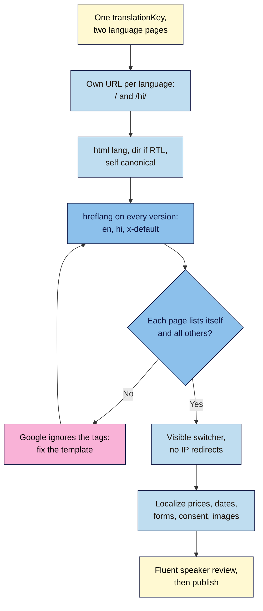

# M08.L04 — Going Global: Multilingual & Multi-Region Sites
> After this lesson your launch page has a second-language version at its own URL, with the right `lang`, a visible language switcher, `hreflang` links that search engines can follow, and prices, dates and wording that feel local, checked by a fluent speaker rather than trusted to a machine.

**Time:** ~19 min reading + ~50 min exercise · **Level:** L3 Advanced · **Prereqs:** M07.L04, M08.L03 · **Remediate to:** M07.L04
**Verified against:** Google Search Central "Tell Google about localized versions of your page" (ISO 639-1 language and ISO 3166-1 Alpha 2 region codes; region alone is not valid; each version must list itself and all others, and tags that don't point to each other are ignored; fully qualified URLs; HTML, HTTP header and sitemap methods are equivalent; `x-default` for unmatched users) and "Managing multi-regional and multilingual sites" (Google uses visible content, not `lang` attributes, to detect language; avoid automatic redirects; don't use IP analysis to adapt content; URL parameters not recommended); W3C WCAG 2.2 (3.1.1 Language of Page, 3.1.2 Language of Parts); MDN `Intl.NumberFormat` and `Intl.DateTimeFormat`; all read 2026-11-03. The Eleventy example (hreflang generated from `translationKey`, the switcher and translated strings) was built for real with Eleventy 3.1.7, and the `Intl` outputs were produced with Node 24 on 2026-11-03. No browser tests were run.

> Note: the Hindi text in this lesson is a short draft for the example. Like any translation you publish, it should be checked by a fluent speaker; that check is part of the exercise.

> ⚠️ **Freshness flag:** Google's international guidance has been stable for years, but Search Console reports, browser translation features and AI translation quality change. Re-read Google's two pages before a large launch.

## Learning objectives
1. **Structure** a second-language version with its own URL, set `lang` (and `dir` for right-to-left scripts) and a self-canonical per language, and **add** a visible language switcher that never redirects visitors automatically by IP. *(O1)*
2. **Add** `hreflang` annotations (reciprocal, self-referencing, `x-default`) in the `<head>` or the sitemap, and **verify** them by reading the generated HTML. *(O2)*
3. **Localize**, not just translate: dates, numbers and currency (`Intl.DateTimeFormat`, `Intl.NumberFormat`), prices, examples, images and alt text, form labels and consent/privacy text; **review** machine or AI translation with a fluent speaker before publishing. *(O3)*

## Why it matters
Nila Coffee's founder wants Hindi-speaking customers in North India. A plugin "translates" the page in the visitor's browser and the site redirects anyone with an Indian IP to it. Results: Google only ever sees English (its crawler usually comes from the US and is redirected nowhere), so the Hindi page never appears in search; an English-speaking customer in Delhi is forced into Hindi with no way back; the button reads "Join the launch list" in a literal translation nobody would say; the price shows `$` to Indian visitors; and the cookie banner stays in English, so consent isn't clearly informed. A second language is a second **site experience**, not a filter on the first one.

## Core concept
**Plain version:** give each language its **own URL** with real translated content. Tell browsers and screen readers the language with `lang`. Tell search engines how the versions relate with **`hreflang`** links, where every version lists all versions, including itself. Let people **choose** with a visible switcher; never force them by IP. Then **localize**: currency, dates, examples, images and legal text, checked by someone fluent.

**Analogy:** a restaurant with menus in two languages. Each menu is complete on its own (own URL). The cover says which language it is (`lang`). Each menu says "also available in: English, हिन्दी" (`hreflang` and the switcher). The waiter hands you the menu you ask for, not the one they guess from your accent (no IP redirects). And the dishes are priced in the local currency (localization).

### Choosing the URL structure
| Structure | Example | Google's view | Good for |
|---|---|---|---|
| **Subdirectory** | `nilacoffee.example/hi/` | Easy to set up on one host | Most small sites: one domain, one repo, one deploy (this lesson) |
| **Subdomain** | `hi.nilacoffee.example` | Users may not know if `hi` means language or country | Separate teams or hosting per language |
| **Country domain** | `nilacoffee.in`, `nilacoffee.de` | Clear country targeting; costly; one country each | Big businesses with country operations |
| **URL parameter** | `?lang=hi` | **Not recommended** | Avoid |
| **Same URL, swapped by cookie or browser setting** | — | Google recommends **different URLs per language** instead | Avoid for public pages |

### `lang` is for people and browsers; `hreflang` is for search engines
- `<html lang="hi">` tells screen readers which voice to use, browsers which fonts, hyphenation and translation offers to use (WCAG 3.1.1). For a phrase in another language inside a page, mark that part, e.g. an English customer quote on the Hindi page: `<blockquote lang="en">…</blockquote>` (WCAG 3.1.2). Proper names such as "Nila Coffee" and technical terms are exempt: no `lang` needed. Right-to-left scripts (Arabic, Urdu, Hebrew) also need `dir="rtl"` on `<html>`.
- Google says it **doesn't use** `lang` or `hreflang` to detect a page's language; it reads the visible content. `hreflang` tells Google *which other versions exist*, so it can show the right one to each searcher.

### `hreflang` rules (from Google's documentation)
```html
<!-- On BOTH the English and the Hindi page, identical: -->
<link rel="alternate" hreflang="en" href="https://nilacoffee.example/">
<link rel="alternate" hreflang="hi" href="https://nilacoffee.example/hi/">
<link rel="alternate" hreflang="x-default" href="https://nilacoffee.example/">
```
- **Every version lists itself and all others.** If two pages don't point to each other, Google ignores the tags.
- **Codes:** language from ISO 639-1 (`en`, `hi`, `es`), optionally plus a region from ISO 3166-1 Alpha 2 (`en-GB`, `es-MX`). A region alone isn't valid. `UK` isn't a region code (use `GB`); `in` is not "India" or "Hindi" (Hindi is `hi`, India is `IN`, so `hi-IN` or `en-IN`).
- **Full URLs** with `https://`, never `/hi/`.
- **`x-default`** is the fallback for anyone whose language matches none of your versions. Google's examples point it at a language-selector page; pointing it at your main version, as this lesson does, is common practice for small sites.
- **One method is enough:** `<head>` links, HTTP headers or the XML sitemap; Google treats them the same.
- **Canonical:** each language page's canonical points to **itself**. A Hindi page whose canonical points to the English page asks Google to drop the Hindi page.

### Localize, don't just translate
| Element | English (India) | Hindi | Tool |
|---|---|---|---|
| Price | ₹1,299.00 | ₹1,299.00 | `Intl.NumberFormat('hi-IN', { style: 'currency', currency: 'INR' })` |
| Launch date | 1 December 2026 | 1 दिसंबर 2026 | `Intl.DateTimeFormat('hi-IN', { dateStyle: 'long' })` |
| Same price for Germany | — | — | `de-DE`, EUR → `1.299,00 €` |
| Button text | "Join the launch list" | Written by a fluent speaker, not word-for-word | People |
| Images and alt | Photos and alt text that fit the market | Alt text translated too | People |
| Form labels, errors, consent banner, privacy notice | All translated, and legally right for the region (Lesson 6.4) | | People + local rules |

(Outputs above produced with Node 24 on 2026-11-03; browsers use the same `Intl` data, but tiny differences between engines are possible.)

## How it works



**In words:** pages that are translations of each other share a key. Each gets its own URL, its own `lang` and a canonical to itself. The template prints `hreflang` links for every version on every version, plus `x-default`, so the set is always reciprocal. Visitors switch with a visible menu, never by redirect. Prices, dates, forms, consent and images are localized, and a fluent speaker reviews everything before it goes live.

## Hands-on walkthrough

Work in the Eleventy project from Lesson 8.3, on a branch: `git switch -c hindi`. Use **your** second language; the steps show Hindi.

**Part A: give each page a language and a translation key (8 min)**
1. In `index.njk`'s front matter add:
   ```yaml
   lang: en
   translationKey: home
   ```
   Add `lang: en` to `thank-you.njk` too (it has no translation yet).
2. Create `hi/index.njk`. Translate your real content (your own words, or a draft you'll have reviewed in Part E):
   ```html
   ---
   layout: base.njk
   lang: hi
   translationKey: home
   title: हर महीने ताज़ी कॉफ़ी बीन्स
   description: इसी हफ़्ते भुनी हुई बीन्स, 3 दिन में आपके घर।
   ---
   <section aria-labelledby="hero-title">
     <h1 id="hero-title">हर महीने ताज़ी कॉफ़ी बीन्स</h1>
     …
   </section>
   ```
   **Expected:** after building, `_site/hi/index.html` exists with `<html lang="hi">` (your layout already prints `{{ lang or site.lang }}`) and its own canonical, `https://…/hi/`.

**Part B: generate reciprocal `hreflang` from the template (10 min)**
1. In `_includes/base.njk`, under the canonical line, add:
   ```html
   
   
   <link rel="alternate" hreflang="{{ p.data.lang }}" href="{{ site.url }}{{ p.url }}">
   
   <link rel="alternate" hreflang="x-default" href="{{ site.url }}{{ p.url }}">
   
   
   ```
   Every page with the same `translationKey` lists all pages with that key, itself included, so the set is reciprocal by design. Your main language (`site.lang`, English) doubles as `x-default`.
2. Build (`npx @11ty/eleventy --serve`) and open `_site/hi/index.html` in VS Code.
   **Expected (checked with Eleventy 3.1.7):**
   ```html
   <html lang="hi">
   …
   <link rel="canonical" href="https://nilacoffee.example/hi/">
   <link rel="alternate" hreflang="en" href="https://nilacoffee.example/">
   <link rel="alternate" hreflang="x-default" href="https://nilacoffee.example/">
   <link rel="alternate" hreflang="hi" href="https://nilacoffee.example/hi/">
   ```
   and the **same three `alternate` lines** in `_site/index.html`.
   > 🖼️ **Image prompt:** Desktop screenshot (1440×900) of VS Code with `_site/index.html` and `_site/hi/index.html` side by side, both showing the same three `<link rel="alternate" hreflang=…>` lines (en, x-default, hi) and different canonical and `lang` values. Outline the three hreflang lines in both files. Highlight the key element with a 3px #F9B2D7 outline; blur any personal details.
   > **Alt text:** The English and Hindi built pages side by side, each listing the same en, hi and x-default hreflang links.
3. If you keep a hand-written `sitemap.xml` (Lesson 7.4), add `/hi/` to it. You don't need hreflang in the sitemap as well: one method is enough.

**Part C: a language switcher and translated interface text (12 min)**
1. Create `_data/strings.json` for words that live in partials:
   ```json
   {
     "en": { "langName": "English", "home": "home", "privacy": "Privacy", "switcher": "Language" },
     "hi": { "langName": "हिन्दी", "home": "होम", "privacy": "गोपनीयता", "switcher": "भाषा" }
   }
   ```
2. In `_includes/header.njk`, add the switcher (shown only on pages that have translations):
   ```html
   
   <nav aria-label="{{ strings[lang].switcher }}">
     <ul>
     
       <li><a href="{{ p.url }}" hreflang="{{ p.data.lang }}" lang="{{ p.data.lang }}" aria-current="page">{{ strings[p.data.lang].langName }}</a></li>
     
     </ul>
   </nav>
   
   ```
   Each language is named **in its own language** ("हिन्दी", not "Hindi"), with `lang` on the link so screen readers pronounce it correctly. No flags: flags are countries, not languages.
3. Replace fixed words in partials with strings, e.g. the footer's `Privacy` → `{{ strings[lang].privacy }}`, and the logo alt → `{{ site.name }} {{ strings[lang].home }}`.
   **Expected (checked):** on `/hi/`, the header shows `English` and `हिन्दी` (the latter with `aria-current="page"`), the navigation is labelled `भाषा`, and the footer link reads `गोपनीयता`.
   > 🖼️ **Image prompt:** Mobile screenshot (390×844) of the Hindi version of the Nila Coffee launch page showing the header language switcher with "English" and "हिन्दी" (current), the Hindi hero heading, and a price formatted as ₹1,299.00. Outline the switcher. Highlight the key element with a 3px #F9B2D7 outline; blur any personal details.
   > **Alt text:** Hindi launch page on a phone with an English/हिन्दी language switcher and a rupee price.

**Part D: localize prices, dates, forms and consent (12 min)**
1. Format prices and dates with `Intl` instead of typing them. In your page script (deferred, Lesson 7.1):
   ```js
   // Formats every <data class="price" value="1299" data-currency="INR"> on the page
   const locale = document.documentElement.lang === 'hi' ? 'hi-IN' : 'en-IN';
   for (const el of document.querySelectorAll('data.price')) {
     el.textContent = new Intl.NumberFormat(locale, {
       style: 'currency', currency: el.dataset.currency
     }).format(Number(el.value));
   }
   ```
   with `<data class="price" value="1299" data-currency="INR">₹1,299</data>` in the HTML, so the price is still readable without JavaScript.
   **Expected (checked in Node 24):** `₹1,299.00` for both `en-IN` and `hi-IN`; a German page with `EUR` would show `1.299,00 €`. Dates with `Intl.DateTimeFormat('hi-IN', { dateStyle: 'long' })` show `1 दिसंबर 2026`.
2. Translate the **form** (labels, hint, button, your M05.L04 error messages: pick them by `document.documentElement.lang`), the **consent banner** text and the **auto-reply** (Lesson 8.2: send the Hindi version when a hidden `lang` field says `hi`).
3. Check the **privacy notice** and consent wording for the region the page targets (Lesson 6.4); a translated notice must say the same thing, legally, as the original.

**Part E: review, break it, fix it (8 min)**
1. **Fluent-speaker review.** Ask a fluent speaker (a customer, colleague or friend) to read the page aloud and mark anything unnatural, wrong or culturally off. Record their changes in your project note. Machine and AI translation are fine as a **first draft**, never as the final version.
2. **Break: not reciprocal.** Remove `translationKey: home` from `hi/index.njk` and rebuild.
   **Expected (checked):** `_site/index.html` now lists only `hreflang="en"` and `x-default`; the Hindi page lists nothing and loses its switcher. Hand-coded sites get into this state all the time, and Google then ignores the annotations. Fix: put the key back.
3. **Break: wrong codes.** Temporarily set `lang: in` on the Hindi page.
   **Expected (checked):** the built page says `hreflang="in"` and `<html lang="in">`, and the switcher's Hindi link is **empty** (`strings.in` doesn't exist), so it has no accessible name: `in` isn't a valid ISO 639-1 language code (Hindi is `hi`; India is the region `IN`), so search engines and screen readers can't use it. Similarly `en-UK` is wrong; it's `en-GB`. Fix: `hi`.
4. **Break: canonical to English.** In `base.njk`, temporarily change the canonical line to `<link rel="canonical" href="{{ site.url }}/">` and rebuild.
   **Expected:** `_site/hi/index.html` now has `<link rel="canonical" href="https://nilacoffee.example/">`. The Hindi page now tells Google "the English page is the real one", so it can drop out of search. Fix: restore `{{ site.url }}{{ page.url }}`, so each language's canonical points to itself.
5. Merge and deploy (Lesson 8.3's workflow), then open both live URLs and check the switcher, the `lang` and the `hreflang` lines in View Source.

## When to use / when not to
- **Translate a page** when you have real customers in that language and someone who can answer them in it. A translated page with an English-only support inbox disappoints people.
- **Language vs region:** use language-only codes (`hi`, `es`) unless content differs by country (prices, shipping, law). Then use language-region pairs (`en-IN`, `en-GB`) and make the content actually differ.
- **Browser translation** (Chrome's translate offer) is useful for visitors, but it isn't your multilingual site: search engines don't index it, and you can't review its wording.
- **Suggest, don't redirect:** a small banner ("यह पेज हिन्दी में भी है", "This page is also in Hindi") based on the browser's language is fine; forcing a redirect by IP or browser language isn't.
- **Trade-off:** every language multiplies upkeep (copy changes, legal text, support, auto-replies). Start with your most important page in one extra language, not the whole site in five.

## Use AI for this
**Example prompt:**
> "Translate this landing-page copy into Hindi for customers in North India [paste]. Natural, friendly marketing tone, not word-for-word. Keep the brand name 'Nila Coffee' in Latin script. Keep prices and numbers unchanged. Mark any phrase where you're unsure of the cultural fit, and give me a back-translation into English line by line so I can check the meaning."

**What AI does well here:** fast first drafts, back-translations for checking meaning, and lists of things to localize (dates, units, examples, idioms).
**Where it gets it wrong:** literal phrasing, wrong formality level, made-up idioms, mistranslated legal text, and confident output in languages with less training data. It also invents `hreflang` codes (`en-UK`, `in`, `hi-HI`).
**How to check:** a fluent speaker reads it aloud; legal and consent text is checked against the official source for that region; codes are checked against ISO 639-1 and ISO 3166-1 and the rules above.

## Common mistakes
- **One URL, language swapped by script or cookie.** Search engines only see one version.
- **Automatic redirects by IP or browser language.** They trap visitors and can hide versions from crawlers.
- **`hreflang` on one page only,** or missing the self-reference. Not reciprocal → ignored.
- **Invalid codes:** `en-UK`, `in`, region alone (`IN`), or `x-default` missing when you have many languages.
- **Relative `hreflang` URLs** (`/hi/`). They must be full `https://` URLs.
- **Every language's canonical pointing to the English page.**
- **Translating the body but not the title, description, Open Graph tags, alt text, form, consent banner and auto-reply.**
- **Flags for languages,** and language names in English only.
- **Publishing machine translation unreviewed.**

## Troubleshooting
| Symptom | Likely cause | Fix |
|---|---|---|
| Built page has no `hreflang` lines | Page missing `translationKey`, or the key differs between pages | Same `translationKey` value on all versions |
| Only one language listed on each page | Only one page has the key, or `lang` is missing on one | Check both front matters; rebuild |
| Switcher shows an empty list on some pages | Those pages have no translations | Wrap the switcher in `` (as in Part C) |
| Hindi text shows as boxes | Your web font lacks Devanagari glyphs | Add a font that covers the script (e.g. a Noto family), or let the fallback system font render it |
| Screen reader reads Hindi with an English voice | Missing or wrong `lang` on `<html>`, or on a mixed-language passage | `<html lang="hi">`; `lang` on passages in another language (not needed on brand names) |
| Search shows the English page to Hindi searchers | Hindi page not indexed yet, canonical points to English, or tags not reciprocal | URL Inspection on the Hindi URL (Lesson 7.4); fix canonical and tags; wait for recrawl |
| Price shows `NaN` or `₹NaN` | `value` attribute missing or not a plain number | `value="1299"` (no symbols or commas) |

## Exercise
**Task:** publish a second-language version of your launch page:
1. Choose the URL structure and write one sentence on why.
2. Create the translated page with `lang`, self-canonical, translated title, description and Open Graph tags, and a `translationKey`.
3. Generate reciprocal `hreflang` with `x-default`, and add the language switcher with names in each language.
4. Localize prices and dates with `Intl`, and translate the form, consent banner, auto-reply and privacy notice.
5. Get a fluent-speaker review and record what they changed.
6. Plant and fix the three bugs from Part E.

**Expected outcome:** two live URLs whose View Source shows matching `hreflang` sets and correct `lang` and canonicals, a working switcher, localized prices and dates, translated form and consent text, and a review note with at least three changes the fluent speaker made (or a note that they approved it unchanged).
**Stretch goal:** add a right-to-left language test page (e.g. Arabic or Urdu, a single section) with `dir="rtl"`, and check that your CSS layout mirrors correctly; logical properties such as `margin-inline-start` make this easier (Lesson 3.3).

## Key takeaways
- **One URL per language,** with real translated content; subdirectories (`/hi/`) suit most small sites.
- `lang` (and `dir`) is for people, browsers and screen readers; **`hreflang`** tells search engines which versions exist.
- `hreflang` must be **reciprocal and self-referencing**, use **valid ISO codes** and **full URLs**, with an **`x-default`**; generate it from a template so it can't drift.
- **Never auto-redirect** by IP or browser language; offer a visible switcher with language names in their own language.
- **Localize** prices, dates, forms, consent and images, and have a **fluent speaker** review every translation.

## Teach it back
Explain to a friend in 3 sentences why redirecting Indian visitors to the Hindi page by IP is a bad idea, and what to do instead.

## Glossary terms added
- Internationalization (i18n) / localization (l10n) — added to `webdev-101/glossary.md`
- `hreflang` — added to `webdev-101/glossary.md`
- `x-default` — added to `webdev-101/glossary.md`
- Reciprocal (return) links — added to `webdev-101/glossary.md`
- Language code (ISO 639-1) / region code (ISO 3166-1 Alpha 2) — added to `webdev-101/glossary.md`
- `dir` (right-to-left) — added to `webdev-101/glossary.md`
- Language switcher — added to `webdev-101/glossary.md`
- `Intl.NumberFormat` / `Intl.DateTimeFormat` — added to `webdev-101/glossary.md`
- Translation key — added to `webdev-101/glossary.md`
- Back-translation — added to `webdev-101/glossary.md`

## Further reading
*All checked 2026-11-03.*
- Google Search Central — Tell Google about localized versions of your page: https://developers.google.com/search/docs/specialty/international/localized-versions
- Google Search Central — Managing multi-regional and multilingual sites: https://developers.google.com/search/docs/specialty/international/managing-multi-regional-sites
- W3C — Language tags in HTML and XML: https://www.w3.org/International/articles/language-tags/
- W3C — Understanding WCAG 2.2: 3.1.1 Language of Page: https://www.w3.org/WAI/WCAG22/Understanding/language-of-page.html
- W3C — Structural markup and right-to-left text in HTML: https://www.w3.org/International/questions/qa-html-dir
- MDN — `Intl.NumberFormat`: https://developer.mozilla.org/en-US/docs/Web/JavaScript/Reference/Global_Objects/Intl/NumberFormat
- MDN — `Intl.DateTimeFormat`: https://developer.mozilla.org/en-US/docs/Web/JavaScript/Reference/Global_Objects/Intl/DateTimeFormat
- ISO — Online Browsing Platform (country codes, ISO 3166): https://www.iso.org/obp/ui/#search

## Refresher card
*Used by remediation when a learner fails a quiz twice on a later lesson that points back here.*
Own URL per language (`/hi/`), real translation. `<html lang="hi">` (+ `dir="rtl"` for RTL) for people and screen readers; Google detects language from visible content. `hreflang` on every version listing all versions incl. itself + `x-default`; ISO 639-1 language (+ optional ISO 3166-1 region: `en-GB`, not `en-UK`; Hindi `hi`, not `in`); full `https://` URLs; one method (head, header or sitemap). Each version's canonical = itself. Visible switcher, names in their own language; no IP/browser redirects. Localize with `Intl.NumberFormat`/`DateTimeFormat`; translate forms, consent, auto-reply, privacy; fluent-speaker review.
