# Web Development 101 — for Marketers & Content Creators — Syllabus

_Lessons are added per module by `/plan-module <N>`. Source of truth for topics: `course-outline.md`._

**At a glance:** 8 modules · 36 lessons · each lesson 10–25 min reading + a hands-on exercise and a 5–8 question quiz · one capstone per module · one launch page built from M02 and launched in the final "Launch Week" capstone.

Times below are **hands-on** estimates (on top of reading time). Each lesson header shows its level (L1/L2/L3) and "Remediate to" lesson.

| Module | Level | Lessons | Non-negotiables taught | Planned |
|--------|-------|---------|------------------------|---------|
| M01 How the Web Works | L1 | 5 | #1 | ✅ |
| M02 HTML: The Structure of Content | L1 | 5 | #2, #3, #8 | — |
| M03 CSS: Design, Brand & Layout | L1 | 5 | #4, #5 | — |
| M04 Publish It: Tools, Hosting & Domains | L2 | 5 | #6, #7 | — |
| M05 JavaScript for Marketers | L2 | 4 | #3 (reinforced) | — |
| M06 Tracking, Analytics & Consent | L2 | 4 | #9, #10 | — |
| M07 Fast, Accessible & Search-Ready | L3 | 4 | #11 | — |
| M08 Advanced: AI, Automation & Scale | L3 | 4 | #12 | — |

---

## M01 — How the Web Works (L1)

**Goal:** a clear mental model of what happens between typing a URL and seeing a page. · NN #1
**Zero install:** everything runs in a desktop or mobile browser.

```mermaid
flowchart LR
  %% alt: M01 lesson path: internet vs web, URLs and DNS, hosting and page loads, static vs dynamic, DevTools, then the module capstone.
  L1[L01 Internet vs the Web]:::cream --> L2[L02 URLs, domains & DNS]:::sky
  L2 --> L3[L03 Hosting & how a page loads]:::sky
  L3 --> L4[L04 Static vs dynamic,<br/>code vs CMS vs no-code]:::blue
  L4 --> L5[L05 First look at DevTools]:::blue
  L5 --> C[M01 Capstone:<br/>how this site works]:::pink

  classDef cream fill:#FFF9D2,color:#000000,stroke:#111844
  classDef sky   fill:#BFDDF0,color:#1F150C,stroke:#111844
  classDef blue  fill:#8CC0EB,color:#111844,stroke:#111844
  classDef pink  fill:#F9B2D7,color:#000000,stroke:#111844
```

### M01.L01 — The Internet vs the Web
- **File:** `lessons/m01-l01-internet-vs-web.md` · **Prereqs:** none · **Remediate to:** — (entry point; glossary) · **Hands-on:** ~20 min
- **Objectives:**
  1. **Distinguish** the Internet (the network) from the Web (one service on it) using everyday examples.
  2. **Explain** the roles of a client, a server and a browser in loading a page.
  3. **Demonstrate** that a browser turns code into a page by rendering HTML typed into the address bar.
- **Hands-on idea:** sort 10 things you did online today into "Web" and "other Internet services"; render a one-line web page from the address bar with no tools; pick the brand site for the M01 capstone and a launch-page idea for the running project.

### M01.L02 — URLs, Domains & DNS
- **File:** `lessons/m01-l02-urls-domains-dns.md` · **Prereqs:** L01 · **Remediate to:** L01 · **Hands-on:** ~25 min
- **Objectives:**
  1. **Break down** any URL into scheme, subdomain, domain, TLD, path, query string (incl. UTMs) and fragment.
  2. **Explain** how DNS turns a domain name into an IP address, and what A, AAAA, CNAME and TXT records do.
  3. **Look up** the DNS records and registrar of a real domain with free tools.
- **Hands-on idea:** dissect three campaign URLs; run a DNS lookup (e.g. Google Admin Toolbox Dig) and a WHOIS/RDAP lookup on a brand domain.

### M01.L03 — Hosting & How a Page Loads
- **File:** `lessons/m01-l03-hosting-page-load.md` · **Prereqs:** L02 · **Remediate to:** L02 · **Hands-on:** ~25 min
- **Objectives:**
  1. **Describe** the request → response cycle, including status codes 200, 301, 404 and 500.
  2. **Explain** what HTTPS adds over HTTP and why browsers warn on HTTP pages.
  3. **Compare** hosting types (static, shared, managed, cloud/CDN) by cost, effort and fit for marketers.
- **Hands-on idea:** check status codes and redirects of real URLs (http → https, www → non-www); read the padlock/certificate details.

### M01.L04 — Static vs Dynamic, Code vs CMS vs No-Code
- **File:** `lessons/m01-l04-static-dynamic-cms.md` · **Prereqs:** L03 · **Remediate to:** L03 · **Hands-on:** ~20 min
- **Objectives:**
  1. **Explain** the difference between a static page and a dynamically generated one.
  2. **Compare** hand-coded, CMS (WordPress) and no-code builders (Webflow, Wix, Framer) on cost, control, speed and lock-in.
  3. **Identify** what a site is built with using free detection tools and page clues.
- **Hands-on idea:** identify the stack of three brand sites (e.g. with Wappalyzer or BuiltWith free lookups) and score each approach for a sample brief.

### M01.L05 — Your First Look at DevTools
- **File:** `lessons/m01-l05-first-look-devtools.md` · **Prereqs:** L01 · **Remediate to:** L01 · **Hands-on:** ~30 min
- **Objectives:**
  1. **Open** DevTools and use the Elements panel to inspect and live-edit text and styles.
  2. **View** page source and explain how it differs from the live DOM.
  3. **Use** the Network panel to find a page's total requests and transfer size, and the largest file.
- **Hands-on idea:** "redesign" a brand's homepage headline and button colour live (it resets on reload), then measure page weight; includes a break-it-and-fix-it task (delete an element, explain why reload restores it).

### M01 Capstone — "How this site works"
- **File:** `capstones/m01-capstone.md` + `cheatsheets/m01-how-the-web-works.md`
- One-page breakdown of a brand site you admire: domain and registrar, DNS host, web host/CDN, CMS or builder, HTTPS status, redirects, page weight and request count, with screenshots of DevTools evidence. Rubric: accuracy, evidence, clear explanation, decision insight.
