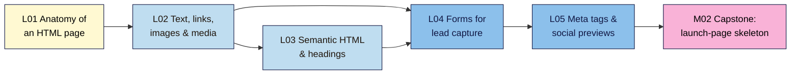
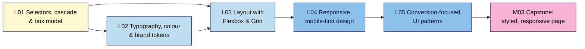
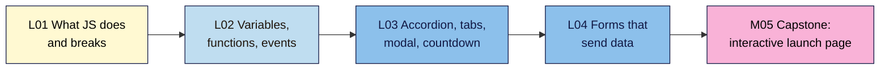
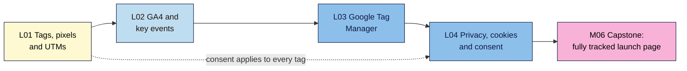
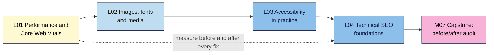

# Web Development 101 — for Marketers & Content Creators — Syllabus

_Lessons are added per module by `/plan-module <N>`. Source of truth for topics: `course-outline.md`._

**At a glance:** 8 modules · 36 lessons · each lesson 10–25 min reading + a hands-on exercise and a 5–8 question quiz · one capstone per module · one launch page built from M02 and launched in the final "Launch Week" capstone.

Times below are **hands-on** estimates (on top of reading time). Each lesson header shows its level (L1/L2/L3) and "Remediate to" lesson.

| Module | Level | Lessons | Non-negotiables taught | Planned |
|--------|-------|---------|------------------------|---------|
| M01 How the Web Works | L1 | 5 | #1 | ✅ |
| M02 HTML: The Structure of Content | L1 | 5 | #2, #3, #8 | ✅ |
| M03 CSS: Design, Brand & Layout | L1 | 5 | #4, #5 | ✅ |
| M04 Publish It: Tools, Hosting & Domains | L2 | 5 | #6, #7 | ✅ |
| M05 JavaScript for Marketers | L2 | 4 | #3, #6, #7, #12 (reinforced) | ✅ |
| M06 Tracking, Analytics & Consent | L2 | 4 | #9, #10 (+ #3, #6, #12 reinforced) | ✅ |
| M07 Fast, Accessible & Search-Ready | L3 | 4 | #11 (+ #2, #3, #4, #5, #8, #12 reinforced) | ✅ |
| M08 Advanced: AI, Automation & Scale | L3 | 4 | #12 | — |

---

## M01 — How the Web Works (L1)

**Goal:** a clear mental model of what happens between typing a URL and seeing a page. · NN #1
**Zero install:** everything runs in a desktop or mobile browser.

```mermaid
flowchart LR
  %% alt: M01 lesson path: internet vs web, URLs and DNS, hosting and page loads, static vs dynamic, DevTools, then the module capstone.
  L1[L01 Internet vs the Web]:::cream --> L2[L02 URLs, domains & DNS]:::sky
  L2 --> L3[L03 Hosting & how a page loads]:::sky
  L3 --> L4[L04 Static vs dynamic,<br/>code vs CMS vs no-code]:::blue
  L4 --> L5[L05 First look at DevTools]:::blue
  L5 --> C[M01 Capstone:<br/>how this site works]:::pink

  classDef cream fill:#FFF9D2,color:#000000,stroke:#111844
  classDef sky   fill:#BFDDF0,color:#1F150C,stroke:#111844
  classDef blue  fill:#8CC0EB,color:#111844,stroke:#111844
  classDef pink  fill:#F9B2D7,color:#000000,stroke:#111844
```

### M01.L01 — The Internet vs the Web
- **File:** `lessons/m01-l01-internet-vs-web.md` · **Prereqs:** none · **Remediate to:** — (entry point; glossary) · **Hands-on:** ~20 min
- **Objectives:**
  1. **Distinguish** the Internet (the network) from the Web (one service on it) using everyday examples.
  2. **Explain** the roles of a client, a server and a browser in loading a page.
  3. **Demonstrate** that a browser turns code into a page by rendering HTML typed into the address bar.
- **Hands-on idea:** sort 10 things you did online today into "Web" and "other Internet services"; render a one-line web page from the address bar with no tools; pick the brand site for the M01 capstone and a launch-page idea for the running project.

### M01.L02 — URLs, Domains & DNS
- **File:** `lessons/m01-l02-urls-domains-dns.md` · **Prereqs:** L01 · **Remediate to:** L01 · **Hands-on:** ~25 min
- **Objectives:**
  1. **Break down** any URL into scheme, subdomain, domain, TLD, path, query string (incl. UTMs) and fragment.
  2. **Explain** how DNS turns a domain name into an IP address, and what A, AAAA, CNAME and TXT records do.
  3. **Look up** the DNS records and registrar of a real domain with free tools.
- **Hands-on idea:** dissect three campaign URLs; run a DNS lookup (e.g. Google Admin Toolbox Dig) and a WHOIS/RDAP lookup on a brand domain.

### M01.L03 — Hosting & How a Page Loads
- **File:** `lessons/m01-l03-hosting-page-load.md` · **Prereqs:** L02 · **Remediate to:** L02 · **Hands-on:** ~25 min
- **Objectives:**
  1. **Describe** the request → response cycle, including status codes 200, 301, 404 and 500.
  2. **Explain** what HTTPS adds over HTTP and why browsers warn on HTTP pages.
  3. **Compare** hosting types (static, shared, managed, cloud/CDN) by cost, effort and fit for marketers.
- **Hands-on idea:** check status codes and redirects of real URLs (http → https, www → non-www); read the padlock/certificate details.

### M01.L04 — Static vs Dynamic, Code vs CMS vs No-Code
- **File:** `lessons/m01-l04-static-dynamic-cms.md` · **Prereqs:** L03 · **Remediate to:** L03 · **Hands-on:** ~20 min
- **Objectives:**
  1. **Explain** the difference between a static page and a dynamically generated one.
  2. **Compare** hand-coded, CMS (WordPress) and no-code builders (Webflow, Wix, Framer) on cost, control, speed and lock-in.
  3. **Identify** what a site is built with using free detection tools and page clues.
- **Hands-on idea:** identify the stack of three brand sites (e.g. with Wappalyzer or BuiltWith free lookups) and score each approach for a sample brief.

### M01.L05 — Your First Look at DevTools
- **File:** `lessons/m01-l05-first-look-devtools.md` · **Prereqs:** L01 · **Remediate to:** L01 · **Hands-on:** ~30 min
- **Objectives:**
  1. **Open** DevTools and use the Elements panel to inspect and live-edit text and styles.
  2. **View** page source and explain how it differs from the live DOM.
  3. **Use** the Network panel to find a page's total requests and transfer size, and the largest file.
- **Hands-on idea:** "redesign" a brand's homepage headline and button colour live (it resets on reload), then measure page weight; includes a break-it-and-fix-it task (delete an element, explain why reload restores it).

### M01 Capstone — "How this site works"
- **File:** `capstones/m01-capstone.md` + `cheatsheets/m01-how-the-web-works.md`
- One-page breakdown of a brand site you admire: domain and registrar, DNS host, web host/CDN, CMS or builder, HTTPS status, redirects, page weight and request count, with screenshots of DevTools evidence. Rubric: accuracy, evidence, clear explanation, decision insight.

---

## M02 — HTML: The Structure of Content (L1)

**Goal:** write clean, meaningful HTML for real marketing content. · NN #2, #3, #8
**Zero install:** a free browser playground (CodePen; no account needed to try, a free account to save) plus the W3C validator's paste-in checker. Local files arrive in Module 4.
**Running project:** each lesson adds one block of the learner's launch page; the capstone assembles the full content skeleton.

### M02.L01 — Anatomy of an HTML Page
- **File:** `lessons/m02-l01-html-page-anatomy.md` · **Prereqs:** M01.L01, M01.L05 · **Remediate to:** M01.L05 · **Hands-on:** ~25 min
- **Objectives:**
  1. **Build** a valid HTML page with `<!DOCTYPE html>`, `html` (with `lang`), `head` (charset, viewport, title) and `body`.
  2. **Explain** elements, tags, attributes and nesting, and which tags are empty (void) elements.
  3. **Validate** a page with the W3C Nu HTML Checker and fix the errors it reports.
- **Hands-on idea:** first pen in CodePen; deliberately break nesting and a missing `lang`, then fix from the validator's messages (break-it-and-fix-it).

### M02.L02 — Text, Links, Images & Media
- **File:** `lessons/m02-l02-text-links-images-media.md` · **Prereqs:** M02.L01 · **Remediate to:** M02.L01 · **Hands-on:** ~30 min
- **Objectives:**
  1. **Mark up** headings, paragraphs, lists, emphasis and quotes for real marketing copy.
  2. **Create** links (absolute, relative, anchor, `mailto:`/`tel:`, new tab with safe `rel`) with descriptive link text.
  3. **Add** images with useful `alt` text, width/height, and embed video safely (`<video>`, YouTube `iframe` with `title`).
- **Hands-on idea:** mark up Nila Coffee's benefits and testimonial block, then the learner's own hero and benefits.

### M02.L03 — Semantic HTML & Heading Structure
- **File:** `lessons/m02-l03-semantic-html-headings.md` · **Prereqs:** M02.L02 · **Remediate to:** M02.L02 · **Hands-on:** ~25 min
- **Objectives:**
  1. **Use** landmarks (`header`, `nav`, `main`, `section`, `article`, `aside`, `footer`) instead of generic `div`s where they fit.
  2. **Write** one `h1` and a logical H2–H6 outline that matches the page's content, not its font sizes.
  3. **Check** structure with a heading-outline view and a screen reader's landmark list.
- **Hands-on idea:** convert a "div soup" landing page to semantic HTML; audit its outline with a free browser extension or the validator's outline view.

### M02.L04 — Forms for Lead Capture
- **File:** `lessons/m02-l04-lead-capture-forms.md` · **Prereqs:** M02.L02, M02.L03 · **Remediate to:** M02.L02 · **Hands-on:** ~30 min
- **Objectives:**
  1. **Build** a sign-up form with `form`, `label`, the right `input` types, `autocomplete` and a real `button`.
  2. **Apply** built-in validation (`required`, `type="email"`, `minlength`, `pattern`) and accessible error hints.
  3. **Decide** which fields to ask for (data minimisation) and add a consent checkbox and privacy-note link.
- **Hands-on idea:** a newsletter sign-up for the launch page; keyboard-only test (Tab, Enter) and a screen-reader label check. Sending the data comes in M05.L04.

### M02.L05 — Meta Tags & Social Previews
- **File:** `lessons/m02-l05-meta-tags-social-previews.md` · **Prereqs:** M02.L01 · **Remediate to:** M02.L01 · **Hands-on:** ~25 min
- **Objectives:**
  1. **Write** a title and meta description that match search intent and fit typical display lengths.
  2. **Add** Open Graph (`og:title`, `og:description`, `og:image`, `og:url`, `og:type`) and Twitter/X card tags with a correctly sized share image.
  3. **Test** link previews with free tools (Facebook Sharing Debugger, LinkedIn Post Inspector) and explain why previews cache.
- **Hands-on idea:** write meta tags for the launch page; inspect a brand's preview tags in DevTools and run them through the preview debuggers.

### M02 Capstone — Launch-page content skeleton
- **File:** `capstones/m02-capstone.md` + `cheatsheets/m02-html.md`
- Hand-code the full content skeleton of your launch page (hero, benefits, testimonials, FAQ, sign-up form) with correct semantics and share-ready meta tags, unstyled. Rubric: validity, semantics and headings, accessibility of images and forms, meta completeness, content clarity.

---

## M03 — CSS: Design, Brand & Layout (L1)

**Goal:** turn the skeleton into an on-brand page that works on every screen. · NN #4, #5 (taught), #3 (reinforced: focus styles, target size)
**Zero install:** CodePen's CSS panel for quick experiments; the real work is a `styles.css` file next to `launch.html` in the `webdev-101` folder, edited in Notepad/TextEdit and checked in the browser's DevTools. VS Code arrives in Module 4.
**Running project:** each lesson styles one layer of the learner's launch page (base text and spacing → brand tokens → layout → responsive → CTAs); the capstone finishes and tests it.

### M03.L01 — How CSS Works: Selectors, Cascade, Box Model
- **File:** `lessons/m03-l01-css-selectors-cascade-box-model.md` · **Prereqs:** M02.L01, M01.L05 · **Remediate to:** M02.L01 · **Hands-on:** ~30 min
- **Objectives:**
  1. **Connect** CSS to a page (linked stylesheet, `<style>`, inline) and explain why a linked file is the default.
  2. **Write** rules with type, class, ID, descendant and attribute selectors, and **predict** which rule wins using the cascade, specificity and inheritance.
  3. **Control** spacing with the box model (content, padding, border, margin, `box-sizing: border-box`) and inspect it in DevTools.
- **Hands-on idea:** link `styles.css` to `launch.html`, set base text and spacing; "why isn't my style applying?" break-it-and-fix-it (wrong file path, typo, a more specific rule winning) solved in the Styles pane.

### M03.L02 — Typography, Color & Brand Tokens
- **File:** `lessons/m03-l02-typography-color-brand-tokens.md` · **Prereqs:** M03.L01 · **Remediate to:** M03.L01 · **Hands-on:** ~30 min
- **Objectives:**
  1. **Turn** a brand guide into CSS custom properties (colour, font and spacing tokens) and apply them with `var()`.
  2. **Set** readable type: a system or web font with `font-display: swap`, sizes in `rem`, line height and line length.
  3. **Check** text and UI contrast against WCAG 2.2 AA (4.5:1 text, 3:1 large text and UI parts) and fix failing pairs.
- **Hands-on idea:** Nila Coffee's tokens first, then the learner's own; a failing-contrast CTA found with DevTools and a contrast checker, then fixed by changing one token.

### M03.L03 — Layout with Flexbox & Grid
- **File:** `lessons/m03-l03-layout-flexbox-grid.md` · **Prereqs:** M03.L01, M03.L02 · **Remediate to:** M03.L01 · **Hands-on:** ~35 min
- **Objectives:**
  1. **Explain** normal flow and **choose** Flexbox (one direction) or Grid (rows and columns) for a layout job.
  2. **Build** a header/nav bar and a hero with Flexbox (`gap`, `justify-content`, `align-items`, `flex-wrap`).
  3. **Build** a card grid that adapts without media queries (`repeat(auto-fit, minmax(…))`) and check it with the DevTools grid/flex overlays, keeping visual order the same as source order.
- **Hands-on idea:** Nila's nav and benefits cards; the learner's header, hero and benefits; overlays on in DevTools.

### M03.L04 — Responsive, Mobile-First Design
- **File:** `lessons/m03-l04-responsive-mobile-first.md` · **Prereqs:** M03.L03 · **Remediate to:** M03.L03 · **Hands-on:** ~30 min
- **Objectives:**
  1. **Explain** the viewport meta tag and mobile-first CSS (small-screen base, `min-width` media queries add to it).
  2. **Use** fluid sizing (`%`, `rem`, `max-width`, `clamp()`) and flexible images (`max-width: 100%; height: auto`).
  3. **Test** at 320, 768 and 1280 px in the DevTools device toolbar and fix horizontal scrolling and small tap targets (WCAG 1.4.10 Reflow, 2.5.8 Target Size).
- **Hands-on idea:** make the launch page mobile-first; break-it-and-fix-it: find the one fixed-width element that makes the page scroll sideways on a phone.

### M03.L05 — Conversion-Focused UI Patterns
- **File:** `lessons/m03-l05-conversion-ui-patterns.md` · **Prereqs:** M03.L03, M03.L04 · **Remediate to:** M03.L03 · **Hands-on:** ~35 min
- **Objectives:**
  1. **Style** primary and secondary CTAs with clear hierarchy and visible `:hover` and `:focus-visible` states.
  2. **Build** honest testimonial and pricing-card patterns (no dark patterns: fake timers, hidden costs, confirmshaming).
  3. **Decide** when a ready-made CSS library helps, and add one safely (pinned version, licence, contrast re-check).
- **Hands-on idea:** Nila's two-plan pricing table and CTA states; the learner's CTA and testimonials; compare the page with and without a classless library.

### M03 Capstone — Styled, responsive launch page
- **File:** `capstones/m03-capstone.md` + `cheatsheets/m03-css.md`
- Style the launch page to a brand guide (tokens in `:root`, one linked stylesheet). It must pass a 320 / 768 / 1280 px check with no sideways scroll, AA contrast on every text and CTA pair, and visible keyboard focus. Includes a break-it-and-fix-it set of planted CSS bugs. Rubric: brand tokens and consistency, responsive layout, contrast and focus, CSS quality, conversion clarity.

## M04 — Publish It: Tools, Hosting & Domains (L2)

**Goal:** move from playground to a real, live site you control. · NN #6 Version control before you deploy, #7 HTTPS on every page (taught), #1 mental model of the web (reinforced: DNS, status codes, "works locally but not live")
**First installs:** VS Code and Git (both free, Windows/Mac/Linux) and a free GitHub account. Hosting stays free (GitHub Pages, Netlify or Cloudflare Pages); a custom domain is the only optional cost (≈ $10–15 / ₹800–1,200 a year). Learners without a domain use the host's free subdomain and still get HTTPS.
**Running project:** the M03 launch page (`launch.html`, `styles.css`, `images/`) moves into a tidy project folder, goes into a Git repository, deploys on every push, and ends on a custom domain (or free subdomain) with HTTPS.

```mermaid
flowchart LR
  %% alt: M04 lesson path: VS Code and folders, Git and GitHub, deploy to free hosting, custom domain DNS and HTTPS, choosing code, CMS or no-code, then the live-site capstone.
  L1[L01 VS Code,<br/>files & folders]:::cream --> L2[L02 Git & GitHub<br/>without fear]:::sky
  L2 --> L3[L03 Deploy to<br/>free hosting]:::sky
  L3 --> L4[L04 Custom domain,<br/>DNS & HTTPS]:::blue
  L4 --> L5[L05 Code, CMS<br/>or no-code?]:::blue
  L5 --> C[M04 Capstone:<br/>live, versioned site]:::pink

  classDef cream fill:#FFF9D2,color:#000000,stroke:#111844
  classDef sky   fill:#BFDDF0,color:#1F150C,stroke:#111844
  classDef blue  fill:#8CC0EB,color:#111844,stroke:#111844
  classDef pink  fill:#F9B2D7,color:#000000,stroke:#111844
```

### M04.L01 — Your Toolkit: VS Code, Files & Folders
- **File:** `lessons/m04-l01-vscode-files-folders.md` · **Prereqs:** M01.L05, M03 capstone · **Remediate to:** M01.L05 · **Hands-on:** ~30 min
- **Objectives:**
  1. **Set up** VS Code with a project folder, a small set of trusted extensions and format-on-save, and open, edit and save files from it.
  2. **Organise** a site folder (`index.html`, `css/`, `images/`) with web-safe file names (lowercase, no spaces) and **fix** broken relative paths.
  3. **Preview** the site locally (a local server via an extension or the built-in terminal) and explain why `http://localhost` behaves more like a live site than opening the file directly.
- **Hands-on idea:** move the M03 launch page into `nila-launch/`, rename `launch.html` to `index.html`, update paths; break-it-and-fix-it: `Images/Beans.JPG` vs `images/beans.jpg` works on Windows/Mac but will break live.

### M04.L02 — Git & GitHub Without Fear
- **File:** `lessons/m04-l02-git-github-basics.md` · **Prereqs:** M04.L01 · **Remediate to:** M04.L01 · **Hands-on:** ~35 min
- **Objectives:**
  1. **Explain** repository, commit, history, branch, remote and push in plain words, and why version control comes before deploying (NN #6).
  2. **Commit** changes with clear messages from VS Code's Source Control panel (and the matching four Git commands), and **push** to a new GitHub repository.
  3. **Undo** a bad change safely (discard, revert a commit) and keep secrets out with `.gitignore`.
- **Hands-on idea:** first commit of the launch page, push to GitHub; break-it-and-fix-it: commit a "bad CTA colour" change, then revert it and read the history.

### M04.L03 — Deploy to Free Hosting
- **File:** `lessons/m04-l03-deploy-free-hosting.md` · **Prereqs:** M04.L02 · **Remediate to:** M04.L02 · **Hands-on:** ~35 min
- **Objectives:**
  1. **Compare** GitHub Pages, Netlify and Cloudflare Pages on free-tier limits, commercial-use terms, build settings and deploy previews.
  2. **Publish** the launch page from its GitHub repository so every push redeploys automatically.
  3. **Test** the live site (real 404s, case-sensitive paths, HTTPS padlock, phone check) and **roll back** a bad deploy.
- **Hands-on idea:** deploy to GitHub Pages (or Netlify/Cloudflare Pages), open it on a phone; break-it-and-fix-it: the image that worked locally 404s live because of letter case.

### M04.L04 — Custom Domains, DNS Records & HTTPS
- **File:** `lessons/m04-l04-custom-domains-dns-https.md` · **Prereqs:** M04.L03, M01.L02 · **Remediate to:** M01.L02 · **Hands-on:** ~40 min (plus DNS waiting time)
- **Objectives:**
  1. **Choose** and register a domain sensibly (registrar vs DNS host, renewal price, WHOIS privacy, auto-renew), or justify the free subdomain.
  2. **Connect** the domain to the host with the right records (apex A/ALIAS, `www` CNAME, verification TXT) and **verify** them with a DNS lookup tool, without touching email (MX) records.
  3. **Enable** HTTPS with a free auto-renewing certificate, force HTTP → HTTPS and pick one canonical host (`www` or not) (NN #7).
- **Hands-on idea:** connect a domain (or walk through with the free subdomain and a DNS lookup tool); break-it-and-fix-it: a CNAME typo, diagnosed with Dig and the browser error.

### M04.L05 — Choosing How to Build: Code, CMS or No-Code
- **File:** `lessons/m04-l05-choosing-code-cms-nocode.md` · **Prereqs:** M01.L04, M04.L03 · **Remediate to:** M01.L04 · **Hands-on:** ~25 min
- **Objectives:**
  1. **Apply** a decision checklist (who edits, how often, features, budget, skills, ownership and exit) to a project brief.
  2. **Estimate** the three-year cost and effort of hand-coded, WordPress and no-code options, including hidden costs (plugins, themes, time, migration).
  3. **Write** a one-page recommendation for your next project, and know where WordPress 101 picks up.
- **Hands-on idea:** three client briefs (a café menu, a coach with a blog, a shop with 200 products) scored with the checklist; the learner's own decision note.

### M04 Capstone — Live, versioned launch page
- **File:** `capstones/m04-capstone.md` + `cheatsheets/m04-publish.md`
- The launch page is live on a custom domain (or the host's free subdomain) with HTTPS forced and one canonical host, deployed automatically from a public or private GitHub repository with a readable history (at least five meaningful commits, including one revert). Includes a break-it-and-fix-it set: a case-mismatched path, a CNAME typo and a bad commit rolled back. Plus a short written decision on code vs CMS vs no-code for the learner's next project. Rubric: project structure, version control, deployment and testing, domain and HTTPS, build-approach decision.

## M05 — JavaScript for Marketers (L2)

**Goal:** add interactivity to the launch page and understand (and debug) the scripts that marketing tools inject. · NN #3 Alt text, labels and keyboard access (reinforced: every component works with a keyboard and a screen reader), #6 Version control (reinforced: each component is its own commit), #7 HTTPS (reinforced: forms only post to `https://` endpoints), #12 Review AI output (every lesson's "Use AI for this" checks generated JS for accessibility and errors)
**First installs:** none. The editor, Git and hosting from M04 are enough; a free Formspree (or Netlify Forms) account and a free Brevo or Mailchimp account arrive in L04.
**Running project:** the live M04 launch page gains an FAQ accordion, a polite newsletter modal and a working lead form that delivers to an email list. All JavaScript lives in one file, `js/main.js`, loaded with `defer`; the page still works (content readable, form submittable) if JavaScript fails.

### M05.L01 — What JavaScript Does (and Breaks)
- **File:** `lessons/m05-l01-what-javascript-does.md` · **Prereqs:** M01.L05, M04 capstone · **Remediate to:** M01.L05 · **Hands-on:** ~30 min
- **Objectives:**
  1. **Explain** what JavaScript adds to HTML and CSS (changing the DOM, reacting to events, talking to servers) and how a `<script>` loads (`defer`, `async`, inline vs external).
  2. **Read** the Console (errors, warnings, the red line and its file:line link) and the Network panel's JS requests to **identify** which script broke a page or slowed it down.
  3. **Audit** the third-party scripts on a marketing page (chat widget, pixel, tag manager) for what they do, their weight and whether the page still works with JavaScript turned off.
- **Hands-on idea:** add `js/main.js` with `defer` and a one-line `console.log`; audit a brand site's scripts (Network → JS filter, Coverage, disable JavaScript in DevTools); break-it-and-fix-it: a script tag in `<head>` without `defer` that can't find the button yet (`Cannot read properties of null`), and a 404'd script path.

### M05.L02 — JS Basics: Variables, Functions, Events
- **File:** `lessons/m05-l02-js-basics-events.md` · **Prereqs:** M05.L01 · **Remediate to:** M05.L01 · **Hands-on:** ~40 min
- **Objectives:**
  1. **Write** small scripts with `const`/`let`, strings, numbers, booleans, arrays, `if` statements and functions, and run them in the Console.
  2. **Select** elements (`querySelector`, `querySelectorAll`) and **change** them safely (`textContent`, `classList`, attributes such as `aria-expanded`) instead of rewriting HTML.
  3. **Attach** event listeners (click, input, submit, scroll with a cheap check) and **use** event delegation, with keyboard users in mind.
- **Hands-on idea:** a "copy discount code" button that updates its label and announces "Copied" politely, a sticky header class added after scrolling past the hero, and a live character counter on the message field; break-it-and-fix-it: `=` vs `===`, a typo in a class name, a listener added to a NodeList.

### M05.L03 — Interactive Components
- **File:** `lessons/m05-l03-interactive-components.md` · **Prereqs:** M05.L02, M03.L05 · **Remediate to:** M05.L02 · **Hands-on:** ~45 min
- **Objectives:**
  1. **Build** an FAQ accordion with native `
`/`
` first, and **explain** when a scripted version with `aria-expanded` is worth it.
  2. **Build** a newsletter modal with the native `<dialog>` element (focus, Escape, a visible close button, shown once per visit or after a delay, never on page load blocking content) and accessible tabs following the WAI-ARIA tabs pattern.
  3. **Build** a countdown timer to a real launch date that stays honest (time zone, what happens at zero, no fake resets) and **test** every component with keyboard only and a screen reader quick check.
- **Hands-on idea:** add the FAQ, the modal and the launch countdown to the live page, one commit each; break-it-and-fix-it: a modal that traps no focus (Tab escapes behind it), a countdown that resets on reload (fake urgency, a dark pattern from M03.L05), tabs that only work with a mouse.

### M05.L04 — Forms That Work: Validation & Sending Data
- **File:** `lessons/m05-l04-forms-send-data.md` · **Prereqs:** M02.L04, M05.L02 · **Remediate to:** M02.L04 · **Hands-on:** ~45 min
- **Objectives:**
  1. **Validate** inputs with built-in HTML first (`required`, `type="email"`, `pattern`), then add friendly JavaScript messages linked with `aria-describedby`, without blocking valid input.
  2. **Send** form data to a form service (Formspree or Netlify Forms) over HTTPS with a plain `action` (works without JS) and then with `fetch()` for an inline success message; **handle** errors and double submissions.
  3. **Deliver** leads to an email list (Brevo or Mailchimp embedded form or the service's integration) with double opt-in and a consent line, and **protect** the form from spam (honeypot field; the service's CAPTCHA option).
- **Hands-on idea:** connect the M02 lead form to Formspree, then to a Brevo or Mailchimp list with double opt-in; break-it-and-fix-it: a form posting to `http://`, an `action` with a typo (404), a missing `name` attribute so the field never arrives.

### M05 Capstone — Interactive launch page
- **File:** `capstones/m05-capstone.md` + `cheatsheets/m05-javascript.md`
- The live launch page gains a working FAQ accordion, a timed newsletter modal (polite: delayed or scroll-triggered, dismissible, shown once, keyboard and screen-reader friendly) and a lead form that delivers to an email list with double opt-in. All JS in one deferred `js/main.js`; the content and form still work with JavaScript off. Includes a break-it-and-fix-it set (a `null` element error, a modal focus bug, a form field missing `name`) and a short script audit of the page (own and third-party scripts, weight, purpose). Rubric: JavaScript quality and progressive enhancement, accessibility of components (NN #3), form delivery and consent, honesty (no fake urgency), debugging evidence.

## M06 — Tracking, Analytics & Consent (L2)

**Goal:** measure what matters on the launch page (visits by campaign, sign-ups as key events), legally and honestly. · NN #9 Consent before tracking where the law requires it (taught: L04, applied to every tag in L01–L03 and the capstone), #10 Measure with defined key events (taught: L02–L03); reinforced: #3 (the consent banner works with a keyboard and a screen reader), #6 (each tracking change is a commit or a GTM container version), #12 (AI-generated tracking code and banner wording checked)
**First installs:** a free Google Analytics 4 property (L02), a free Google Tag Manager container (L03), and a consent banner: a free-tier consent management platform (CMP) from Google's CMP Partner Program list or an open-source option (L04). Chrome's **Tag Assistant** for testing.
**Running project:** the live M05 launch page gets a UTM naming sheet for its launch campaign, GA4 measuring page views and `generate_lead` (marked as a key event) through GTM, and a consent banner with Google Consent Mode v2 so nothing that needs consent runs before the visitor agrees. The M05 form's success branch pushes a `dataLayer` event, so only real, confirmed sign-ups count.
**Order note:** L02 and L03 install tracking before the consent banner arrives in L04. Learners keep tracking in test (their own visits, internal traffic filtered) until L04; each lesson says so in a `> Note:`.
**Freshness:** GA4 menus, Consent Mode requirements and privacy laws (India's DPDP Rules 2025 phase in until 2027; US state laws keep multiplying) change often; each lesson carries a freshness flag and a check date.

### M06.L01 — Tags, Pixels & UTMs
- **File:** `lessons/m06-l01-tags-pixels-utms.md` · **Prereqs:** M05.L01 · **Remediate to:** M05.L01 · **Hands-on:** ~35 min
- **Objectives:**
  1. **Explain** how a tag or pixel works (a script or image that sends a request with parameters, often setting cookies; first- vs third-party) and **observe** one firing in the Network panel.
  2. **Build** consistent UTM links (`utm_source`, `utm_medium`, `utm_campaign`, optional `utm_content`, `utm_term`) from a naming convention (lowercase, hyphens, GA4's default channel rules for `utm_medium`), and **decide** where not to use them (internal links).
  3. **Audit** the tags on a page (what each collects, who receives it, whether it sets cookies) as the input to the consent work in L04.
- **Hands-on idea:** a UTM naming sheet and builder (spreadsheet formula or Google's Campaign URL Builder) for Nila Coffee's launch: newsletter, Instagram bio, WhatsApp share, a paid ad; watch a GA4 or Meta Pixel request on a brand site in Network (filter `collect`); tag inventory table for your own page. Break-it-and-fix-it: `utm_source=Instagram` vs `instagram` splitting one source into two rows, UTMs on internal links restarting the session's source, a second `?` instead of `&` breaking the parameters.

### M06.L02 — Google Analytics 4 & Key Events
- **File:** `lessons/m06-l02-ga4-key-events.md` · **Prereqs:** M06.L01 · **Remediate to:** M06.L01 · **Hands-on:** ~45 min
- **Objectives:**
  1. **Set up** a GA4 property and web data stream, review Enhanced measurement, and **verify** data arriving in Realtime and DebugView.
  2. **Define** key events: send `generate_lead` from the M05 form's success branch only (after `response.ok`), mark it as a key event, and **filter** internal traffic.
  3. **Read** the core reports (Traffic acquisition by session source/medium and campaign, Pages and screens, Key events) and **answer** a business question ("which channel brought sign-ups?") from them.
- **Hands-on idea:** install the Google tag (gtag.js) on the launch page, send a test sign-up and find it in DebugView, mark `generate_lead` as a key event, set up the internal-traffic filter; read the reports for a UTM-tagged test visit from L01. Break-it-and-fix-it: a Measurement ID typo (no data in Realtime), `generate_lead` fired on button click so failed submissions count, the tag on only one page of the site.

### M06.L03 — Google Tag Manager
- **File:** `lessons/m06-l03-google-tag-manager.md` · **Prereqs:** M06.L02 · **Remediate to:** M06.L02 · **Hands-on:** ~45 min
- **Objectives:**
  1. **Explain** GTM's model (tags, triggers, variables, the `dataLayer`, workspaces and versions) and **install** the container snippet, replacing the hard-coded gtag.js from L02.
  2. **Configure** the Google tag and a GA4 event tag for `generate_lead` fired by a custom `dataLayer.push` event from the form's success branch, with a variable for the form name.
  3. **Test** in Preview mode (Tag Assistant), **publish** a named version, and **roll back** a bad version.
- **Hands-on idea:** move GA4 from gtag.js to GTM, push `{ event: 'generate_lead', form_name: 'launch-list' }` after `response.ok`, check it in Tag Assistant and GA4 DebugView, publish "v2 – lead event"; a UTM-tagged visit from L01 shows up correctly. Break-it-and-fix-it: GA4 installed twice (gtag.js left in plus GTM → double page views), a trigger on "All Elements" clicks that counts failed submissions, changes tested in Preview but never published.

### M06.L04 — Privacy, Cookies & Consent Around the World
- **File:** `lessons/m06-l04-privacy-cookies-consent.md` · **Prereqs:** M06.L01, M06.L03, M02.L04 · **Remediate to:** M06.L01 · **Hands-on:** ~50 min
- **Objectives:**
  1. **Compare** the basics of GDPR + ePrivacy (EU/UK), CCPA/CPRA (California), DPDP Act 2023 and Rules 2025 (India) and LGPD (Brazil): opt-in vs opt-out, what counts as consent, rights to withdraw, with a "check a lawyer" boundary.
  2. **Add** a consent banner (free-tier CMP or open-source) with equal "Accept" and "Reject" choices, a way to change one's mind later, and keyboard and screen-reader access, and **update** the privacy page to list the tags from L01.
  3. **Configure** Google Consent Mode v2 (default `denied` before any tag, `update` on choice; basic vs advanced) through GTM, and **verify** in Tag Assistant and DevTools that no analytics cookie is set before consent.
- **Hands-on idea:** a tag-by-tag consent table (from the L01 inventory), banner installed via GTM, Consent Mode defaults and updates checked in Tag Assistant's Consent tab, cookies checked in Application → Cookies before and after Accept/Reject. Break-it-and-fix-it: GA4 firing before the consent default (cookie set on first load), a banner with no "Reject" on the first layer, the consent default set after the Google tag loads.

### M06 Capstone — Fully tracked launch page
- **File:** `capstones/m06-capstone.md` + `cheatsheets/m06-tracking.md`
- The live launch page measures page views and `generate_lead` (a key event) through GA4 via GTM, with UTM-tagged links for a small launch campaign (at least three channels from the naming sheet) and a working consent banner with Consent Mode v2. Deliverable: a measurement plan (business question → key event → report), the tag and consent table, Tag Assistant and DevTools evidence that nothing needing consent runs before Accept, a privacy checklist, and a one-paragraph answer to "which channel brought sign-ups?" from test data. Break-it-and-fix-it set: duplicate GA4 install, a UTM case mismatch, a tag firing before consent. Rubric: measurement plan and key events (NN #10), tag hygiene (GTM versions, no duplicates), UTM consistency, consent and privacy (NN #9, privacy checklist), evidence and honesty of reporting.

## M07 — Fast, Accessible & Search-Ready (L3)

**Goal:** make the live launch page load fast on a mid-range phone, work for everyone, and be understood by search and AI engines, and prove it with before/after reports. · NN #11 Core Web Vitals in the "good" range (taught: L01–L02); reinforced: #2 (one H1 and a logical outline, re-audited in L03 and read by search in L04), #3 (alt text, labels and keyboard access, audited in L03), #4 (mobile-first: mobile Lighthouse and Search Console's mobile view), #5 (contrast re-checked in L03), #8 (titles, descriptions and Open Graph checked alongside structured data in L04), #12 (AI-suggested fixes and schema checked before shipping)
**First installs:** none new to pay for. Lighthouse in Chrome DevTools, PageSpeed Insights, WAVE or axe DevTools (free browser extension), a free screen reader (NVDA on Windows, VoiceOver on Mac/iPhone, TalkBack on Android), Squoosh (images), Google's Rich Results Test and Schema Markup Validator, and **Google Search Console** for the learner's own domain (L04).
**Running project:** the tracked M06 launch page. Each lesson starts with a "before" measurement of the learner's own page and ends with an "after"; the tags from M06 are part of what gets measured (L01 checks their cost, and nothing may break consent).
**Level note (L3):** less hand-holding; each lesson gives a method (measure → find the cause → fix one thing → re-measure) and expects learners to apply it to their own page's problems, not just Nila Coffee's.
**Freshness:** Lighthouse versions and audit names, Core Web Vitals thresholds and metrics (INP replaced FID in March 2024), image-format support, WCAG versions (2.2 current; 3.0 in draft) and Google's rich-result eligibility (e.g. FAQ and HowTo rich results were restricted in 2023) change; each lesson carries a check date and a freshness flag.

### M07.L01 — Performance & Core Web Vitals
- **File:** `lessons/m07-l01-performance-core-web-vitals.md` · **Prereqs:** M04.L03, M06.L03 · **Remediate to:** M03.L04 · **Hands-on:** ~45 min
- **Objectives:**
  1. **Explain** LCP, INP and CLS (what each measures, the "good" thresholds at the 75th percentile) and the difference between lab data (Lighthouse) and field data (Chrome UX Report, shown in PageSpeed Insights and Search Console).
  2. **Read** a Lighthouse and PageSpeed Insights report for the launch page (mobile): find the LCP element, layout-shift culprits and long tasks, and **rank** the fixes by impact.
  3. **Fix** at least two causes (render-blocking CSS/JS, `defer` on scripts, missing image dimensions, heavy third-party tags from M06) and **verify** the change with a before/after Lighthouse run under the same conditions.
- **Hands-on idea:** Nila Coffee's page first: a slow hero, a late-loading banner that shifts the layout, and a blocking script; then the learner's own page, mobile Lighthouse runs (median of three) saved as before/after JSON or screenshots. Break-it-and-fix-it: remove the image `width`/`height` (CLS jumps), move `main.js` into `<head>` without `defer` (render-blocking), add a heavy third-party embed above the fold (LCP and total blocking time worsen).

### M07.L02 — Images, Fonts & Media Optimization
- **File:** `lessons/m07-l02-images-fonts-media.md` · **Prereqs:** M07.L01, M02.L02, M03.L02 · **Remediate to:** M02.L02 · **Hands-on:** ~45 min
- **Objectives:**
  1. **Convert** and compress images to modern formats (AVIF/WebP with a fallback via `<picture>`) at the right dimensions, and **serve** responsive sizes with `srcset` and `sizes`.
  2. **Apply** loading hints correctly: `loading="lazy"` below the fold only, `fetchpriority="high"` (and no lazy-loading) on the LCP image, `decoding`, and preloading only what is critical.
  3. **Load** fonts and media efficiently: self-hosted WOFF2, `font-display: swap`, a limited set of weights, a fallback font tuned to reduce layout shift, and video/embeds as lightweight facades or `preload="none"`.
- **Hands-on idea:** Squoosh the hero in three formats and compare file size vs quality; build a `<picture>` with `srcset`; swap a YouTube embed for a click-to-load facade; measure LCP and page weight before/after. Break-it-and-fix-it: lazy-loading the hero image (LCP gets worse), a hero served as one 1600 px `src` with no `srcset`, so phones download the desktop file, a Google Fonts link loading nine weights.

### M07.L03 — Accessibility in Practice (WCAG 2.2)
- **File:** `lessons/m07-l03-accessibility-wcag.md` · **Prereqs:** M02.L03, M03.L02, M05.L03 · **Remediate to:** M02.L03 · **Hands-on:** ~50 min
- **Objectives:**
  1. **Explain** the WCAG 2.2 level AA structure (POUR principles, success criteria, conformance) and what automated tools can and cannot find.
  2. **Audit** the launch page three ways: automated (Lighthouse accessibility + WAVE or axe), keyboard-only (focus order, visible focus, no traps, WCAG 2.4.11 Focus Not Obscured) and with a screen reader (headings, landmarks, link names, form labels and errors, the consent banner and dialog).
  3. **Fix** and **re-test** the common failures (missing or poor alt text, unlabelled inputs, low contrast, empty links/buttons, skipped heading levels, focus hidden by a sticky header, small targets), and **record** the results in an accessibility statement.
- **Hands-on idea:** a short audit log (issue, WCAG criterion, how found, fix, retested) for Nila Coffee's page and then the learner's own; a 5-minute screen-reader script everyone follows. Break-it-and-fix-it: an icon-only button with no accessible name, a sticky header covering the focused link, form errors shown only in red.

### M07.L04 — Technical SEO Foundations
- **File:** `lessons/m07-l04-technical-seo-foundations.md` · **Prereqs:** M02.L05, M04.L04, M07.L01 · **Remediate to:** M02.L05 · **Hands-on:** ~45 min
- **Objectives:**
  1. **Add** structured data in JSON-LD (`Organization` with `logo` and `sameAs`, plus `Product`/`Offer` or `Person`/`ProfessionalService` for the learner's page) that matches visible content, and **validate** it with the Rich Results Test and the Schema Markup Validator.
  2. **Create** an XML sitemap and `robots.txt`, set self-referencing canonical URLs, and **decide** what should be `noindex` (thank-you page, test pages) without blocking crawling of what should be indexed.
  3. **Verify** the domain in Google Search Console, submit the sitemap, inspect the launch URL (indexing, mobile rendering, detected structured data) and **explain** how search and AI answers use the same signals (bridge to Modern SEO).
- **Hands-on idea:** JSON-LD for Nila Coffee's subscription box, then the learner's own; sitemap + robots.txt committed and deployed; Search Console DNS verification (reuses M04.L04) and URL Inspection. Break-it-and-fix-it: `Disallow: /` left in robots.txt from a staging copy, a canonical pointing to the `http://` or `www` duplicate, schema with a price that doesn't match the page.

### M07 Capstone — Before/after: fast, accessible and search-ready
- **File:** `capstones/m07-capstone.md` + `cheatsheets/m07-fast-accessible-search.md`
- Raise the live launch page to Lighthouse 90+ (mobile) in Performance, Accessibility, Best Practices and SEO, with LCP, INP (or total blocking time in the lab) and CLS in the "good" range; pass a manual accessibility audit (keyboard + screen reader) with no open level A/AA issues; add structured data that validates with no errors; sitemap submitted in Search Console. Consent and tracking from M06 must still work after the changes. Deliverable: before/after report (Lighthouse/PSI runs under the same conditions, the audit log, Rich Results Test result, Search Console screenshots) and an honest note on what lab scores don't prove. Break-it-and-fix-it set: a lazy-loaded LCP image, an icon button with no accessible name, `Disallow: /` in robots.txt. Rubric: performance and CWV (NN #11), images/fonts/media, accessibility (NN #2, #3, #5), technical SEO and structured data (NN #8), evidence and honesty (before/after under the same conditions, no score-chasing that hurts users).
