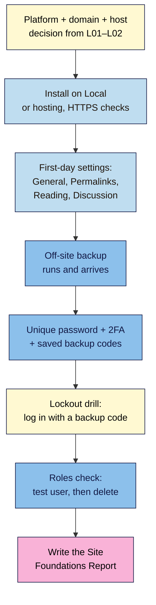
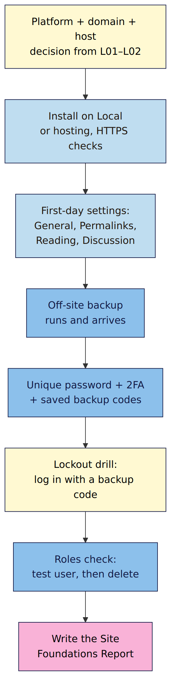

# M01 Capstone — A practice site you own, configured and protected
> By the end of this capstone your practice site is ready for its first real post: correctly configured, on HTTPS, backed up off-site and behind two-factor login. You'll have a one-page **Site Foundations Report** to prove it.

**Time:** ~60–90 min · **Level:** beginner · **Prereqs:** M01.L01–M01.L05
**Non-negotiables assessed:** #1 Own your platform · #2 Permalinks before the first post · #3 Day-one safety net
**Verified against:** WordPress 7.1.4, Local, UpdraftPlus and Two Factor on 2026-10-29

## The brief
You're about to start publishing. Before you do, a friend who's a web developer offers to check your setup, but only if you send a one-page report showing what you chose and proof it works. Build the site to that standard and write the report.

This is the same **practice site** you'll keep building in every module and launch in M09.

## How it works





**In words:** start from your platform and hosting decision, confirm the install and HTTPS, apply the first-day settings, prove a backup reaches off-site storage, lock down the login with 2FA and backup codes, practise getting back in when your phone is "lost", check user roles, then write it all up.

## Tasks

### 1. Ownership decision (from M01.L01–L02)
- Your platform choice and the trade-off you accept (two sentences).
- Your chosen domain (available, with first-year **and** renewal price), even if you haven't bought it yet.
- Your two scored hosting options with **3-year costs**, and which one you'd pick.

### 2. Install and HTTPS (from M01.L03)
- Practice site running on Local (or hosting) with a username that isn't `admin`.
- All four HTTPS checks pass: padlock, both addresses `https://` in Settings → General, no HTTPS issue in Tools → Site Health, and `http://` redirects (live sites only).

### 3. First-day settings (from M01.L04)
- Real site title and tagline (or a deliberately blank tagline), correct language, **city** timezone.
- **Post name** permalinks.
- Reading: feed setting chosen on purpose; "Discourage search engines" state noted (and why).
- Discussion: comments on or off by decision; moderation on; pingbacks and trackbacks off; open registration off.
- Sample post, Sample Page and sample comment deleted; Privacy Policy draft kept.

### 4. Safety net (from M01.L05)
- One backup solution with a schedule (database daily, files weekly, or your host's off-site equivalent) and a first backup **visible in off-site storage**.
- Admin password generated by a password manager (20+ characters).
- 2FA on with an authenticator app or passkey; backup codes saved in your password manager.

### 5. Break it and fix it: the lockout drill
Pretend you've lost your phone.
1. Log out. At the 2FA prompt, choose to use a **backup code** instead of your app, and log in with one.
   **Expected:** you're in. That code is now used up.
   > 🖼️ **Image prompt:** Screenshot of the WordPress login 2FA prompt (Two Factor plugin) asking for an authentication code, with the link to use a backup verification code instead outlined. Highlight the key element with a 3px #F9B2D7 outline; blur any personal details.
   > **Alt text:** WordPress two-factor login prompt with the option to use a backup code highlighted.
2. Go to **Users → Profile → Two-Factor Options** and **generate new backup codes**. Replace the old set in your password manager.
   **Expected:** a fresh set of codes; the old ones no longer work.
3. In one sentence, write what would have happened without saved backup codes, and how you'd recover (from the M01.L05 troubleshooting table).

### 6. Roles check
- Create a test **Contributor**, confirm they see **Submit for Review** rather than Publish, then delete them.
- Write which role you'd give (a) a regular guest writer, (b) a one-off guest writer, (c) a developer fixing one problem.

## Deliverable: Site Foundations Report
One page (Markdown, Google Doc or PDF) with these headings. Screenshots are the best evidence; redact passwords, codes and email addresses.

```markdown
# Site Foundations Report — <site name>
Date: YYYY-MM-DD · WordPress version: x.y.z · Running on: Local / <host>

## 1. Ownership
Platform + trade-off: …
Domain (first-year / renewal price): …
Hosts compared (score / 3-year cost): … → choice: …

## 2. Install and HTTPS
Admin username isn't `admin`: ✅ · HTTPS checks: padlock ✅ addresses ✅ Site Health ✅ redirect ✅/n.a.

## 3. Settings
Title / tagline / timezone city: …
Permalinks: Post name ✅ · Feed: full / excerpt because … · Search visibility: … because …
Comments: on/off because … · Moderation ✅ · Pingbacks off ✅ · Registration off ✅
Sample content removed ✅ · Privacy Policy draft kept ✅

## 4. Safety net
Backups: <plugin or host>, schedule …, stored at …, first backup seen on <date> ✅
Password manager ✅ · 2FA method: … · Backup codes saved ✅

## 5. Lockout drill
Backup-code login ✅ · New codes generated ✅
Without codes I would have …

## 6. Roles
Guest writer: … · One-off writer: … · Developer: …
```

## Rubric
Score each criterion; **Good** or better on all five completes the module.

| Criterion | Excellent (4) | Good (3) | Needs work (2) | Missing (1) |
|---|---|---|---|---|
| **Ownership decision** (NN #1) | Platform trade-off, domain with renewal price and two hosts with 3-year costs, all justified | All three present; one justification thin | Domain or host comparison missing renewal / 3-year cost | No decision recorded |
| **Install and HTTPS** | All applicable HTTPS checks pass with evidence; non-`admin` username | HTTPS works; one check not evidenced | Padlock works but an address is still `http://`, or username is `admin` | Site not running on HTTPS |
| **First-day settings** (NN #2) | Post name permalinks, city timezone and every Reading/Discussion choice explained; sample content cleaned, Privacy Policy kept | Settings correct; one or two choices not explained | Permalinks or timezone wrong, or sample content left | Settings untouched |
| **Off-site backups** (NN #3) | Scheduled backups with retention, first backup shown arriving off-site, schedule fits publishing rhythm | Scheduled and off-site; arrival shown | Backups only on the same server, or never run | No backups |
| **Login security and roles** (NN #3) | Password-manager password, 2FA (app or passkey), new backup codes after the drill, correct roles for all three helpers | 2FA and backup codes in place; roles mostly right | 2FA on but no backup codes, or roles too generous | No 2FA |

## Self-check before you submit
- [ ] I could hand this report to someone else and they'd know exactly how my site is set up.
- [ ] Nothing secret is visible (passwords, backup codes, full email addresses).
- [ ] My backup really is **off-site** (I saw it in Google Drive / Dropbox / my host's off-site storage).
- [ ] My backup codes are saved somewhere I can reach without my phone.

## What's next
Module 2 starts publishing on this site: posts vs pages, blocks, patterns and categories. Your safety net means you can experiment freely; you'll **test a restore** from these backups in M07.

## Module 1 cheat sheet
Keep `wordpress-101/cheatsheets/m01-own-your-platform.md` open while you work.
