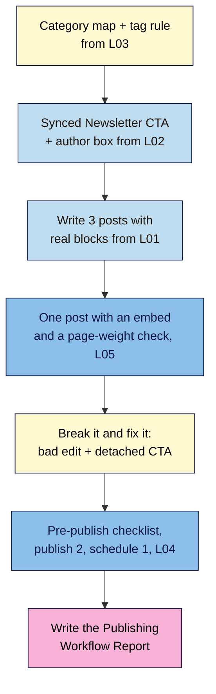

# M02 Capstone — Three posts, one reusable CTA, a clean structure and a scheduled post
> By the end of this capstone your practice site has a real content structure, three finished posts sharing one synced call to action, and a post scheduled for your publishing slot. You'll write a one-page **Publishing Workflow Report** to prove it.

**Time:** ~75–100 min (setup ~15, writing ~45, drills and scheduling ~15, report ~15) · **Level:** beginner · **Prereqs:** M02.L01–M02.L05
**Non-negotiables assessed:** #4 The block editor (posts vs pages, blocks, patterns, scheduling) · #5 Categories, tags and site structure
**Verified against:** WordPress 7.0 core source (labels used in M02.L01–L05) on 2026-10-31

## The brief
A small brand in your niche is considering sponsoring you, and asks: "How do you publish? Show us three recent posts, how your site is organised, and when your next post goes out." Build the posts to that standard and send a one-page report.

Keep working on the same **practice site** from M01. Write about your **real niche**: these posts can become real launch content in M09.

## How it works



**In words:** start with your category map and tag rule, build the synced CTA once, then write three posts that use it. Give one post an embed and measure its cost. Break two things on purpose and fix them. Run the checklist, publish two posts and schedule the third. Then write it all up.

## Tasks

### 1. Structure (from M02.L03)
- 4–7 categories, each with a one-sentence description; **Uncategorized** renamed or no longer the default.
- Your written tag rule (reuse first; new tag only for 3+ posts; max 3 per post).

### 2. Reusable content (from M02.L02)
- A **synced** *Newsletter CTA* (heading, one sentence, button) and a **synced** *Author box*.
- One **unsynced** pattern for a layout you repeat in your niche (recipe card, episode notes, pros and cons…).

### 3. Three posts (from M02.L01 and M02.L05)
Each post:
- 400+ words on a real topic in your niche, with at least **two H2 headings**, a list, an image, and the synced **CTA** and **author box** at the end. Don't polish forever: aim for ~15 minutes of writing per post.
- Exactly **one** category; tags only by your rule.
- One post also uses your unsynced pattern, and one has **one** embed (video or podcast episode) chosen on purpose.
- For the embed post, record page weight **without** the embed (measure the preview before adding it, or temporarily use **Convert to link**) and **with** it: requests and data transferred, as in M02.L05 Part C.

### 4. Break it and fix it
**a) The bad edit.** In one finished post, select all the content and replace it with a single line, *Oops*. Save.
1. Open **Revisions**, find the last good version and **Restore This Revision**.
   **Expected:** the full post is back, and the restore itself shows as a new revision.

**b) The CTA that didn't update.** In your second post, select the synced CTA and choose **Detach**, then confirm in the "Detach pattern?" dialog (pretend it was an accident). Now **Edit original** in another post and change the button text to *Get the Friday email*. Save.
   > If you enabled overrides on the CTA's **Button** in M02.L02, posts where you changed it keep their own text. Use a block without overrides for this drill (e.g. the paragraph).
1. View all three posts.
   **Expected:** two show the new text; the detached one still shows the old text.
2. Fix it: delete the detached blocks from that post and insert the synced *Newsletter CTA* again.
   **Expected:** all three posts now show *Get the Friday email*.
3. In one sentence, write how you'd spot a detached copy in future (hint: list view shows a synced pattern differently from ordinary blocks).

### 5. Publish and schedule (from M02.L04)
- Run the **7-point pre-publish checklist** on all three posts and resolve any Notes.
- Publish two posts. **Schedule** the third for your weekly publishing slot (e.g. next Tuesday 07:00, site timezone).
- Check **Posts → All Posts**: two **Published**, one **Scheduled**.
   > 🖼️ **Image prompt:** Screenshot of Posts → All Posts in WordPress 7.0 showing three posts: two "Published" and one "Scheduled" with a future date, each in a different category (e.g. Recipes, Meal Prep, Kitchen Basics), with the Categories and Tags columns visible. Highlight the key element with a 3px #F9B2D7 outline; blur any personal details.
   > **Alt text:** Posts list with two published posts and one scheduled post, each in its own category, with tags shown.

## Deliverable: Publishing Workflow Report
One page (Markdown, Google Doc or PDF) with these headings. Screenshots are the best evidence.

```markdown
# Publishing Workflow Report — <site name>
Date: YYYY-MM-DD · WordPress version: x.y.z · Running on: Local / <host>

## 1. Structure
Categories (name — description): …
Uncategorized renamed / replaced as default: ✅
Tag rule: …

## 2. Reusable content
Synced: Newsletter CTA ✅ · Author box ✅ · Unsynced: <name> — used in <post>

## 3. Posts
| Title | Category | Tags | Words | Status (date) |
|---|---|---|---|---|
| … | … | … | … | Published / Scheduled (…) |

## 4. Embed decision
Embedded: <what> because … · Page weight: without <n requests / x KB> → with <n / x>
Replaced with screenshot/quote + link instead: … (or "none needed")

## 5. Break it and fix it
Bad edit restored from revision ✅ · Detached CTA found and replaced ✅
How I'd spot a detached copy: …

## 6. Workflow
Publishing slot: <day, time, timezone> · Pre-publish checklist used on all 3 posts ✅
```

## Rubric
Score each criterion; **Good** or better on all five completes the module.

| Criterion | Excellent (4) | Good (3) | Needs work (2) | Missing (1) |
|---|---|---|---|---|
| **Posts and blocks** (NN #4) | Three 400+ word posts with real heading structure (H2/H3), lists, images and the CTA; all read well in Preview | Three posts with headings and the CTA; one is thin or has a layout slip | Headings faked with bold text, or a post is missing the CTA | Fewer than three posts |
| **Reusable patterns** (NN #4) | Synced CTA and author box used on all posts; unsynced pattern used where content differs; detach drill fixed and explained | Synced CTA on all posts and drill fixed; author box or unsynced pattern missing | CTA copied by hand into some posts, or drill not done | No patterns |
| **Site structure** (NN #5) | 4–7 non-overlapping categories with descriptions, Uncategorized gone, written tag rule followed by every post | Categories and rule in place; one description or tag slips | Overlapping categories, posts in several categories, or one-off tags | Everything in Uncategorized |
| **Editorial workflow** (NN #4) | Checklist run on all posts, revision restore done, two published and one scheduled in the right timezone for a stated slot | Published and scheduled correctly; checklist evidence thin | Scheduled at the wrong time, or published to "preview" | No scheduled post |
| **Embed judgement** | One purposeful embed, page weight measured with and without, decision justified (screenshot/quote where better) | Embed and measurement present; justification brief | Several embeds with no measurement | No embed decision recorded |

## Self-check before you submit
- [ ] Every post has exactly one category and passes the tag rule.
- [ ] Changing the CTA original updates **all three** posts.
- [ ] The scheduled post shows **Scheduled** with the right date and time in my site's timezone.
- [ ] Nothing in the posts or screenshots shows private details or other people's content I don't have permission to use.

## What's next
Module 3 makes your media fast and accessible: the images in these three posts are your raw material for resizing, compressing and writing proper alt text.

## Module 2 cheat sheet
Keep `wordpress-101/cheatsheets/m02-publish-with-blocks.md` open while you work.
