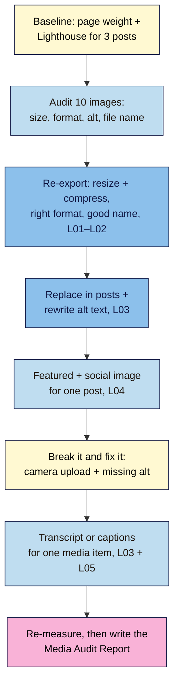

# M03 Capstone — Audit and optimise 10 images, add alt text and one transcript
> By the end of this capstone the images in your three Module 2 posts are right-sized, compressed and properly described, your pages are measurably lighter, and one video or audio item has a transcript. You'll prove it with a one-page **Media Audit Report**.

**Time:** ~90–120 min (baseline ~15, image fixes ~45, alt text ~15, drills and transcript ~20, report ~15) · **Level:** beginner · **Prereqs:** M03.L01–M03.L05
**Non-negotiables assessed:** #6 Media done right (right-sized, compressed, modern formats) · #7 Accessibility basics (alt text, captions, transcripts)
**Verified against:** WordPress 7.0 core source (labels and defaults used in M03.L01–L05) on 2026-10-31

## The brief
The brand from the Module 2 brief has come back: "Your posts look great, but they load slowly on our phones, and our accessibility lead says the images aren't described. Can you fix it and show us the difference?" Audit the media on your practice site, fix it, and send a one-page report with before-and-after numbers.

Keep working on the same **practice site** (Local). Use the **three posts** from the M02 capstone and the images in them; add images until you have **at least 10** across the posts (include at least one screenshot and one decorative image).

## How it works



**In words:** measure first, so you can prove the difference. Audit every image, re-export the bad ones, replace them in your posts and rewrite their alt text. Give one post a proper featured and social image. Break two things on purpose and fix them. Add a transcript or captions to one media item, then measure again and write it up.

## Tasks

### 1. Baseline (before you change anything)
For each of the three posts, in a Chrome **Incognito** window:
- DevTools → **Network** → tick **Disable cache** → reload. Record **requests** and **transferred** (bottom bar), and the size of the **largest image**.
- DevTools → **Lighthouse** → **Mode: Navigation**, **Device: Mobile**, **Performance** → **Analyze page load**. Record the **Performance** score and **LCP**, and note any image-related audits (wording varies by version, e.g. "Improve image delivery" or "Properly size images").
- Local runs on your computer, so compare each post **with itself** before and after, not with live websites.

### 2. Audit 10 images
Fill in one row per image (copy the table into your report):

| # | Post | File name | Uploaded size (px) | File size | Format | Used as (full / content / thumbnail / decorative / screenshot) | Alt text now | Problem(s) |
|---|---|---|---|---|---|---|---|---|

Look for: originals much wider than needed (M03.L01 table), photos as PNG, screenshots as low-quality JPEG, camera names (`IMG_4471.jpg`), missing or keyword-stuffed alt, "Image of…", and images showing text that isn't in the post.

### 3. Fix them
For every image with a problem:
1. Start from the **original** file (never re-compress an already compressed copy). Resize to the right width for its use, compress in Squoosh at 100% zoom, choose the right format (photo: JPEG/WebP; screenshot: PNG or lossless WebP), and give it a **descriptive file name**.
2. Upload it, then select the old image in the post and use **Replace** in the Image block toolbar.
3. Write **Alternative text** in the block for its purpose in **that** post (or leave it empty for the decorative image). No "Image of…", no keyword lists.
4. If you use an image-optimisation plugin (M03.L02), you only need **one**; note which, and its settings.
5. Delete the old upload from **Media → Library** only after checking **Uploaded to** in list view and searching your posts for it. Media deletes are permanent.

### 4. Featured and social image (from M03.L04)
- Give all three posts a featured image that survives your theme's crop (3:2 in Twenty Twenty-Five).
- For **one** post, make a **1200 × 630** social image from your template (JPEG or PNG, text inside the safe margin), uploaded with alt text and ready for your SEO plugin in M05.

### 5. Break it and fix it
**a) The camera upload.** Take a photo straight from your phone (no resizing), upload it to one post as a content-width **Image** block, set **Resolution** to **Full Size**, and leave **Alternative text** empty. Save, then run the Network check again.
1. Record the transferred size and the image's file name in the Network tab.
   **Expected:** a large jump in transferred data, and a `-scaled` file of up to 2560 px being downloaded for a ~645 px column.
2. In DevTools, right-click the image → **Inspect**.
   **Expected:** `alt=""`: a screen reader would skip a photo that matters to the post.
3. Fix it: set **Resolution** back to **Large**, add useful alt text, and ideally replace it with a resized, compressed export. Re-check.
   **Expected:** the transferred size drops back, and the `alt` attribute describes the image.
4. In one sentence, explain why "empty alt" was the wrong choice here but the right one for your decorative image.

**b) The alt text that didn't update.** In **Media → Library**, change the **Alternative Text** of an image that's already used in a post. View the post and inspect the image.
   **Expected:** the post still shows the old alt. Fix it by editing **Alternative text** in that post's Image block, and write one sentence on why WordPress works this way.

### 6. One transcript or captions (from M03.L03 and M03.L05)
Pick **one**:
- A podcast episode or audio clip (1–3 minutes is fine): an edited transcript with speaker names, in a **Details** block ("Read the transcript") under the player.
- A YouTube video you embedded in M02: edited captions in **YouTube Studio → Subtitles**, plus a short note in the post that captions are available.
- A short self-hosted clip: a `.vtt` file attached via the Video block's **Text tracks** (**Kind → Captions**), with **Preload** set to Metadata or None and a **poster image**.
If a post has an embed near the top, decide whether it needs a facade (M03.L05), and record your decision.

### 7. Re-measure
Repeat Task 1 for all three posts and fill in the comparison.
   > 🖼️ **Image prompt:** Side-by-side screenshots of the Chrome DevTools Network tab bottom bar for the same post before and after optimisation, e.g. "38 requests · 9.4 MB transferred" vs "36 requests · 1.1 MB transferred", with the largest image row visible in each. Highlight the key element with a 3px #F9B2D7 outline; blur any personal details.
   > **Alt text:** Network tab totals for one post before and after optimising images, showing transferred data falling sharply.

## Deliverable: Media Audit Report
One page (Markdown, Google Doc or PDF) with these headings. Screenshots are the best evidence.

```markdown
# Media Audit Report — <site name>
Date: YYYY-MM-DD · WordPress version: x.y.z · Running on: Local / <host>
Image plugin or host optimisation: <name + settings> / none

## 1. Before and after
| Post | Transferred before → after | Largest image before → after | Lighthouse Performance before → after | LCP before → after |
|---|---|---|---|---|
| … | 9.4 MB → 1.1 MB | 4.8 MB → 180 KB | 54 → 88 | 6.1 s → 2.3 s |

## 2. Image audit (10 images)
<the audit table from Task 2, with a "Fix" column added>

## 3. Alt text
Three examples (before → after, and why), including the decorative image (empty alt) and one link or chart if you have one.

## 4. Featured and social images
Featured images on all 3 posts ✅ · Social image (1200 × 630): <file name>

## 5. Break it and fix it
Camera upload: transferred <before> → <with camera photo> → <fixed>; why empty alt was wrong here: …
Media Library alt vs block alt: …

## 6. Transcript / captions
Item: … · Method: Details-block transcript / YouTube captions / .vtt track · Facade decision: …

## 7. My image rule
Photos: <width, format, quality> · Screenshots: <format> · Hero: <width> · Social: 1200 × 630 JPEG/PNG
```

## Rubric
Score each criterion; **Good** or better on all five completes the module.

| Criterion | Excellent (4) | Good (3) | Needs work (2) | Missing (1) |
|---|---|---|---|---|
| **Right-size and compress** (NN #6) | All 10 images resized for their use, compressed from originals, sensible formats (PNG/lossless only for screenshots); one plugin or host route documented | 8–9 images fixed; formats sensible | Images compressed but not resized, or photos left as PNG | No images changed |
| **Measured improvement** (NN #6) | Before/after for all three posts (transferred, largest image, Lighthouse, LCP) with screenshots and a one-line explanation of the biggest win | Before/after for all three posts; little explanation | Only one post measured, or "after" only | No measurements |
| **Alt text and file names** (NN #7) | Every image has purpose-based alt or a deliberate empty alt; no "Image of…" or stuffing; descriptive file names on all re-uploads | Alt on all images; one or two weak but not misleading | Alt copied from file names, keyword lists, or decorative images described at length | Alt missing on most images |
| **Transcript or captions** (NN #7) | Edited transcript or captions (names, terms, speakers, key sounds), well placed, with a reasoned embed or facade decision | Transcript or captions present and mostly corrected | Unedited auto-transcript or auto-captions | None |
| **Break it and fix it** | Both drills done with numbers, fixes verified in DevTools, both "why" sentences correct | Both drills done and fixed; explanations brief | One drill done, or fix not verified | No drills |

## Self-check before you submit
- [ ] Every image in the three posts is in the audit table, and none is wider than its use needs.
- [ ] I can point to the decorative image and show `alt=""` in DevTools.
- [ ] My before and after numbers come from the same pages, same device mode and **Disable cache** on.
- [ ] I deleted old uploads only after checking **Uploaded to** and searching my posts.
- [ ] No screenshots or transcripts include private details or other people's content without permission.

## What's next
Module 4 makes the site yours: theme, layout, navigation and the key pages every creator site needs. Your lighter, accessible posts will sit inside that design.

## Module 3 cheat sheet
Keep `wordpress-101/cheatsheets/m03-media.md` open while you work.
