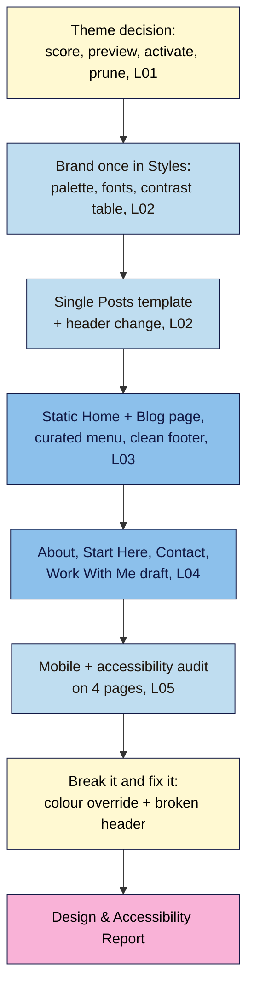

# M04 Capstone — Brand your site and build About + Start Here pages that pass accessibility checks
> By the end of this capstone your practice site has a maintained block theme, your brand colours and fonts set once in global styles, a clear homepage, menu and footer, and About, Start Here and Contact pages that pass a contrast check and a keyboard walk-through. You'll prove it with a one-page **Design & Accessibility Report**.

**Time:** ~100–130 min (theme ~15, brand ~25, navigation and homepage ~20, creator pages ~35, audit and drills ~25, report ~15) · **Level:** beginner · **Prereqs:** M04.L01–M04.L05
**Non-negotiables assessed:** #7 Accessibility basics (contrast, heading order, link text, keyboard), applied to your design and key pages
**Verified against:** WordPress 7.0 and Twenty Twenty-Five 1.5 (labels used in M04.L01–L05), Fluent Forms 6.2.16, WCAG 2.2 on 2026-10-31

## The brief
A small brand you'd love to work with has found your site: "We like your posts, but the site doesn't feel like *you* yet, and before we partner with anyone our accessibility lead checks their pages. Can you give it a proper look, a clear front door and a way to contact you, and show us it's readable for everyone?" Make the site look and work like a real creator brand, then send a one-page report with evidence.

Keep working on the same **Local** practice site, with the three posts from the M02/M03 capstones.

## How it works



**In words:** settle the theme first, then set your brand once in Styles and check every colour pair. Build the signposts (homepage, menu, footer) and the creator pages. Audit four pages on a phone-sized screen, with WAVE and with the keyboard; break two things on purpose, fix them, and write it up.

## Tasks

### 1. Theme decision (from M04.L01)
- Score **three** block themes with the 12-point rubric using **today's** directory data (Last updated, Minimum WordPress/PHP, installs, ratings, accessibility-ready, weight).
- **Live Preview** your top two with your own posts, then back up and **Activate** the winner (Twenty Twenty-Five is a fine winner).
- Delete unused themes, keeping **one** default theme as a fallback.

### 2. Brand once in global styles (from M04.L02)
- **Styles → Colors → Edit palette:** set the theme's **Base**, **Contrast** and accent slots to your brand colours (or start from **Browse styles** and adjust).
- **Typography:** install at most **two** font families from **Manage fonts** (Install Fonts or Upload) and set **Text** and **Headings** under Elements.
- **Contrast table:** test every text/background pair you actually use (body text, links, buttons, headings, footer text) in the WebAIM Contrast Checker. Every pair must reach **4.5:1** (3:1 for large text only). If a brand colour fails, keep it for backgrounds or decoration and add a darker shade for text.
- **Templates:** add one element every post should have to **Single Posts** (e.g. your synced author box or newsletter CTA below **Content**), and make one change to the **Header** part. Keep a note of what you changed.

### 3. Homepage, menu and footer (from M04.L03)
- Create **Home** and **Blog** pages and set them in **Settings → Reading** (**A static page**). Use **Page No Title** for Home and make your headline the page's **H1**.
- Home has: a promise headline, a short intro, your best 3 posts (or a Latest Posts block), and a sign-up.
- Replace the fallback menu with a curated **Main menu** of 4–6 items: **Start Here**, **Blog** (or main categories), **About**, **Contact**.
- Footer: newsletter CTA, legal/help links to **published** pages only, 2–4 **Social Icons** with full URLs. **No `#` links left.**

### 4. Creator pages (from M04.L04)
- **About:** reader-first headline (who it's for + outcome) on the first screen, 3–4 proof bullets (true ones), a short story, one next step.
- **Start Here:** 2–3 reader goals, 3 best posts each, a category link per goal, newsletter CTA.
- **Contact:** one form plugin; **honeypot** and **token-based protection** on; **email notification on** with Reply To set; specific thank-you message; one-line privacy note. Send two test messages and check **Entries** and **Mailpit**.
- **Work With Me:** saved as a **draft** with the six outline headings and dated audience numbers.

### 5. Mobile and accessibility audit (from M04.L05)
Audit **Home**, **About**, **Start Here** and **Contact**:
- Device mode at **320 px** and **200%** zoom (plus a real phone via **Live Link** if you can): no sideways scrolling, menu collapses, tap targets usable.
- **WAVE** (or Lighthouse Accessibility): fix all **Errors** and **Contrast Errors**; note how you handled each **Alert**.
- **Document Overview → Outline:** one H1 per page, no skipped levels.
- Link text and alt text: no "click here", no empty links, functional images describe their destination.
- **Keyboard walk-through:** Skip to content → header → menu button (Enter opens, Esc closes) → content → footer → contact form submitted with the keyboard.
   > 🖼️ **Image prompt:** Screenshot of the WAVE browser extension summary panel on a branded About page showing 0 Errors and 0 Contrast Errors, with a few Alerts and the Structure/Contrast tabs visible. Highlight the key element with a 3px #F9B2D7 outline; blur any personal details.
   > **Alt text:** WAVE summary for the About page showing zero errors and zero contrast errors.

### 6. Break it and fix it
**a) The block-level colour override.** On your **About** page, select one paragraph and give it a light text colour from your palette (e.g. a pale accent such as Twenty Twenty-Five's yellow **Accent 1** on a white background). In the block settings you may see WordPress's own warning, *"This color combination may be hard for people to read."* Update the page anyway and run WAVE.
1. Record the **Contrast Errors** count and the ratio WAVE (or the WebAIM checker) reports for that paragraph.
   **Expected:** at least one new contrast error (yellow `#FFEE58` on white is about **1.2:1**).
2. Now change your **Contrast** colour in **Styles** and view the page.
   **Expected:** every other paragraph changes, but the overridden one doesn't: a block-level setting beats global styles. Then set **Contrast** back (or use **Styles → Revisions** to restore the previous version).
3. Fix it: select the paragraph and **clear** its text colour so it follows Styles. Rerun WAVE.
   **Expected:** the contrast error is gone.
4. Write one sentence on why styling blocks one by one makes rebrands and accessibility harder.

**b) The broken header.** In **Appearance → Editor → Patterns → Header**, delete the **Navigation** block and save.
1. Visit **three different pages** (Home, a post, Contact).
   **Expected:** the menu is missing on **all** of them, because the header is one shared template part.
2. Fix it: **Patterns → Template parts → Header** (or **All template parts**) → **⋮** → **Reset**, and confirm *"Reset to default and clear all customizations?"*.
   **Expected:** the theme's original header returns, but your earlier header change from Task 2 is gone too.
3. Look at which menu the restored header shows. Because the theme's Navigation block isn't set to a specific menu, WordPress shows your **most recently published** menu, probably **Main menu**. If it shows another one, select the Navigation block and choose **Main menu** from the menu's **⋮** options. Re-add your header change, then retest the keyboard path through the menu.
4. Write one sentence on what Reset removes, and one on how you'd avoid needing it (e.g. a note of every template change).

## Deliverable: Design & Accessibility Report
One page (Markdown, Google Doc or PDF) with these headings. Screenshots are the best evidence.

```markdown
# Design & Accessibility Report — <site name>
Date: YYYY-MM-DD · WordPress version: x.y.z · Theme: <name + version> · Running on: Local / <host>

## 1. Theme decision
| Theme | Last updated | Min WP / PHP | Installs | Rating | A11y-ready | Weight | Score /12 |
|---|---|---|---|---|---|---|---|
Winner and why (2 sentences). Themes deleted: … · Fallback kept: …

## 2. Brand sheet
| Slot | Hex | Used for |
|---|---|---|
Fonts: <heading family + weights> / <body family + weights> · Source: Install Fonts / Upload
Templates and parts customised: …

## 3. Contrast table
| Text | Background | Ratio | Pass (4.5:1 / 3:1 large) |
|---|---|---|---|

## 4. Signposts
Homepage: static (Home) · Posts page: Blog · Main menu: <items> · Footer: <CTA, links, social>
Screenshots: homepage desktop + phone with menu open; footer.

## 5. Creator pages
About / Start Here / Contact URLs · Work With Me: draft ✅
Contact form: plugin <name> · Honeypot ✅ · Token protection ✅ · Notification ✅ · Test entries: 2 · Mailpit ✅

## 6. Accessibility audit
| Page | WAVE errors before → after | Contrast errors before → after | H1 count | Keyboard path OK | 320 px / 200% OK |
|---|---|---|---|---|---|
Alerts and how I handled them: …

## 7. Break it and fix it
Colour override: contrast errors <n> → <n>; why block-level styling hurts: …
Broken header: pages affected <n>; what Reset removed: …; how I'll avoid it: …
```

## Rubric
Score each criterion; **Good** or better on all five completes the module.

| Criterion | Excellent (4) | Good (3) | Needs work (2) | Missing (1) |
|---|---|---|---|---|
| **Theme and global styles** | Maintained block theme chosen with a scored shortlist; brand set entirely in Styles (palette slots + ≤2 font families), no block-level colour overrides; Single Posts and Header customised and documented; unused themes pruned | Theme chosen with scores; brand set in Styles with one or two overrides; templates customised | Brand applied block by block, or theme chosen without checking update date/requirements | Default look unchanged |
| **Contrast and accessibility** (NN #7) | Every text pair in the contrast table ≥ 4.5:1 (3:1 large); WAVE 0 errors and 0 contrast errors on all 4 pages; one H1 per page; descriptive links; keyboard path fully works | All pairs pass; WAVE errors fixed on 3–4 pages; minor alerts left with reasons | Some pairs fail, or WAVE run but errors left; keyboard path not tested | No contrast or accessibility checks |
| **Homepage, menu and footer** | Static Home with a clear promise and H1, Blog posts page, curated 4–6 item menu, footer with CTA, legal/help and social links; no `#` or draft links; works at 320 px | Static Home and Blog set; curated menu; footer cleaned | Fallback (all pages) menu still in use, or placeholder links remain | Homepage/menu/footer untouched |
| **Creator pages and contact** | Reader-first About, goal-based Start Here, Contact form with spam protection, notification and Reply To tested (Entries + Mailpit), privacy note; Work With Me outline with dated numbers | About, Start Here and a working, protected Contact form; Work With Me outlined | Pages exist but About is bio-first, Start Here lists everything, or form untested/unprotected | Pages missing |
| **Break it and fix it** | Both drills done with numbers, fixes verified (WAVE rerun, menu retested by keyboard), all "why" sentences correct | Both drills done and fixed; explanations brief | One drill done, or fix not verified | No drills |

## Self-check before you submit
- [ ] My brand colours live in **Styles**, and no paragraph, heading or button has its own colour override.
- [ ] Every row in my contrast table passes, including link and button text.
- [ ] Each audited page has exactly one H1 and no "(Incorrect heading level)" warnings.
- [ ] Every menu and footer link goes to a published page, never `#`.
- [ ] My contact form emails me **and** stores entries, and I tested it twice.
- [ ] My media-kit numbers are real and dated, and screenshots hide personal details.

## What's next
Module 5 gets your site found: how search engines and AI answer engines discover, index and cite your pages, one SEO plugin set up properly, and Search Console connected. Your clear structure, headings and creator pages are the foundation it builds on.

## Module 4 cheat sheet
Keep `wordpress-101/cheatsheets/m04-design.md` open while you work.
