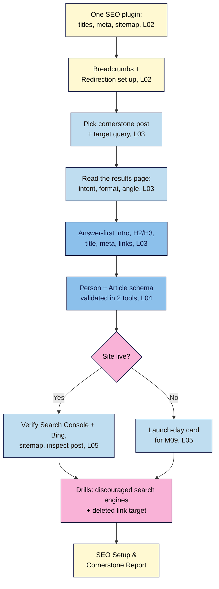

# M05 Capstone — Configure your SEO plugin, connect Search Console, and fully optimise one cornerstone post
> By the end of this capstone your site has one SEO plugin set up properly, a working sitemap, breadcrumbs, accurate author schema and a redirect habit. One **cornerstone post** is optimised end to end for a real query, and Search Console and Bing are verified (or ready for launch day). You'll prove it with a one-page **SEO Setup & Cornerstone Report**.

**Time:** ~110–140 min (plugin setup ~25, cornerstone post ~45, schema and validation ~15, Search Console and Bing ~20, drills ~15, report ~15) · **Level:** beginner · **Prereqs:** M05.L01–M05.L05
**Non-negotiables assessed:** #8 On-page SEO + one SEO plugin configured (titles, meta, sitemap, schema, Search Console)
**Verified against:** WordPress 7.0, Yoast SEO 28.8, Redirection 5.10.1 (labels used in M05.L01–L05), Google Search Central and Search Console Help on 2026-10-31

> Note: Search Console and Bing need a site that's **live on the internet**. If your site is still on Local, do Task 5 as a **launch-day card** (a short, ready-to-follow checklist) and complete it in M09. The rubric gives full credit for either path.

## The brief
A friend who runs a popular newsletter wants to feature one of your posts: "I'll link to your best guide, but only if people can actually find the rest of your site afterwards, and I want to see it shows up properly when people search for it." Pick the post you're proudest of, make it the best answer on the web for one real query, set up the plumbing so search engines and AI answers can find, understand and cite your whole site, and send a one-page report with evidence.

Keep working on the same practice site, with the posts and pages from the M02–M04 capstones.

## How it works



**In words:** set up one SEO plugin and the redirect habit first. Then choose one cornerstone post and a real query, read the results page, and rebuild the post around what searchers want: answer first, clear headings, a strong title and description, and internal links in and out. Make sure its schema describes you accurately, and validate it. Connect Search Console and Bing (or prepare a launch-day card), break two things on purpose, fix them, and write it up.

## Tasks

### 1. One SEO plugin, set up properly (from M05.L01–L02)
- Confirm **Settings → Reading → Search engine visibility** is **unticked** on any live site (on Local it doesn't matter, but check you know where it is).
- **One** SEO plugin only (Yoast SEO, Rank Math or AIOSEO). Deactivate and delete any other plugin that writes titles, Open Graph or schema.
- **Site representation** (Person or Organization), **Site basics** (title, tagline, separator), and **Social profiles** filled in.
- **Content types:** Posts and Pages title templates checked; Posts description template set to **Excerpt**; a hand-written description for **Home**, **About** and **Start Here**.
- **Sitemap:** `/sitemap_index.xml` loads, is in `robots.txt`, and doesn't include author archives on a one-person site.
- **Breadcrumbs:** the core **Breadcrumbs** block in the **Single Posts** template.
- **Redirects:** **Redirection** installed with **Monitor permalink changes** and the 404 log on (or Rank Math's **Redirections** module). Your redirects table from M05.L02 started in your site docs.

### 2. Choose your cornerstone post and query (from M05.L03)
- Pick the post you most want people to find: usually a guide that answers a common question in your niche, which other posts can link to.
- Choose **one target query** a real person would type (e.g. *easy miso ramen recipe*, not *ramen*).
- Search it in a private window and fill in the **results table**: features, intent, format, angle, what they all cover, what's missing. Decide whether your post fits. If it doesn't, change the post or the query.
   > 🖼️ **Image prompt:** Screenshot of a filled-in results-page notes table in a document, with rows for Features, Intent, Format, Angle, What they all cover and What's missing for the query "easy miso ramen recipe", 1200 × 700. Highlight the "What's missing" row with a 3px #F9B2D7 outline; blur any personal details.
   > **Alt text:** A results-page notes table for one query, with the What's missing row highlighted as the post's extra value.

### 3. Optimise the post end to end (from M05.L02–L03, M03)
- **Opening:** the first 2–3 sentences answer the query or state the promise; the story comes after.
- **Headings:** one H1 (the title), then H2/H3 that match the format searchers expect; **Document Overview → Outline** shows no warnings. Include one H2 for your "what's missing" extra value.
- **Title and description:** check the SEO title (unique, descriptive, close to the H1, not stuffed) and write a custom meta description for this post (who it's for + what they get).
- **Slug:** short and descriptive. If you change it on a published post, confirm the old URL redirects (WordPress does this for posts; test with `curl -I` or a private window).
- **Internal links:** at least **3 links in** from related posts and **2 links out** to related posts or a category page, all with descriptive anchor text. Add the post to your **Start Here** page if it fits (M04.L04).
- **Images:** a featured image (with a 1200 × 630 social image if needed, M03.L04) and alt text that describes each image's purpose (M03.L03).
- **Re-read as the searcher:** did you get the answer in the first screen on a phone?

### 4. Schema that describes you accurately (from M05.L04)
- **Users → Profile:** real or pen name as the display name, a 1–2 sentence bio, your About page as **Website**, 1–3 social profile fields, a Gravatar photo.
- Your byline is visible on the post.
- Validate the cornerstone post in the **Rich Results Test** and the **Schema Markup Validator** (paste the page source on Local; use the URL on a live site). Record what each tool detected and any errors or warnings, and fix errors at the source.
- No FAQ or How-to markup added for rich results (they no longer appear), and no hand-pasted JSON-LD.

### 5. Search Console and Bing (from M05.L05)
**If your site is live:**
- Verify a **Domain** or **URL-prefix** property in Search Console, and note the method. Keep the record or tag in place.
- Submit `sitemap_index.xml` → **Status: Success**.
- **Import** the site into Bing Webmaster Tools (or verify with the meta tag) and check the sitemap is listed.
- **Inspect** your cornerstone post's URL; if it's not on Google, **Request indexing** once.
- After a few days, take your own screenshot of the **Pages** report and sort each not-indexed reason into *expected* or *action needed*.

**If your site is still on Local:** write a **launch-day card** with: the property type you'll use and why; where the verification code goes (DNS provider or **Yoast → Site connections**); the sitemap URL to submit; the Bing Import step; the URL you'll inspect first; and a reminder to untick **Discourage search engines**. You'll follow it in M09.

### 6. Break it and fix it
**a) The "invisible site" switch.** On your **Local** site (never on a live one), tick **Settings → Reading → Discourage search engines from indexing this site** and save.
1. Look at the dashboard: Yoast shows **"Huge SEO Issue: You're blocking access to robots."**
2. View your cornerstone post's source and search for `robots`.
   **Expected:** the robots meta tag now contains `noindex`. Every page on the site now asks search engines not to index it.
3. On a live site, this is exactly what Search Console would show weeks later as pages marked `noindex` in the **Pages** report (M05.L05), and why Kemi had no visitors (M05.L01).
4. Fix it: untick the box, **Save Changes**, and confirm the warning is gone and `noindex` has left the source.
5. Write one sentence on how you'll make sure this box is unticked on launch day (e.g. it's the first line of your launch-day card).

**b) The deleted link target.** Your cornerstone post links to a related post (Task 3). Move that **related post** to the **Trash**.
1. Click the link in your cornerstone post.
   **Expected:** your theme's 404 page. Then open **Tools → Redirection → 404s**: the hit is logged with the old URL.
2. Decide: is there a close replacement? If yes, add a **301** from the old URL to it in **Tools → Redirection**, and update the link in your cornerstone post to point **directly** at the new target (no redirect hop). If no, remove or replace the link.
   **Expected:** `curl -I` on the old URL returns `301` with the new `Location:`, or the link is gone.
3. Restore the trashed post if you still want it (**Posts → Trash → Restore**) and remove the now-unneeded redirect, so it can't loop.
4. Write one sentence on why you update the link itself as well as adding a redirect.

## Deliverable: SEO Setup & Cornerstone Report
One page (Markdown, Google Doc or PDF) with these headings. Screenshots are the best evidence.

```markdown
# SEO Setup & Cornerstone Report — <site name>
Date: YYYY-MM-DD · WordPress version: x.y.z · SEO plugin: <name + version> · Running on: Local / <host>

## 1. SEO plugin setup
Site representation: Person / Organization · Title separator: … · Posts title template: … · Description template: …
Sitemap: <URL> ✅ in robots.txt ✅ · Author archives in sitemap: no ✅ · Breadcrumbs block in Single Posts ✅
Redirects: plugin <name> · Monitor permalink changes ✅ · 404 log ✅ · Redirects table started ✅

## 2. Cornerstone post and query
Post: <title + URL> · Target query: … 
| Signal | What I saw |
|---|---|
Fits intent/format/angle? … · My extra value: …

## 3. Before → after
| Element | Before | After |
|---|---|---|
| First 2 sentences | | |
| H2/H3 outline | | |
| SEO title | | |
| Meta description | | |
| Slug (and redirect test) | | |
| Internal links in / out | | |
| Featured image + alt | | |

## 4. Schema
Person: name / bio / sameAs ✅ · Byline visible ✅
| Tool | Items detected | Errors | Warnings | Fixes |
|---|---|---|---|---|
| Rich Results Test | | | | |
| Schema Markup Validator | | | | |

## 5. Search Console and Bing (or launch-day card)
Property type + method: … · Sitemap status: … · Bing: Import / meta tag ✅ · Cornerstone URL inspection: …
Pages report: | Reason | Count | Expected / action |
(or: launch-day card, 6 steps)

## 6. Break it and fix it
Discouraged search engines: warning seen ✅ · noindex in source ✅ → fixed ✅ · launch-day safeguard: …
Deleted link target: 404 logged ✅ · fix: 301 to … / link removed · link updated directly ✅ · why: …
```

## Rubric
Score each criterion; **Good** or better on all five completes the module.

| Criterion | Excellent (4) | Good (3) | Needs work (2) | Missing (1) |
|---|---|---|---|---|
| **SEO plugin and site plumbing** (NN #8) | Exactly one SEO plugin; representation, templates (Excerpt description), hand-written key-page descriptions; sitemap index loads and is in robots.txt with thin archives excluded; core Breadcrumbs block in Single Posts; Redirection (or equivalent) monitoring and 404 log on; redirects table started | One SEO plugin with templates, sitemap and breadcrumbs working; redirects tool installed | Plugin installed but defaults unchecked, or a second plugin still writes titles/schema | No SEO plugin, or two |
| **Search intent and on-page structure** | Real query with a complete results table; post fits intent, format and angle and adds a clear extra; answer-first opening; clean H1→H2→H3 outline; unique title and custom description | Results table done; answer-first opening; clean outline; title and description checked | Query chosen without checking results, or opening still story-first, or heading levels skipped | Post not optimised |
| **Internal links and URLs** | ≥3 links in and ≥2 out, all with descriptive anchors; post linked from Start Here (if it fits); slug clean, any change tested with a 301; no links to redirects or 404s | ≥3 in and ≥2 out with descriptive anchors; slug checked | Fewer links, or generic anchors ("click here") | No internal links added |
| **Schema and validation** | Person schema has real name, bio, About page and profiles; byline visible; both tools run with results recorded; errors fixed at the source; no FAQ/How-to or hand-pasted JSON-LD | Person schema fixed; both tools run, no errors | One tool only, or "admin"/username still the author, or errors left | No validation |
| **Search Console, Bing and drills** | Live: both verified, sitemap Success, post inspected, Pages reasons sorted correctly. Local: complete 6-step launch-day card. Both drills done with evidence and correct "why" sentences | Live verification or a complete launch-day card; both drills done | Card incomplete, sitemap not submitted, or one drill only | Nothing done |

## Self-check before you submit
- [ ] Only **one** plugin writes titles, Open Graph and schema (view source: one `<title>`, one `yoast-schema-graph` or equivalent).
- [ ] My cornerstone post's first 2–3 sentences would satisfy someone who reads nothing else.
- [ ] Every internal link goes straight to a live page (no 404s, no redirect hops).
- [ ] My author name in schema is my real or pen name, not a username.
- [ ] **Discourage search engines** is unticked on any live site, and it's on my launch-day card.
- [ ] I didn't request indexing more than once for the same URL.

## What's next
Module 6 turns visitors into subscribers and subscribers into income: email capture done lawfully, comments and community, repurposing one post into many, and your first monetisation page. Your cornerstone post is the natural place for your first sign-up form.

## Module 5 cheat sheet
Keep `wordpress-101/cheatsheets/m05-seo.md` open while you work.
