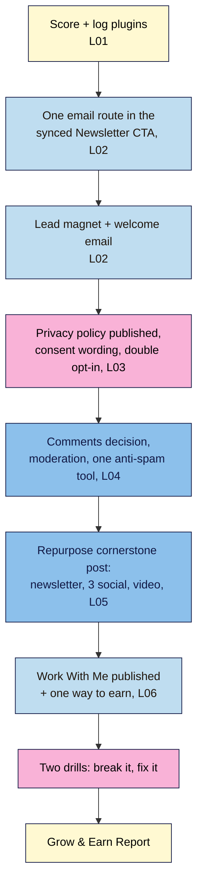

# M06 Capstone — Lawful email capture, a lead magnet and your Work With Me page
> By the end of this capstone your site turns readers into subscribers lawfully: one email route connected through your synced Newsletter CTA, a real lead magnet delivered by a welcome email, a published privacy policy, double opt-in, protected comments and forms, one post repurposed into four formats, and a published Work With Me page with one way to earn.

**Time:** ~120–150 min (plugins and email route ~25, lead magnet ~30, privacy and consent ~25, comments and spam ~15, repurposing ~20, Work With Me + product ~25, drills ~15, report ~15) · **Level:** beginner · **Prereqs:** M06.L01–M06.L06
**Non-negotiables assessed:** #9 Email list capture with a privacy notice
**Verified against:** WordPress 7.0, Fluent Forms 6.2.16, Kit 3.4.8, MailPoet 5.44.0, MC4WP 4.14.1, Akismet 5.7.2, Antispam Bee 2.11.13 (labels used in M06.L01–L06), on 2026-11-01

> Note: double opt-in, RSS-to-email and some payment buttons (e.g. Jetpack) behave differently on **Local**. Where a step needs a live site, do it on your live site if you have one; otherwise write it as a **launch-day card** item for M09. The rubric gives full credit for either path. Not legal or tax advice.

## The brief
A small brand in your niche emails you: "We'd love to sponsor a newsletter issue. How many subscribers do you have, how do people sign up, and where are your rates?" You realise you have no list, no rates page and no privacy policy. Your job: build the whole path from **reader → subscriber → paying relationship**, lawfully and in a way you can keep up with, and send the brand a link to your Work With Me page.

Keep working on the same practice site, with the posts, pages, synced Newsletter CTA and cornerstone post from the M02–M05 capstones.

## How it works



**In words:** check every plugin you add, connect one email route inside your synced CTA, give readers a lead magnet, make capture lawful, protect comments and forms, get more from your best post, and publish the page that turns attention into income. Then break two things on purpose and fix them.

## Tasks

### 1. Plugins you can trust (from M06.L01)
1. Start (or update) your **plugin log** with every plugin on the site: job, why chosen (score /16), version, installed date, source, auto-updates, last reviewed, exit plan.
2. Score **every new plugin** you add in this capstone (email, anti-spam, payments) with the 16-point checklist **before** installing it. Note any you rejected and why.
3. Delete inactive plugins you don't need.
   **Evidence:** the plugin log; one completed 16-point scoring table; **Plugins → Installed Plugins** showing no unused inactive plugins.

### 2. One email route and the synced CTA (from M06.L02)
1. Record your email provider, today's free-plan limit, and how you'd **export** your subscribers.
2. Connect it with **one** route: official plugin, an integration you already have (e.g. Fluent Forms → Mailchimp), or embed code.
3. Put the form inside your **synced Newsletter CTA** with a **specific promise** (what, how often, for whom). Confirm it shows at the end of posts, on Start Here, on About and in the footer.
4. Check it at 320 px wide: readable, tappable, nothing covering the content. No full-screen popup on arrival.
   **Evidence:** screenshots of the CTA in two places (one on mobile); the route you chose and why in one sentence.

### 3. Lead magnet and welcome email (from M06.L02, M06.L05)
1. Make the lead magnet you outlined in M06.L02: a small, specific next step from your best post (checklist, printable, template), 1–3 pages.
2. Set up the **welcome email** in your provider: thanks, what to expect and how often, the lead magnet link, and a link to Start Here.
3. Offer it in the CTA and on the post it came from: *"Get the free [thing] and the [weekly] email."*
   **Evidence:** the file (or its first page), the welcome email text, and a screenshot of the offer on the source post.

### 4. Lawful capture (from M06.L03)
1. **Settings → Privacy** → create or select your policy; customise every section (naming your email provider, form plugin, anti-spam and any checkout); add **Last updated**; **Publish**.
2. Link **Privacy Policy** in the footer; confirm it opens (no 404) on desktop and mobile.
3. Add consent wording under every sign-up form: what, how often, unsubscribe any time, policy link. Add a privacy line to your contact form. Use separate, **unticked** boxes for separate purposes.
4. Turn on **double opt-in** for your route (e.g. Fluent Forms Mailchimp feed **Enable Double Opt-in**, MC4WP **Use double opt-in?**, MailPoet **Enable sign-up confirmation**, or your provider's setting). Edit the success message to *"Check your inbox to confirm."*
5. **Test end to end:** sign up with an address you own → "check your inbox" → confirmation email → confirmed subscriber → welcome email with the lead magnet. Record where the provider shows the sign-up date and confirmation. Delete the test subscriber.
   **Evidence:** the policy URL; a screenshot of the consent line; the test sequence (form message → confirmation email → confirmed status → welcome email). Local path: a launch-day card item for the live test.

### 5. Comments and spam (from M06.L04)
1. Write your comments decision in one line (on / off / some posts, and when you check them).
2. **Settings → Discussion:** pingbacks and trackbacks off; name and email required; cookies opt-in checkbox on; **Comment author must have a previously approved comment** (or manual approval); hold **2 or more links**; a short **Comment Moderation** word list. Bulk-close comments on posts where you don't want them.
3. Add **one** anti-spam tool (Akismet or Antispam Bee), scored and logged; turn on your form's **honeypot**. Update the privacy policy if the tool sends data to a third party.
4. Test: one normal comment (approve and reply), one 3-link comment (held or spam), one form entry.
   **Evidence:** your one-line decision; a screenshot of the moderation settings; the three test results.

### 6. Repurpose your cornerstone post (from M06.L05)
1. Fill in a **repurposing sheet** for your M05 cornerstone post (key points, one story, one sourced fact, one reader question).
2. From the sheet only, write: one **newsletter issue** (150–300 words), **three social posts** (tip, story, question) and a **30–60 second video script** (Say / Show).
3. Note your **site feed** and one **category feed** URL, your Excerpt/Full text choice, and whether you'll use RSS-to-email (review-first).
   **Evidence:** the sheet and the four drafts; the two feed URLs; your RSS decision.

### 7. Work With Me and one way to earn (from M06.L06)
1. Write your audience numbers **with a date** and pick **one** monetization model with a one-sentence reason.
2. Complete and **publish** your Work With Me page: who you work with, dated audience numbers, 2–4 offers with "from" prices or "rates on request", real past partners only (or leave it out), how you disclose, and a button to your contact form. Link it from the footer and About page.
3. Set up **one** way to earn that fits your model: a digital product via a hosted checkout with a **Buttons** block, or one affiliate link (disclosed before the link, `nofollow` or `sponsored`), or a sponsorship offer in your newsletter. Update your privacy policy and plugin log.
   **Evidence:** the Work With Me URL; the monetization decision; a screenshot of the product button or disclosed affiliate link.

### 8. Break it and fix it
**a) The draft privacy policy.** On your **Local** site, open your Privacy Policy page and switch it back to a draft: in the **Page** sidebar, click the **Status** value and choose **Draft** ("Not ready to publish."), then **Save**.
1. Log out (or use a private window) and click **Privacy Policy** in your footer and under your sign-up form.
   **Expected:** a 404 page. Every consent line on your site now points to nothing.
2. Go to **Settings → Privacy**. Notice that your page is still selected, and the screen offers to **edit** or **preview** it (not *view*), a clue that it isn't public.
3. Fix it: **Publish** the page again. Confirm both links open it while logged out.
4. Write one sentence on how you'll catch this in future (e.g. a monthly logged-out check of footer links, M09).

**b) The over-eager spam word.** Go to **Settings → Discussion → Disallowed Comment Keys**, add the single word `ass`, and save.
1. Logged out, leave a comment on a post: *"I took a cooking class and this recipe was the favourite."*
   **Expected:** the comment never appears and isn't in **Pending**. Look in **Comments → Trash**: it's there. WordPress matched `ass` inside *class*.
2. Fix it: remove `ass` from **Disallowed Comment Keys**, and if you still want to catch that word, put it in **Comment Moderation** instead (held for review, not trashed). Restore the comment from Trash and approve it, or delete it.
3. Write one sentence on which list you'll use for borderline words, and why.

## Deliverable: Grow & Earn Report
One page (Markdown, Google Doc or PDF) with these headings. Screenshots are the best evidence.

```
# Grow & Earn Report — <site name>
Date: <YYYY-MM-DD>   Site: <Local / live URL>

## 1. Plugin log
<table or link; one 16-point score shown in full; rejected plugins and why>

## 2. Email route and CTA
Provider · free-plan limit (date) · export method · route chosen and why
<screenshots: CTA on a post (desktop) and on Start Here (mobile)>

## 3. Lead magnet and welcome email
<title, format, source post; welcome email text>

## 4. Lawful capture
Privacy policy URL · consent wording · double opt-in setting location
Test: form message → confirmation → confirmed → welcome email (or launch-day card)

## 5. Comments and spam
Decision · moderation settings · anti-spam tool · 3 test results

## 6. Repurposing
<sheet + newsletter, 3 social posts, video script; feed URLs; RSS decision>

## 7. Work With Me and earning
Page URL · dated numbers · model chosen and why · product/affiliate/sponsor evidence

## 8. Break it and fix it
a) <what broke, how you found it, how you fixed it, one sentence>
b) <same>
```

## Rubric
Score each criterion; **Good** or better on all five completes the module.

| Criterion | Excellent (4) | Good (3) | Needs work (2) | Missing (1) |
|---|---|---|---|---|
| **Email capture route** (NN #9) | One route in the synced CTA with a specific promise, showing in 3+ places, mobile-checked, no intrusive popup; export method recorded; new plugins scored and logged | One working route in the synced CTA in 2+ places; promise is specific | Form works but is pasted unsynced, vague promise, or two routes | No working sign-up |
| **Privacy and consent** (NN #9) | Published, customised policy naming every service, linked in footer and beside every form; consent line covers what/how often/unsubscribe/policy; unticked separate boxes; double opt-in tested end to end (or full launch-day item) | Published policy linked in footer and at the form; consent line present; double opt-in on | Policy still has suggested text, or consent line missing on some forms, or double opt-in off | No published policy |
| **Lead magnet and welcome** | A specific next step from the best post, finished, delivered by a welcome email that sets expectations; offered on the source post and CTA | Finished lead magnet delivered by welcome email | Outline only, or delivered without a welcome email | None |
| **Community, spam and repurposing** | Honest comments decision; recommended moderation; one anti-spam tool logged and in the policy; honeypot on; tests recorded; repurposing set complete, every fact traceable to the sheet; feed URLs and RSS decision noted | Moderation and one anti-spam tool set; repurposing set complete | Settings partly done, two anti-spam tools, or repurposing missing a format | Not attempted |
| **Work With Me, earning and drills** | Published page with dated real numbers, clear offers and prices, linked from footer and About; one earning route live with disclosure and policy update; both drills done with evidence and a prevention sentence | Published page with dated numbers and offers; one earning route set up; both drills done | Page unpublished, numbers undated, or one drill missing | No page and no drills |

## Self-check before you submit
- [ ] Logged out, every **Privacy Policy** link opens the published page (no 404).
- [ ] Every sign-up form says what, how often, "unsubscribe any time", and links to the policy. No pre-ticked boxes.
- [ ] My test subscriber went through **pending → confirmed** before getting the welcome email, and I deleted it afterwards.
- [ ] Only **one** email route and **one** comment anti-spam plugin are active.
- [ ] Every number on my Work With Me page is real and dated.
- [ ] Every affiliate link has a disclosure **before** the link.
- [ ] My privacy policy names every service that receives readers' data (email provider, anti-spam, checkout).

## What's next
Module 7 protects everything you've built: updates, security, backups you've actually restored, performance and caching. Your plugin log from this module becomes the list you update and review each month.

## Module 6 cheat sheet
Keep `wordpress-101/cheatsheets/m06-grow-monetize.md` open while you work.
