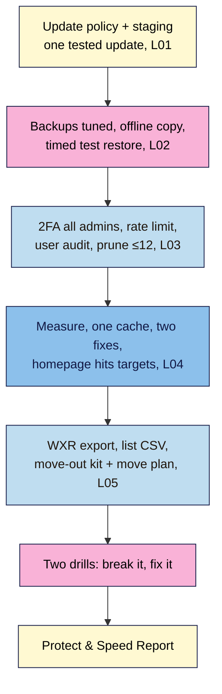

# M07 Capstone — Protect & speed up: a site that survives anything
> By the end of this capstone your site has an update routine you've tested, backups you've actually restored (with a time in minutes), every admin behind 2FA, 10–12 plugins or fewer, a homepage that meets "good" Core Web Vitals targets, and a move-out kit that lets you leave any host.

**Time:** ~150–180 min (updates and staging ~25, backups and test restore ~35, security audit ~20, performance ~30, export and move-out kit ~20, drills ~25, report ~15) · **Level:** beginner · **Prereqs:** M07.L01–M07.L05
**Non-negotiables assessed:** #3 Day-one safety net (restore test, hardening) · #6 Media done right (reinforced) · #10 Updates + lean plugin hygiene · #11 Performance / Core Web Vitals · #1 Own your platform (reinforced: export and migrate)
**Verified against:** WordPress 7.1.4, UpdraftPlus 1.26.14, Two Factor 0.17.0, Limit Login Attempts Reloaded 3.3.10, WP Super Cache 3.1.4, WordPress Importer 0.9.7, web.dev Core Web Vitals thresholds and Lighthouse 13 (labels and behaviour used in M07.L01–L05), on 2026-11-01

> Note: PageSpeed Insights, real-user (field) data, host staging and DNS steps need a **live** site. On **Local**, use Lighthouse lab numbers for the performance targets, and write any live-only step as a **launch-day card** item for M09. The rubric gives full credit for either path.

## The brief
A creator friend messages you at 7 a.m.: their host had a disk failure overnight, their "daily backups" turned out to be on the same server, and their site is gone. You realise you've never restored your own backups, you still have a guest writer's Editor account from last year, and your homepage takes four seconds to show its main image on your phone. Your job: make your site **survivable and fast**, prove it with evidence, and package everything so you could move host tomorrow.

Keep working on the same practice site, with the plugin log from M06 and the posts, pages, synced Newsletter CTA and cornerstone post from earlier capstones.

## How it works



**In words:** decide how updates happen and test one on staging. Make your backups trustworthy and restore one, timing it. Lock logins, audit every account and prune plugins. Measure, cache, fix and re-measure until your homepage hits the targets. Package your content, list and plan so you could leave any host. Then break two things on purpose and fix them.

## Tasks

### 1. Updates you can trust (from M07.L01)
1. Record your WordPress version and its status (latest / outdated / insecure) from **Dashboard → Updates** or `api.wordpress.org/core/stable-check/1.0/`. If it isn't **latest**, update it (backup first).
2. Set your core auto-update choice and record an **Auto-updates** choice for every plugin and theme in your plugin log (low-risk on; builders, forms, checkout and caching manual).
3. Create a **staging** copy (host, Local or WP Staging) with **Discourage search engines** ticked on staging only.
4. Update **one** high-risk item on staging, run the **5-minute check** (homepage, a post, forms, editor, dashboard), then update it live.
5. On Local or staging, roll back one plugin with **Upload Plugin → Replace current with uploaded**, then update it again.
6. Write your **weekly update routine** in five lines (when · backup · what to auto/test · the check · the log).
   **Evidence:** version + status; plugin log with the Auto-updates column; staging URL (or Local site name); the 5-minute check results; your five-line routine.

### 2. Backups you've restored (from M07.L02)
1. Set database and files schedules and retention from the M07.L02 table (covering at least a month), and confirm they fit your cloud storage.
2. Confirm your backups are **off-site** (different company from your host, its own 2FA). Write down what your host keeps (where, how long, whether you can restore it yourself).
3. Download one full backup set to a dated **offline** folder.
4. Restore your latest backup set onto a fresh **Local `restore-test`** site (or host staging, with its UpdraftPlus schedules set to **Manual** first): **Rescan remote storage** (or **Upload backup files**), all five components, **Search and replace site location** ticked, then log in with the **original** site's login. Run the page check.
5. Fill in a **restore log**: date, backup set, source, restored to, time to restore (RTO), data lost (RPO), surprises, next test due.
   **Evidence:** a screenshot of your schedules and retention; the offline folder listing; a screenshot of **Restore successful!** (or the restored homepage on `restore-test`); the completed restore log.

### 3. Locked doors and fewer rooms (from M07.L03)
1. **Users → All Users → Administrator**: every admin (and editor) shows a 2FA method in the **Two-Factor** column, with backup codes saved.
2. **One** rate-limiting or firewall layer (host, Wordfence or Limit Login Attempts Reloaded), tested on Local with the lockout message.
3. **User audit table** for every account: leavers deleted (content **attributed** to you), roles downgraded to the lowest that works, unused **Application Passwords** revoked, **Anyone can register** off, **New User Default Role** Subscriber.
4. **Prune:** delete inactive plugins (after exporting any data you need) and spare themes (keep one default), remove duplicate jobs, and get to **10–12 active plugins or fewer**.
5. **Tools → Site Health → Status**: no *"You should remove inactive plugins"* or *"…inactive themes"* recommendations.
6. Add a dated row to your **security log**.
   **Evidence:** the Two-Factor column screenshot (names blurred); the lockout message; the user audit table; plugin count before → after; the Site Health screenshot; the security log row.

### 4. A fast homepage (from M07.L04)
1. **Measure** your homepage and one typical post: **PageSpeed Insights** (live) or **Lighthouse** in an Incognito window (Local), **Mobile**, three runs, middle result. Record field CWV (if available), score, LCP, TBT, CLS, the LCP element and the top three insights.
2. Confirm **one** page cache (host or one plugin). With WP Super Cache: **Test Cache** → *"The timestamps on both pages match!"*, and check it logged out.
3. Apply **two** fixes from the M07.L04 table that match your insights (e.g. resize and compress the hero image to your M03 rule; swap a top-of-page embed for a facade; remove a plugin that loads scripts everywhere).
4. **Re-measure** the same way until your homepage meets the targets below, and write your **CDN decision** in one sentence.
   | Path | Target for "good" |
   |---|---|
   | **Live, with field data** | PSI **Core Web Vitals Assessment: Passed** (LCP ≤ 2.5 s, INP ≤ 200 ms, CLS ≤ 0.1 at the 75th percentile) |
   | **Live without field data, or Local** | Lighthouse mobile lab: **LCP ≤ 2.5 s**, **CLS ≤ 0.1** and **TBT ≤ 200 ms** (the lab's stand-in for INP), middle of three runs |
   > Local runs on your own computer, so its numbers are better than real hosting will be. Hitting the targets on Local proves your fixes work. Re-measure with PSI on launch day (M09).
   **Evidence:** before/after tables for both pages; the two fixes named; a screenshot of the final homepage report; the CDN decision.

### 5. Own it and be ready to leave (from M07.L05)
1. **Tools → Export → All content → Download Export File**; store it in your offline folder.
2. Import it into a fresh `import-test` site and fill in the **"came across?"** table, naming at least three things a content export doesn't carry (and noting why images don't download on Local).
3. Export your **email list** as a CSV **with consent fields**, and store it securely.
4. Write a one-page **move-out kit** note (where the latest full backup, WXR export, subscriber CSV and media originals are; your accounts list, with logins kept in your password manager; last-refreshed dates).
5. Write a dated, six-step **migration checklist** for moving your live site to a new host on the same domain (lower TTL → full backup → restore on new host → check on temporary URL → freeze and switch DNS + HTTPS → watch 1–2 weeks → cancel old host).
   **Evidence:** the WXR file name and size; the completed table; confirmation the CSV is stored (no screenshots of subscriber data); the move-out kit note; the migration checklist.

### 6. Break it and fix it
**a) The bad morning: restore in place, against the clock.** Work on your **Local practice site** only, never a live site.
1. Go to **Settings → UpdraftPlus Backups → Backup / Restore → Backup Now** (database + files) and wait until it appears in **Existing backups** with today's time.
2. Now cause a bad morning, all at once:
   - Delete one post and **Empty Trash**.
   - Switch to a different theme in **Appearance → Themes**.
   - Deactivate every plugin **except UpdraftPlus**.
3. **Start a timer.** Restore the backup you just made: **Restore** → tick **Plugins, Themes, Uploads, Others** and **Database** → **Next** → **Restore**. This time UpdraftPlus *doesn't* call it a migration, because it's the same site address.
   **Expected:** **Restore successful!** You may need to log in again (same login and 2FA as before). The deleted post is back, your theme is active, and every plugin is active again, because the restored database brought back the list of active plugins. If a page cache is on, click **Delete Cache** before you check, so logged-out views don't show pages cached during the bad morning.
4. **Stop the timer** after your 5-minute check (homepage, the restored post, forms, editor). Add the time to your restore log as an **in-place restore** and compare it with Task 2's restore to a test site.
5. Write one sentence: what would you have lost if your last backup had been **a week** old instead of five minutes old? (That's your recovery point.)

**b) The cache that hides your change.** You need a working page cache on Local (Task 4).
1. Open your homepage in a **logged-out** private window and note your site title in the header. Reload it once so the cached copy exists.
2. In your normal (logged-in) window, change **Settings → General → Site Title** (e.g. add " — test") and **Save Changes**.
3. Reload the homepage in the logged-out window.
   **Expected:** with WP Super Cache, the **old** title is still there. The plugin clears pages when you publish or edit a post, change a comment, update a classic menu or switch theme, but not when you change a general setting like this. Its cached pages otherwise expire after an hour by default. (If the new title already shows, your cache was cleared or expired, or your host's cache works differently. Note which.)
4. Fix it: **Settings → WP Super Cache → Delete Cache** (and purge your host or CDN cache on a live site), then reload logged out.
   **Expected:** the new title shows. Change the title back, delete the cache again, and check once more.
5. Write one sentence on when you'll clear the cache by hand (e.g. after changing settings, menus that don't refresh, widgets or the theme's global styles), and add it to your weekly update routine.

## Deliverable: Protect & Speed Report
One page (Markdown, Google Doc or PDF) with these headings. Screenshots are the best evidence; blur names, emails and codes.

```
# Protect & Speed Report — <site name>
Date: <YYYY-MM-DD>   Site: <Local / live URL>

## 1. Updates
WordPress version + status · core auto-update choice · plugin log (Auto-updates column)
Staging location · tested update + 5-minute check · rollback practised · weekly routine (5 lines)

## 2. Backups and restore
Schedules + retention · off-site storage + 2FA · host backups (where / how long / self-restore?)
Offline copy (date) · restore log (RTO, RPO, surprises, next test)

## 3. Security and lean plugins
2FA on all admins/editors · rate limiting / firewall · user audit table
Plugins before → after · themes kept · Site Health result · security log row

## 4. Performance
Before/after tables (homepage + post) · page cache used + test result · two fixes
Final homepage numbers vs target (field or lab) · CDN decision

## 5. Ownership
WXR export (name, size) · "came across?" table · list CSV stored · move-out kit · migration checklist

## 6. Break it and fix it
a) <in-place restore time vs test restore time; what a week-old backup would have lost>
b) <what stayed stale, how you cleared it, when you'll clear by hand>
```

## Rubric
Score each criterion; **Good** or better on all five completes the module.

| Criterion | Excellent (4) | Good (3) | Needs work (2) | Missing (1) |
|---|---|---|---|---|
| **Updates and staging** (NN #10) | Latest WordPress; deliberate auto-update choice for core and every plugin/theme in the log; staging hidden from search; a high-risk update tested then applied with the 5-minute check; rollback practised; five-line weekly routine | Latest WordPress (or dated plan); auto-update choices logged; one update tested on staging and applied live | Updates done live without testing, or choices not logged | Outdated/insecure version and no routine |
| **Backups and restore** (NN #3) | Retention ≥ 1 month and fits storage; off-site with its own 2FA; offline copy; full test restore to a separate site **and** the in-place drill, both timed; complete restore log with next test date | Off-site backups with ≥ 1 month retention; one full test restore timed and logged | Backups set but never restored, or retention under 2 weeks, or same-server only | No working backups |
| **Security and lean plugins** (NN #3, #10) | 2FA on every admin and editor with backup codes; one rate-limit/firewall layer tested; audit table with every action done (leavers removed, lowest roles, app passwords revoked, registration closed); ≤ 10–12 plugins with one per job; Site Health clean; security log row | 2FA on all admins; one rate-limit layer; leavers removed and roles checked; inactive plugins and spare themes deleted | 2FA only on your account, or inactive plugins left installed, or two security plugins for one job | No 2FA |
| **Performance** (NN #11, #6) | Baseline and after tables for two pages (3 runs, middle result); one page cache tested logged out; two fixes matched to insights; homepage meets the field or lab targets; CDN decision reasoned | One cache working; two fixes applied; homepage meets the targets | Measured but targets not met, or no cache, or two caching plugins | Not measured |
| **Ownership and drills** (NN #1) | WXR export stored and imported with a complete "came across?" table; list CSV with consent stored securely; move-out kit and dated migration checklist; both drills done with times, evidence and a prevention sentence | WXR export and list CSV stored; migration checklist written; both drills done | Export only, or checklist missing, or one drill missing | Neither export nor drills |

## Self-check before you submit
- [ ] **Dashboard → Updates** shows the latest WordPress, and every plugin in my log has an auto-update decision.
- [ ] I have restored a backup **twice** (to a test site and in place) and written both times down.
- [ ] My staging or test copy has backup schedules on **Manual** and **Discourage search engines** ticked.
- [ ] Every Administrator and Editor shows a 2FA method in the **Two-Factor** column; nobody has more access than their job needs.
- [ ] No inactive plugins or spare themes are installed; I have ≤ 10–12 active plugins, one per job.
- [ ] Only **one** page cache and **one** security/login-protection tool per job are active.
- [ ] My homepage meets the "good" targets (field, or lab on Local) measured as the middle of three mobile runs.
- [ ] My move-out kit lists where every copy is, and my subscriber CSV is stored securely (not in a screenshot or shared folder).

## What's next
Module 8 measures and protects what you've built from the outside: analytics you actually review, Search Console, and the legal pages (disclosures, cookie consent) that keep you on the right side of the law. Your M07 update, backup and security logs become part of the monthly maintenance plan you'll finish in M09.

## Module 7 cheat sheet
Keep `wordpress-101/cheatsheets/m07-protect-speed.md` open while you work.
