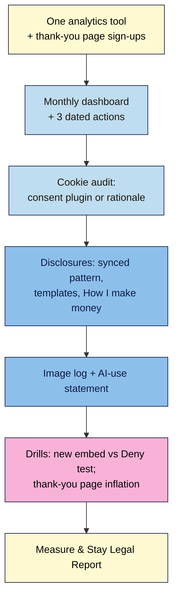

# M08 Capstone — Measure & stay legal: a site you understand and can defend
> By the end of this capstone you have one analytics tool that counts real visits and email sign-ups, a one-page monthly dashboard with three dated actions, a cookie setup you've proved with a Deny test (or a written reason you don't need one), clear affiliate and sponsor disclosures on every post that needs them, and an image log and AI-use statement you could show anyone who asks.

**Time:** ~120–150 min (analytics and sign-up tracking ~25, monthly dashboard ~30, cookie audit and consent ~25, disclosures ~20, image log and AI statement ~20, drills ~20, report ~10) · **Level:** beginner · **Prereqs:** M08.L01–M08.L05
**Non-negotiables assessed:** #13 Analytics you actually review · #12 Disclosures & legal pages (privacy, cookie consent where required, affiliate/sponsor disclosure) · #9 Email capture with a privacy notice (reinforced: sign-ups measured) · #8 Search Console (reinforced)
**Verified against:** Site Kit by Google 1.190.0, Independent Analytics 2.16.2, Complianz 7.5.6, WordPress 7.1.4 (synced patterns, Openverse), Search Console and GA4 help pages, FTC, ASA/CAP and CMA guidance, EU ePrivacy/EDPB, ICO and CCPA pages (labels and rules used in M08.L01–L05), on 2026-11-01

> Note: Search Console, GA4, Plausible and Fathom need a **live** site. On **Local**, use Independent Analytics (or Koko) for analytics and sign-ups, fill the Search Console columns of your dashboard with "launch", and write any live-only step as a **launch-day card** item for M09. The rubric gives full credit for either path. **Not legal advice.**

## The brief
A brand emails: they'd like to sponsor a post and ask for "your monthly numbers, your audience's location and a link to your disclosure policy". You realise you have three analytics plugins giving three different totals, you don't know how many readers signed up last month, your cookie banner only says "OK", your affiliate posts disclose in the footer, and you can't say where half your images came from. This capstone gives you answers you can send the same day, and pages that stand up if a regulator, a programme or a reader looks.

Keep working on the same practice site, with the plugin log, privacy policy, sign-up form and Work With Me page from M06, and the update, backup and security logs from M07.

## How it works



**In words:** install one analytics tool and make sign-ups countable. Fill your first monthly dashboard row and choose three actions. Audit your cookies and either set up consent properly or write down why you don't need it. Disclose every material connection where readers see it first. Log every image's licence and publish how you use AI. Then break two things on purpose and fix them.

## Tasks

### 1. One analytics tool that counts (from M08.L01)
1. Fill in the M08.L01 decision table (commercial? readers' location? Google Ads/AdSense? budget? will you open it monthly?) and write your one-sentence choice.
2. If you have more than one analytics tool active, **deactivate and delete** all but one (export any data you want first).
3. Install or keep your chosen tool. Test with a **logged-out private window**: visit the homepage and two posts.
   **Expected:** the visits appear (Independent Analytics **Views** and **Pages** table, or GA4 **Reports → Realtime**).
4. Add the tool to your **plugin log** (P10) and update your **privacy policy** (tool, cookies yes/no, where data is stored, **Last updated**).
   **Evidence:** decision table + sentence; plugin count for analytics = 1; screenshot of the counted test visit; plugin log row; privacy policy excerpt.

### 2. Sign-ups and the monthly dashboard (from M08.L02)
1. Create the noindex **`/thanks/`** page (Yoast: **Advanced → Allow search engines to show this content in search results? → No**), keep it out of menus, and point your sign-up form at it (Fluent Forms **Confirmation Type: To a Page**, or Kit **Redirect to another page** with **Send subscriber data to thank you page** off).
2. Count it: GA4 `generate_lead` event (**Admin → Data display → Events → + Create event**, **Mark as key event**, `page_location` contains `/thanks`), or the **Thanks** row in your cookieless tool.
3. Do one logged-out test sign-up and confirm it. **Expected:** one thank-you view (or `generate_lead` in Realtime) and one confirmed subscriber in your email provider.
4. Fill in the **first row** of your monthly dashboard (clicks, impressions, CTR, non-branded clicks, visitors, top 3 posts, top source %, thank-you views, confirmed subscribers, sign-up rate). On Local, write "launch" in the Search Console columns.
5. Write **three actions** in the form *"[Action] on [page] by [date]"*, each tied to a number in your row, and put a recurring 30-minute review on the first Monday of each month.
   **Evidence:** `/thanks/` URL + noindex screenshot; the test sign-up counted in analytics and confirmed in the provider; the dashboard row; three dated actions; the calendar entry.

### 3. Cookies you can account for (from M08.L03)
1. Audit cookies in DevTools (**Application → Storage → Cookies**, plus local and session storage) in a **Chrome Guest** or **Firefox private** window (not Chrome Incognito, which blocks third-party cookies) as a **logged-out** visitor on the homepage, a post with an embed and the sign-up page. Fill in the cookie table (Name, Domain, Set by, Purpose, Strictly necessary?).
2. Remove or swap at least one non-essential tracker if you can (cookieless analytics, click-to-load embed, locally hosted fonts, delete an unused pixel), then re-scan.
3. **Path 1:** if only strictly necessary cookies remain, file the dated **no-consent rationale** and summarise it in your privacy policy. **Path 2:** otherwise set up **one** consent plugin (Complianz: **Wizard → Website Scan → Statistics → Services/Plugins/Advertising → Documents → Finish**), with **Accept**, **Deny** and **View preferences** equally prominent, and the Cookie Policy in your footer. With Site Kit, switch on **Enable consent mode**.
4. **Path 2 only:** run the **Deny test** (new private window, Deny, reload: no `_ga` or other non-necessary cookies; embeds show placeholders) and the **Accept test**.
   **Evidence:** the cookie table (before and after your swap); either the rationale or banner screenshot + Deny/Accept results; privacy policy Cookies section; quarterly re-scan reminder.

### 4. Disclosures readers see first (from M08.L04)
1. Create the **synced** *Affiliate disclosure* pattern (*"**Ad — affiliate links.** I earn a commission if you buy through the links marked (ad) below…"*), and insert it **under the title, before the first link**, in every post with affiliate links.
2. Mark each affiliate link **(ad)** (Amazon: *(paid link)*) and check it has `rel="sponsored"`.
3. Create **unsynced** *Sponsored disclosure* (*"**Ad.** This post is sponsored by [Brand]…"*) and *Gifted disclosure* (*"**Ad — gifted.** [Brand] sent me…"*) templates.
4. Publish **"How I make money"** at `/disclosure/` (affiliate programmes and required statements, sponsored posts, gifted products, ads, editorial promise, last updated) and add it to the footer next to Privacy Policy and Cookie Policy. Link it from your Work With Me page.
5. Phone check: open one affiliate post. **Expected:** the disclosure is on the first screen, before any affiliate link.
   **Evidence:** list of affiliate posts with the synced box; one link labelled (ad) with `rel="sponsored"` (Edit as HTML screenshot); the two templates in **My patterns**; the published disclosure page; the mobile screenshot.

### 5. Images you can prove and AI you're open about (from M08.L05)
1. Insert one image through **+ → Media → Openverse** and keep its automatic attribution caption.
2. Start your **image log** (Post · File · Source URL · Type · Licence + link · Conditions met? · Proof · Date) and complete it for your **five most-visited posts**. Replace any image you can't trace, and delete the old file.
3. Add *Source · Licence · Downloaded* to each logged image's **Description** in the Media Library.
4. Publish your **"How I use AI"** statement (on the disclosure page or About page), caption every AI image *"AI-generated image ([tool])"*, and add a note to any post where AI drafted a substantial part.
   **Evidence:** the Openverse image with caption; the image log for five posts (with replacements noted); one Description screenshot; the published AI-use statement; one labelled AI image (if you use any).

### 6. Break it and fix it
**a) The embed that breaks your cookie promise.** Work on your **Local practice site**.
1. Make sure Task 3 is finished: either your **Deny test** passes (Path 2) or your rationale says *"no cookies before a click"* (Path 1).
2. In a test post, add a **YouTube** block with any public video. **Publish**.
3. In a new **Chrome Guest** or **Firefox private** window (logged out; Chrome Incognito would block YouTube's third-party cookies and hide the problem), open the post. Path 2: click **Deny** and reload. Open DevTools → **Application → Storage → Cookies** and look at the **youtube.com** entry, plus **Local storage**.
   **Expected:** Path 1 sites now set YouTube cookies or storage on page view, so your rationale is no longer true. Path 2 sites do too if YouTube isn't ticked in the consent plugin, because the embed loads before any choice.
4. Fix it. Path 1: replace the embed with a thumbnail image linking to the video (or a click-to-load embed), and re-scan. Path 2: **Complianz → Wizard → Consent → Services**, tick **YouTube**, finish, then Deny and reload.
   **Expected:** after Deny (or with no banner on Path 1), no YouTube cookies or storage until the reader chooses to play; Complianz shows a placeholder.
5. Write one sentence on which kinds of change will trigger a re-scan from now on (new embed, plugin, ad network, pixel), and add it to your quarterly reminder.

**b) The thank-you page that inflates your sign-ups.** You need Task 2 working.
1. Note today's thank-you page count in your analytics.
2. Add **Thanks** to your main menu and, in a logged-out window, visit it **three times** from the menu without signing up.
3. Check your analytics. **Expected:** three extra thank-you views (or `generate_lead` events), but **no** new subscribers in your email provider. Your sign-up count is now wrong.
4. Fix it: remove **Thanks** from every menu, confirm it's still **noindex**, and in your dashboard write the corrected number with a note (*"3 test views removed"*).
5. Write one sentence on why the email provider's **confirmed subscribers** is the number you report to sponsors, and the thank-you page is for *where* sign-ups came from.

## Deliverable: Measure & Stay Legal Report
One page (Markdown, Google Doc or PDF) with these headings. Screenshots are the best evidence; blur names, emails and IDs.

```
# Measure & Stay Legal Report — <site name>
Date: <YYYY-MM-DD>   Site: <Local / live URL>   Readers mostly in: <regions>

## 1. Analytics
Tool + one-sentence choice · analytics tools active = 1 · test visit counted · plugin log row · privacy policy updated

## 2. Sign-ups and dashboard
/thanks/ (noindex, not in menus) · how sign-ups are counted · test sign-up counted + confirmed
Dashboard row 1 · three dated actions · monthly review slot

## 3. Cookies
Cookie table (before → after swap) · Path 1 rationale OR Path 2 plugin + Deny/Accept results · policy + re-scan date

## 4. Disclosures
Posts with synced affiliate box · link labels + rel="sponsored" · sponsored/gifted templates
"How I make money" URL in footer · mobile first-screen check

## 5. Images and AI
Openverse image · image log (5 posts, replacements) · Description notes · AI-use statement URL · AI image labels

## 6. Break it and fix it
a) <what the embed set before the fix, what you changed, re-scan triggers>
b) <inflated vs corrected count; which number you report and why>
```

## Rubric
Score each criterion; **Good** or better on all five completes the module.

| Criterion | Excellent (4) | Good (3) | Needs work (2) | Missing (1) |
|---|---|---|---|---|
| **Analytics and sign-ups** (NN #13, #9) | One tool chosen with a reasoned sentence; logged-out visit counted; noindex thank-you page out of menus; sign-up counted in analytics **and** confirmed in the provider; plugin log and privacy policy updated | One tool; test visit counted; sign-ups counted by thank-you page or key event | Tool installed but test visit or sign-up tracking unproven, or two analytics tools active | No analytics tool, or never checked |
| **Monthly review** (NN #13, #8) | Complete dashboard row (Search Console columns live or marked "launch"); three actions each tied to a number, with page and date; recurring review slot; drill (b) corrected count with note | Dashboard row; three dated actions; review slot | Numbers recorded but no actions, or actions not tied to data | No dashboard |
| **Cookie consent** (NN #12) | Full logged-out cookie table; at least one tracker removed or swapped; Path 1 dated rationale **or** Path 2 single plugin with equal Accept/Deny, passing Deny and Accept tests; policy updated; drill (a) fixed with re-scan triggers | Cookie table; rationale or a banner that passes the Deny test; policy updated | Banner present but Deny test not run or failing, or no-banner claim without an audit | No audit and no decision |
| **Disclosures** (NN #12) | Synced affiliate box under the title on every affiliate post; every affiliate link labelled and `rel="sponsored"`; sponsored and gifted templates with "Ad"; disclosure page with required programme statements, in footer and linked from Work With Me; mobile first-screen evidence | Synced box at the top of affiliate posts; links labelled; disclosure page in footer | Disclosure only at the end, only in the footer, or vague wording ("may contain") | No disclosures on posts with affiliate links or sponsors |
| **Images and AI** (NN #12, #6) | Image log for five posts with source, licence, proof and date; untraceable images replaced; Description notes; Openverse caption kept; AI-use statement published; AI images labelled; no fake persona | Image log for five posts; untraceable images replaced; AI-use statement published | Log incomplete, or untraceable images left in place | No log and no AI statement |

## Self-check before you submit
- [ ] Exactly **one** analytics tool is active, and a logged-out visit shows up in it.
- [ ] My test sign-up landed on `/thanks/`, was counted, and became a **confirmed** subscriber; `/thanks/` is noindex and in no menu.
- [ ] My dashboard row is filled in and every one of my three actions names a page, a change and a date.
- [ ] I audited cookies **logged out**; I either have a dated rationale or a banner where **Deny** leaves no `_ga` or embed cookies.
- [ ] Every post with an affiliate link shows "Ad" on the first screen on my phone, and every affiliate link is labelled and `rel="sponsored"`.
- [ ] Footer: Privacy Policy · Cookie Policy (if any) · How I make money.
- [ ] Every image on my five busiest posts is in my image log with a licence or "own photo", and my AI-use statement is live.

## What's next
Module 9 is the launch. You'll take everything from M01–M08 (setup, design, content, media, SEO, email, protection and these legal and measurement pages) through a launch checklist on a live site. The **launch-day card** items you've collected (Search Console, live analytics, PageSpeed field data, host staging) all get done then.

## Module 8 cheat sheet
Keep `wordpress-101/cheatsheets/m08-measure-legal.md` open while you work.
