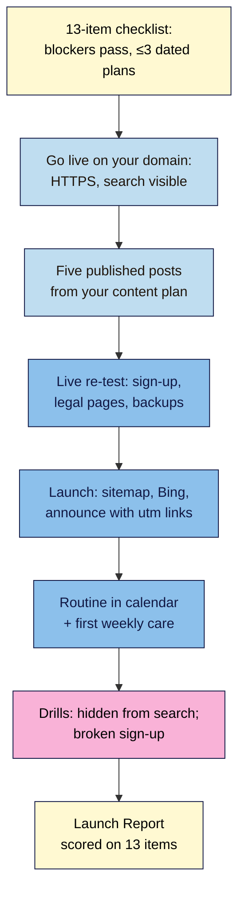

# M09 Final Capstone — Launch your creator site
> By the end of this capstone your site is live on your own domain with five published posts, a working email sign-up, legal pages, backups you've proved, one SEO plugin, one analytics tool and a maintenance routine in your calendar. A one-page **Launch Report** scores it against all 13 non-negotiables.

**Time:** ~4–6 hours, best spread over a week (checklist and fixes ~60 min, move to live ~30–60, five posts ~120, sign-up and legal re-test ~20, search engines and speed ~20, routine ~15, drills ~20, report ~20) · **Level:** beginner · **Prereqs:** M01–M08 and M09.L01–M09.L03
**Non-negotiables assessed:** all 13 (#1–#13). Blockers #1, #2, #3, #9 and #12 must pass.
**Verified against:** WordPress 7.1 core code (**Discourage search engines** robots output, Site Health *"Search engines are discouraged from indexing this site."*, dashboard *"Search engines discouraged"*), UpdraftPlus 1.26.14 (free migration via its built-in Migrator Lite), Yoast SEO 28.8, Search Console and Bing Webmaster Tools help, and the checklist, content plan and routines from M09.L01–L03, on 2026-11-01

> Note: this capstone needs a **live** site. If you can't buy hosting yet, do every task on **Local**, mark the live-only items (domain HTTPS, Search Console, Bing, PageSpeed field data, real confirmation emails, launch announcement) as **"launch-day card"**, and score yourself **Good at most** on the criteria that need them. Come back and finish them on launch day.

## The brief
A reader who found you on social media asks: "Do you have a website I can follow?" This is the moment the course has been building to. You don't want to send them to a half-finished site with a broken sign-up form and a sample post. You want to send a link you're proud of, to a site that will still be safe, findable and legal in a year.

Launch the practice site you've built since M01 as your real site. Then prove it works, in the same way you'd prove it to a sponsor, a host's support team or your future self.

## How it works



**In words:** pass the pre-launch checklist first, with every blocker green. Move the site to live hosting and check it straight away. Publish five posts that show everything you've learned. Re-test the parts that only really work on a live site: sign-ups, legal pages and off-site backups. Then launch: tell the search engines, tell your readers, and put the routine in your calendar. Finally, break two things on purpose, fix them, and write the report.

## Tasks

### 1. Pass the pre-launch checklist (from M09.L01)
1. Complete the **13-row checklist** with a status (✅ / 📅) and evidence for every row.
2. All five **⛔ blockers** pass: #1 own platform, #2 permalinks, #3 safety net, #9 privacy notice on the form, #12 legal pages.
3. No more than **three 📅 dated plans**, each written as *"[Fix] on [what] by [date]. Owner: [you]."*
4. Practice leftovers are gone: sample content, drill posts, test users and test subscribers. Trash emptied.
   **Evidence:** the completed checklist; Site Health **Status** with no critical issues.

### 2. Go live (from M09.L01 Part C and M01.L02–L03)
1. If you built on Local, move to your host (UpdraftPlus **Upload backup files** → **Restore**, all five components, **Search and replace site location in the database (migrate)** ticked) or use your host's free migration service.
2. Do the **first five minutes on live**: both addresses `https://` in **Settings → General**; **Settings → Permalinks → Save Changes** once; **Discourage search engines from indexing this site** **unticked**; new strong password; reconnect email provider, UpdraftPlus remote storage and schedules (not Manual); **Delete Cache** if you use a page cache.
3. Check HTTPS on the homepage, one post and the sign-up page (padlock, no mixed-content warnings).
   **Expected:** `https://yourdomain.com` loads for a logged-out visitor on a phone using mobile data.
   **Evidence:** live URL; screenshot of **Settings → Reading** with the box unticked.

### 3. Publish five posts (from M02–M05 and M09.L02)
Choose at least two posts from your **content plan**; mark one as a cornerstone in Yoast (**Mark as cornerstone content**). Every post must pass this per-post checklist:

| # | Check | From |
|---|---|---|
| a | Post (not page), one category from your 4–7, no "Uncategorized" | M02.L01, M02.L03 |
| b | Clear H2/H3 structure, no skipped levels, descriptive link text | M02.L01, M04.L05 |
| c | Images at your width rule, compressed or WebP/AVIF, alt text written (or deliberately empty for decoration), licence in your image log | M03.L02–L03, M08.L05 |
| d | SEO title and meta description set; answers the search intent in the first lines | M05.L02–L03 |
| e | At least two internal links (to the cornerstone or a supporting post) | M05.L03, M09.L02 |
| f | Synced **Newsletter CTA** and **Author box** patterns | M02.L02 |
| g | Affiliate or sponsored? Synced disclosure under the title, links labelled and `rel="sponsored"` | M08.L04 |

At least one of the five must have been **scheduled** (not published by hand), so you've seen your schedule work on the live server.
   **Evidence:** the five URLs with a ✅ row per post; the **Posts** list showing one went from *Scheduled* to *Published*.

   > 🖼️ **Image prompt:** Screenshot of a live WordPress post on a phone (390 × 844): title, a short disclosure box under it, an H2 and an image with visible caption, and the synced Newsletter CTA starting at the bottom of the screen. Highlight the CTA with a 3px #F9B2D7 outline; blur any personal details.
   > **Alt text:** A live post on a phone with a disclosure under the title, a heading, an image and the newsletter sign-up box.

### 4. Live re-test: email, legal pages and backups (from M06–M08)
1. **Sign-up (NN #9):** from a phone on mobile data, sign up with an address you control. Confirm via the **real** confirmation email.
   **Expected:** you land on `/thanks/` (noindex, no menu), the sign-up is counted in analytics, and a **confirmed** subscriber appears in your **real** list. Delete the test subscriber afterwards.
2. **Legal pages (NN #12):** footer shows **Privacy Policy**, **How I make money** and (if you use a banner) **Cookie Policy**, all **published**. The privacy policy names every service you use on the live site and has a current **Last updated** date. If you use a cookie banner, re-run the **Deny** test on the live domain.
3. **Backups (NN #3):** run **Backup Now** on live and see the new set arrive in your **off-site** storage. Every Administrator and Editor shows 2FA on **Users**.
   **Evidence:** screenshots (blur addresses): `/thanks/` page, the confirmed subscriber, the footer, the new backup in off-site storage, the Users 2FA column.

### 5. Launch and tell people (from M09.L03 Parts A–C)
1. Launch morning: re-check the four likeliest failures; turn off any coming-soon or maintenance mode.
2. Search Console: verify, **Indexing → Sitemaps** → submit `sitemap_index.xml` (**Status: Success**); **URL Inspection → Request indexing** for the homepage and your cornerstone only. Bing Webmaster Tools: **Import** from Search Console.
3. Run **PageSpeed Insights** on the homepage (mobile). Record LCP, CLS and INP (or TBT if there's no field data yet) and the date.
4. Send a short launch email to **consented** subscribers only, and post on your own social accounts with **utm-tagged** links.
   **Evidence:** Sitemaps row, Bing site list, PageSpeed result, the launch email (or a note that your list is empty so far) and one tagged link.

### 6. Routine in the calendar (from M09.L03 Part D)
1. Four recurring events (weekly care, monthly review, quarterly service, yearly check) with their checklists in the description.
2. Five one-off launch-month events (days 1, 3, 7, 14 and 30).
3. On day 7, run your first **weekly care** session and log it (backup status, updates, comments).
   **Evidence:** calendar screenshot; the weekly care log entry; your launch date recorded in your site docs.

### 7. Break it and fix it: two launch drills
**(a) Hidden from search.** It's the classic launch mistake (Maya's story in M09.L01).
1. Tick **Settings → Reading → Discourage search engines from indexing this site** and save.
2. Find the evidence three ways: the **Dashboard → At a Glance** box shows *"Search engines discouraged"*; **Tools → Site Health** lists *"Search engines are discouraged from indexing this site."*; and the homepage source (**Ctrl+U**) contains a `robots` meta tag with `noindex`.
3. Untick the box, save, and confirm all three signs are gone. If Google crawled the site while it was hidden, re-inspect the homepage in **URL Inspection** and **Request indexing** again.
4. Write one sentence: which of your routines would have caught this, and when.

   > 🖼️ **Image prompt:** Screenshot of Tools → Site Health → Status in WordPress 7.1 showing the recommended improvement "Search engines are discouraged from indexing this site." expanded, 1280 × 720. Highlight that row with a 3px #F9B2D7 outline; blur any personal details.
   > **Alt text:** Site Health listing "Search engines are discouraged from indexing this site" as a recommended improvement.

**(b) The silent sign-up failure.** Forms usually break without any error message.
1. Point your sign-up form at the wrong destination: switch its list or form to a **test list**, or deactivate the integration feed (e.g. Fluent Forms Mailchimp Feed off).
2. Sign up from your phone. Note what the reader sees (often the normal thank-you page) and what's missing (no confirmation email, no subscriber in your real list).
3. Fix it, sign up again, and confirm the subscriber reaches your **real** list as **confirmed**. Delete both test subscribers.
4. Write one sentence: which check in your weekly or monthly routine would catch this, and add it if it's missing.

## Deliverable: Launch Report
One page (Markdown, Google Doc or PDF). Screenshots are the best evidence; blur email addresses, names and IDs.

```markdown
# Launch Report — <site name>
Live URL: https://… · Launch date: YYYY-MM-DD · WordPress: x.y.z · Host: …

## 1. Non-negotiables scoreboard
| # | Item | Status (✅/📅) | Evidence |
|---|---|---|---|
| 1 | Own your platform ⛔ | | |
| 2 | Permalinks ⛔ | | |
| 3 | Safety net ⛔ | | |
| 4 | Block editor workflow | | |
| 5 | Categories & structure | | |
| 6 | Media | | |
| 7 | Accessibility | | |
| 8 | On-page SEO + one SEO plugin | | |
| 9 | Email capture + privacy notice ⛔ | | |
| 10 | Updates + lean plugins | | |
| 11 | Performance | | |
| 12 | Disclosures & legal pages ⛔ | | |
| 13 | Analytics you review | | |
Dated plans (max 3): …

## 2. Go-live checks
Addresses https ✅ · permalinks saved ✅ · search visible ✅ · schedules not Manual ✅ · cache cleared ✅/n.a.

## 3. Five posts
| URL | Category | Cornerstone? | a–g all ✅? |
Scheduled post published on time: ✅

## 4. Live re-test
Sign-up → /thanks/ → confirmed in real list ✅ · Footer legal pages ✅ · Deny test ✅/n.a. · Live backup off-site ✅ · 2FA all admins/editors ✅

## 5. Launch
Sitemap Success ✅ · Bing ✅ · Indexing requested: homepage + … · PageSpeed (mobile, date): LCP … CLS … INP/TBT …
Announcement: email to … consented subscribers / social posts with utm ✅

## 6. Routine
4 recurring + 5 one-off events ✅ · First weekly care on YYYY-MM-DD: …

## 7. Drills
a) Signs found: … · Caught by routine: …
b) What the reader saw: … · What was missing: … · Check added: …

## 8. Next 90 days
The three things I'll improve first, each with a date: …
```

## Rubric
Score each criterion. To **complete the course**: every ⛔ blocker passes **and** you score **Good** or better on all five criteria.

| Criterion | Excellent (4) | Good (3) | Needs work (2) | Missing (1) |
|---|---|---|---|---|
| **Own it, protect it, keep it lean** (NN #1, #2, #3, #10) | Live on your own domain with HTTPS; Post name permalinks unchanged since the first post; scheduled backups seen arriving off-site from live and a dated restore in your log; 2FA on every admin and editor; latest WordPress, no inactive plugins or spare themes, plugin log current | Live (or on Local with the launch-day card filled in), permalinks set, off-site backups running and 2FA on; plugins mostly lean | Backups still Manual or on the same server, 2FA missing for a user, or inactive plugins left | A blocker fails: no off-site backups, no 2FA, or permalinks changed after publishing |
| **Five posts that show the craft** (NN #4, #5, #6, #7) | Five published posts, each passing checks a–g; one cornerstone marked; one went live on schedule; categories 4–7 with descriptions; image log covers every image | Five posts; at most two small gaps across checks a–g; one scheduled post | Fewer than five posts, or repeated gaps (missing alt text, no headings, oversized images) | Sample or placeholder content still live |
| **Findable and fast** (NN #8, #11) | One SEO plugin; sitemap **Success**; Bing imported; homepage and cornerstone inspected; titles and metas on all five posts; homepage passes LCP/CLS/INP (or lab TBT) on mobile, or has a dated plan with the cause named | Sitemap submitted and Success; SEO basics on all five posts; PageSpeed recorded | Sitemap missing or failing, two SEO plugins, or no speed check | Site hidden from search engines |
| **Email and legal, proved live** (NN #9, #12) | Live sign-up reaches a confirmed subscriber in the real list via `/thanks/`; consent line with privacy link; footer legal pages published and current; Deny test passes (if you use a banner); disclosures under the title on every affiliate or sponsored post; drill (b) done with a check added to your routine | Live sign-up confirmed; legal pages in the footer; disclosures in place | Sign-up only tested on Local, legal page still a draft, or disclosure only at the end of posts | No working sign-up or no privacy policy |
| **Launched, measured and maintained** (NN #13, plus launch) | One analytics tool counting a logged-out visit; launch announcement with utm links to consented subscribers; four recurring and five launch-month events; first weekly care logged; drill (a) done with the routine that catches it; three dated 90-day actions | Analytics counting; routine in the calendar; launch announced | Routine planned but not in a calendar, or analytics never checked | No analytics and no routine |

## Self-check before you submit
- [ ] A friend on a phone, on mobile data, can open my site, read a post and sign up, and gets a confirmation email.
- [ ] **Settings → Reading** shows **Discourage search engines** unticked, and Site Health no longer warns about it.
- [ ] My newest backup is in off-site storage, and the schedules aren't set to Manual.
- [ ] My footer links to published legal pages, and every affiliate post discloses on the first screen.
- [ ] Every ⛔ blocker in my scoreboard is ✅, and I have at most three dated plans.
- [ ] My calendar has the weekly, monthly, quarterly and yearly routines, starting this week.

## What's next
You've finished WordPress 101 for Content Creators. The course ends here, but the site doesn't. Your routines are now the course. Each **monthly review** turns data into three actions, each **quarterly service** proves your backups and prunes what you don't need, and each **yearly check** re-runs the 13-item checklist. When you're ready for more, the course's *nice-to-have* list (memberships, a full shop, multilingual sites) is where to grow.

## Module 9 cheat sheet
Keep `wordpress-101/cheatsheets/m09-launch.md` open while you work.
