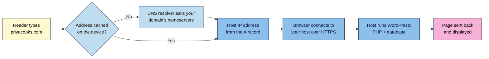
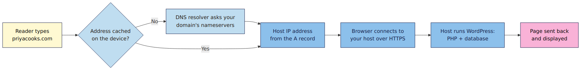

# M01.L02 — Domains, DNS and creator-friendly hosting
> After this lesson you can explain how someone typing your address reaches your site, and pick a domain and a host that won't hold you back.

**Time:** ~18 min reading + ~25 min exercise · **Level:** beginner · **Prereqs:** M01.L01
**Verified against:** WordPress 7.1.4 server requirements (wordpress.org/requirements), php.net supported versions and ICANN transfer rules on 2026-10-29

> ⚠️ **Freshness flag:** domain prices, hosting plans and PHP support dates change every year, and ICANN has approved changes to transfer locks that weren't in force when this lesson was checked. Re-check the links in Further reading before you buy.

## Learning objectives
1. **Describe** how a domain, DNS records and a web host work together to serve your site.
2. **Evaluate** a hosting plan against creator criteria: managed updates, off-site backups, staging, PHP version, support and price after renewal.
3. **Shortlist** a domain name and two hosting plans that meet the criteria.

## Why it matters
Karthik bought a ₹99 first-year hosting deal for his tech-review channel's website. A year later the renewal bill was ₹5,400. The plan ran an old PHP version, backups were stored on the same server as his site, and there was no staging copy to test updates. When a plugin update broke his homepage, he had nothing to roll back to. The cheapest plan on day one became the most expensive and riskiest one by year two. Domain and hosting choices are cheap to get right now and painful to fix later.

## Core concept
**Plain version:** your **domain** is your site's name, **DNS** is the phone book that turns the name into a server address, and your **host** is the computer that stores WordPress and sends out your pages.

**Analogy:** the domain is your shop's name on the signboard. DNS is the map app that tells customers which street the shop is on. The host is the building itself: rent, electricity, security guard and all.

**Precise definitions:**
- **Domain name:** a human-readable address such as `priyacooks.com`, rented yearly from a **registrar** (e.g. Namecheap, Porkbun, Cloudflare Registrar, GoDaddy, or an Indian NIXI-accredited registrar for `.in`).
- **DNS (Domain Name System):** the global directory that maps names to server addresses. Your domain's **nameservers** say which DNS provider holds its records.
- **DNS records:** the entries in that directory. The ones creators meet most:

  | Record | What it does | Example |
  |---|---|---|
  | **A / AAAA** | Points the name to the server's IPv4 / IPv6 address | `@ → 203.0.113.10` |
  | **CNAME** | Points one name to another name | `www → priyacooks.com` |
  | **MX** | Says which server receives your email | `@ → mail provider` |
  | **TXT** | Holds verification and email-security text (Search Console, SPF, DKIM) | `google-site-verification=…` |

- **TTL (time to live):** how long other computers may cache a record before asking again. A change can take up to the old TTL to be seen everywhere, which is why people say DNS "propagates".
- **Web host:** a company that runs the server, PHP and database WordPress needs. **Managed WordPress hosting** adds WordPress-specific updates, backups, caching and support.

## How it works





**In words:** when a reader types your address, their device first checks whether it already knows the IP address. If not, a DNS resolver asks your domain's nameservers, which return the A record: the IP address of your host. The browser connects to that server over HTTPS, the host runs WordPress (PHP code plus a database), and the finished page comes back. The registrar, DNS provider and host can be three different companies. Keeping the **registrar separate from the host** is common practice: if you change hosts, you only edit DNS, and your domain never gets caught up in a hosting dispute or an unpaid bill.

### Choosing a domain
- **Short, sayable, spellable.** If you say it on a podcast, listeners should type it right the first time.
- **`.com` if you can get it; a country ending (`.in`, `.co.uk`) if your audience is local.** Newer endings (`.blog`, `.studio`) work but are less familiar to readers.
- **Avoid hyphens, numbers and trademarks** (a brand name in your domain can get it taken away).
- **Turn on auto-renew and registrant privacy** (most registrars include privacy free; `.in` and some country endings have their own rules).
- **Typical cost:** about $10–15 (₹800–1,200) a year for `.com`; `.in` often ₹200–900 the first year, more on renewal. Always check the **renewal** price, not just the first-year deal.
- **Transfer lock:** after you register or transfer a domain, ICANN rules generally block moving it to another registrar for **60 days**. ICANN has approved a shorter 30-day lock, but it had no effective date when this lesson was checked. Choose a registrar you're happy to stay with for a couple of months.

### Choosing a host: the creator checklist
| Criterion | What "good" looks like | Why it matters for creators |
|---|---|---|
| **PHP version** | PHP **8.3 or newer** available, and you can switch versions yourself | WordPress recommends 8.3+; PHP 8.2 loses security support at the end of 2026 |
| **Database** | MySQL 8.0+ or MariaDB 10.6+ | WordPress's recommended minimum |
| **HTTPS** | Free SSL certificate (e.g. Let's Encrypt), auto-renewed | Required for every WordPress site; browsers warn readers without it |
| **Backups** | Daily, stored **off-site**, kept 14–30 days, one-click restore | Your safety net if an update or hack breaks the site (M01.L05) |
| **Staging** | One-click staging copy | Test updates and theme changes before readers see them (M07) |
| **Managed updates & security** | Automatic core updates, malware scanning, firewall | Most creator sites are hacked through outdated plugins |
| **Performance** | Server-level page caching, data centre near your readers, optional CDN | Faster pages keep readers and help Core Web Vitals (M07) |
| **Support** | 24/7 chat with WordPress-savvy staff | You'll need help at the worst possible moment |
| **Price after renewal** | Renewal price shown clearly; 3-year cost you can afford | Intro deals often triple or more on renewal |
| **Easy exit** | Full backup download, no lock-in to a custom builder | Ownership (M01.L01) means being able to leave |

> **Freshness note:** this course names criteria, not brands. Hosting companies change owners, prices and quality often. Check recent independent reviews and the host's own documentation.

## Hands-on walkthrough

**Part A: see DNS at work (5 min)**
1. Open a terminal: **Command Prompt** on Windows, **Terminal** on macOS or Linux.
2. Run:
   ```
   nslookup wordpress.org
   ```
   **Expected output:** a "Server:" line (your DNS resolver), then a "Name: wordpress.org" line followed by one or more "Address:" lines. Those addresses come from wordpress.org's **A** and **AAAA** records.
   > 🖼️ **Image prompt:** Terminal screenshot (dark theme, large monospace font) of `nslookup wordpress.org` output, annotated with callouts: "Server = your DNS resolver" and "Address lines = A/AAAA records". Highlight the key element with a 3px #F9B2D7 outline; blur any personal details.
   > **Alt text:** nslookup output for wordpress.org with the resolver line and the A/AAAA address lines labelled.
3. Run `nslookup -type=MX gmail.com`.
   **Expected output:** several "mail exchanger =" lines. That's an **MX** record telling the world where Gmail's email goes.

> No terminal? Use the free DNS lookup at **https://lookup.icann.org** (registration data) or any "DNS lookup" web tool to see the same records.

**Part B: shortlist a domain (10 min)**
1. Write 10 name ideas: your name, your niche, or a short combination (`priyacooks`, `arjunrecords`).
2. Cross out anything with hyphens, numbers, hard spellings or someone else's trademark.
3. Check your top 3 at a registrar's search box.
   **Expected:** each shows **available** with a first-year price and (on good registrars) the renewal price, or **taken**.
   > 🖼️ **Image prompt:** Generic, unbranded registrar search result mock-up for `priyacooks.in`: an "Available" badge, the first-year price, and the renewal price circled, plus one alternative marked "Taken". No real registrar logos. Highlight the key element with a 3px #F9B2D7 outline; blur any personal details.
   > **Alt text:** Domain search result showing priyacooks.in available, with first-year and renewal prices; the renewal price is circled.
4. For a taken name, look it up at **https://lookup.icann.org** to see when it was registered and by which registrar.
   **Expected:** registration and expiry dates and the registrar name (personal details are usually redacted).
5. Pick one available name and note its first-year and renewal price. **Don't buy yet** unless you're ready; you'll use it at the latest when you launch in M09.

**Part C: score two hosts (10 min)**
1. Pick two hosting plans you're considering (one budget, one managed WordPress).
2. Score each from 0 (missing) to 2 (meets "good") on the 10 checklist criteria above. Find answers on each host's features page and knowledge base.
3. Work out the **3-year cost**: first-year price + 2 × renewal price.

| | Host 1: ______ | Host 2: ______ |
|---|---|---|
| Checklist score (max 20) | | |
| First-year price | | |
| Renewal price / year | | |
| **3-year cost** | | |

**Expected output:** two scores and two 3-year costs. A higher-scoring plan often costs more in year one but less in risk and time. Keep this table; you'll use it in the module capstone.

## When to use / when not to
- **Choose managed WordPress hosting** if you'd rather spend your time creating than maintaining. **Trade-off:** it costs more (often $20–35 / ₹1,500–3,000 a month) and some managed hosts block certain plugins.
- **Choose good shared hosting** if your budget is tight and traffic is modest. Check backups, staging and PHP version carefully; these are where cheap plans cut corners.
- **Don't buy hosting yet** if you're still learning: your Playground or Local site from M01.L01 is enough until you're ready to go live.
- **Keep the domain at a registrar, not bundled "free" with hosting**, if you want to switch hosts without moving the domain. Bundled is fine if you understand the domain's renewal price after the free year.

## Use AI for this
**Example prompt:**
> "I'm a [niche] creator in [country]. My audience is mostly in [region]. Suggest 15 short, easy-to-spell domain names for [topic], no hyphens or numbers. Then turn this hosting checklist into questions I can paste into a host's live chat: PHP 8.3+, off-site daily backups, one-click staging, free SSL, server caching, 24/7 WordPress support, renewal price, full backup download."

**What AI does well here:** brainstorming many name ideas fast, and turning a checklist into clear pre-sales questions.
**Where it gets it wrong:** it can't check whether a domain is available, and it often quotes old hosting prices, plan names or "best host" lists that are out of date or affiliate-driven.
**How to check:** check availability at a registrar yourself, get prices from the host's own pricing page, and confirm features in the host's documentation or live chat.

## Common mistakes
- **Comparing first-year prices only.** Always compare the 3-year cost including renewals.
- **Assuming the host's backups are enough.** Backups on the same server can disappear with the server. Make sure at least one copy is off-site (M01.L05).
- **Letting the domain expire.** Turn on auto-renew and keep the card and contact email up to date.
- **Changing DNS right before an important launch.** Lower the TTL a day ahead, or allow time for changes to be seen everywhere.
- **Picking a domain that's hard to say or spell.** Test it by saying it out loud to a friend.

## Troubleshooting
| Symptom | Likely cause | Fix |
|---|---|---|
| New site shows the host's placeholder or an old site | DNS change still cached (TTL) or the A record points to the wrong IP | Check the A record against the IP your host gives you; wait out the TTL; test with `nslookup yourdomain.com` |
| `nslookup` says "Non-existent domain" | Domain not registered yet, expired, or nameservers not set | Check the domain's status and nameservers at your registrar |
| Can't move the domain to a new registrar | Transfer lock after a recent registration or transfer, or the domain is locked at the registrar | Wait out the lock period; unlock the domain and get the auth (EPP) code from your current registrar |
| Host says your PHP version is "8.1" or older | Old default on the plan | Switch PHP version in the hosting panel, or ask support; avoid hosts that can't offer 8.3+ |
| Renewal invoice is much higher than expected | Intro price ended | Compare 3-year costs before buying; consider moving before renewal |

## Exercise
**Task:** complete Parts B and C: one available domain name (with first-year and renewal price) and a scored comparison of two hosting plans with 3-year costs. Write two sentences: which host you'd choose and the one trade-off you're accepting.
**Expected outcome:** a short note with your domain choice, both host scores, both 3-year costs and your two-sentence decision, saved where you can find it for the M01 capstone.
**Stretch goal:** ask both hosts' pre-sales chat three checklist questions (PHP version, where backups are stored, staging) and record how quickly and clearly they answer. Support quality before you buy predicts support quality after.

## Key takeaways
- Domain = the name, DNS = the directory, host = the server running WordPress.
- Keep your domain at a registrar separate from your host so you can switch hosts by editing DNS.
- Judge hosts on PHP 8.3+, off-site backups, staging, HTTPS, support and **renewal** price.
- Compare the 3-year cost, not the first-year deal.
- DNS changes take time to show everywhere; check records with `nslookup`.

## Teach it back
Explain to a friend in 3 sentences what happens between typing a web address and seeing the page, using the words domain, DNS and host.

## Glossary terms added
- Domain name — added to `wordpress-101/glossary.md`
- Registrar — added to `wordpress-101/glossary.md`
- DNS — added to `wordpress-101/glossary.md`
- Nameservers — added to `wordpress-101/glossary.md`
- A / AAAA, CNAME, MX, TXT records — added to `wordpress-101/glossary.md`
- TTL — added to `wordpress-101/glossary.md`
- Managed WordPress hosting — added to `wordpress-101/glossary.md`
- Staging site — added to `wordpress-101/glossary.md`

## Further reading
*All checked 2026-10-29.*
- WordPress.org — Server requirements: https://wordpress.org/requirements/
- WordPress documentation — Before you install: https://developer.wordpress.org/advanced-administration/before-install/
- PHP — Supported versions: https://www.php.net/supported-versions.php
- ICANN — Transferring your domain name: https://www.icann.org/resources/pages/name-holder-faqs-2017-10-10-en
- ICANN Lookup (registration data): https://lookup.icann.org
- NIXI — .IN registry (Indian domains): https://www.registry.in/
- Let's Encrypt — How it works: https://letsencrypt.org/how-it-works/
