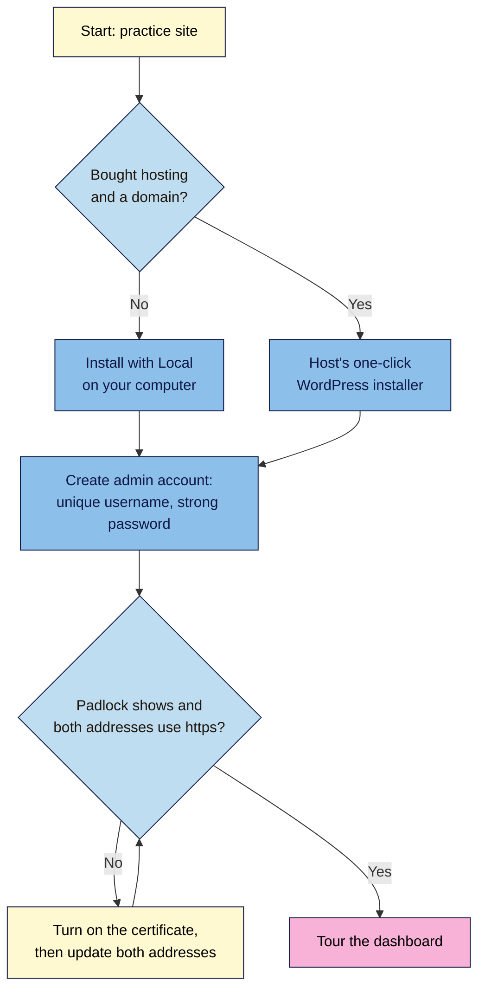
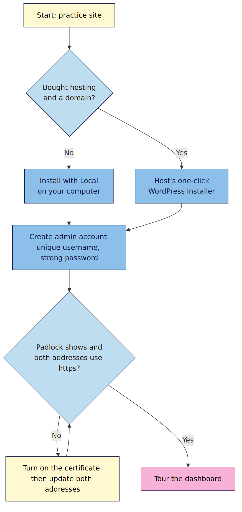

# M01.L03 — Install WordPress, turn on HTTPS and tour the dashboard
> After this lesson you have a permanent WordPress practice site, you've confirmed it runs on `https://`, and you can find your way around the dashboard.

**Time:** ~15 min reading + ~25 min exercise · **Level:** beginner · **Prereqs:** M01.L02
**Verified against:** WordPress 7.1.4, Local (localwp.com) and WordPress Playground on 2026-10-29

> ⚠️ **Freshness flag:** WordPress 7.0 (May 2026) gave the dashboard its biggest refresh in years, and 7.1 (August 2026) changed more. Menu names and positions in this lesson match WordPress 7.1. If a menu has moved, use the command palette (**Ctrl+K** / **⌘+K**) to search for it by name.

## Learning objectives
1. **Install** WordPress using a host's one-click installer, Local or Playground.
2. **Confirm** HTTPS works and the site address uses `https://`.
3. **Locate** the main dashboard areas: Posts, Pages, Media, Appearance, Plugins, Users, Tools and Settings.

## Why it matters
Leena installed WordPress through her host and started writing straight away. Two weeks later she noticed Chrome showing "Not secure" next to her address: the host had issued a free certificate, but WordPress was still set to `http://`. Fixing it meant changing her site addresses and redirecting old links, and some readers had already shared the insecure ones. Installing takes ten minutes. Checking HTTPS and learning where things live in those first ten minutes saves hours later.

## Core concept
**Plain version:** installing WordPress means putting its files on a server and connecting them to a database. HTTPS means the connection between reader and site is encrypted. The dashboard (`/wp-admin/`) is the control room where you run everything.

**Analogy:** installing is moving furniture into your new shop. HTTPS is the lock on the door and the sealed envelope for every message between you and your customers. The dashboard is the back office where you stock shelves, change the window display and hire staff.

**Precise definitions:**
- **Installation:** WordPress needs three things: its files, a **MySQL/MariaDB database** and an **admin account**. One-click installers, Local and Playground do all three for you.
- **HTTPS / TLS certificate:** a certificate proves your site's identity and encrypts traffic. Most hosts issue free **Let's Encrypt** certificates that renew automatically. WordPress recommends HTTPS for every site.
- **WordPress Address and Site Address:** two settings in **Settings → General** that tell WordPress its own URL. Both must start with `https://` once your certificate works.
- **Dashboard (WP Admin):** the admin area at `yoursite.com/wp-admin/`. Only logged-in users see it, and what they see depends on their role.

### Three ways to install: which one when
| Method | Cost | Public website? | Best for |
|---|---|---|---|
| **WordPress Playground** (playground.wordpress.net) | Free | No, runs in your browser | Quick experiments; what you used in M01.L01 |
| **Local** (localwp.com) | Free | No, runs on your computer | **Your practice site for this course**: permanent, works offline, easy to back up |
| **Host's one-click installer** | Your hosting plan | **Yes** | Your real site, when you've bought a domain and hosting (M01.L02) |

From this lesson on, the course uses one **practice site** that you build module by module and launch in M09. Use Local for it unless you've already bought hosting.

## How it works

**In words:** if you haven't bought hosting yet, install with Local; if you have, use your host's one-click installer. Either way, create an admin account with a unique username and a strong password. Then check HTTPS: the browser shows a padlock and both addresses in **Settings → General** start with `https://`. If not, turn on the certificate and update both addresses. Then tour the dashboard.

## Hands-on walkthrough

**Part A, option 1: install with Local (recommended, ~10 min)**
1. Download **Local** from **https://localwp.com** (free; Windows, macOS, Linux) and install it.
   **Expected:** Local opens with a **+** (Create a new site) button.
2. Click **+** → **Create a new site**. Name it after your project (e.g. `priyacooks`). Choose **Preferred** environment.
   **Expected:** Local suggests a local address such as `priyacooks.local`.
3. Set the admin username, password and email.
   - Username: **not** `admin`. Use something unguessable.
   - Password: let your password manager generate it (M01.L05 covers this properly).
   **Expected:** after a minute, the site shows as running with **Open site** and **WP Admin** buttons.
   > 🖼️ **Image prompt:** Screenshot of the Local app (localwp.com) Overview tab for a site named `priyacooks`, status running, with the Open site and WP Admin buttons and the SSL "Trust" control outlined. Highlight the key element with a 3px #F9B2D7 outline; blur any personal details.
   > **Alt text:** Local app overview of the priyacooks site, showing Open site, WP Admin and the SSL Trust button.
4. In the site's **Overview**, find **SSL** and click **Trust** (Local may ask for your computer password).
   **Expected:** SSL shows as trusted, and **Open site** loads `https://priyacooks.local` with a padlock.

**Part A, option 2: install with your host's one-click installer (~10 min)**
1. Log in to your hosting control panel and find **WordPress** (often under "Website", "Apps" or "Softaculous").
2. Choose your domain, set the protocol to **https://**, and set the admin username (not `admin`), a strong password and your email.
   **Expected:** a "WordPress installed" message with your site address and admin login link.
3. In the panel's **SSL/TLS** or **Security** section, confirm a free certificate (usually Let's Encrypt) is active and set to auto-renew.
   **Expected:** status "Active" or "Issued" for your domain (and `www`, if you use it).

> **Using Playground instead?** That's fine for this lesson: Playground already runs on `https://playground.wordpress.net`. Remember to **Save** it, and plan to move to Local or hosting before M02.

**Part B: confirm HTTPS (5 min)**
1. Open your site's homepage.
   **Expected:** a padlock (or "connection is secure" icon) left of the address, and the address starts with `https://`.
2. Go to **Settings → General**.
   **Expected:** **WordPress Address (URL)** and **Site Address (URL)** both start with `https://`.
   > 🖼️ **Image prompt:** Screenshot of Settings → General in WordPress 7.1, cropped to the WordPress Address (URL) and Site Address (URL) fields, both reading `https://priyacooks.local`, with the `https://` part outlined. Highlight the key element with a 3px #F9B2D7 outline; blur any personal details.
   > **Alt text:** Settings → General with WordPress Address and Site Address both starting with https://.
3. Go to **Tools → Site Health**.
   **Expected:** no critical issue about HTTPS. If WordPress detects a working certificate but your addresses still use `http://`, Site Health may offer a button to **update your site to use HTTPS**. Use it, or change both addresses yourself (exactly the same URL, `https://`, no trailing slash).
4. Type your address with `http://` instead of `https://`.
   **Expected:** you land on the `https://` version. If not, ask your host to turn on an HTTP→HTTPS redirect (on Local, this isn't needed).

**Part C: dashboard scavenger hunt (10 min)**
Log in at `/wp-admin/` and find each item. Tick it off and write down the menu path.

| # | Find… | Where it lives in WordPress 7.1 |
|---|---|---|
| 1 | The screen listing all your posts | **Posts → All Posts** |
| 2 | Where you'd create an About page | **Pages → Add New Page** |
| 3 | Every image you've uploaded | **Media → Library** |
| 4 | Where you change your site's design | **Appearance → Editor** (block themes) or **Themes** |
| 5 | Where fonts are managed | **Appearance → Fonts** |
| 6 | Installed plugins, and how to add one | **Plugins → Installed Plugins / Add New Plugin** |
| 7 | Your own profile and password | **Users → Profile** |
| 8 | Export your content (from M01.L01) and Site Health | **Tools → Export**, **Tools → Site Health** |
| 9 | Site title, timezone and addresses | **Settings → General** |
| 10 | Where you'll set permalinks next lesson | **Settings → Permalinks** |

**Bonus:** press **Ctrl+K** (Windows/Linux) or **⌘+K** (Mac) anywhere in the dashboard and type "permalinks".
**Expected:** the command palette offers Permalinks. Use it whenever a menu has moved.
> 🖼️ **Image prompt:** Screenshot of the WordPress 7.1 command palette (Ctrl+K) open over the dashboard, with "permalinks" typed and the Permalinks result selected. Highlight the key element with a 3px #F9B2D7 outline; blur any personal details.
> **Alt text:** The command palette open with permalinks typed and the Permalinks result highlighted.

## When to use / when not to
- **Use Local** for your practice site while you learn. It's free, private and permanent. **Trade-off:** nobody else can see it, so you can't share a link or test real search traffic.
- **Use a host's installer** when you're ready for a public site. Pick **https://** in the installer if offered; it saves fixing addresses later.
- **Use Playground** for throwaway experiments (testing a plugin or theme in seconds), not as your main practice site.
- **Don't install by hand** (uploading files and creating a database yourself) unless your host has no installer; it's slower and easier to get wrong. The official guide is in Further reading if you need it.

## Use AI for this
**Example prompt:**
> "I just installed WordPress 7.1 on [Local / my host's name]. My site shows 'Not secure' in Chrome. Here's what Settings → General shows: [paste both addresses]. Here's what my hosting panel's SSL section shows: [paste]. Walk me through checking and fixing HTTPS step by step, and tell me what to check after each step."

**What AI does well here:** turning a confusing symptom into an ordered checklist, and explaining error messages in plain language.
**Where it gets it wrong:** it often suggests editing `wp-config.php` or installing an "SSL plugin" first, when the usual fix is turning on the host's free certificate and updating two settings. It also describes old dashboard menus from earlier WordPress versions.
**How to check:** follow WordPress's official HTTPS documentation and your host's own knowledge base, and use the command palette to find any menu AI names.

## Common mistakes
- **Using `admin` as the username.** It's the first name attackers try. Choose something unique.
- **Weak or reused password.** Generate one with a password manager.
- **Changing the site addresses before the certificate works.** You can lock yourself out. Check that `https://yourdomain` loads with a padlock *first*.
- **Typos in WordPress Address / Site Address.** A wrong character can make the dashboard unreachable. Copy and paste, no trailing slash.
- **Installing a plugin to "fix" HTTPS** before checking the host's certificate and Site Health.

## Troubleshooting
| Symptom | Likely cause | Fix |
|---|---|---|
| "Not secure" warning or no padlock | Certificate not issued yet, or addresses still `http://` | Turn on the host's free certificate; wait for it to issue; then update both addresses in Settings → General |
| Padlock but some pages still say "Not secure" | **Mixed content**: images or scripts loaded over `http://` | Re-insert the affected images; for many old URLs, ask your host or use a search-and-replace tool after a backup |
| Locked out after changing the addresses | Typo or certificate not working | Your host's file manager: edit `wp-config.php` to set `WP_HOME` and `WP_SITEURL` to the correct URL, or ask support. On Local, fix it in Local's site settings |
| Local site shows a certificate warning | Local's certificate not trusted yet | In Local's site **Overview**, click **SSL → Trust** |
| A menu from this lesson isn't where it says | Different WordPress version or a plugin moved it | Press Ctrl+K / ⌘+K and search for it by name |
| Too many redirects after switching to HTTPS | Host and WordPress both redirecting in a loop, often behind a proxy or CDN | Ask your host to check SSL and redirect settings; don't stack redirect plugins |

## Exercise
**Task:** install your practice site with Local (or your host), confirm HTTPS using all four checks in Part B, and complete the 10-item scavenger hunt.
**Expected outcome:** a running practice site at `https://…` with a padlock, both addresses in Settings → General using `https://`, no HTTPS issue in Site Health, and your scavenger-hunt table filled in with menu paths.
**Stretch goal (break it and fix it):** on your **Local** site only, go to **Settings → General** and change the Site Address to `http://` (leave WordPress Address as `https://`). Visit the homepage and note what happens to links and the padlock. Then set it back. Write one sentence on what you saw.

## Key takeaways
- WordPress = files + a database + an admin account; installers do all three.
- Use **Local** for your course practice site; use your **host's installer** for the real one.
- HTTPS isn't done until the padlock shows **and** both addresses in Settings → General use `https://`.
- Never use `admin` as a username; use a generated password.
- Lost in the dashboard? **Ctrl+K / ⌘+K** finds any screen by name.

## Teach it back
Explain to a friend in 3 sentences how to tell whether a WordPress site is really using HTTPS, and what to change if it isn't.

## Glossary terms added
- Dashboard (WP Admin) — added to `wordpress-101/glossary.md`
- HTTPS / TLS certificate — added to `wordpress-101/glossary.md`
- Let's Encrypt — added to `wordpress-101/glossary.md`
- WordPress Address and Site Address — added to `wordpress-101/glossary.md`
- Mixed content — added to `wordpress-101/glossary.md`
- Command palette — added to `wordpress-101/glossary.md`
- Local — added to `wordpress-101/glossary.md`

## Further reading
*All checked 2026-10-29.*
- WordPress 7.0 Field Guide (dashboard changes): https://make.wordpress.org/core/2026/05/14/wordpress-7-0-field-guide/
- WordPress.org — Server requirements (HTTPS recommended): https://wordpress.org/requirements/
- WordPress developer docs — HTTPS for WordPress: https://developer.wordpress.org/advanced-administration/security/https/
- WordPress developer docs — How to install WordPress (manual install): https://developer.wordpress.org/advanced-administration/before-install/howto-install/
- WordPress documentation — Dashboard screen: https://wordpress.org/documentation/article/dashboard-screen/
- WordPress documentation — Site Health screen: https://wordpress.org/documentation/article/site-health-screen/
- Local (free local WordPress): https://localwp.com
- Let's Encrypt — How it works: https://letsencrypt.org/how-it-works/
