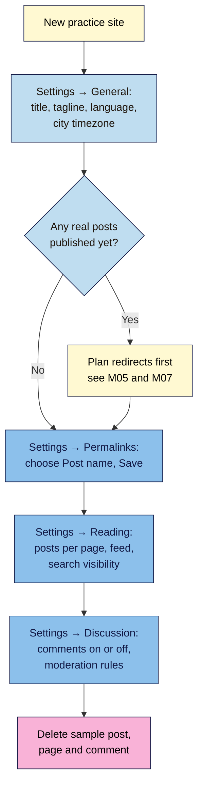
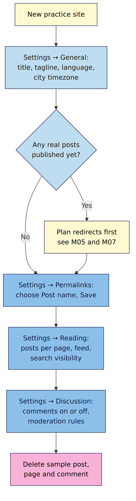

# M01.L04 — First-day settings: permalinks, reading and discussion
> After this lesson your practice site has the right name, clock, web addresses and comment rules, before a single real post exists.

**Time:** ~15 min reading + ~15 min exercise · **Level:** beginner · **Prereqs:** M01.L03
**Verified against:** WordPress 7.1.4 Settings screens and core install defaults, and Google Search Central's URL structure guide, on 2026-10-29

## Learning objectives
1. **Set** the site title, tagline, timezone and language correctly.
2. **Choose** a permalink structure before the first post, and **explain** why changing it later risks links and search equity.
3. **Configure** reading and discussion settings to match your publishing plan.

## Why it matters
Tomás published 40 recipes with URLs like `/2025/03/14/easy-paella/`. A year later he switched to `/easy-paella/` because the dates made evergreen recipes look stale. Some old links redirected, others didn't, newsletter archives and Pinterest pins pointed to dead pages, and Google had to recrawl every recipe under its new address. His traffic dipped for weeks. Meanwhile his site's timezone had been UTC all along, so his "7 a.m." scheduled posts went out in the middle of his readers' night. Ten minutes in **Settings** on day one would have avoided both.

## Core concept
**Plain version:** WordPress's **Settings** menu holds a handful of choices that shape everything that follows: your site's name, its clock, how its web addresses look, what the homepage and feeds show, and who can comment. Some are easy to change later. **Permalinks are not.**

**Analogy:** it's like setting up a new phone before filling it with photos: name it, set the time zone, choose how files are named. Renaming every photo later is possible, but every place that linked to the old names breaks.

**Precise definitions:**
- **Permalink:** the permanent web address of a post or page, e.g. `https://priyacooks.com/easy-paella/`. The part after the domain comes from the **permalink structure**; the post's own part is its **slug** (`easy-paella`).
- **Permalink structure:** the pattern WordPress uses for every post URL, set in **Settings → Permalinks**. On a fresh install WordPress uses **Day and name** (`/2026/10/29/easy-paella/`) if your server supports it, otherwise **Plain** (`/?p=123`). Some hosts and Local choose differently, so always check.
- **Search equity:** the trust and ranking signals a URL builds up from links, shares and history. It's tied to the address.
- **Timezone:** the clock WordPress uses for publish times, scheduling and dates. Choose a **city** (e.g. *Kolkata*, *London*, *New York*), not a "UTC+…" offset, so daylight saving is handled automatically.

### Which permalink structure?
| Structure | Example | Use when | Trade-off |
|---|---|---|---|
| **Post name** (recommended) | `/easy-paella/` | Most creator sites: evergreen content, recipes, guides, show notes | Two posts can't share a slug; WordPress adds `-2` if they try |
| Category + post name (custom) | `/recipes/easy-paella/` | Your categories are stable, clear sections | Moving a post to another category changes its URL |
| Day and name (core default) | `/2026/10/29/easy-paella/` | News sites where the date matters to readers | Makes evergreen posts look dated; long URLs |
| Plain | `/?p=123` | Never for a real site | Meaningless to readers and search engines |

This matches Google's URL guidance: use simple, readable words, separate words with hyphens, and avoid long ID numbers.

**Why changing later hurts:** when the structure changes, every post's address changes. WordPress tries to guess and redirect old URLs that would otherwise 404, and often succeeds, but you can't rely on it for every post, every link and every feed or archive that copied the old address. Search engines must recrawl every page under its new URL before rankings settle. Choose once, on day one.

## How it works

**In words:** set **General** first (name, language, clock). Before any real post exists, set **Permalinks**; if posts already exist, plan redirects before changing it. Then set **Reading** (how many posts per page, what feeds show, search visibility) and **Discussion** (whether and how people comment). Finally, delete WordPress's sample content.

## Hands-on walkthrough
Work on your **Local** practice site from M01.L03.

**Step 1: Settings → General (3 min)**
1. **Site Title:** your brand or name (e.g. *Priya Cooks*). **Tagline:** one short line saying who it's for (e.g. *Weeknight Indian recipes in 30 minutes*), or leave it blank. Don't leave WordPress's default text.
2. **Site Language:** your audience's language.
3. **Timezone:** pick the **city** where you (or most of your readers) are.
   **Expected:** the "Universal time" and "Local time" lines below the dropdown show your real local time.
4. **Membership → Anyone can register:** leave **unticked**. **New User Default Role:** leave as **Subscriber**.
5. Check **Administration Email Address** is an inbox you read.
6. Click **Save Changes**.
   **Expected:** "Settings saved." at the top.

**Step 2: Settings → Permalinks (2 min)**
1. Note which structure is selected now (Day and name, Plain or Post name).
2. Select **Post name** and click **Save Changes**.
   **Expected:** "Permalink structure updated." The example under Post name shows `https://yoursite/sample-post/`.
   > 🖼️ **Image prompt:** Screenshot of Settings → Permalinks in WordPress 7.1 with the "Permalink structure updated." notice, the Post name option selected, and its example URL `/sample-post/` outlined. Highlight the key element with a 3px #F9B2D7 outline; blur any personal details.
   > **Alt text:** Permalinks settings with Post name selected and the example URL ending in /sample-post/.
3. Open any post or page on the site.
   **Expected:** its address ends in a readable slug, e.g. `/sample-page/`. If you get a "Not Found" error, see Troubleshooting.

**Step 3: Settings → Reading (2 min)**
1. **Your homepage displays:** leave **Your latest posts** for now. You'll build a static homepage in M04.
2. **Blog pages show at most:** 10 is fine.
3. **For each post in a feed, include:** choose **Excerpt** if you want feed readers and newsletter tools to send people to your site, or **Full text** if you want readers to read everything in their feed reader. Creators who earn from site visits usually choose Excerpt.
4. **Search engine visibility:** on your **Local** site it doesn't matter (nobody can reach it). On a **live** site, leave **Discourage search engines** **unticked** unless the site is deliberately unfinished, and untick it at launch.
5. **Save Changes.**

**Step 4: Settings → Discussion (4 min)**
Decide first: **do you want comments?** (M06.L04 covers this properly.) Either way, apply safe defaults:
1. **Comment author must fill out name and email:** ticked.
2. **Automatically close comments on old posts:** ticked if you can't moderate old posts, with **Close comments when post is how many days old** set to 30–90.
3. **Comment must be manually approved:** ticked (or at least **Comment author must have a previously approved comment**).
4. **Hold a comment in the queue if it contains 2 or more links:** keep the default; spam is mostly links.
5. **Attempt to notify any blogs linked to from the post** and **Allow link notifications from other blogs (pingbacks and trackbacks)**: untick both. Today they're mostly spam.
6. If you don't want comments at all, untick **Allow people to submit comments on new posts**.
7. **Save Changes.**
   **Expected:** "Settings saved."
   > 🖼️ **Image prompt:** Screenshot of Settings → Discussion in WordPress 7.1 with the safe defaults from this step: link-notification and pingback boxes unticked; name-and-email and manual approval ticked. Outline the changed checkboxes. Highlight the key element with a 3px #F9B2D7 outline; blur any personal details.
   > **Alt text:** Discussion settings with pingbacks off, name and email required and manual comment approval on.

**Step 5: delete the sample content (2 min)**
1. **Posts → All Posts:** move **Hello world!** to Trash, then empty the trash.
2. **Pages → All Pages:** trash **Sample Page**. **Keep the Privacy Policy draft**; you'll finish it in M06.
3. **Comments:** the sample comment disappears with Hello world!. Check the Comments screen is empty.
   **Expected:** no sample post, no Sample Page, an empty Comments screen, and the Privacy Policy still in drafts.

## When to use / when not to
- **Choose Post name** for almost every creator site. **Trade-off:** readers can't see from the URL how old a post is; show the date (or "last updated" date) on the page itself instead.
- **Choose Category + post name** only if your categories are few and permanent (e.g. `/recipes/`, `/podcast/`). Moving a post between categories changes its URL.
- **Keep dates in the URL** only for news-style content where publication date is the point.
- **Changing permalinks on an existing site** is possible, but plan it: take a backup, list your top URLs, check every one redirects afterwards, and update links you control. M05 and M07 cover redirects.

## Use AI for this
**Example prompt:**
> "I run a [niche] site with posts about [topics]. My readers are mostly in [country]. I publish [how often] and I [do / don't] want comments. Recommend WordPress 7.1 settings for Settings → General, Permalinks, Reading and Discussion, and explain each choice in one sentence."

**What AI does well here:** turning your publishing plan into a settings checklist and explaining trade-offs (comments on/off, excerpt vs full feeds).
**Where it gets it wrong:** it may insist WordPress has no redirects when permalinks change (it does try to guess) or promise it always redirects (it doesn't always). It can also describe options that have been renamed or removed.
**How to check:** compare with the WordPress documentation for each Settings screen (Further reading) and test on your Local site: change one setting, then look at the result in the browser.

## Common mistakes
- **Publishing first, choosing permalinks later.** Change the structure before your first real post.
- **Picking "UTC+5:30" instead of a city.** Offsets don't follow daylight-saving changes; cities do.
- **Ticking "Anyone can register."** It invites spam accounts. Leave it off unless you run a membership site.
- **Launching with "Discourage search engines" still ticked.** Your site quietly stays out of search results.
- **Deleting the Privacy Policy draft** along with the sample content. You'll need it in M06.

## Troubleshooting
| Symptom | Likely cause | Fix |
|---|---|---|
| Every post shows "Not Found" after choosing Post name | Server rewrite rules not updated (common on Apache without a writable `.htaccess`) | Go to Settings → Permalinks and click Save Changes again; if it persists, ask your host to enable rewrite rules or make `.htaccess` writable |
| Scheduled posts publish at the wrong hour | Timezone set to UTC or a fixed offset | Settings → General → Timezone → choose your city |
| Live site not showing in Google weeks after launch | "Discourage search engines" ticked | Untick it in Settings → Reading, then check URL Inspection in Search Console (M05) |
| A post's URL ends in `-2` | Another post, page or attachment already uses that slug | Rename or delete the old item, then edit the slug in the post's settings |
| Spam comments on old posts | Comments open forever, no moderation | Turn on manual approval and auto-close comments after 30–90 days |

## Exercise
**Task:** on your Local practice site, complete Steps 1–5. Then record your choices in a short "site settings log": site title, tagline, timezone city, permalink structure, feed setting, comments on/off and moderation rules.
**Expected outcome:** Post name permalinks, a city timezone showing the right local time, safe discussion defaults, no sample content, the Privacy Policy draft kept, and a settings log you'll add to in M01.L05.
**Stretch goal (break it and fix it):** publish a test post called "Permalink test". Switch permalinks to **Day and name**, copy the post's new URL, then switch back to **Post name**. Visit the copied date-based URL. Does WordPress redirect you, or show "Not Found"? Write one sentence on what happened and why you still shouldn't rely on it. Then delete the test post.

## Key takeaways
- Set **General** first: a real title, tagline, language and a **city** timezone.
- Choose **Post name** permalinks **before your first real post**.
- WordPress tries to redirect old URLs after a structure change, but don't count on it.
- Untick **Discourage search engines** on a live site; turn off open registration and pingbacks.
- Delete the sample post and page, but keep the Privacy Policy draft.

## Teach it back
Explain to a friend in 3 sentences why you set your permalink structure before publishing, and what you'd do if you had to change it on a site that's already live.

## Glossary terms added
- Permalink — added to `wordpress-101/glossary.md`
- Permalink structure — added to `wordpress-101/glossary.md`
- Slug — added to `wordpress-101/glossary.md`
- Search equity — added to `wordpress-101/glossary.md`
- Pingbacks and trackbacks — added to `wordpress-101/glossary.md`
- RSS feed (full text vs excerpt) — added to `wordpress-101/glossary.md`

## Further reading
*All checked 2026-10-29.*
- WordPress documentation — Settings General Screen: https://wordpress.org/documentation/article/settings-general-screen/
- WordPress documentation — Settings Permalinks Screen: https://wordpress.org/documentation/article/settings-permalinks-screen/
- WordPress documentation — Customize permalinks: https://wordpress.org/documentation/article/customize-permalinks/
- WordPress documentation — Settings Reading Screen: https://wordpress.org/documentation/article/settings-reading-screen/
- WordPress documentation — Settings Discussion Screen: https://wordpress.org/documentation/article/settings-discussion-screen/
- Google Search Central — URL structure best practices: https://developers.google.com/search/docs/crawling-indexing/url-structure
- Google Search Central — Site moves with URL changes: https://developers.google.com/search/docs/crawling-indexing/site-move-with-url-changes
