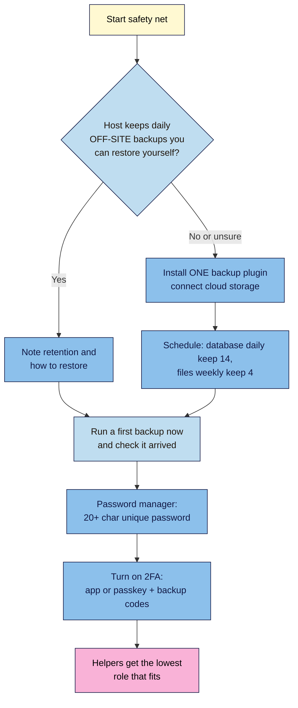
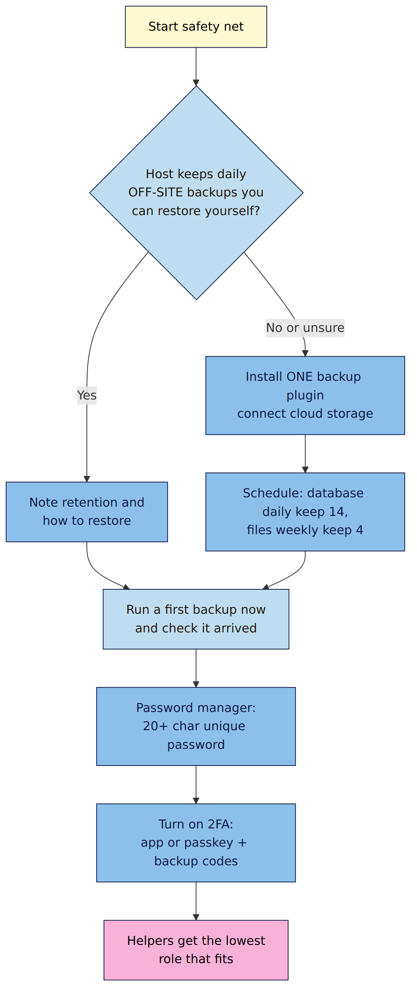

# M01.L05 — Your day-one safety net: backups, 2FA, passwords and user roles
> After this lesson your practice site backs itself up somewhere safe, your login needs more than a password, and you know which role to give anyone who helps you.

**Time:** ~18 min reading + ~25 min exercise · **Level:** beginner · **Prereqs:** M01.L04
**Verified against:** WordPress 7.1 admin code, UpdraftPlus 1.26.14 and Two Factor 0.17.0 (plugin code and wordpress.org listings), WordPress Roles and Capabilities documentation and NIST SP 800-63B-4 on 2026-10-29; labels re-checked 2026-11-01

> ⚠️ **Freshness flag:** plugin names, free-tier limits and storage options change. This lesson teaches the **job** (off-site backups, 2FA) and uses UpdraftPlus and Two Factor as free examples. If your host already does a job well, use that instead. Re-check each plugin's wordpress.org page (last updated, tested-up-to version) before installing.

## Learning objectives
1. **Schedule** automated off-site backups with one backup plugin, or confirm your host does it off-site.
2. **Turn on** two-factor authentication and use a password manager for a strong, unique admin password.
3. **Assign** the least-privilege user role (Editor, Author, Contributor) when you bring in help.

## Why it matters
Ananya's travel blog had four years of posts when a plugin update broke her site at midnight before a sponsored launch. Her host's backups lived on the same server, which was also the one that had failed. Her friend Ravi had a worse week: he'd reused his email password for his WordPress admin, it leaked in an unrelated breach, and someone logged in and planted spam links across 200 posts. Both problems take about 25 minutes to prevent, and almost nobody does it until after the first disaster.

## Core concept
**Plain version:** the day-one safety net has three parts:
1. **Backups** you can restore, stored somewhere other than your server.
2. **Strong logins:** a unique, password-manager-generated password **plus** a second factor (2FA).
3. **Least privilege:** everyone who helps you gets only the access their job needs.

**Analogy:** backups are a photocopy of your house keys and documents kept at a friend's place. 2FA is a door that needs both a key and a code. User roles are giving the cleaner a key to the front door, not to the safe.

**Precise definitions:**
- **Backup:** a copy of your site's **database** (posts, pages, settings, comments, users) and **files** (themes, plugins, uploads). You need both to restore.
- **Off-site backup:** a backup stored with a different company from your host (Google Drive, Dropbox, an S3-compatible bucket). If the server dies, the backup survives.
- **The 3-2-1 rule:** keep **3** copies of your data, on **2** different kinds of storage, with **1** off-site. A host backup plus a plugin backup in cloud storage plus an occasional download to your computer meets it.
- **Two-factor authentication (2FA):** logging in needs your password **and** something else: a code from an authenticator app, a passkey or security key, or (weakest) an emailed code.
- **Password manager:** an app (e.g. Bitwarden, 1Password, or the one built into your browser or phone) that generates and remembers long, unique passwords.
- **User role:** a set of permissions in WordPress. The main ones:

| Role | Can do | Give it to |
|---|---|---|
| **Administrator** | Everything: plugins, themes, users, settings | You. Ideally only you |
| **Editor** | Publish and edit **anyone's** posts and pages, moderate comments | A trusted managing editor |
| **Author** | Publish and edit **their own** posts, upload media | A regular guest writer you trust |
| **Contributor** | Write and edit their own posts but **can't publish** or upload media | A new or one-off guest writer; you review first |
| **Subscriber** | Manage their own profile only | Readers who sign up (if you allow it) |

### What good passwords look like now
Current NIST guidance (SP 800-63B-4) favours **length over complexity**: long passwords (at least 15 characters if a password is the only factor), checked against lists of breached passwords, with **no forced character mixes and no scheduled changes**. Change a password when there's a reason, such as a breach. In practice: let your password manager generate one 20+ characters long, never reuse it, and add 2FA.

## How it works

**In words:** first find out whether your host already keeps daily **off-site** backups you can restore yourself. If not (or you're on Local, like now), install **one** backup plugin, connect cloud storage and set a schedule. Either way, run a first backup and check it arrived. Then lock the front door: a password-manager password and 2FA with saved backup codes. Finally, give every helper the lowest role that lets them do their job.

## Hands-on walkthrough
Work on your **Local** practice site. On a live site, do exactly the same steps.

**Part A: off-site backups with UpdraftPlus (12 min)**
1. **Plugins → Add Plugin**, search **UpdraftPlus**, check the listing (recently updated, tested with your WordPress version, many active installs), then **Install Now → Activate**.
   **Expected:** a new **Settings → UpdraftPlus Backups** screen.
2. Open **Settings → UpdraftPlus Backups → Settings**.
   - **Files backup schedule:** Weekly, retain **4** backups.
   - **Database backup schedule:** Daily, retain **14** backups.
   - **Remote storage:** choose **Google Drive** or **Dropbox** (both free in UpdraftPlus).
   > 🖼️ **Image prompt:** Screenshot of the UpdraftPlus Settings tab: Files backup schedule Weekly, retain 4; Database backup schedule Daily, retain 14; Google Drive selected as remote storage. Outline the schedule and storage choices. Highlight the key element with a 3px #F9B2D7 outline; blur any personal details.
   > **Alt text:** UpdraftPlus settings with weekly file backups kept 4 times, daily database backups kept 14 times, and Google Drive selected.
3. Scroll down, click **Save Changes**, and follow the prompt to **authenticate** with your cloud account.
   **Expected:** a success message saying UpdraftPlus is connected to your account.
4. Go to **Backup / Restore** and click **Backup Now** (database + files, send to remote storage).
   **Expected:** a progress bar, then a new row under **Existing backups** with date, database and files.
5. Open your Google Drive or Dropbox in another tab.
   **Expected:** an **UpdraftPlus** folder containing files named with today's date (`…-db.gz`, `…-plugins.zip`, `…-uploads.zip`, etc.).

> **On a live site with good managed hosting?** Your host may already do daily off-site backups with one-click restore. Check its documentation for **where** backups are stored and **how long** they're kept. If they're off-site and you can restore them yourself, you can skip the plugin. Don't run two backup plugins.

**Part B: password manager + 2FA (8 min)**
1. In your password manager, generate a new **20+ character** password for this site's admin account. Go to **Users → Profile**, set it under **Account Management → Set New Password**, then **Update Profile**.
   **Expected:** "Profile updated." Log out and back in with the saved password.
2. **Plugins → Add Plugin**, search **Two Factor** (by WordPress.org contributors), **Install → Activate**.
3. Go to **Users → Profile** and find the **Two-Factor Options** section.
   - Enable **Authenticator App**. Scan the QR code with an authenticator app (e.g. Google Authenticator, Microsoft Authenticator, or your password manager's built-in one), and type the 6-digit code to confirm.
   - Enable **Recovery Codes** and click **Generate new recovery codes**. Use **Download Codes** or **Copy Codes** and save them in your password manager (they're shown only once).
   - Set **Primary Method** to **Authenticator App**. **Update Profile.**
   **Expected:** the authenticator app shows as configured, and you have 10 recovery codes saved.
   > 🖼️ **Image prompt:** Screenshot of Users → Profile → Two-Factor Options (Two Factor plugin) with Authenticator App enabled and set as the Primary Method, and Recovery Codes enabled. Blur the QR code and every code. Highlight the key element with a 3px #F9B2D7 outline; blur any personal details.
   > **Alt text:** Two-Factor Options with the authenticator app enabled as primary and backup codes generated (codes blurred).
4. Log out and log in again.
   **Expected:** after your password, WordPress asks for an authentication code. Enter the code from your app.

> **Prefer passkeys?** The companion plugin **Two-Factor Provider: WebAuthn** adds passkeys and hardware keys (Windows Hello, Touch ID, YubiKey) as a second factor. Set it up *in addition to* backup codes.

**Part C: create a least-privilege test user (5 min)**
1. **Users → Add User.** Username `test-author`, a test email (on Local, emails are caught by Local's built-in mail tool, so any address works), Role **Author**. **Add User.**
   **Expected:** `test-author` appears in Users with role Author.
2. Open a private browser window and log in as `test-author`.
   **Expected:** a much shorter menu: Posts, Media, Profile. No Plugins, Appearance, Settings or Users.
3. Back as yourself, change `test-author` to **Contributor** and log in again as them. Start a post.
   **Expected:** the button says **Submit for Review**, not Publish.
   > 🖼️ **Image prompt:** Screenshot of the block editor logged in as a Contributor, top bar cropped to show the Submit for Review button outlined where Publish would normally be. Highlight the key element with a 3px #F9B2D7 outline; blur any personal details.
   > **Alt text:** Block editor for a Contributor showing a Submit for Review button instead of Publish.
4. Delete `test-author` when done (attribute any content to yourself).

## When to use / when not to
- **Use a backup plugin** when your host doesn't keep off-site backups you can restore yourself, or when you want your own copy anyway. **Trade-off:** backups take server resources; schedule them for quiet hours and don't run two backup plugins.
- **Use your host's backups alone** only if they're off-site, daily, kept 14+ days, and you've confirmed how to restore them. You'll test a restore in M07.
- **Use an authenticator app or passkey for 2FA**, not email codes, for admin accounts. Email 2FA is better than nothing but fails if your email is compromised.
- **Give Administrator to nobody else** unless they truly manage plugins and settings. A developer can have a temporary admin account that you delete afterwards.

## Use AI for this
**Example prompt:**
> "I run a WordPress site with [X] posts and [Y] GB of uploads, and I publish [how often]. My host is [name] and its docs say this about backups: [paste]. Do I still need a backup plugin? Suggest a schedule and retention for database and files, and list the steps to check my backups actually work."

**What AI does well here:** reading your host's backup docs with you and turning your publishing rhythm into a sensible schedule.
**Where it gets it wrong:** it can confidently say a host's backups are off-site when they aren't, recommend outdated or paid-only plugin features, or suggest stacking several security plugins.
**How to check:** confirm storage location and retention in your host's own documentation or support chat, and confirm plugin features on the plugin's wordpress.org page. The only proof a backup works is a restore (M07).

## Common mistakes
- **Backups stored only on the same server.** If the server goes, so do they.
- **Never checking a backup arrived.** Open the cloud folder after the first run.
- **Losing access to 2FA.** Save backup codes in your password manager before you need them.
- **Giving everyone Administrator** "to keep it simple". It's the most common way helpers' hacked accounts become your hacked site.
- **Reusing your email password** for WordPress, or using `admin` as a username (M01.L03).

## Troubleshooting
| Symptom | Likely cause | Fix |
|---|---|---|
| UpdraftPlus "Backup Now" stalls or times out | Large uploads folder, low server limits or blocked background tasks | Run it again; on live hosting ask support about PHP time and memory limits; split database and files backups |
| No files in Google Drive / Dropbox | Remote storage not authenticated or authentication expired | Settings → UpdraftPlus → re-authenticate, then run Backup Now and check again |
| Locked out after enabling 2FA (lost phone) | No backup codes saved | Use a saved backup code. Without one: on a live site ask your host to deactivate the Two Factor plugin (rename its folder); on Local, deactivate it from Local's database or files |
| 2FA code always rejected | Phone clock out of sync | Turn on automatic date and time on your phone, then try a fresh code |
| Test user sees Plugins and Settings | Wrong role assigned | Users → edit the user → set Role to Author or Contributor |

## Exercise
**Task:** complete Parts A–C on your Local practice site. Add three lines to your site settings log from M01.L04: where backups go and on what schedule, which 2FA methods are on (and where backup codes are saved), and which role you'd give a regular guest writer.
**Expected outcome:** a successful UpdraftPlus backup visible in your cloud storage, a 2FA login working with your authenticator app, backup codes saved, `test-author` created, tested as Author and Contributor, and deleted, and three new lines in your settings log.
**Stretch goal (break it and fix it):** in UpdraftPlus, disconnect your remote storage and run **Backup Now**. Where did the backup go, and why isn't that an off-site backup? Reconnect storage and run it again.

## Key takeaways
- A backup only counts if it's **off-site** and you've seen it arrive; you'll prove it restores in M07.
- One backup plugin, or your host's off-site backups. Never two backup plugins.
- Password manager + 20+ character unique password + 2FA (app or passkey), with backup codes saved.
- Give helpers the **lowest role** that does the job; keep Administrator for yourself.
- Length beats complexity; change passwords when there's a reason, not on a schedule.

## Teach it back
Explain to a friend in 3 sentences why backups on the same server as the website aren't enough, and what to do instead.

## Glossary terms added
- Backup (database + files) — added to `wordpress-101/glossary.md`
- Off-site backup — added to `wordpress-101/glossary.md`
- 3-2-1 rule — added to `wordpress-101/glossary.md`
- Two-factor authentication (2FA) — added to `wordpress-101/glossary.md`
- Backup codes — added to `wordpress-101/glossary.md`
- Passkey — added to `wordpress-101/glossary.md`
- Password manager — added to `wordpress-101/glossary.md`
- User role — added to `wordpress-101/glossary.md`
- Least privilege — added to `wordpress-101/glossary.md`

## Further reading
*All checked 2026-10-29.*
- WordPress documentation — WordPress Backups: https://wordpress.org/documentation/article/wordpress-backups/
- WordPress documentation — Roles and Capabilities: https://wordpress.org/documentation/article/roles-and-capabilities/
- WordPress developer docs — Hardening WordPress (security): https://developer.wordpress.org/advanced-administration/security/hardening/
- UpdraftPlus on wordpress.org: https://wordpress.org/plugins/updraftplus/
- Two Factor on wordpress.org: https://wordpress.org/plugins/two-factor/
- WebAuthn Provider for Two Factor (passkeys): https://wordpress.org/plugins/two-factor-provider-webauthn/
- NIST SP 800-63B-4 — Digital Identity Guidelines: Authentication: https://pages.nist.gov/800-63-4/sp800-63b.html
