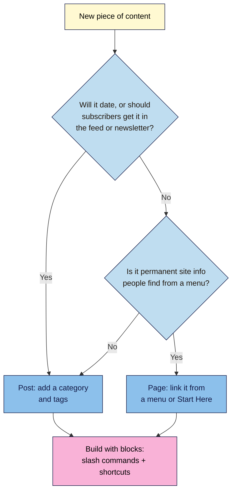
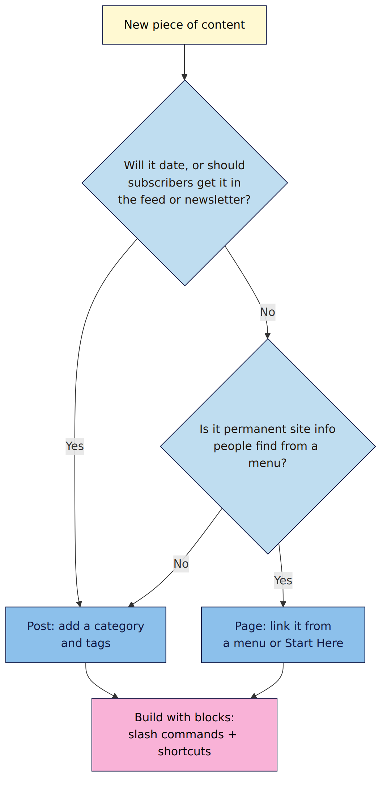

# M02.L01 — Posts vs pages, and getting fast in the block editor
> After this lesson you know where each piece of content belongs, and you can build a full post with your hands on the keyboard.

**Time:** ~15 min reading + ~20 min exercise · **Level:** beginner · **Prereqs:** Module 1 (your Local practice site)
**Verified against:** WordPress 7.1.4 block editor; keyboard shortcuts read from WordPress core's registered shortcut list, on 2026-10-29

> ⚠️ **Freshness flag:** the block editor changes with every WordPress release. If a shortcut or button here doesn't match your screen, press **Shift+Alt+H** (Mac: **Ctrl+Option+H**) in the editor to see the shortcut list for your version.

## Learning objectives
1. **Decide** whether a piece of content belongs in a post or a page.
2. **Build** a post with paragraph, heading, list, image, quote and button blocks using the block toolbar and list view.
3. **Use** slash commands and at least five keyboard shortcuts to write without reaching for the mouse.

## Why it matters
Maya published her podcast's "Work With Me" details as a blog post. It appeared in her RSS feed, went out in her automatic newsletter, slid off her homepage within a week, and showed a 2024 date that made sponsors think it was out of date. Meanwhile her weekly episode notes were *pages*, so they never reached subscribers at all. Choosing the right type takes five seconds and decides who sees the content and for how long. Once that's right, speed matters: creators who know ten shortcuts publish noticeably faster than those who hunt through menus.

## Core concept
**Plain version:** **posts** are your time-based content stream: articles, episodes, newsletters. **Pages** are your site's permanent rooms: About, Contact, Start Here. Both are built from **blocks**, one block per piece of content.

**Analogy:** posts are the episodes of your show; pages are the show's website menu. Blocks are Lego bricks: a heading brick, a paragraph brick, an image brick, snapped together in order.

**Precise definitions:**

| | **Post** | **Page** |
|---|---|---|
| Ordered by | Date (newest first) | No date order; can have parent/child pages |
| Appears in | Blog index, RSS feed, archives, category and tag pages | Menus and links you add |
| Uses categories & tags | Yes | No |
| Typical examples | Articles, recipes, episode show notes, tutorials, news | About, Start Here, Contact, Work With Me, Privacy Policy |
| Shows a date | Usually | Usually not |

- **Block:** a single unit of content (paragraph, heading, image, list, quote, button…) that you can move, style and transform.
- **Block toolbar:** the small bar above the selected block with its type, alignment, formatting and **⋮ Options** menu.
- **Settings sidebar:** the panel on the right with **Post** settings (status, categories, featured image, excerpt) and **Block** settings for the selected block.
- **List view:** an outline of every block in the document, for jumping around and reordering.
- **Slash command:** typing `/` at the start of an empty paragraph to insert any block by name.

## How it works

**In words:** if the content is part of your publishing stream (it has a date that matters, or subscribers should get it in the feed or newsletter), it's a **post**. If it's permanent information people find from a menu, it's a **page**. When unsure, choose a post: it reaches more readers. Then build it from blocks.

### Your keyboard toolkit
On a Mac, read **Ctrl** as **⌘ (Cmd)** and **Alt** as **⌥ (Option)**, except where the Mac column says otherwise.

| Do this | Windows / Linux | Mac |
|---|---|---|
| Insert any block | `/` then type the block name, **Enter** (at the start of an empty paragraph) | same |
| New paragraph block | **Enter** at the end of a block | same |
| Heading / list / quote while typing | type `## ` · `- ` · `1. ` · `> ` at the start of a paragraph | same |
| Add a link to selected text | **Ctrl+K** | **⌘+K** |
| Save draft | **Ctrl+S** | **⌘+S** |
| Undo / redo | **Ctrl+Z** / **Ctrl+Shift+Z** | **⌘+Z** / **⌘+Shift+Z** |
| Duplicate selected block | **Ctrl+Shift+D** | **⌘+Shift+D** |
| Remove selected block | **Shift+Alt+Z** | **Ctrl+Option+Z** |
| Insert a block before / after | **Ctrl+Alt+T** / **Ctrl+Alt+Y** | **⌘+Option+T** / **⌘+Option+Y** |
| Move block up / down | **Ctrl+Shift+Alt+T** / **Ctrl+Shift+Alt+Y** | **⌘+Shift+Option+T** / **⌘+Shift+Option+Y** |
| Open / close list view | **Shift+Alt+O** | **Ctrl+Option+O** |
| Open / close settings sidebar | **Ctrl+Shift+,** | **⌘+Shift+,** |
| Jump to the block toolbar | **Alt+F10** | **Option+F10** (on some Macs **Fn+Option+F10**) |
| Show all shortcuts | **Shift+Alt+H** | **Ctrl+Option+H** |

## Hands-on walkthrough
Use your **Local** practice site. In this walkthrough, try to **insert every block from the keyboard**: `/` commands and the markdown-style shortcuts.

**Step 1: create the post (2 min)**
1. **Posts → Add New Post**. Type the title: *My first real post*. Press **Enter**.
   **Expected:** the cursor moves to an empty paragraph block below the title.

**Step 2: write with the keyboard (8 min)**
1. Type an opening paragraph (two sentences). Press **Enter**.
2. Type `## ` (two hashes and a space), then *Why I started this site*. Press **Enter**.
   **Expected:** a **Heading (H2)** block, then a new empty paragraph.
3. Type `- ` and three bullet points, pressing **Enter** after each. Press **Enter** twice to leave the list.
   **Expected:** a **List** block with three items.
4. Type `/image`, press **Enter**, then choose **Upload** and pick any photo.
   **Expected:** an **Image** block showing your photo. (You'll add proper alt text in M03; type a short description in the image's **Alternative text** setting for now.)
5. Click below the image (or press **Ctrl+Alt+Y** to insert after), type `> ` and a one-line quote.
   **Expected:** a **Quote** block.
6. Type `/buttons`, **Enter**, and type *Subscribe*. Select the text, press **Ctrl+K**, and link it to `https://example.com`.
   **Expected:** a **Buttons** block with one linked button.
7. Press **Ctrl+S**.
   **Expected:** "Saved" appears near the top. Your post is still a draft.

**Step 3: edit with the toolbar and list view (5 min)**
1. Press **Shift+Alt+O** to open **list view**.
   **Expected:** an outline: Paragraph, Heading, List, Image, Quote, Buttons.
   > 🖼️ **Image prompt:** Desktop screenshot of the WordPress 7.1 block editor with list view open on the left, showing Paragraph, Heading, List, Image, Quote and Buttons, and the matching post on the right. Outline the list view panel. Highlight the key element with a 3px #F9B2D7 outline; blur any personal details.
   > **Alt text:** Block editor with list view open, showing the post's six blocks in order next to the post.
2. Select the **Quote** in list view and press **Ctrl+Shift+Alt+T** twice to move it up above the image.
   **Expected:** the quote now sits above the image, in the outline and in the post.
3. Select the **Heading**, press **Ctrl+Shift+D** to duplicate it, change the copy's text to *What's coming next*, then delete it with **Shift+Alt+Z**.
4. Click the heading block and use the **block toolbar**: change it from H2 to H3 and back.
   **Expected:** the heading level changes; the list view label updates.
   > 🖼️ **Image prompt:** Close-up screenshot of the block toolbar above a Heading block, with the heading-level dropdown open showing H1–H6 and H3 being selected. Highlight the key element with a 3px #F9B2D7 outline; blur any personal details.
   > **Alt text:** Block toolbar on a heading with the level menu open and H3 selected.

**Step 4: post settings and publish (3 min)**
1. Press **Ctrl+Shift+,** to open the settings sidebar and choose the **Post** tab.
2. Leave the category as it is (you'll design categories in M02.L03). Add a one-sentence **excerpt** if your theme shows one.
3. Click **Publish**, then **Publish** again in the confirmation panel.
   **Expected:** "Post published" with a **View Post** link. Open it: every block appears in order.

**Step 5: a page, for contrast (2 min)**
1. **Pages → Add New Page**, title *Contact*, one paragraph, **Publish**.
2. Visit your site's blog index and RSS feed (`/feed/`).
   **Expected:** *My first real post* appears in both; *Contact* appears in neither.

## When to use / when not to
- **Use a post** for anything in your publishing stream: articles, recipes, episode notes, tutorials, announcements. **Trade-off:** posts slide down the blog index over time; link your best ones from a Start Here page (M04).
- **Use a page** for permanent site information: About, Start Here, Contact, Work With Me, legal pages.
- **Don't** publish evergreen guides as pages just to avoid dates. Keep them as posts so they reach subscribers, and show a "last updated" date instead.
- **Use keyboard shortcuts** for writing and restructuring; use the mouse for fine visual work (image cropping, colours) where clicking is faster.

## Use AI for this
**Example prompt:**
> "Here are 12 pieces of content I want on my [niche] site: [list]. For each, tell me whether it should be a WordPress post or page, and why, in one line. Then draft a block outline for the first post: which blocks (heading, paragraph, list, image, quote, buttons) in which order."

**What AI does well here:** sorting a content list into posts and pages quickly, and suggesting a clear block structure.
**Where it gets it wrong:** it often lists old or made-up keyboard shortcuts, and may call things by names from older WordPress versions (e.g. "Gutenberg blocks", "reusable blocks" instead of patterns).
**How to check:** press **Shift+Alt+H** in your editor for the real shortcut list, and test each suggestion on your Local site.

## Common mistakes
- **Putting timeless site information in posts** (it falls off the homepage and goes out in your feed) or **episode notes in pages** (subscribers never see them).
- **Pressing Enter in a list and wondering why you can't escape.** Press **Enter** twice on an empty item to leave the list.
- **Using bold text instead of a heading.** Headings structure the page for readers, screen readers and search engines; bold doesn't.
- **Leaving the default "Uncategorized" category.** You'll fix this in M02.L03.
- **Copy-pasting from Word or Google Docs without checking.** Paste usually creates the right blocks, but check headings and remove leftover formatting.

## Troubleshooting
| Symptom | Likely cause | Fix |
|---|---|---|
| `/` doesn't open a block list | Cursor isn't at the start of an empty paragraph | Press **Enter** for a new empty paragraph, then type `/` |
| `## ` stays as text | Typed mid-paragraph, or the paragraph wasn't empty | Start a new paragraph and type `## ` first |
| A shortcut does nothing or does something else | Browser, OS or extension uses the same keys, or your version differs | Check **Shift+Alt+H**; try another browser or disable the conflicting extension |
| Can't find Publish | Settings sidebar or top bar hidden (distraction-free mode) | Press **Ctrl+Shift+\\** to leave distraction-free mode, or move the mouse to the top |
| New page doesn't appear on the blog | Working as intended | Pages don't appear in the blog index or feed; add them to a menu in M04 |

## Exercise
**Task:** list 10 pieces of content you plan to publish in your first three months and mark each **post** or **page** with a one-line reason. Then publish one post on your practice site that uses all six blocks (paragraph, heading, list, image, quote, buttons), inserting every block from the keyboard.
**Expected outcome:** a 10-item content list sorted into posts and pages, and a published post with all six blocks that appears in your blog index and `/feed/`.
**Stretch goal:** time yourself rebuilding the same post using only the mouse, then only the keyboard. Note which five shortcuts saved the most time and keep them on a sticky note.

## Key takeaways
- **Posts** = dated stream, in the feed, with categories and tags. **Pages** = permanent rooms, found from menus.
- When in doubt, make it a post; it reaches subscribers.
- Type `/` to insert any block; `## `, `- `, `1. `, `> ` create headings, lists and quotes as you type.
- List view (**Shift+Alt+O**) is the fastest way to see and reorder structure.
- **Shift+Alt+H** shows every shortcut for your WordPress version.

## Teach it back
Explain to a friend in 3 sentences how to decide whether something on their website should be a post or a page.

## Glossary terms added
- Post — added to `wordpress-101/glossary.md`
- Page — added to `wordpress-101/glossary.md`
- Block — added to `wordpress-101/glossary.md`
- Block toolbar — added to `wordpress-101/glossary.md`
- List view — added to `wordpress-101/glossary.md`
- Settings sidebar — added to `wordpress-101/glossary.md`
- Slash command — added to `wordpress-101/glossary.md`

## Further reading
*All checked 2026-10-29.*
- WordPress documentation — Posts vs. Pages: https://wordpress.org/documentation/article/post-vs-page/
- WordPress documentation — Block editor overview: https://wordpress.org/documentation/article/wordpress-block-editor/
- WordPress documentation — Keyboard shortcuts: https://wordpress.org/documentation/article/keyboard-shortcuts-block-editor/
- WordPress documentation — List View: https://wordpress.org/documentation/article/list-view/
- Learn WordPress — Creating posts and pages (official tutorials): https://learn.wordpress.org/
