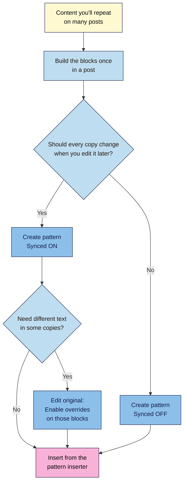
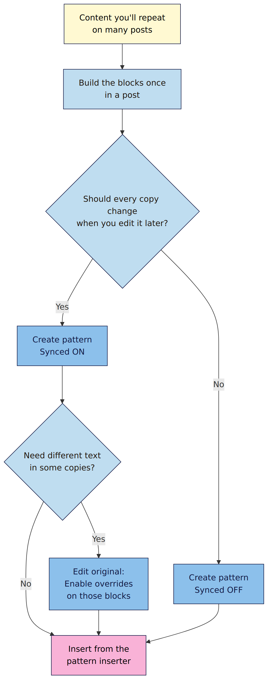

# M02.L02 — Patterns and synced patterns for reusable content
> After this lesson you can drop ready-made layouts into any post, and change a newsletter call-to-action once to update it on every post.

**Time:** ~15 min reading + ~20 min exercise · **Level:** beginner · **Prereqs:** M02.L01
**Verified against:** WordPress 7.1 block editor code (pattern labels, overrides support, shortcuts) and WordPress documentation on patterns, 2026-10-29; re-checked 2026-11-01

> ⚠️ **Freshness flag:** pattern features have changed in most recent releases (reusable blocks became synced patterns in 6.3; overrides arrived in 6.6). Menu positions may differ in your version: press **Ctrl+K / ⌘+K** and type "patterns".

## Learning objectives
1. **Insert** and customise patterns from the pattern library.
2. **Create** a synced pattern (CTA, author box or disclaimer) and update it everywhere at once.
3. **Explain** when to use a synced vs an unsynced pattern.

## Why it matters
Sofia ends every recipe post with "Get my weekly meal plan → Subscribe". When she switched newsletter providers, the sign-up link changed, and she had to open 140 posts one by one. She missed 30, and readers kept clicking a dead link for months. Her friend Daniel had built his CTA as a **synced pattern**: he edited it once, and every post updated in seconds. Anything you'll repeat across many posts (calls to action, author boxes, affiliate disclaimers) should be built once and reused.

## Core concept
**Plain version:** a **pattern** is a saved group of blocks you can insert in one go. A **synced** pattern stays linked: change the original and every copy changes. An **unsynced** pattern is a starting template: once inserted, each copy is independent.

**Analogy:** an unsynced pattern is a photocopy of a form: you fill in each copy differently. A synced pattern is a shared noticeboard: change the notice once and everyone who looks at it sees the new version.

**Precise definitions:**
- **Pattern:** a saved arrangement of blocks (e.g. a heading, paragraph and button). Themes and plugins ship patterns; you can make your own.
- **Synced pattern:** a pattern where every inserted copy shows the same content and design. Editing it (via **Edit original**) updates every post and page that uses it. Formerly called a *reusable block*.
- **Unsynced (regular) pattern:** a pattern copied into the post as normal blocks; changes to one copy don't affect others.
- **Overrides:** an option inside a synced pattern that lets chosen **Paragraph, Heading, Image or Button** blocks (and, since WordPress 7.1, **List item**) have different content in each copy, while the layout and design stay synced.
- **Detach:** turns a copy of a synced pattern back into ordinary blocks, cutting the link to the original.

| | **Synced** | **Unsynced** |
|---|---|---|
| Edit once, updates everywhere | ✅ | ❌ |
| Each copy can be different | Only blocks with overrides enabled | ✅ fully |
| Best for | Newsletter CTA, author box, affiliate disclaimer, sponsor message | Recipe card layout, episode-notes template, "pros and cons" table |

## How it works

**In words:** build the blocks once in a post. If every copy should change when you update it (a sign-up link, a disclaimer), save it as a **synced** pattern. If it's a layout you'll fill in differently each time, save it **unsynced**. If a synced pattern needs slightly different text in some posts (e.g. a CTA headline per topic), enable **overrides** on just those blocks. Then insert it from the pattern inserter wherever you need it.

## Hands-on walkthrough
Work on your **Local** practice site, in the post you published in M02.L01.

**Part A: insert and customise a theme pattern (5 min)**
1. Open your post. Click the **+** (block inserter) in the top bar and choose the **Patterns** tab.
   **Expected:** pattern categories from your theme (e.g. Call to action, Text, Gallery).
   > 🖼️ **Image prompt:** Screenshot of the block inserter's Patterns tab in WordPress 7.1, listing theme pattern categories (Call to action, Text, Gallery…) with a pattern preview showing on hover. Highlight the key element with a 3px #F9B2D7 outline; blur any personal details.
   > **Alt text:** Block inserter Patterns tab listing pattern categories with a preview of a call-to-action pattern.
2. Pick any **Call to action** or **Text** pattern and click it.
   **Expected:** a group of blocks appears in your post.
3. Change its text and swap its image. Open **list view** (**Shift+Alt+O**; Mac: **Ctrl+Option+O**).
   **Expected:** the pattern shows as ordinary blocks (often inside a **Group**), not linked to anything. That's an **unsynced** pattern.
4. Delete it (select the Group in list view, **Shift+Alt+Z**; Mac: **Ctrl+Option+Z**).

**Part B: build a synced newsletter CTA (7 min)**
1. At the end of your post, add:
   - a **Heading** (H3): *Get one new recipe every Friday*
   - a **Paragraph**: *Join 1,000 home cooks. No spam, unsubscribe any time.*
   - a **Buttons** block: *Subscribe*, linked to `https://example.com/subscribe`
2. In list view, select all three blocks (click the first, **Shift**+click the last).
3. Open the **⋮ Options** menu in the block toolbar and choose **Create pattern**.
4. Name it *Newsletter CTA*, pick a category (e.g. Call to action), and leave **Synced** turned **on** ("Sync this pattern across multiple locations"). Click **Add**.
   > 🖼️ **Image prompt:** Screenshot of the Create pattern dialog in WordPress 7.1: Name "Newsletter CTA", Category "Call to action", and the "Synced" toggle switched on and outlined. Highlight the key element with a 3px #F9B2D7 outline; blur any personal details.
   > **Alt text:** Create pattern dialog with the name Newsletter CTA, category Call to action and Synced turned on.
   **Expected:** the three blocks now sit inside one **synced pattern** block, shown with a distinct (often purple) outline and icon.
5. **Update** the post.

**Part C: update it everywhere (3 min)**
1. Create a second test post and insert **Newsletter CTA** from the inserter's **Patterns** tab (it's under **My patterns** or the category you chose). Publish it.
2. In either post, select the CTA and choose **Edit original**. Change the link to `https://example.com/newsletter` and the button text to *Subscribe free*. Save.
3. View both posts.
   **Expected:** both show *Subscribe free* with the new link. You edited once; every copy changed.
   > 🖼️ **Image prompt:** Side-by-side screenshots of two different posts, each ending with the same synced Newsletter CTA showing the button "Subscribe free"; a small inset shows the Edit original button in the pattern's toolbar. Highlight the key element with a 3px #F9B2D7 outline; blur any personal details.
   > **Alt text:** Two posts showing the same updated Subscribe free call to action, with the Edit original button inset.

**Part D: an author box (5 min)**
1. In your first post, add a **Group** containing an **Image** (your photo), a **Heading** (your name) and a **Paragraph** (one line about you).
2. Select the Group → **⋮ Options → Create pattern** → name *Author box*, **Synced** on.
   **Expected:** the author box is now a synced pattern you can add to any post.
3. Find both patterns in one place: **Appearance → Editor → Patterns** (block themes), or the **Manage patterns** link in the pattern inserter.
   **Expected:** *Newsletter CTA* and *Author box* listed under your patterns, marked as synced.

## When to use / when not to
- **Use synced** for anything that must be identical and up to date everywhere: newsletter CTAs, author boxes, affiliate or sponsorship disclaimers (M08), "support my work" boxes. **Trade-off:** one edit changes every post, so a typo goes everywhere too. Preview carefully.
- **Use synced with overrides** when the design must stay consistent but some wording changes per post (e.g. a CTA headline that mentions each post's topic).
- **Use unsynced** for layouts you fill in differently each time: recipe cards, episode-notes templates, comparison tables.
- **Detach** a synced copy only when one post genuinely needs something different and overrides won't do. Detached copies no longer receive updates.

## Use AI for this
**Example prompt:**
> "I run a [niche] site. Suggest 5 reusable content blocks I should save as WordPress patterns (e.g. newsletter CTA, author box, disclaimer). For each, say whether it should be synced or unsynced and why, and draft the text in under 40 words, in a friendly tone for [audience]."

**What AI does well here:** spotting repeated content worth turning into patterns, and drafting short CTA and author-box copy.
**Where it gets it wrong:** it may describe "reusable blocks" menus from older WordPress versions, or claim every block supports overrides (in core it's Paragraph, Heading, Image and Button, plus List item from WordPress 7.1, and a few site-building blocks such as Navigation links).
**How to check:** follow the labels in your own editor (**Create pattern**, **Synced**, **Edit original**), and press **Ctrl+K** to find the patterns screen. Edit AI copy for your voice and check any claims (e.g. "1,000 subscribers") are true.

## Common mistakes
- **Copy-pasting a CTA into every post** instead of making it a synced pattern. Updating later becomes a manual hunt.
- **Making a layout template synced.** Editing one recipe's text then changes every recipe. Use unsynced for templates.
- **Detaching by accident** and wondering why a post didn't update. Re-insert the synced pattern.
- **Editing the original in a hurry.** Changes go live on every post at once; double-check links and spelling.
- **Hard-coding numbers that go stale** ("Join 1,000 readers"). Update them in the synced pattern, or use wording that stays true.

## Troubleshooting
| Symptom | Likely cause | Fix |
|---|---|---|
| No **Create pattern** in the Options menu | No blocks selected, or your role can't create patterns | Select the blocks (or the Group) first; you need Editor or Administrator |
| Editing the CTA in one post didn't update the others | That copy was **detached** or created as **unsynced** | Delete that copy and insert the synced pattern again |
| Can't type in a synced pattern | Synced content is locked except for blocks with overrides | Use **Edit original** to change it everywhere, or enable overrides on that block |
| Can't find your patterns | Different inserter category or menu location in your version | Patterns tab → **My patterns**, or Ctrl+K → "patterns" |
| Pattern looks different on another theme | Patterns use the active theme's styles | Expected; restyle via global styles (M04) |

## Exercise
**Task:** create two synced patterns (*Newsletter CTA* and *Author box*) and one unsynced pattern for a layout you'll repeat (e.g. *Recipe card*, *Episode notes*, *Pros and cons*). Add the CTA and author box to two posts, then change the CTA once and confirm both posts update.
**Expected outcome:** three patterns in your pattern library (two synced, one unsynced), two posts showing the same CTA and author box, and evidence (two screenshots) that one edit updated both.
**Stretch goal:** open the CTA with **Edit original**, select its **Heading**, and in the block's **Advanced** settings choose **Enable overrides** (give it a name). In one post, change the headline to mention that post's topic. Check the other post still shows the default headline, then try **Reset** on the overridden one.

## Key takeaways
- A **pattern** is a saved group of blocks; **synced** copies update together, **unsynced** copies are independent.
- Make repeated, must-be-identical content (CTAs, author boxes, disclaimers) **synced**.
- Make fill-in layouts (recipe cards, episode notes) **unsynced**.
- **Overrides** let chosen Paragraph, Heading, Image, Button (and from 7.1, List item) blocks differ per post while the design stays synced.
- **Edit original** changes every copy at once, so preview before saving.

## Teach it back
Explain to a friend in 3 sentences the difference between a synced and an unsynced pattern, with one example of each from their own site.

## Glossary terms added
- Pattern — added to `wordpress-101/glossary.md`
- Synced pattern — added to `wordpress-101/glossary.md`
- Unsynced pattern — added to `wordpress-101/glossary.md`
- Overrides (synced patterns) — added to `wordpress-101/glossary.md`
- Detach — added to `wordpress-101/glossary.md`
- Call to action (CTA) — added to `wordpress-101/glossary.md`

## Further reading
*All checked 2026-10-29.*
- WordPress documentation — Synced Patterns: https://wordpress.org/documentation/article/reusable-blocks/
- WordPress documentation — Block Pattern Directory and patterns: https://wordpress.org/documentation/article/block-pattern-directory/
- WordPress Developer Blog — An introduction to overrides in synced patterns (2024): https://developer.wordpress.org/news/2024/06/an-introduction-to-overrides-in-synced-patterns/
- WordPress Pattern Directory: https://wordpress.org/patterns/
- Learn WordPress — patterns tutorials: https://learn.wordpress.org/
