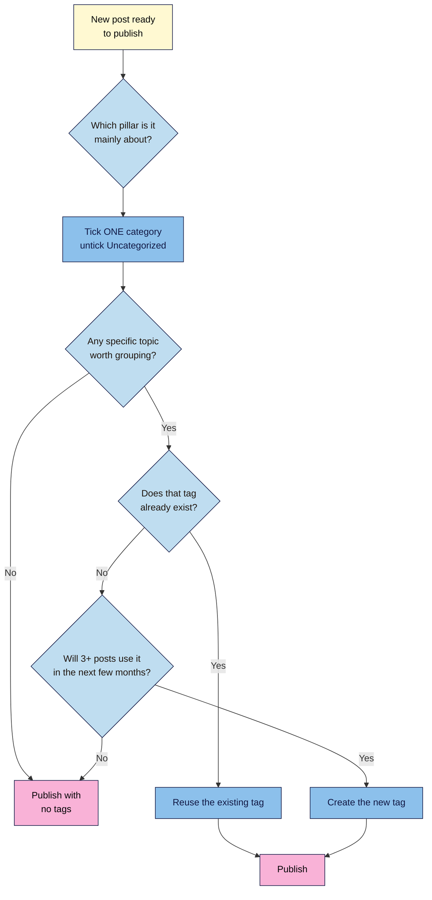

# M02.L03 — Categories vs tags: design a content structure for your niche
> After this lesson you can give every post a clear home with 4–7 categories, and tag posts without creating dozens of empty-looking tag pages.

**Time:** ~15 min reading + ~20 min exercise · **Level:** beginner · **Prereqs:** M02.L01
**Verified against:** WordPress 7.0 core source (screen labels and help text in `edit-tags.php`, taxonomy labels, editor tag hint) and WordPress documentation on 2026-10-31

> ⚠️ **Freshness flag:** recent versions (checked in 7.0) say **Add Category** and **Add Tag**; older versions say "Add New Category" / "Add New Tag". If a label differs in your version, press **Ctrl+K / ⌘+K** and type "categories".

## Learning objectives
1. **Distinguish** categories (the main sections of your site) from tags (cross-cutting topics).
2. **Design** 4–7 categories for your niche that map to your main content pillars.
3. **Set** a simple tagging rule that avoids thin tag archives.

## Why it matters
Meera started a travel blog and tagged everything: *beach*, *beaches*, *Goa beaches*, *sunset*, *budget*, *cheap travel*… Two years later she had 38 posts and 410 tags, most used once. Her site had hundreds of tag pages showing a single post each, her menu had nothing sensible to link to, and readers who loved her Kerala posts couldn't find the rest. Her friend Kwame set up six categories on day one (*Destinations*, *Itineraries*, *Budget Travel*, *Food*, *Gear*, *Tips*) and a short tag rule. His menu links to six clear sections, and every section page fills up month by month. Structure decided on day one costs ten minutes; fixing it after 100 posts costs a weekend.

## Core concept
**Plain version:** **categories** are the main sections of your site, like the sections of a newspaper. Every post goes in one. **Tags** are optional labels for specific topics that cut across sections, like an index at the back of a book.

**Analogy:** your site is a supermarket. Categories are the **aisles** (Dairy, Bakery, Produce): every product sits in one aisle, and there are only a handful. Tags are the **shelf stickers** (*gluten-free*, *on offer*, *local*): they help shoppers find things across aisles, but a sticker that appears on one product is pointless.

**Precise definitions:**
- **Taxonomy:** a way of grouping content. WordPress has two built in for posts: categories and tags.
- **Category:** a hierarchical taxonomy (it can have parent and child categories). In WordPress's own words, categories "define sections of your site and group related posts". Every post has at least one; if you choose none, it gets the **default category**.
- **Default category:** the category WordPress gives a post when you don't pick one. On a new site it's **Uncategorized**. It can't be deleted, but you can rename it or choose a different default in **Settings → Writing → Default Post Category**.
- **Tag:** a flat (non-hierarchical), optional label for a specific topic, e.g. a key ingredient, a place, or a recurring series.
- **Archive page:** the page WordPress builds automatically for each category and tag, listing its posts, e.g. `/category/recipes/` and `/tag/paneer/`.
- **Content pillar:** one of the 4–7 big themes your site is about. Each pillar becomes a category.

| | **Categories** | **Tags** |
|---|---|---|
| Purpose | Main sections (your content pillars) | Specific cross-cutting topics |
| Required? | Yes: every post has at least one | No |
| How many on the site | 4–7 to start | Grows slowly, by your tag rule |
| How many per post | 1 (occasionally 2) | 0–3 |
| Hierarchy | Can have parents and children | Flat |
| Typical use | Menu items, section pages | "More on this topic" links, series |

**Why it matters for search (in plain terms):** Google's SEO Starter Guide recommends organising your site "in a logical way" because it helps search engines and readers understand how your pages relate. Category pages also give you natural internal links between related posts (you'll build on this in M05). Large numbers of near-empty tag pages add little for readers; that is observed practice, not a Google rule. M05 shows how your SEO plugin can keep thin archives out of search results.

## How it works

**In words:** every post gets **one** category: the pillar it's mainly about. Then ask whether a specific topic is worth grouping. Reuse a tag if it exists. Create a new tag only if at least three posts will use it soon. Otherwise, publish without tags: that's fine.

## Hands-on walkthrough
Work on your **Local** practice site, using the posts you published in M02.L01 and M02.L02.

**Part A: sketch your category map (5 min)**
1. List 10–15 post ideas you'll realistically write in the next six months.
2. Group them into piles of similar posts. Aim for **4–7 piles**; merge piles with fewer than ~5 ideas.
3. Name each pile with a short, plain noun that a reader would understand from your menu. Fill in this table:

| Pillar / category | Slug | Description (1–2 sentences, for readers) | 3 example posts |
|---|---|---|---|
| *Recipes* | `recipes` | *Weeknight Indian recipes that take 30 minutes or less.* | *Paneer butter masala; …* |
| | | | |

   **Expected:** 4–7 rows; every post idea fits clearly into **one** row.

**Part B: rename "Uncategorized" (3 min)**
1. Go to **Posts → Categories**. Hover over **Uncategorized** and click **Edit**.
2. Change **Name** to your first pillar (e.g. *Recipes*), **Slug** to `recipes`, and add the **Description** from your table. Click **Update**.
   **Expected:** a "Category updated." message. The category list shows *Recipes*, with your existing posts counted against it, because they were in Uncategorized.

> Prefer a different default? After Part C, go to **Settings → Writing** and choose any category under **Default Post Category**.

**Part C: create the other categories (5 min)**
1. Still on **Posts → Categories**, use the **Add Category** form on the left:
   - **Name:** e.g. *Meal Prep*
   - **Slug:** `meal-prep` (lowercase, hyphens, short)
   - **Parent Category:** None (keep it flat for now)
   - **Description:** the sentence from your table
2. Click **Add Category**. Repeat for each row of your map.
   **Expected:** each category appears in the list on the right with a count of 0.
   > 🖼️ **Image prompt:** Screenshot of Posts → Categories in WordPress 7.0, with the Add Category form filled in (Name "Meal Prep", Slug "meal-prep", Parent Category "None", a one-sentence description) and the category list on the right showing Recipes, Quick Dinners and Festive Sweets with post counts. Highlight the key element with a 3px #F9B2D7 outline; blur any personal details.
   > **Alt text:** Add Category form filled in for Meal Prep, next to a list of the site's categories and their post counts.

**Part D: file a post and tag it (5 min)**
1. Open *My first real post* from M02.L01. Open the settings sidebar (**Ctrl+Shift+,**) and choose the **Post** tab.
2. In the **Categories** panel, tick the one category it belongs to, and make sure no other category is ticked.
3. In the **Tags** panel, start typing a tag (e.g. *pan…*). WordPress suggests matching tags that already exist: pick one instead of creating a near-duplicate. If none fits and your tag rule allows a new one, finish typing *paneer* and press **Enter** (the hint says "Separate with commas or the Enter key."). Add at most one or two.
   **Expected:** the tags appear as small chips under the field.
   > 🖼️ **Image prompt:** Screenshot of the WordPress 7.0 block editor's settings sidebar, Post tab, with the Categories panel (one category ticked) and the Tags panel showing two tag chips, "paneer" and "weeknight". Highlight the key element with a 3px #F9B2D7 outline; blur any personal details.
   > **Alt text:** Post settings sidebar with one category ticked and two tags added.
4. Click **Save** (or **Update**), then visit `/category/recipes/` (use your own slug) and `/tag/paneer/`.
   **Expected:** each archive page lists the post. Your theme may also show the category description at the top.

**Part E: write your tagging rule (2 min)**
To see which tags you already have and how many posts each holds, open **Posts → Tags** and sort by the **Count** column. Then write this somewhere you'll see it every time you publish (e.g. a pinned note or your publishing checklist):
> **Tag rule:** reuse an existing tag first. Create a new tag only if 3+ posts will use it within a few months. Max 3 tags per post. Singular, lowercase (*paneer*, not *Paneer Recipes*).

## When to use / when not to
- **Use categories** for the handful of big sections you want in your menu and want every post to belong to.
- **Use tags** for specific topics, ingredients, places or series that span categories and will collect several posts (e.g. *diwali* across *Recipes* and *Meal Prep*).
- **Don't use tags** as hashtags or keyword lists. One-off tags create archive pages with a single post, which help nobody.
- **Use child categories** only when a pillar grows past ~30 posts and splits naturally (e.g. *Recipes → Vegetarian*). **Trade-off:** hierarchy makes your menu richer but adds decisions every time you publish. Start flat; you can add children later without changing post URLs, because your permalinks use **Post name** (M01.L04).

## Use AI for this
**Example prompt:**
> "I run a [niche] site for [audience]. Here are 15 post ideas: [list]. Group them into 4–7 WordPress categories (my content pillars). For each category, give a short plain-English name, a lowercase slug and a one-sentence description for readers. Then suggest at most 8 tags that would each apply to 3 or more of these posts. Flag any post that doesn't fit one category clearly."

**What AI does well here:** spotting groups in a messy list of ideas, naming them, and drafting short category descriptions.
**Where it gets it wrong:** it often proposes too many categories (10–20), overlapping ones (*Tips* and *Guides*), or tags for every keyword. It may also claim tags "boost rankings", which isn't something Google says.
**How to check:** every category should hold ~5+ of your planned posts, no post should fit two categories equally, and every suggested tag should apply to 3+ posts. Cut anything that fails.

## Common mistakes
- **Leaving posts in "Uncategorized".** It tells readers (and you) nothing. Rename it to a real pillar.
- **Too many categories.** Fifteen categories with two posts each is a tag list in disguise. Start with 4–7.
- **Ticking several categories per post** "to be safe". The post then shows up in several sections and your sections stop meaning anything. One is the default; two is the exception.
- **Tag sprawl:** near-duplicates (*recipe*, *recipes*, *Recipe Ideas*) and one-off tags. Reuse before you create.
- **Using the same word as a category and a tag** (category *Recipes*, tag *recipes*). You get two archive pages listing almost the same posts, which confuses readers. Pick one.
- **Renaming a category's slug after launch** without a redirect. The category archive URL changes and old links to it break (your post URLs don't change, thanks to Post name permalinks). M05 covers redirects.

## Troubleshooting
| Symptom | Likely cause | Fix |
|---|---|---|
| There's no **Delete** link for Uncategorized | It's the default category, and the default can't be deleted | Rename it (Part B), or choose another default in **Settings → Writing** |
| A post still shows in Uncategorized | It's ticked alongside your real category, or no category was ticked so WordPress added the default | Untick it in the post's Categories panel, or use **Quick Edit** in **Posts → All Posts** |
| `/category/your-slug/` shows "Not Found" | A typo in the slug, or permalinks need refreshing | Check the slug in **Posts → Categories**; then **Settings → Permalinks → Save Changes** |
| The category description doesn't show on the archive page | Your theme doesn't display it ("some themes may display it", per WordPress) | Fine for now; with a block theme you can add the **Term Description** block to the Archive template (M04) |
| Duplicate tags (*recipe* and *recipes*) | No tag rule | In **Posts → All Posts**, click the tag you'll delete in the **Tags** column to list its posts, select all, **Bulk actions → Edit**, add the tag you're keeping, **Update**; then delete the duplicate in **Posts → Tags** |
| You want to turn some tags into categories (or vice versa) | Structure changed as the site grew | **Tools → Import → Categories and Tags Converter** (installs a free WordPress.org importer) |

## Exercise
**Task:** finish your category map (Part A) and create **all** your categories with descriptions on your practice site, with Uncategorized renamed. Write and publish two short new test posts, each in a different category, and give one tag to both of them following your tag rule.
**Expected outcome:** 4–7 categories with descriptions in **Posts → Categories**; no post left in Uncategorized; one tag whose archive page (`/tag/…/`) lists two posts; your written tag rule.
**Stretch goal:** add a **Terms List** block (older versions call it *Categories List*; type `/terms` or `/categories`) to a test page (or your sidebar/footer if your theme has one), with **Show post counts** turned on, so readers can browse by section. Note which categories look thin; that tells you what to write next.

## Key takeaways
- **Categories = sections** (4–7 content pillars, one per post). **Tags = specific cross-cutting topics** (optional, reused).
- Rename **Uncategorized** on day one; the default category can't be deleted, only renamed or replaced.
- Give every category a short reader-facing **description**.
- Follow a **tag rule**: reuse first, new tag only if 3+ posts will use it, max 3 per post.
- Post name permalinks mean you can reorganise categories later without changing post URLs.

## Teach it back
Explain to a friend in 3 sentences the difference between a category and a tag, using the supermarket aisle and shelf sticker example and one category and one tag from your own site.

## Glossary terms added
- Taxonomy — added to `wordpress-101/glossary.md`
- Category — added to `wordpress-101/glossary.md`
- Default category — added to `wordpress-101/glossary.md`
- Tag — added to `wordpress-101/glossary.md`
- Archive page (category / tag) — added to `wordpress-101/glossary.md`
- Content pillar — added to `wordpress-101/glossary.md`

## Further reading
*All checked 2026-10-31.*
- WordPress documentation — Posts Categories Screen: https://wordpress.org/documentation/article/posts-categories-screen/
- WordPress documentation — Posts Tags Screen: https://wordpress.org/documentation/article/posts-tags-screen/
- WordPress documentation — Settings Writing Screen (Default Post Category): https://wordpress.org/documentation/article/settings-writing-screen/
- WordPress Developer Resources — Categories, tags and custom taxonomies: https://developer.wordpress.org/themes/basics/categories-tags-custom-taxonomies/
- Google Search Central — SEO Starter Guide ("Organize your site"): https://developers.google.com/search/docs/fundamentals/seo-starter-guide
- Google Search Central — Creating helpful, reliable, people-first content: https://developers.google.com/search/docs/fundamentals/creating-helpful-content
- Categories and Tags Converter (official importer): https://wordpress.org/plugins/wpcat2tag-importer/
