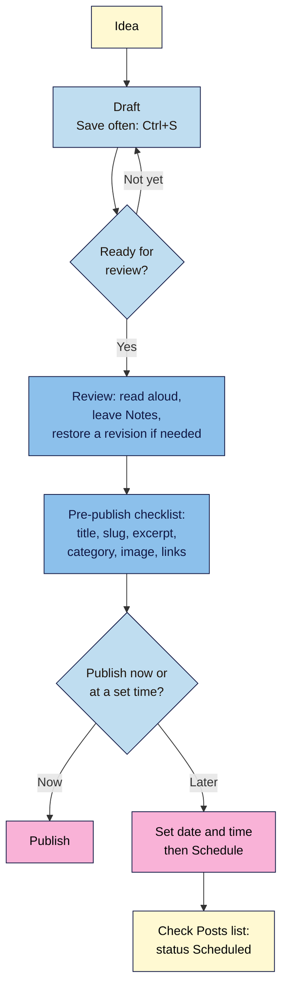

# M02.L04 — Drafts, revisions, scheduling and an editorial workflow
> After this lesson you can undo any bad edit with revisions, schedule posts to publish while you sleep, and run the same pre-publish checklist every time.

**Time:** ~14 min reading + ~15 min exercise · **Level:** beginner · **Prereqs:** M02.L03
**Verified against:** WordPress 7.0 core source (editor status, scheduling, pre-publish, revisions and Notes labels; `WP_POST_REVISIONS` and `AUTOSAVE_INTERVAL` defaults) and WordPress documentation on 2026-10-31

> ⚠️ **Freshness flag:** the post summary panel and Notes (added in WordPress 6.9) are still changing between releases. If a label or position differs in your version, press **Ctrl+K / ⌘+K** and search for it.

## Learning objectives
1. **Restore** an earlier version of a post from its revisions.
2. **Schedule** a post for a future date and time in your site's timezone.
3. **Run** a repeatable pre-publish checklist (title, slug, excerpt, category, featured image, links).

## Why it matters
Lena runs a fitness blog with a weekly Tuesday post and a monthly sponsored review. One Monday night she pasted the wrong draft over a finished post, saved, and closed the tab. The next month she clicked **Publish** on the sponsored review at 11 pm, three days before the brand's embargo lifted, with the link to the old product page. Both problems take two minutes to prevent: **revisions** brought back her finished post in one click, **scheduling** would have published the review at the agreed time, and a five-line **pre-publish checklist** would have caught the wrong link. Creators who publish on a steady rhythm almost all work this way.

## Core concept
**Plain version:** every post moves through a few **statuses** (draft, pending, scheduled, published). While you write, WordPress keeps **revisions**: snapshots of the post each time you save, so you can go back. **Scheduling** sets a future date and time, and WordPress publishes the post for you then. An **editorial workflow** is simply the same steps in the same order every time.

**Analogy:** revisions are your phone's photo history of a whiteboard: wipe the board, and you can still copy back yesterday's version. Scheduling is a timed email: you finish it today, and it goes out on Tuesday at 7 am.

**Precise definitions** (status descriptions are WordPress's own):
- **Draft:** "Not ready to publish." Only people who can edit the post can see it.
- **Pending:** "Waiting for review before publishing." Contributors use **Submit for Review** to put posts here (M01.L05).
- **Scheduled:** "Publish automatically on a chosen date." The post goes live at that date and time, in the timezone you set in M01.L04.
- **Published:** "Visible to everyone."
- **Private:** "Only visible to site admins and editors." Useful for internal notes, not a substitute for drafts.
- **Revision:** a saved copy of a post's title, content and excerpt. WordPress stores one each time you save a draft or update a published post, and by default keeps **all** of them (`WP_POST_REVISIONS` is `true`).
- **Autosave:** a temporary copy WordPress saves about every 60 seconds while you type. There's only one per user per post, and it's replaced each time.
- **WP-Cron:** WordPress's task scheduler, which publishes scheduled posts. It only runs **when someone loads a page** on your site, so on a site with no visitors a scheduled post can be late (**Missed schedule**).
- **Note:** a comment attached to a block inside the editor (WordPress 6.9+), for feedback such as "check this link". Readers never see notes.

## How it works

**In words:** draft and save often. When it's ready, review it (fix with revisions if an edit went wrong, and leave yourself notes). Run the pre-publish checklist. Then publish now, or set a date and time and schedule it. Finally, check the Posts list shows **Scheduled**.

## Hands-on walkthrough
Work on your **Local** practice site.

**Part A: create some revisions (4 min)**
1. **Posts → Add Post.** Title: *5 pantry staples for weeknight curries*. Write two short paragraphs. Press **Ctrl+S**.
   **Expected:** "Saved" appears near the top, and the post stays a **Draft**.
2. Add a third paragraph and press **Ctrl+S**. Then **delete the first paragraph** (pretend it was a mistake) and press **Ctrl+S** again.
   **Expected:** in the settings sidebar (**Ctrl+Shift+,**), **Post** tab, a **Revisions** item now appears with a count (e.g. 3). If you don't see it yet, save once more: it only appears once the post has at least two revisions.

**Part B: restore a revision (4 min)**
1. Click **Revisions** in the sidebar.
   **Expected:** the revisions screen opens, with a slider at the top and the old version on the left, new on the right (removed text in red, added text in green).
   > 🖼️ **Image prompt:** Screenshot of the WordPress 7.0 revisions screen: slider at the top with several revision markers, "Compare any two revisions" checkbox, two columns with a deleted paragraph highlighted red on the left, and the "Restore This Revision" button. Highlight the key element with a 3px #F9B2D7 outline; blur any personal details.
   > **Alt text:** Revisions screen comparing two versions of a post, with removed text in red and the Restore This Revision button.
2. Drag the slider to the version that still has your first paragraph.
3. Click **Restore This Revision**.
   **Expected:** you're back in the editor and the first paragraph is back. Restoring creates a **new** revision, so you can undo the restore too.
4. Optional: tick **Compare any two revisions** to compare any two versions, not just neighbours.

**Part C: leave a note for later (2 min)**
1. Select the second paragraph. Open its **⋮ Options** menu in the block toolbar and choose **Add note**.
2. Type *Check the price of garam masala before publishing*, and post the note.
   **Expected:** the paragraph shows a note marker. Notes are visible only in the editor, to people who can edit the post.
3. When you've dealt with it, mark the note as **resolved**.

**Part D: run the pre-publish checklist (3 min)**
Copy this checklist somewhere you'll use it every time (a pinned note, or a draft titled *Checklist* that you never publish):

| # | Check | Where in WordPress |
|---|---|---|
| 1 | **Title** is clear and says what the reader gets | Top of the editor |
| 2 | **Slug** is short, lowercase, no dates or stop words (e.g. `pantry-staples-curries`) | Sidebar → **Post** tab → **Link** (or **Slug**) |
| 3 | **Excerpt**: one or two sentences that make someone want to click | Sidebar → **Post** tab → excerpt field |
| 4 | **Category**: exactly one (M02.L03), plus tags only by your tag rule | Sidebar → **Categories** / **Tags** |
| 5 | **Featured image** set (proper sizing and alt text come in M03) | Sidebar → **Add a featured image** |
| 6 | **Links**: every link opens the right page; affiliate/sponsor links disclosed (M08) | Click each link → **Preview in new tab** |
| 7 | **Notes** resolved, and the post read once in **Preview** on a phone-sized window | Top bar → **Preview** |

   **Expected:** every row ticked. If one fails, fix it now: after publishing, mistakes go out by RSS and email.

**Part E: schedule it (2 min)**
1. In the sidebar's **Post** tab, find **Publish** (it says **Immediately**). Click it.
2. In the date picker, choose **tomorrow at 07:00**. This is your **site's** time (the timezone you set in **Settings → General** in M01.L04), not necessarily your computer's.
   **Expected:** the main button in the top bar changes from **Publish** to **Schedule**.
3. Click **Schedule**. A panel opens: "Are you ready to schedule?" / "Your work will be published at the specified date and time." Click **Schedule** again.
   **Expected:** "*5 pantry staples for weeknight curries* is now scheduled. It will go live on" followed by tomorrow's date and time.
4. Go to **Posts → All Posts**.
   **Expected:** the post is listed as **Scheduled** with tomorrow's date and time.
   > 🖼️ **Image prompt:** Screenshot of Posts → All Posts in WordPress 7.0, showing the post "5 pantry staples for weeknight curries" with the status "Scheduled" and tomorrow's date at 7:00 am in the Date column. Highlight the key element with a 3px #F9B2D7 outline; blur any personal details.
   > **Alt text:** Posts list showing a post with status Scheduled for 7:00 am tomorrow.
5. To change your mind later: open the post, click the date to change it, or open **Status** and choose **Draft** to unschedule it.

> **On Local:** nobody visits your Local site, so a scheduled post publishes the next time **you** load any page after 07:00. That's WP-Cron working as designed. On a live site with visitors, it's usually on time; M07 shows how to make it reliable with a real server cron job.

## When to use / when not to
- **Schedule** anything with a fixed time (a sponsor's embargo, a launch, your weekly slot) or anything finished early. Writing in batches and scheduling is how most solo creators keep a steady rhythm.
- **Publish immediately** for news and replies to something happening now.
- **Use Pending + Submit for Review** when someone else writes for you (a Contributor) and you publish.
- **Use revisions** to recover from mistakes, **not** as your backup: revisions live in the same database, so if the site is lost, they're lost too (M01.L05 backups cover that).
- **Trade-off:** unlimited revisions are safe but make the database grow on sites with thousands of heavily edited posts. On a creator site this rarely matters; if your host recommends a limit, it can be set in `wp-config.php` (M07).

## Use AI for this
**Example prompt:**
> "Here is my draft blog post: [paste]. Act as my editor. Check it against this checklist and list problems only: (1) does the title say what the reader gets, (2) suggest a short URL slug, (3) write a 1–2 sentence excerpt under 155 characters, (4) list every factual claim or price I should double-check, (5) list every link and what it should point to. Don't rewrite the post."

**What AI does well here:** drafting excerpts and slugs, spotting unclear titles, and listing claims you should check.
**Where it gets it wrong:** it can't click your links or see your WordPress settings (category, featured image, schedule), and it may "correct" facts with confident wrong ones. Asked to rewrite, it flattens your voice.
**How to check:** use its list as a to-do, then verify each item yourself in WordPress and in **Preview**. Never paste a sponsor's confidential details into a public AI tool.

## Common mistakes
- **Clicking Publish "just to see how it looks".** Use **Preview** instead: once published, the post goes out in your RSS feed and to any newsletter that sends new posts automatically.
- **Scheduling in the wrong timezone.** If your site still uses a UTC offset or the wrong city, the post goes out hours early or late. Fix the timezone first (M01.L04).
- **Panicking after a bad edit** and rewriting from memory. Open **Revisions** and restore.
- **Changing the slug after publishing.** WordPress usually redirects the old address to the new one, but your newsletter, social posts and other people's links keep showing the old URL, and redirect chains build up if you do it often. Get it right in the checklist (redirects are covered in M05).
- **Treating Private as a draft.** Private posts look "published" to logged-in editors and can confuse your workflow; keep unfinished work as **Draft**.

## Troubleshooting
| Symptom | Likely cause | Fix |
|---|---|---|
| No **Revisions** item in the sidebar | Only one saved version exists, or revisions are turned off by your host | Save the post again; if it still doesn't appear, ask your host whether `WP_POST_REVISIONS` is set to `0` |
| "There is an autosave of this post that is more recent than the version below" | The browser closed or crashed before you saved | Click **View the autosave**, compare, and restore it if it has your latest work |
| Post shows **Missed schedule** | WP-Cron didn't run at that time (no visitors, or caching blocked it) | Publish it manually now; for live sites, set up a real cron job (M07) |
| Scheduled post went out at the wrong time | Site timezone wrong, or you picked a.m./p.m. incorrectly | Check **Settings → General → Timezone**; re-check the time on the next one |
| Button says **Publish** although you set a date | The date you chose is in the past (in the site's timezone) | Pick a future date and time; the button changes to **Schedule** |
| No **Add note** option | WordPress older than 6.9, or the block can't take notes (e.g. a Classic block) | Update WordPress (M07), or convert the Classic block to blocks |

## Exercise
**Task:** write a real (short) post for your niche. Save at least three versions, restore one, leave and resolve one note, run the 7-point pre-publish checklist, and schedule it for your next "publishing slot" (pick a day and time you could keep every week).
**Expected outcome:** a post with status **Scheduled** in **Posts → All Posts**, at least 3 revisions, a completed checklist, and a written publishing slot (e.g. *Tuesdays 07:00 IST*).
**Stretch goal:** write a second post, schedule it one week after the first, and change the order (swap their dates) without unpublishing anything. Then look at **Posts → All Posts → Scheduled** to see your two-week content calendar.

## Key takeaways
- Statuses: **Draft** (not ready) → **Pending** (waiting for review) → **Scheduled** (goes live at a set time) → **Published**.
- **Revisions** let you restore any saved version; restoring is itself undoable. They aren't backups.
- **Schedule** in your site's timezone; on low-traffic sites WP-Cron can publish late.
- Run the same **7-point pre-publish checklist** every time: title, slug, excerpt, category, featured image, links, preview.
- Use **Preview**, never Publish, to see how a post looks.

## Teach it back
Explain to a friend in 3 sentences how revisions and scheduling would have saved Lena both times, and what your own publishing slot is.

## Glossary terms added
- Post status (Draft, Pending, Scheduled, Published, Private) — added to `wordpress-101/glossary.md`
- Revision — added to `wordpress-101/glossary.md`
- Autosave — added to `wordpress-101/glossary.md`
- WP-Cron — added to `wordpress-101/glossary.md`
- Missed schedule — added to `wordpress-101/glossary.md`
- Notes (editor) — added to `wordpress-101/glossary.md`
- Pre-publish checklist — added to `wordpress-101/glossary.md`

## Further reading
*All checked 2026-10-31.*
- WordPress documentation — Revisions: https://wordpress.org/documentation/article/revisions/
- WordPress documentation — Post status: https://wordpress.org/documentation/article/post-status/
- WordPress documentation — Settings Sidebar (block editor): https://wordpress.org/documentation/article/settings-sidebar/
- WordPress Developer Resources — Cron (how WP-Cron runs on page load): https://developer.wordpress.org/plugins/cron/
- Make WordPress Core — Notes feature in WordPress 6.9 (2025): https://make.wordpress.org/core/2025/11/15/notes-feature-in-wordpress-6-9/
