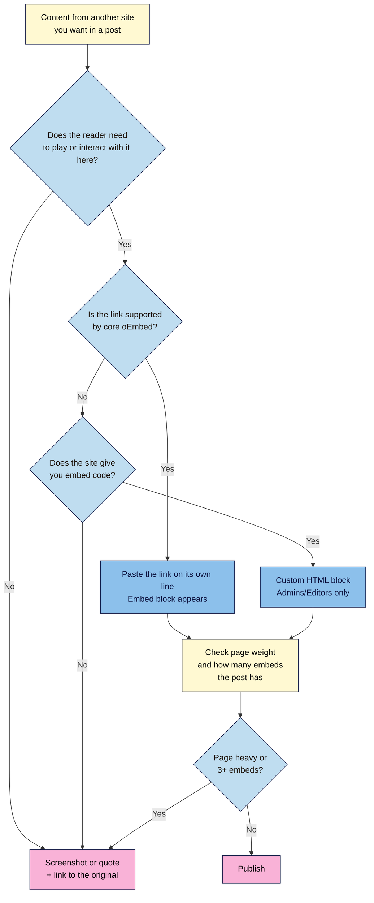

# M02.L05 — Embeds: YouTube, podcasts, social posts and newsletters
> After this lesson you can embed videos, podcast episodes and social posts by pasting a link, measure what each embed costs your readers, and know when a screenshot with a link is the better choice.

**Time:** ~15 min reading + ~15 min exercise · **Level:** beginner · **Prereqs:** M02.L01
**Verified against:** WordPress 7.0 core source (oEmbed provider list in `class-wp-oembed.php`, Embed block labels, iframe lazy loading) and YouTube Help on 2026-10-31

> ⚠️ **Freshness flag:** which sites embed automatically changes between WordPress releases, and social platforms change their embed rules often (Instagram and Facebook were removed from core in 5.5.2; Bluesky was added in 6.6). Check the WordPress **Embeds** documentation for the current list.

## Learning objectives
1. **Embed** a YouTube video, a podcast episode and a social post using embed blocks.
2. **Explain** the privacy and performance cost of third-party embeds.
3. **Choose** between an embed and a linked screenshot for heavy or tracking-heavy content.

## Why it matters
Ravi reviews budget phones. Each review embedded his YouTube video, two X posts from the brand, an Instagram reel and a podcast clip. Readers on mobile data waited for a blank white page while five other companies' players and scripts loaded, and his European readers' cookie banner (M08) had to list services he'd forgotten he used. When he replaced the social posts with screenshots linking to the originals and kept one video, his review pages loaded noticeably faster and nothing was lost: readers could still click through. Embeds are powerful: one pasted link puts your video or podcast right in the post. But every embed is a small piece of someone else's website running inside yours.

## Core concept
**Plain version:** an **embed** shows content from another site (a YouTube video, a Spotify episode, a Bluesky post) inside your post. In WordPress you usually just **paste the link** on its own line, and WordPress turns it into a player or post card.

**Analogy:** an embed is a window in your wall that looks into a neighbour's house. It's convenient, but the neighbour decides what's in the window, can see who's looking, and if they move out the window goes blank. A **screenshot with a link** is a photo of that view, plus directions to the house: it's yours, it's light, and it never goes blank.

**Precise definitions:**
- **oEmbed:** the standard that lets WordPress ask a site like YouTube "how do I display this link?" and get back the player code. WordPress has a built-in list of trusted **oEmbed providers**.
- **Embed block:** the block WordPress creates when you paste a supported link (YouTube, Vimeo, Spotify, SoundCloud, TikTok, Bluesky, Reddit, Pinterest, Pocket Casts, Canva and others). You can also insert it with `/youtube`, `/spotify`, etc.
- **Third-party request:** anything your page loads from another company's servers. Each embed usually brings its own scripts, fonts, images and often **cookies** or tracking.
- **Page weight:** the total size of everything a page downloads, shown in your browser's developer tools as "transferred".
- **Privacy Enhanced Mode (YouTube):** a YouTube player served from `youtube-nocookie.com`. Per YouTube, views in this mode aren't used to personalise the viewer's YouTube experience or ads. It still loads from Google's servers, so it reduces, but doesn't remove, third-party data.
- **Custom HTML block:** a block for pasting embed code a site gives you (e.g. a newsletter sign-up form). On a single site, only **Administrators** and **Editors** can save code like this; Authors can't.

**What core WordPress embeds today** (checked in 7.0):

| You want to embed | Paste the link? | Notes |
|---|---|---|
| YouTube, Vimeo, TED | ✅ | Video player |
| Spotify, SoundCloud, Mixcloud, Pocket Casts | ✅ | Podcast/music player; use the **episode** link |
| Bluesky, Reddit, Tumblr, TikTok, Pinterest | ✅ | Post card |
| X (Twitter) | ⚠️ only `twitter.com/…/status/…` links | Core doesn't recognise `x.com` links; change `x.com` to `twitter.com` in the link, or use a screenshot |
| Instagram, Facebook | ❌ removed in WordPress 5.5.2 | Use the platform's own embed code in a Custom HTML block, or a screenshot + link |
| Apple Podcasts | ❌ not a core provider | Link to the episode, or embed the same episode from Spotify, Pocket Casts or SoundCloud |
| Newsletter sign-up (Substack, Kit, etc.) | ❌ | Paste the tool's embed code into a Custom HTML block (M06.L02 covers sign-up forms properly) |

## How it works

**In words:** first ask whether readers need to play or interact with the content inside your post. If not, a screenshot (or short quote) with a link is lighter and never breaks. If they do, paste the link; if WordPress doesn't support it, use the site's embed code in a Custom HTML block. Then check the page weight: if the post is heavy or has several embeds, swap the least important ones for screenshots.

## Hands-on walkthrough
Work on your **Local** practice site, in **Chrome, Edge or Firefox** on a computer. Your computer needs to be online (the embeds load from the internet).

**Part A: embed a video and a podcast (4 min)**
1. **Posts → Add New Post.** Title: *Embed test*. Add one short paragraph.
2. On a new empty line, paste a YouTube video link (e.g. one of your own, or any `https://www.youtube.com/watch?v=…` link) and press **Enter**.
   **Expected:** the link turns into a **YouTube** embed block showing the video player.
   > 🖼️ **Image prompt:** Screenshot of the WordPress 7.0 block editor with a YouTube embed block selected, showing the video player in the post, the block toolbar, and the settings sidebar with "Media settings" → "Resize for smaller devices" turned on. Highlight the key element with a 3px #F9B2D7 outline; blur any personal details.
   > **Alt text:** A YouTube embed block in the editor, with the Resize for smaller devices setting turned on in the sidebar.
3. Select the block and open the settings sidebar (**Ctrl+Shift+,**). Under **Media settings**, leave **Resize for smaller devices** on, so the player fits phones.
4. Click below the video, type `/spotify` (or `/soundcloud` or `/pocket casts`), press **Enter**, paste a podcast **episode** link, and click **Embed**.
   **Expected:** an episode player appears.

**Part B: embed a social post (3 min)**
1. Find a public post on **Bluesky** (`https://bsky.app/profile/…/post/…`) or **Reddit**. Paste its link on an empty line and press **Enter**.
   **Expected:** a post card with the author, text and date.
2. Try an **X** post link starting with `https://x.com/…`.
   **Expected:** it may stay a plain link or show "Sorry, this content could not be embedded." Click **Convert to link** to keep it as a normal link, or change `x.com` to `twitter.com` in the link and try again.
3. **Save draft**, then click **Preview → Preview in new tab**.
   **Expected:** all embeds display in the preview.

**Part C: measure page weight (6 min)**
1. In the preview tab, press **F12** (or **Ctrl+Shift+I** / **⌘+Option+I**) to open developer tools, and choose the **Network** tab.
2. Tick **Disable cache**, then reload the page (**Ctrl+R** / **⌘+R**). Wait until it stops loading.
3. Read the summary bar at the bottom: *N requests · X kB (or MB) transferred*. Write down both numbers.
   **Expected:** many more requests than you'd guess, including domains like `youtube.com`, `googlevideo.com`, `ytimg.com`, `spotify.com` or `bsky.app`. In Chrome or Edge, type `-domain:priyacooks.local` (your own site's address) in the filter box to see only third-party requests.
   > 🖼️ **Image prompt:** Screenshot of Chrome DevTools' Network tab on a WordPress post preview with embeds, "Disable cache" ticked, the request list showing third-party domains (youtube.com, ytimg.com, spotify.com), and the bottom summary bar showing requests and MB transferred. Highlight the key element with a 3px #F9B2D7 outline; blur any personal details.
   > **Alt text:** Browser network panel listing third-party requests from embeds, with the total requests and data transferred at the bottom.
4. Now open *My first real post* from M02.L01 (no embeds) and repeat steps 2–3.
5. Fill in:

| Post | Requests | Transferred | Third-party domains |
|---|---|---|---|
| *My first real post* (no embeds) | | | |
| *Embed test* (3 embeds) | | | |

   **Expected:** the embed post makes several times more requests and downloads more data, almost all of it from other companies. (Exact numbers vary by browser, network and embed.)

**Part D: swap one embed for a screenshot + link (2 min)**
1. Take a screenshot of **your own** social post. (For other people's posts, quote one short line and link to it instead: screenshots of others' work raise copyright questions, covered in M08.L05.)
2. In *Embed test*, replace the social embed with an **Image** block: upload the screenshot, write alt text that says what the post says, and link the image to the original post with the **Link** button in the image block's toolbar.
3. Add a one-line caption, e.g. *Via @priyacooks on Bluesky*. **Save draft**, preview, and measure again.
   **Expected:** fewer requests and fewer third-party domains, and the content is still there.

## When to use / when not to
- **Embed** your own videos and podcast episodes when readers are likely to play them on the page. Usually one main embed per post is plenty.
- **Use a screenshot (of your own posts) or a short quote + link (for other people's)** for social posts that are just "evidence" (a brand's announcement, a funny reply), anything from platforms that need extra code (Instagram, Facebook), and posts that could be deleted. Screenshots don't break if the original is deleted, and they don't load trackers.
- **Use Privacy Enhanced Mode** (`youtube-nocookie.com`) for YouTube if you care about privacy or want to reduce what your cookie notice must cover (M08). Core's YouTube embed uses `youtube.com`; for no-cookie mode, paste YouTube's embed code with the domain changed in a Custom HTML block, or use a privacy plugin (vetting plugins is M06.L01).
- **Trade-off:** embeds keep readers on your page and update automatically; screenshots are faster, private and permanent but static, and readers must click to play. WordPress adds `loading="lazy"` to iframes in your content (since 5.7), so embeds further down a post usually load only when readers scroll near them, but an embed near the top always loads straight away.

## Use AI for this
**Example prompt:**
> "Here's the outline of my blog post with the embeds I planned: [outline, with each embed noted]. For each embed, say whether a reader really needs to play or interact with it inside the post, or whether a screenshot or quote with a link would work as well. Then write alt text (under 150 characters) for each screenshot I should use instead."

**What AI does well here:** questioning whether each embed earns its place, and drafting alt text and captions for screenshots.
**Where it gets it wrong:** it may tell you a site "embeds automatically in WordPress" (e.g. Instagram) when core removed it, invent embed shortcodes, or guess page weights. It can't see your actual page.
**How to check:** paste the link on an empty line and see whether WordPress embeds it; measure page weight in the Network tab yourself; check your provider list against the WordPress Embeds documentation.

## Common mistakes
- **Pasting the link inside a sentence.** WordPress only auto-embeds a link on its **own line** (or in an Embed block). Inside a paragraph it stays a normal link.
- **Embedding the show instead of the episode.** A podcast's show link embeds the whole show and its latest episodes, which change over time. Use the **episode** link.
- **Five embeds in one post.** Each one adds requests, scripts and possibly cookies. Keep the one that matters; screenshot the rest.
- **Embedding other people's posts as proof that could disappear.** Deleted posts leave a blank or a broken card. Screenshot important evidence (with a link) instead.
- **Forgetting embeds in your cookie notice.** YouTube, X and many players can set cookies or track readers; M08 covers what your notice must say.
- **Pasting random scripts into Custom HTML.** Only paste embed code from the service itself; code can do anything on your site.

## Troubleshooting
| Symptom | Likely cause | Fix |
|---|---|---|
| "Sorry, this content could not be embedded." | The site isn't a core oEmbed provider (e.g. Instagram, `x.com`), the post is private/deleted, or you're offline | Check the link opens in a private window; use the service's embed code, or **Convert to link** and add a screenshot |
| Link stays plain blue text | It's inside a paragraph, not on its own line | Put it on its own line, or insert an **Embed** block and paste it there |
| Your embed code disappears or is changed when you save | Your role is Author or Contributor, and WordPress strips code they aren't allowed to save | Ask an Administrator or Editor to add it, or use a core embed or a link instead |
| Embed is too wide on phones | **Resize for smaller devices** is off, or the code has a fixed width | Turn the setting on; for Custom HTML, remove fixed `width`/`height` or ask the service for responsive code |
| Embed shows on the editor but not on the site | A privacy or cookie plugin blocks it until consent, or a caching plugin serves an old page | Check the cookie banner settings (M08) and clear the cache (M07) |
| Page feels slow with embeds | Several heavy players loading at once | Measure in the Network tab; keep the important one, swap the rest for screenshots + links |

## Exercise
**Task:** in one post for your niche, embed **one** of your own (or a relevant) videos or podcast episodes, and present **two** social posts: one as an embed and one as a screenshot + link. Measure page weight with and without the embeds.
**Expected outcome:** a draft post with one main media embed, one social embed, one screenshot with alt text and a link to the original, and your filled-in page-weight table with a one-sentence decision: which embed would you keep for publishing, and why?
**Stretch goal:** add a newsletter sign-up embed from your newsletter tool (Substack, Kit, MailerLite, Buttondown, etc.) in a **Custom HTML** block, measure how many requests it adds, and decide whether a simple button linking to your sign-up page would do the job instead.

## Key takeaways
- Paste a supported link **on its own line** and WordPress embeds it; use the **episode** link for podcasts.
- Core no longer embeds Instagram or Facebook, and only recognises `twitter.com` links for X.
- Every embed loads another company's code, often with cookies and tracking, and adds page weight.
- Use a **screenshot or quote + link** when readers don't need to play the content on your page.
- Measure: the Network tab shows requests and data transferred; keep embeds that earn their weight.

## Teach it back
Explain to a friend in 3 sentences why one YouTube embed is fine but five embeds in a post isn't, and when you'd use a screenshot with a link instead.

## Glossary terms added
- Embed — added to `wordpress-101/glossary.md`
- oEmbed (provider) — added to `wordpress-101/glossary.md`
- Third-party request — added to `wordpress-101/glossary.md`
- Page weight — added to `wordpress-101/glossary.md`
- Privacy Enhanced Mode (YouTube) — added to `wordpress-101/glossary.md`
- Custom HTML block — added to `wordpress-101/glossary.md`

## Further reading
*All checked 2026-10-31.*
- WordPress documentation — Embeds (supported sites and changelog): https://wordpress.org/documentation/article/embeds/
- WordPress documentation — Custom HTML block: https://wordpress.org/documentation/article/custom-html/
- YouTube Help — Embed videos and playlists (Privacy Enhanced Mode): https://support.google.com/youtube/answer/171780
- Chrome for Developers — Inspect network activity (DevTools Network panel): https://developer.chrome.com/docs/devtools/network/
- web.dev — Loading third-party JavaScript efficiently: https://web.dev/articles/third-party-javascript
- PageSpeed Insights (test a live page; for public sites only): https://pagespeed.web.dev/
