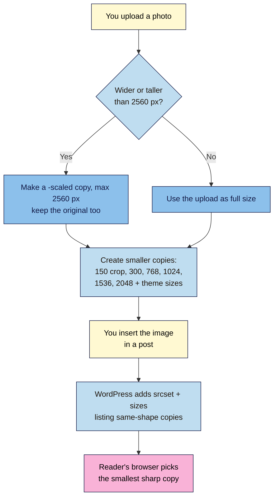

# M03.L01 — The Media Library and the image sizes WordPress creates
> After this lesson you can manage your images in the Media Library, see exactly which sizes WordPress makes from every upload, and upload photos at dimensions that look sharp without wasting space.

**Time:** ~15 min reading + ~15 min exercise · **Level:** beginner · **Prereqs:** M02
**Verified against:** WordPress 7.0 core source (default sizes in `schema.php`, `big_image_size_threshold`, `srcset` rules in `media.php`, Media screen labels) and WordPress documentation on 2026-10-31

> ⚠️ **Freshness flag:** image handling changes quietly between releases (e.g. big-image scaling in 5.3, HEIC → JPEG conversion in 6.7, `sizes="auto"` for lazy images in 6.7). Your theme and plugins can also add sizes. Trust what your own uploads folder shows.

## Learning objectives
1. **Upload, find, edit and replace** files in the Media Library.
2. **Describe** the image sizes WordPress generates and how responsive `srcset` uses them.
3. **Pick** the right upload dimensions for full-width, content-width and thumbnail images.

## Why it matters
Nadia uploaded photos straight from her camera: 6000 × 4000 pixels, 12 MB each. Her food posts took ages to load on phones, and her host warned her she'd used most of her storage in six months. Her friend Joon resized photos to about 2000 pixels wide before uploading and let WordPress do the rest. His pages load quickly, his photos look just as sharp, and his uploads folder is a tenth of the size. Every image you upload becomes **several files**; knowing which ones, and why, is the foundation for the rest of this module.

## Core concept
**Plain version:** when you upload an image, WordPress keeps your original and makes **smaller copies** at standard sizes. When a reader opens your post, their browser picks the **smallest copy that still looks sharp** on their screen. A phone downloads a small file; a big desktop monitor gets a bigger one.

**Analogy:** a print shop that receives your poster and automatically prints it as a postcard, a flyer, a magazine page and a poster. Each reader is handed the format that fits the space they're looking at.

**Precise definitions:**
- **Media Library:** the place (**Media → Library**) where every uploaded file lives, with its details (alternative text, caption, description, file URL). Each file is an **attachment**.
- **Image sizes (sub-sizes):** the copies WordPress makes. Core defaults (WordPress 7.0):

| Size name | Max dimensions | Cropped? | Set in |
|---|---|---|---|
| Thumbnail | 150 × 150 | Yes, to an exact square | **Settings → Media** |
| Medium | 300 × 300 | No, proportional | **Settings → Media** |
| Medium large | 768 wide | No | Hidden (not on the settings screen) |
| Large | 1024 × 1024 | No | **Settings → Media** |
| 1536 × 1536 and 2048 × 2048 | 1536 / 2048 max | No | Hidden |
| Full | your original (or the `-scaled` version) | No | — |

  WordPress only makes sizes **smaller** than your original, and your **theme or plugins may add more**.
- **Big image threshold:** if an uploaded image is wider or taller than **2560 pixels**, WordPress makes a `-scaled` copy (max 2560) and uses it as the "full" size. Your original is still kept on the server.
- **`srcset` and `sizes`:** HTML attributes WordPress adds to images in your posts. `srcset` lists the available copies and their widths; `sizes` tells the browser how wide the image will display. The browser then picks the best file. WordPress lists only copies with the **same shape** as the original (so the square thumbnail isn't included), up to **2048 pixels** wide.
- **Content width:** how wide your theme shows a normal (not wide or full) block. Twenty Twenty-Five uses **645 px**, with **1340 px** for "wide" blocks.

## How it works



**In words:** you upload one photo. If it's huge, WordPress makes a 2560-pixel version to use instead (and keeps your original). It then makes a set of smaller copies. When the image appears in a post, WordPress tells the browser which copies exist, and the browser downloads only the one it needs.

## Hands-on walkthrough
Work on your **Local** practice site. You need one **large photo** from your phone or camera (at least 3000 pixels wide; most phone photos are).

**Part A: check your size settings (2 min)**
1. Go to **Settings → Media**.
   **Expected:** **Thumbnail size** 150 × 150 with **Crop thumbnail to exact dimensions** ticked, **Medium size** 300 × 300, **Large size** 1024 × 1024, and **Organize my uploads into month- and year-based folders** ticked.
2. Leave the defaults. (Change them only if your theme's documentation tells you to; changes apply only to **future** uploads.)

**Part B: upload and inspect (5 min)**
1. **Media → Add Media File** (or drag the photo onto **Media → Library**). Note the "Maximum upload file size" shown on the upload screen.
2. Click the uploaded image to open **Attachment details**.
   **Expected:** **File name**, **File type**, **File size**, **Dimensions** (e.g. *2560 by 1920 pixels* for a 4032 × 3024 phone photo) and, for big photos, an **Original image:** link. That's the scaling at work.
   > 🖼️ **Image prompt:** Screenshot of the WordPress 7.0 Media Library "Attachment details" modal for a large food photo: preview on the left; on the right File name ending in "-scaled.jpg", File size, Dimensions "2560 by 1920 pixels", the "Original image:" link, and the Alternative Text, Title, Caption, Description and File URL fields. Highlight the key element with a 3px #F9B2D7 outline; blur any personal details.
   > **Alt text:** Attachment details for a scaled photo, showing 2560 by 1920 pixels, the Original image link and the alternative text field.
3. In **Local**, open your site's folder (the link or arrow next to the **Site path** on its **Overview** tab). Open `app/public/wp-content/uploads/`, then this year and month.
   **Expected:** one upload, several files, for example:
   ```
   paneer-tikka.jpg                 ← your original (kept)
   paneer-tikka-scaled.jpg          ← 2560 px "full" size
   paneer-tikka-150x150.jpg         ← thumbnail (cropped square)
   paneer-tikka-300x225.jpg         ← medium
   paneer-tikka-768x576.jpg         ← medium large
   paneer-tikka-1024x768.jpg        ← large
   paneer-tikka-1536x1152.jpg
   paneer-tikka-2048x1536.jpg
   ```
   Your theme may add a few more. Note each file's size: the 300-pixel copy is a tiny fraction of the original.

> **iPhone photos (HEIC):** since WordPress 6.7, HEIC uploads are converted to JPEG copies, if your server's image library supports HEIC. If an upload fails, export the photo as JPEG first.

**Part C: see `srcset` in action (5 min)**
1. Open a draft post, add an **Image** block, and choose your photo from the Media Library. Leave **Resolution** in the block's sidebar settings on **Large** (or **Full Size**). **Save draft**, then **Preview** it.
2. In the preview, right-click the image → **Inspect** (or press **Ctrl+U** / **⌘+Option+U** for the page source and search for the file name).
   **Expected:** the `` tag has a `srcset` listing several copies with widths, and a `sizes` attribute, for example:
   ```html
   
   ```
   The 150×150 thumbnail isn't listed: it's a different shape. Images lower on the page may also show `sizes="auto, …"` and `loading="lazy"`.
3. Optional: in DevTools, switch on the **device toolbar** (phone icon), choose a phone, reload, and check the **Network** tab: the phone downloads a smaller copy than your desktop did.

**Part D: edit and replace (3 min)**
1. Back in **Media → Library**, open the photo and click **Edit Image**. Try **Crop** or **Rotate**, then **Save**.
   **Expected:** WordPress saves an edited version and regenerates the sizes; **Restore image** appears so you can undo it.
2. To use a different photo in **one post**, select the Image block and click **Replace** in its toolbar.
3. WordPress has no built-in way to swap the file **behind** an existing attachment everywhere it's used. Upload the new image and use **Replace** in each post, or vet a plugin such as *Enable Media Replace* first (M06.L01).
4. Find files later: **Media → Library** has search plus filters for type and date. Switch to **list view** (the list icon) to see which post each file is **Uploaded to**.

> **Careful:** **Delete permanently** in the Media Library really is permanent. Media skips the trash by default, and any post using the file shows a broken image.

## When to use / when not to
Recommended upload sizes (observed practice for typical creator themes; check your theme's content width):

| Where the image appears | Upload this wide | Why |
|---|---|---|
| **Full-width / wide** (hero, cover, full alignment) | **2000–2560 px** | Fills large screens; WordPress scales anything bigger to 2560 anyway |
| **Content-width** (a normal image in a post) | **~1300–1600 px** | About 2× a 645–800 px content column, so it stays sharp on high-density (Retina) screens |
| **Thumbnails, avatars, logos in lists** | **at least 600 px** | WordPress makes the 150 × 150 crop; a bigger source keeps it crisp |
| Featured and social share images | depends on theme and platform | Covered in M03.L04 |

- **Do** resize before uploading (M03.L02 shows free tools). WordPress's scaling is a safety net, not a plan: your original still sits on the server, using storage and backup space.
- **Don't** upload tiny images (e.g. 600 px) for full-width spots: WordPress never enlarges, so they look blurry.
- **Trade-off:** each upload creates 6–8+ files. That's what makes pages fast for readers, but it multiplies storage and backup size. Fewer, right-sized uploads keep both under control.

## Use AI for this
**Example prompt:**
> "My WordPress theme's content width is 645 px and wide blocks are 1340 px. I publish recipe posts with one hero image and 6–10 step photos. Suggest upload widths for each image type, explain how srcset will serve them on phones vs desktops, and estimate how many files WordPress will create per upload with default settings."

**What AI does well here:** explaining `srcset`/`sizes` in plain words and turning your theme's widths into sensible upload sizes.
**Where it gets it wrong:** it often lists outdated default sizes (missing 1536/2048 or the 2560 scaling), assumes WordPress converts everything to WebP (it doesn't by default), or invents settings.
**How to check:** compare with your own **Settings → Media** screen and the files in your uploads folder, and look at a real `srcset` in your page source.

## Common mistakes
- **Uploading straight from the camera.** 12 MB originals stay on the server forever, even though WordPress scales them for display.
- **Changing Settings → Media sizes and expecting old images to change.** New sizes apply to new uploads only; old images need regenerating (a job for later, with a vetted plugin).
- **Choosing "Full Size" for every image block.** The `sizes` attribute then tells browsers the image may display up to 2560 px wide, so large screens fetch the biggest copy (2048 px) even inside a 645 px column. **Large** is usually right for content-width images.
- **Deleting a file you think is unused.** Check **Uploaded to** in list view and search your posts first. There's no trash for media.
- **Using a cropped thumbnail where a full image belongs.** The 150 × 150 square cuts off the edges of the photo.

## Troubleshooting
| Symptom | Likely cause | Fix |
|---|---|---|
| "exceeds the maximum upload size for this site" | File bigger than the server limit shown on the upload screen | Resize/compress first (M03.L02), or ask your host to raise the limit |
| Upload fails with "The server cannot process the image" | Image too large for the server's memory, or an unsupported format (e.g. HEIC on an older server) | Resize to ~2560 px and save as JPEG before uploading |
| Image looks blurry in the post | Source smaller than the space it fills, or a small size chosen in **Resolution** | Upload a bigger original; set Resolution to **Large** or **Full Size** |
| No `srcset` on an image | Only one size exists (small original), or it's not an image from the Media Library (e.g. pasted from another site) | Upload a larger image from your computer and insert it from the library |
| Folder has many more sizes than listed here | Your theme or plugins register extra sizes | Normal; check your theme's documentation before removing any |
| A post shows a broken image | The file was deleted permanently | Re-upload it and use **Replace** in that post |

## Exercise
**Task:** upload one large photo for each of the three placements (a full-width hero, a content-width photo and a square thumbnail-style image), resized beforehand to the widths in the table. Insert them in a draft post (hero as a **Cover** or full-width Image block). For each, record the uploaded dimensions, the files WordPress created, and which copy your browser downloaded on desktop and on a phone-sized screen.
**Expected outcome:** a small table (image · uploaded size · number of files created · file served on desktop · file served on phone) and one sentence on what you'd change next time.
**Stretch goal:** in DevTools' Network tab, compare the size of the file your phone-sized screen downloaded with the original you uploaded, and work out the percentage saved.

## Key takeaways
- One upload = your original + a set of copies (150 crop, 300, 768, 1024, 1536, 2048, plus any theme sizes).
- Images over **2560 px** get a `-scaled` copy used as "full"; the original stays on the server.
- `srcset` lets each reader's browser download the **smallest sharp copy**; WordPress adds it automatically for Media Library images.
- Upload **~2000–2560 px** for full-width, **~1300–1600 px** for content-width, **600+ px** for thumbnails.
- Media deletes are **permanent**, and WordPress can't swap a file everywhere: use **Replace** per post.

## Teach it back
Explain to a friend in 3 sentences what happens to a photo after they upload it to WordPress, and why a phone and a laptop end up downloading different files.

## Glossary terms added
- Media Library — added to `wordpress-101/glossary.md`
- Attachment — added to `wordpress-101/glossary.md`
- Image sizes (thumbnail, medium, large) — added to `wordpress-101/glossary.md`
- Big image threshold (`-scaled`) — added to `wordpress-101/glossary.md`
- srcset and sizes — added to `wordpress-101/glossary.md`
- Content width — added to `wordpress-101/glossary.md`

## Further reading
*All checked 2026-10-31.*
- WordPress documentation — Media Library Screen: https://wordpress.org/documentation/article/media-library-screen/
- WordPress documentation — Settings Media Screen: https://wordpress.org/documentation/article/settings-media-screen/
- WordPress documentation — Edit Media: https://wordpress.org/documentation/article/edit-media/
- WordPress Developer Resources — Responsive Images: https://developer.wordpress.org/apis/responsive-images/
- Make WordPress Core — Introducing handling of big images in WordPress 5.3 (2019): https://make.wordpress.org/core/2019/10/09/introducing-handling-of-big-images-in-wordpress-5-3/
- MDN — Responsive images: https://developer.mozilla.org/en-US/docs/Web/HTML/Guides/Responsive_images
