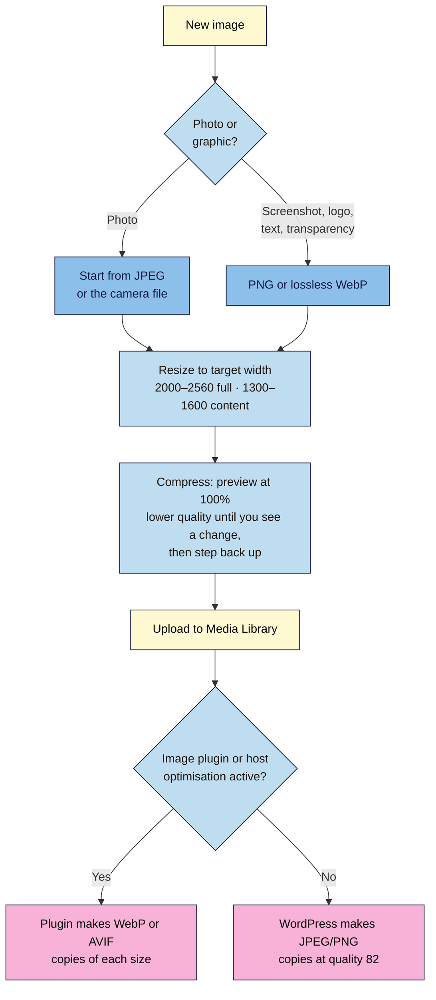

# M03.L02 — Compress, convert and right-size: WebP, AVIF and image plugins
> After this lesson you can shrink any photo to a fraction of its size with no visible loss, choose the right format for each image, and set up one plugin that converts your uploads automatically.

**Time:** ~15 min reading + ~20 min exercise · **Level:** beginner · **Prereqs:** M03.L01
**Verified against:** WordPress 7.0 core source (WebP/AVIF support, default quality 82 JPEG / 86 WebP), Modern Image Formats 2.7.1 (tested with WordPress 7.1.4), Squoosh and MDN on 2026-10-31

> ⚠️ **Freshness flag:** format support moves fast. WordPress added WebP in 5.8 and AVIF in 6.5, and plugin options change between versions. Check your plugin's settings screen and **Tools → Site Health → Info → Media Handling** on your own site.

## Learning objectives
1. **Resize and compress** an image before upload with a free tool.
2. **Compare** JPEG, PNG, WebP and AVIF for file size and browser support.
3. **Configure** one image-optimisation plugin, or confirm your host already handles it.

## Why it matters
Kofi's travel posts each had 15 phone photos. Even after WordPress made smaller copies (M03.L01), each post still downloaded about 4 MB on a phone, and his host's storage filled up with 5 MB originals. He started resizing photos to 1600 pixels and compressing them before upload, and installed one plugin to serve WebP. The same posts now download well under 1 MB, his uploads folder grows a fraction as fast, and nobody has noticed any drop in quality. Images are usually the heaviest part of a creator's page; this is the cheapest speed win you'll ever get.

## Core concept
**Plain version:** three separate things make images light:
1. **Right-size:** don't upload more pixels than any screen will show (M03.L01).
2. **Compress:** throw away detail the eye can't see. Most photos lose 60–80% of their file size this way with no visible difference.
3. **Convert:** save in a modern format (WebP or AVIF) that stores the same picture in fewer bytes.

**Analogy:** packing a suitcase. Right-sizing is leaving the winter coat at home; compressing is rolling your clothes; converting is switching to a smaller, lighter suitcase. Each helps on its own, and together they make a huge difference.

**Precise definitions:**
- **Lossy compression:** shrinks a file by discarding some detail. The **quality** setting (0–100) controls how much. JPEG, WebP and AVIF can all be lossy.
- **Lossless compression:** shrinks a file without changing a single pixel. PNG is lossless; WebP and AVIF have lossless modes too.
- **Quality setting:** WordPress uses quality **82** for the JPEG copies it makes (including the `-scaled` copy of a huge photo) and **86** for WebP copies. The original file you uploaded is stored as-is, so whatever you upload stays on the server at that size.
- **WebP:** a modern format supported by all current major browsers. MDN calls it "an excellent choice" for photos and graphics.
- **AVIF:** a newer format with even better compression. It's supported in current Chrome, Edge, Firefox and Safari, but MDN still advises a **fallback** for older browsers.
- **Fallback image:** a JPEG or PNG version kept alongside a WebP/AVIF file, for browsers or tools that can't read the modern format.
- **Image-optimisation plugin:** a plugin that compresses and/or converts images when you upload them. Core WordPress doesn't convert JPEGs to WebP or AVIF by itself.

| Format | Best for | Transparency | Typical size vs JPEG | Browser support (2026) |
|---|---|---|---|---|
| **JPEG** | Photos | ❌ | baseline | Universal |
| **PNG** | Screenshots, logos, text, sharp graphics | ✅ | Often **larger** for photos | Universal |
| **WebP** | Photos and graphics | ✅ | Usually noticeably smaller | All current browsers |
| **AVIF** | Photos (smallest files) | ✅ | Usually smallest | Current browsers; keep a fallback |
| **SVG** | Simple logos and icons (vector) | ✅ | Tiny | Universal, but WordPress blocks SVG uploads by default for security |

*Size comparisons are typical results (observed practice) and vary by image; you'll measure your own in the exercise.*

## How it works

**In words:** decide whether it's a photo (JPEG to start) or a sharp graphic (PNG or lossless WebP). Resize it to the width it'll actually display at. Compress it, checking at 100% zoom. Upload it, and let one plugin (or your host) create modern-format copies. Without a plugin, WordPress still makes its usual copies, but in the original format.

## Hands-on walkthrough
You need the large phone photo from M03.L01 (or any photo 3000+ px wide), a browser, and your **Local** site.

**Part A: check what your server supports (2 min)**
1. Go to **Tools → Site Health → Info** and open **Media Handling**.
2. Look at **ImageMagick supported file formats** (or **GD supported file formats**).
   **Expected:** a list that includes `WEBP` and, on most up-to-date servers, `AVIF`. If AVIF is missing, your server can't create AVIF files: use WebP.

**Part B: compress three ways with Squoosh (10 min)**
1. Open **https://squoosh.app** (free, by Google Chrome Labs; the image is processed in your browser, not uploaded). Drag in your photo.
2. In the right-hand panel, open **Resize**, set **Width** to **1600** (keep **Maintain aspect ratio** on).
3. Version 1: under **Compress**, choose **MozJPEG**, quality **75**. (Squoosh's labels can change; look for the format menu and the **Quality** slider.) Use the slider in the middle of the image and zoom to **100%** to compare with the original. Note the file size shown, then **download**.
4. Version 2: change to **WebP**, quality **75**. Compare, note the size, download.
5. Version 3: change to **AVIF**, quality **55** (AVIF numbers aren't comparable with JPEG's). Compare, note the size, download.
   > 🖼️ **Image prompt:** Screenshot of squoosh.app comparing a food photo: original on the left, WebP at quality 75 on the right, the split slider in the middle, Resize set to width 1600, and the file size readouts at the bottom of each side (original vs compressed, with the percentage saved). Highlight the key element with a 3px #F9B2D7 outline; blur any personal details.
   > **Alt text:** Squoosh comparing an original photo with a WebP version, showing a file 96% smaller with no visible difference.
6. Fill in this table:

| Version | Width | Format / quality | File size | Visible difference at 100%? |
|---|---|---|---|---|
| Original | e.g. 4032 | JPEG (camera) | | — |
| 1 | 1600 | MozJPEG 75 | | |
| 2 | 1600 | WebP 75 | | |
| 3 | 1600 | AVIF 55 | | |

   **Expected:** every compressed version is a small fraction of the original; WebP is usually smaller than MozJPEG, and AVIF smaller still. On the photo, you probably can't tell them apart at normal viewing size.
7. If you can see blocky patches or smeared detail (look at skies, skin and text), raise the quality by 5 and check again.

**Part C: set up one image plugin (6 min)**
Pick **one** route. Never run two image-optimisation plugins at once.
- **Route 1, Modern Image Formats** (free, by the WordPress Performance Team):
  1. **Plugins → Add Plugin**, search **Modern Image Formats**, check the listing (author WordPress Performance Team, tested with your WordPress version, recently updated), then **Install Now → Activate**.
  2. Go to **Settings → Media** and find the plugin's options.
     **Expected:** an output-format choice (AVIF or WebP, if your server supports both) and an **Output fallback images** checkbox.
  3. Choose **WebP** for the widest compatibility (or AVIF if Part A listed it and you want the smallest files). Tick **Output fallback images** if you want JPEG copies kept too, e.g. for email newsletters that pull your images. **Save Changes**.
  4. Upload your **Version 1** JPEG from Part B. In your uploads folder, look at the new files.
     **Expected:** a new folder listing with your JPEG original plus **WebP** (or AVIF) copies for each size (and JPEG copies too if you ticked the fallback option). The plugin only affects **new** uploads, and skips a conversion if the modern file would be larger.
- **Route 2, your host does it:** some managed hosts and CDNs convert and compress images automatically. Check your host's documentation for "WebP", "image optimisation" or "Polish". If it's on, **don't** add a plugin; just compress before upload.
- **Route 3, a full optimiser** (ShortPixel, EWWW Image Optimizer, Imagify): these also compress your originals and existing images, often with a free monthly quota and paid plans. Vet them with the M06.L01 checklist before choosing.

**Part D: compare in the browser (2 min)**
1. Insert the image you uploaded in Part C into a draft post and **Preview** it.
2. Right-click the image → **Open image in new tab**.
   **Expected:** the address ends in `.webp` (or `.avif`) with Route 1. In DevTools' **Network** tab, its size is far below the 1024-pixel JPEG copy from M03.L01.

## When to use / when not to
- **Always** resize and compress before upload. It's free and it shrinks your originals, which plugins on default settings leave untouched.
- **Use WebP** as your default modern format: excellent compression and support in every current browser.
- **Use AVIF** when your server supports it and you want the smallest files, with fallbacks on (or accept that a small number of very old browsers will miss out).
- **Keep PNG** (or lossless WebP) for screenshots, text and logos with sharp edges or transparency: lossy compression smudges text.
- **Don't** upload SVGs unless you understand the risk. WordPress blocks them by default because an SVG file can contain code.
- **Trade-off:** plugins that convert on upload are hands-off but add more files per upload (and double them with fallbacks), and some full optimisers send your images to their servers. Compressing by hand costs you a minute per image but needs no plugin at all.

## Use AI for this
**Example prompt:**
> "I run a [niche] blog on WordPress 7.x. My server supports WebP and AVIF. I upload about 10 phone photos per post plus 2–3 screenshots. Recommend a workflow: target widths, format and quality settings for photos vs screenshots in Squoosh, and whether I need an image plugin. Explain the trade-offs in plain English and keep it to one plugin at most."

**What AI does well here:** turning your situation into a simple routine, and explaining lossy vs lossless.
**Where it gets it wrong:** it often recommends stacking several optimisation plugins, quotes outdated browser support for WebP or AVIF, or claims WordPress converts to WebP by default (core doesn't). It can't see your actual images.
**How to check:** test settings in Squoosh at 100% zoom, read Site Health's Media Handling list, and measure the result in the Network tab.

## Common mistakes
- **Compressing without resizing.** A 6000-pixel image at quality 60 is still far bigger than a 1600-pixel one at quality 80.
- **Running two image plugins.** They fight over the same files, double the work and can break images. One plugin, or your host, never both.
- **Saving photos as PNG** "for quality". Lossless PNG photos are often several times bigger than a good JPEG or WebP.
- **Compressing screenshots like photos.** Low-quality lossy compression blurs text; use PNG or higher-quality/lossless WebP.
- **Re-compressing an already compressed image.** Each lossy save loses more detail. Always start from the original.
- **Expecting a new plugin to fix old images.** Conversion plugins only affect new uploads unless you regenerate images (a careful, back-up-first job).

## Troubleshooting
| Symptom | Likely cause | Fix |
|---|---|---|
| WebP/AVIF upload fails ("not supported" or server can't process) | Server's image library lacks that format | Check **Site Health → Info → Media Handling**; upload JPEG, or ask your host to update ImageMagick/GD |
| Plugin installed, but no WebP files appear | Only new uploads are converted; or the WebP would have been larger, so the plugin skipped it | Upload a new image to test; regenerate old images only after a backup |
| Photo looks blotchy or banded (skies, gradients) | Quality too low | Raise quality by 5–10 and re-export from the original |
| Screenshot text looks fuzzy | Lossy compression on sharp text | Export as PNG or lossless WebP |
| Newsletter or social preview shows no image | The tool can't read WebP/AVIF | Turn on fallback images, or use a JPEG for featured/social images (M03.L04) |
| Storage still growing fast | Large originals still being uploaded | Resize before upload; WordPress keeps every original |

## Exercise
**Task:** take three real images for your next post (two photos and one screenshot). Resize and compress each in Squoosh using the right format for its type, then upload them with your chosen plugin or host route active. Record each image's original size, compressed size and the format WordPress serves.
**Expected outcome:** a table (image · type · original size · compressed size · format served · % saved) and a one-line "image rule" you'll follow every time (e.g. *Photos: 1600 px, WebP 75. Screenshots: PNG. Hero: 2400 px, WebP 75.*).
**Stretch goal:** run the same post through **PageSpeed Insights** once your site is live (or note it for M09), and check whether "Improve image delivery" or a similar image audit still flags anything.

## Key takeaways
- Three separate wins: **right-size**, **compress**, **convert**. Do all three.
- **Compress before upload** (Squoosh at 100% zoom); WordPress never shrinks your originals.
- **WebP** is the safe modern default; **AVIF** is smallest but keep a fallback; **PNG** for sharp graphics and text.
- Core WordPress accepts WebP and AVIF uploads but doesn't convert JPEGs: use **one** plugin (e.g. Modern Image Formats) **or** your host's optimisation.
- Conversion plugins affect **new** uploads only.

## Teach it back
Explain to a friend in 3 sentences the difference between resizing, compressing and converting an image, and which one saves the most for a photo straight off a phone.

## Glossary terms added
- Lossy compression — added to `wordpress-101/glossary.md`
- Lossless compression — added to `wordpress-101/glossary.md`
- WebP — added to `wordpress-101/glossary.md`
- AVIF — added to `wordpress-101/glossary.md`
- Fallback image — added to `wordpress-101/glossary.md`
- Image-optimisation plugin — added to `wordpress-101/glossary.md`

## Further reading
*All checked 2026-10-31.*
- MDN — Image file type and format guide: https://developer.mozilla.org/en-US/docs/Web/Media/Guides/Formats/Image_types
- Make WordPress Core — WordPress 5.8 adds WebP support (2021): https://make.wordpress.org/core/2021/06/07/wordpress-5-8-adds-webp-support/
- Make WordPress Core — WordPress 6.5 adds AVIF support (2024): https://make.wordpress.org/core/2024/02/23/wordpress-6-5-adds-avif-support/
- Modern Image Formats plugin (WordPress Performance Team): https://wordpress.org/plugins/webp-uploads/
- Squoosh (free in-browser image compressor): https://squoosh.app/
- web.dev — Use WebP images: https://web.dev/articles/serve-images-webp
- Can I use — AVIF: https://caniuse.com/avif · WebP: https://caniuse.com/webp
