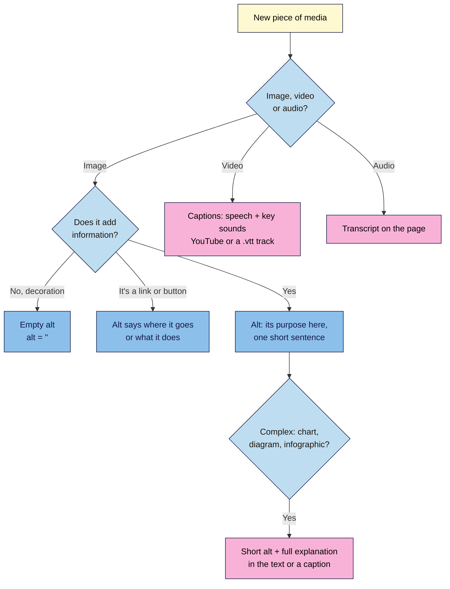

# M03.L03 — Accessible media: alt text, captions, transcripts and file names
> After this lesson every image, video and audio file you publish can be understood by everyone, including people using screen readers, people watching with the sound off, and search engines.

**Time:** ~15 min reading + ~20 min exercise · **Level:** beginner · **Prereqs:** M03.L01
**Verified against:** WordPress 7.0 core source (Image block **Alternative text** field, Video block **Text tracks**, `.vtt` uploads allowed), W3C WAI tutorials and WCAG 2.2, Google Search Central image guidance on 2026-10-31

> ⚠️ **Freshness flag:** AI tools that suggest alt text and auto-captions improve quickly, and plugins are adding them to WordPress. The principles here (describe the purpose, check machine output) don't change; the tools do.

## Learning objectives
1. **Write useful alt text**, and recognise when an image is decorative and should have empty alt.
2. **Add captions** to a video and a **transcript** to audio content.
3. **Name files descriptively** for accessibility and image search.

## Why it matters
Rosa runs a gardening blog. One of her readers, Ben, is blind and uses a screen reader. On her old posts it announced "image, IMG underscore 4471 dot JPG" twelve times per post. After she added short alt text ("Tomato seedlings two weeks after transplanting, leaves just turning dark green"), Ben emailed to say it was the first gardening blog he could follow. Her podcast episodes got transcripts, so every tip she said out loud became text that readers could skim and search engines could index. Accessible media isn't a nice extra: about 1 in 6 people live with a significant disability (WHO), many readers watch video with the sound off, and search engines rely on the same text to understand your images.

## Core concept
**Plain version:** every piece of media needs a **text version** for people who can't see or hear it:
- an **image** needs **alt text** (or a deliberately empty alt if it's only decoration);
- a **video** needs **captions** (the words and important sounds, on screen);
- **audio** (a podcast) needs a **transcript** (everything said, as text on the page).

**Analogy:** describing a photo to a friend over the phone. You wouldn't say "a JPEG". You'd say what matters about it *for the conversation you're having*.

**Precise definitions:**
- **Alt text (alternative text):** the `alt` attribute on an image, read aloud by screen readers and shown if the image fails to load. It should convey the image's **purpose in that context**, usually in one short sentence. Don't start with "Image of…"; screen readers already announce it's an image.
- **Decorative image:** an image that adds nothing to the meaning (a divider, a background texture, a photo whose content is fully described in the text next to it). It should have **empty alt** (`alt=""`) so screen readers skip it. That's different from **missing** alt, where some screen readers read the file name instead.
- **Functional image:** an image that is a link or a button (e.g. a logo linking home). Its alt describes **where it goes or what it does** ("Rosa's Garden home"), not what it looks like.
- **Caption (image):** visible text under an image, for everyone. It doesn't replace alt text; the two should not repeat each other word for word.
- **Captions (video):** on-screen text of the speech **plus important sounds** ("[thunder]", "[laughs]"). **Subtitles** usually translate the speech for people who can hear. WCAG 2.2 success criterion 1.2.2 requires captions for prerecorded video with sound.
- **Transcript:** a text version of audio (or video) content. WCAG 1.2.1 requires one for prerecorded audio-only content such as a podcast.
- **WebVTT (`.vtt`):** the caption file format web browsers use. WordPress lets you upload `.vtt` files and attach them to a Video block.

## How it works



**In words:** for an image, ask whether it adds information. If not, leave the alt empty. If it's a link, say where it goes. Otherwise describe its purpose in a sentence, and for charts or infographics also explain the data in the text. Videos get captions; audio gets a transcript.

### Good and bad alt text (same photo, different posts)
| Context | ❌ Weak | ✅ Useful |
|---|---|---|
| Recipe step | `IMG_4471.JPG` (missing alt) | "Dough after the first rise, doubled in size and puffy" |
| Same photo in a "kitchen tools" post | "Bread dough" | "Dough rising in a clear glass bowl with measurement marks" |
| Author photo next to the name "Rosa Díaz" | "Photo of Rosa Díaz, gardener, smiling, wearing a hat, outdoors" | Empty alt (the name beside it says it all), or "Rosa Díaz" if it stands alone |
| Logo linking home | "Logo" | "Rosa's Garden home" |
| Chart of monthly visitors | "Chart" | "Line chart: visitors doubled from 2,000 to 4,000 between March and June" (+ data in the text) |
| SEO-stuffed | "tomato tomatoes grow tomatoes best tomato seeds buy" | "Three tomato varieties side by side: cherry, plum and beefsteak" |

## Hands-on walkthrough
Use your **Local** practice site and the draft post from M03.L01/L02.

**Part A: name files before you upload (3 min)**
1. On your computer, rename three photos from camera names (`IMG_4471.jpg`) to short descriptive names with hyphens: `sourdough-first-rise.jpg`, `tomato-seedlings-week-two.jpg`.
2. Upload them to **Media → Library**.
   **Expected:** the file URL uses your name, and WordPress fills the **Title** field with it (`sourdough-first-rise`), unless the photo has a title embedded by your camera or editing app. WordPress can't rename a file after upload without a plugin, so name files **first**. Keep expectations realistic: Google calls file names "very light clues" about an image; alt text and the surrounding text matter far more.

**Part B: write alt text in the Image block (5 min)**
1. Insert one photo in your draft with an **Image** block. In the block sidebar (**Settings**), find **Alternative text**.
   **Expected:** a text box with the help text "Leave empty if decorative." and a **Describe the purpose of the image.** link.
   > 🖼️ **Image prompt:** Screenshot of the WordPress 7.0 block editor with an Image block selected: the photo of rising dough in the canvas and, in the right sidebar under Settings, the "Alternative text" box filled with "Dough after the first rise, doubled in size and puffy" and the "Leave empty if decorative." help text below. Highlight the key element with a 3px #F9B2D7 outline; blur any personal details.
   > **Alt text:** The Image block sidebar with a one-sentence description typed into the Alternative text field.
2. Type a description of the image's **purpose in this post** (aim for under ~125 characters; there's no hard limit, but screen reader users can't skim long alt).
3. Add a short visible **caption** with the block toolbar's **Add caption** button, if it helps everyone (e.g. "Ready to shape after 4 hours at room temperature"). Don't repeat the alt text.
4. Insert a decorative divider image (or a background-style photo) and leave **Alternative text** **empty** on purpose.
5. **Preview**, right-click each image → **Inspect**.
   **Expected:** `alt="Dough after the first rise…"` on the first image and `alt=""` on the decorative one.

> **Media Library alt vs block alt:** the **Alternative Text** field in **Media → Library** is the default that's copied in when you insert the image. Changing it later doesn't update posts that already use the image, and changing a block's alt doesn't update the library. Edit the alt in the block, per post.

**Part C: captions for a video (6 min)**
- **YouTube video (most creators, M02.L05):** in **YouTube Studio → Subtitles**, open the auto-generated captions and **edit** them: fix names, jargon and punctuation, then publish. Auto-captions are a starting point, not finished captions. The embed in WordPress then shows them via the player's **CC** button.
- **Self-hosted video (a Video block):**
  1. Create a caption file. Many tools export **WebVTT (`.vtt`)**: YouTube Studio (download), editors such as Descript or CapCut, or a free transcription tool. A `.vtt` file looks like:
     ```
     WEBVTT

     00:00:00.000 --> 00:00:03.500
     Today we're shaping sourdough.

     00:00:03.500 --> 00:00:05.000
     [dough slaps on the counter]
     ```
  2. Select the **Video** block → toolbar **Text tracks** → **Add tracks** → **Upload** your `.vtt` file.
  3. Set **Label** (e.g. "English"), **Source language** (`en`) and **Kind** → **Captions**. Close the panel and save.
     **Expected:** on the preview, the video player shows a **CC** (or subtitles) control, and the captions appear in time with the speech.

**Part D: a transcript for audio (6 min)**
1. Get a first draft: export a transcript from your podcast host or recording tool, or run the audio through a transcription tool (many AI tools do this well).
2. **Edit it:** fix names and terms, add speaker names ("**Rosa:** …"), and note important non-speech sounds.
3. Under the **Audio** block (which has no caption-track option), add a **Details** block titled "Read the transcript" and paste the transcript inside, or put it on its own linked page for long episodes.
   **Expected:** a reader can read every word of the episode on the page, and search engines can index it.

## When to use / when not to
- **Always** give informative images alt text; **always** caption videos with speech; **always** offer transcripts for podcasts and audio.
- **Use empty alt** for decorative images, and for images whose content is fully described by the text right next to them.
- **Don't** use the image's alt for SEO keywords. Google's guidance: use descriptive, useful alt text and avoid keyword stuffing, which may be seen as spam.
- **Don't** put important text only inside an image (a quote card, a sale banner). Repeat it in the post or in the alt.
- **Trade-off:** good captions and transcripts take time (often 10–30 minutes per episode even with AI drafts). Start with your most popular and newest content, then work back.

## Use AI for this
**Example prompt:**
> "Here's a photo from my [niche] post titled '[title]'. The paragraph next to it says: '[paragraph]'. Write alt text under 125 characters that explains what this image adds to the post. Don't start with 'Image of'. If the paragraph already says everything the image shows, tell me the image is decorative and should have empty alt."

**What AI does well here:** drafting alt text from an image, turning audio into a transcript draft, and spotting decorative images when you give it the surrounding text.
**Where it gets it wrong:** it describes what it sees, not why the image is in **your** post; it invents details (brand names, people's identities, numbers in charts); and auto-transcripts mishear names and jargon.
**How to check:** read every AI alt text against the post, never let it guess who a person is, check chart numbers yourself, and listen back while reading a transcript.

## Common mistakes
- **Leaving alt missing instead of empty.** A missing alt can make screen readers read the file name; decorative images need `alt=""` on purpose.
- **Starting with "Image of…" or "Picture of…".** Screen readers already say "image".
- **Describing the image instead of its purpose.** "A bowl" vs "Dough doubled in size": the second tells the reader why it's there.
- **Keyword-stuffing alt text.** Bad for screen reader users and against Google's guidance.
- **Publishing YouTube auto-captions unedited.** Names, numbers and terms are often wrong.
- **Uploading `IMG_4471.jpg` and planning to rename later.** File names can't be changed after upload without a plugin.
- **Updating alt in the Media Library and expecting old posts to change.** Each block keeps its own copy.

## Troubleshooting
| Symptom | Likely cause | Fix |
|---|---|---|
| Screen reader reads a file name | Image has no `alt` attribute at all | Add alt text, or mark it decorative by leaving the field empty in the block (WordPress outputs `alt=""`) |
| Changed alt in Media Library, post still shows old alt | Alt is copied into the block on insert | Edit **Alternative text** in the block in that post |
| `.vtt` upload rejected | File saved as `.txt` or `.srt`, or missing the `WEBVTT` first line | Export as WebVTT, or convert SRT to VTT with a free converter; check the first line |
| Captions don't appear on the video | Track **Kind** not set, or the player's CC control is off | Set **Kind → Captions**, then click **CC** in the player |
| Captions out of sync | Timestamps from a different edit of the video | Re-export the captions from the final video |
| Theme's featured image has no alt | Theme uses the Media Library alt for featured images | Add alt in **Media → Library** for that image |

## Exercise
**Task:** pick five images from your posts (or your practice post) and rewrite their alt text using the decision flowchart: at least one should end up **decorative** (empty alt) and one should be a **link** or **chart**. Then create one transcript: either for a short video or audio clip of your own (1–3 minutes), or by editing the YouTube auto-captions for one of your videos.
**Expected outcome:** a table (image · context · old alt · new alt · decorative? yes/no) and one edited transcript or caption file attached to a post.
**Stretch goal:** turn on your computer's screen reader (VoiceOver on Mac: **⌘+F5**; Narrator on Windows: **Ctrl+Win+Enter**) and listen to your post from the top. Note anything confusing.

## Key takeaways
- Alt text describes an image's **purpose in this post**, in one short sentence, without "Image of…".
- Decorative images get **empty alt**, which is not the same as **missing** alt.
- Linked images describe **the destination**; charts get a short alt **plus** the data in the text.
- Videos need **edited captions** (YouTube Studio or a `.vtt` track); audio needs a **transcript** on the page.
- Name files descriptively **before** upload: `sourdough-first-rise.jpg`, not `IMG_4471.jpg`.

## Teach it back
Explain to a friend in 3 sentences how to decide what alt text an image needs, and why "decorative" images shouldn't just be left without alt.

## Glossary terms added
- Alt text — added to `wordpress-101/glossary.md`
- Decorative image (empty alt) — added to `wordpress-101/glossary.md`
- Functional image — added to `wordpress-101/glossary.md`
- Captions (video) — added to `wordpress-101/glossary.md`
- Transcript — added to `wordpress-101/glossary.md`
- WebVTT (.vtt) — added to `wordpress-101/glossary.md`

## Further reading
*All checked 2026-10-31.*
- W3C WAI — An alt Decision Tree: https://www.w3.org/WAI/tutorials/images/decision-tree/
- W3C WAI — Captions/Subtitles: https://www.w3.org/WAI/media/av/captions/
- W3C WAI — Transcripts: https://www.w3.org/WAI/media/av/transcripts/
- WCAG 2.2 — Understanding 1.2.1 Audio-only and Video-only (Prerecorded): https://www.w3.org/WAI/WCAG22/Understanding/audio-only-and-video-only-prerecorded.html
- WCAG 2.2 — Understanding 1.2.2 Captions (Prerecorded): https://www.w3.org/WAI/WCAG22/Understanding/captions-prerecorded.html
- Google Search Central — Image SEO best practices: https://developers.google.com/search/docs/appearance/google-images
- WordPress documentation — Image block: https://wordpress.org/documentation/article/image-block/ · Video block: https://wordpress.org/documentation/article/video-block/
- YouTube Help — Add subtitles & captions: https://support.google.com/youtube/answer/2734796
- WHO — Disability fact sheet (about 1 in 6 people): https://www.who.int/news-room/fact-sheets/detail/disability-and-health
