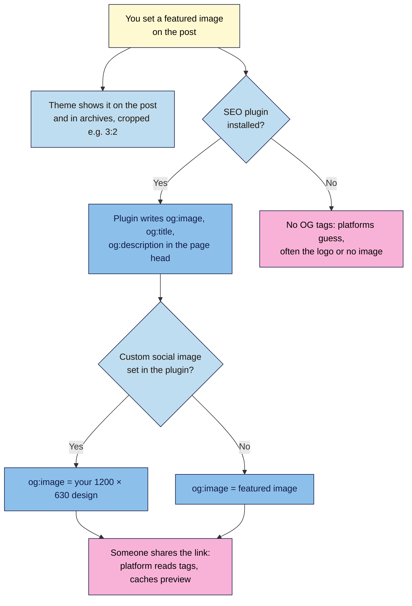

# M03.L04 — Featured images and social share images (Open Graph)
> After this lesson every post has a featured image that fits your theme, and a link that looks good when someone shares it on Facebook, LinkedIn, X, WhatsApp or Slack.

**Time:** ~15 min reading + ~20 min exercise · **Level:** beginner · **Prereqs:** M03.L02
**Verified against:** WordPress 7.0 core source (no Open Graph tags in core; featured images on by default in block themes), Twenty Twenty-Five templates (featured images cropped to 3:2), Meta's sharing image guidance and Google Discover documentation on 2026-10-31

> ⚠️ **Freshness flag:** each platform changes its preview layout and crop without notice. The 1200 × 630 size has been a stable standard for years, but test real previews before a big launch.

## Learning objectives
1. **Set featured images** that work in your theme's layouts and archives.
2. **Explain** how Open Graph tags control the link preview on social platforms and messaging apps.
3. **Create** a reusable social image template at the recommended size.

## Why it matters
Chen shared his new budgeting guide in three WhatsApp groups and on LinkedIn. The preview showed his site logo, squashed, with the title "Home". Almost nobody clicked. His friend Ama's posts always show a clear image with her title in big letters, and her shares get several times the clicks. The difference wasn't talent: Ama has a **featured image** on every post and an SEO plugin that turns it into **Open Graph** tags, built from one reusable template. A link preview is often the first, and only, thing people see of your post.

## Core concept
**Plain version:** the **featured image** is the main picture for a post. Your theme shows it at the top of the post and on your blog and category pages. When someone shares the link, platforms read hidden **Open Graph tags** in the page to decide which image, title and description to show. WordPress doesn't add those tags by itself; an SEO plugin does, usually using your featured image.

**Analogy:** the featured image is the cover of a book in your own shop window. The Open Graph image is the poster you send to other shops to advertise it. Usually they're the same picture, but each window crops it differently.

**Precise definitions:**
- **Featured image (post thumbnail):** the image set in the post's **Featured image** panel in the editor sidebar. Block themes have it switched on automatically. Your theme decides where and how it appears through the **Post Featured Image** block in its templates.
- **Crop / aspect ratio:** themes often display featured images at a fixed shape. **Twenty Twenty-Five** crops them to **3:2** on single posts and in post lists, so a tall photo loses its top and bottom.
- **Open Graph (OG) tags:** `<meta property="og:…">` tags in the page's `<head>`, a protocol created by Facebook and now read by most platforms (Facebook, LinkedIn, WhatsApp, Slack, Discord, iMessage and others). The key ones are `og:title`, `og:description`, `og:image` and `og:url`.
- **Twitter/X cards:** X has its own `twitter:` tags but falls back to Open Graph tags when they're missing.
- **Social share image (OG image):** the image in `og:image`. Meta recommends **at least 1200 × 630 px** (about **1.91:1**), with a file under **8 MB**. Google Discover recommends large images **at least 1200 px wide**, and reads `og:image` too.
- **Sharing debugger:** a tool that shows what a platform sees for your URL and makes it re-read the page, such as Facebook's **Sharing Debugger** and **LinkedIn Post Inspector**.

## How it works



**In words:** your featured image does two jobs. Your theme shows it on your site, cropped to the theme's shape. An SEO plugin copies it, or a custom social image you choose, into Open Graph tags. When someone shares your link, the platform reads those tags once and remembers (caches) the preview, which is why fixing a bad preview needs a debugger.

## Hands-on walkthrough
Use your **Local** site for Parts A–B. Part C needs a **public** URL: Facebook and LinkedIn can't see a site that runs only on your computer.

**Part A: set a featured image that survives the crop (5 min)**
1. Open your draft post. In the right sidebar (**Post** tab), find **Featured image** and click **Set featured image**. Choose a landscape photo of at least **1200 px** wide (resized and compressed as in M03.L02).
2. Check the image's **alt text** in the Media Library panel. On the single post, the theme uses the library's alt (M03.L03). In post lists, where the featured image is a **link** to the post, WordPress uses the **post title** as alt instead, following the "functional image" rule.
   **Expected:** the image appears in the Featured image panel.
   > 🖼️ **Image prompt:** Screenshot of the WordPress 7.0 post editor with the right sidebar's Post tab open, showing the Featured image panel filled with a landscape food photo and the Replace and Remove buttons below it. Highlight the key element with a 3px #F9B2D7 outline; blur any personal details.
   > **Alt text:** The Featured image panel in the post sidebar with a landscape photo set and Replace and Remove buttons.
3. **Preview** the post, then visit your blog page (or **Posts** page).
   **Expected:** in Twenty Twenty-Five the image appears above the post and in the post list, cropped to **3:2**. Anything near the top and bottom edges may be cut off.
4. If something important was cropped, choose a photo with the subject in the **middle**, or (advanced) change the crop in **Appearance → Editor → Templates → Single Posts**, select the **Post Featured Image** block and change **Aspect ratio**. That affects every post, so do it once, deliberately.

**Part B: build a reusable social image template (10 min)**
1. In a free design tool (Canva, Adobe Express, Figma or Google Slides with a custom size), create a **1200 × 630 px** canvas.
2. Design one layout to reuse for every post:
   - Your **post title** in large text (readable when the preview is phone-sized, about 300 px wide);
   - Your **logo or site name** small in a corner;
   - A photo or brand colour background;
   - Keep text and faces inside the **central area** (leave ~10% margin all round), because some apps crop the edges or show a square thumbnail.
3. Save it as a **template**, then make one for this post and export as **JPEG or PNG** (more apps can read these than WebP), compressed under ~300 KB.
   > 🖼️ **Image prompt:** A 1200 × 630 social image template mock-up: left two-thirds shows a bold white post title "How to budget on a freelance income" on a dark teal background, right third a cropped photo of a notebook and calculator, small site logo bottom-left, and a dashed guide showing the 10% safe margin. Highlight the key element with a 3px #F9B2D7 outline; blur any personal details.
   > **Alt text:** A 1200 by 630 social image template with a large post title, a photo on the right and a small logo inside safe margins.
4. Name the file descriptively (`budget-freelance-income-social.jpg`) and upload it to the Media Library with alt text.
5. Where it goes: once your SEO plugin is set up (M05), you'll pick it in the plugin's **social** settings for the post. Without a custom choice, plugins use the featured image. Some creators simply use the 1200 × 630 design **as** the featured image too; that works if your theme's crop doesn't cut the text.

**Part C: check the preview on a public URL (5 min)**
1. Pick a **public** post URL: your live site if you already have one, or any blog post you'd like to examine.
2. View the page source (**Ctrl+U** / **⌘+Option+U**) and search for `og:image`.
   **Expected (site with an SEO plugin):** lines like
   ```html
   <meta property="og:title" content="How to budget on a freelance income" />
   <meta property="og:image" content="https://example.com/wp-content/uploads/2026/10/budget-freelance-income-social.jpg" />
   <meta property="og:image:width" content="1200" />
   <meta property="og:image:height" content="630" />
   ```
   No `og:` lines at all means the site has no Open Graph tags; that's normal for a fresh WordPress site before M05.
3. Open **Facebook Sharing Debugger** (developers.facebook.com/tools/debug, Facebook login needed), paste the URL and click **Debug**.
   **Expected:** a preview card with the image, title and domain, plus any warnings (e.g. missing `og:image`, or an image that's too small).
4. If you changed the image and the old preview still shows, click **Scrape Again**. For LinkedIn, use **Post Inspector** (linkedin.com/post-inspector), which also refreshes LinkedIn's copy.

## When to use / when not to
- **Always** set a featured image on posts: themes, archives, related-post lists, RSS readers and SEO plugins all rely on it.
- **Use a designed 1200 × 630 social image** for posts you'll actively share (guides, launches, newsletters). For quick posts, a well-cropped featured photo is enough.
- **Don't** put essential text in the featured image if your theme crops it; keep text for the social version or within the safe area.
- **Don't** set featured images on pages that don't show them (check your page template) just because you can; but **do** set a social image for key pages such as the home and About pages once your SEO plugin is in place.
- **Trade-off:** a custom social image per post looks professional and earns more clicks but takes 5–10 minutes each; a template keeps that to about two minutes.

## Use AI for this
**Example prompt:**
> "I write a [niche] blog. Give me 5 short headline variations (max 8 words) for a social share image for the post '[title]', plus a layout description for a 1200 × 630 template: where the title, logo and photo go, with a 10% safe margin. Tone: [friendly / expert]."

**What AI does well here:** punchy short titles for the image, layout ideas, and checking the OG tags you paste in.
**Where it gets it wrong:** AI image generators can produce garbled text, invent logos and create images too similar to someone else's work. It also quotes outdated platform sizes.
**How to check:** design the text yourself in your template, use your own or properly licensed photos, and confirm the preview in the Sharing Debugger rather than trusting a size chart.

## Common mistakes
- **No featured image.** Archives show gaps, and shares show a random image or the logo.
- **Text or faces near the edges.** Themes crop to 3:2; some apps crop to a square.
- **Tiny social images.** Below 600 × 315 most platforms show a small thumbnail instead of the large card.
- **WebP or AVIF as the social image.** Some apps and email tools still can't read them; use JPEG or PNG (M03.L02).
- **Two plugins writing OG tags** (an SEO plugin plus a "social" plugin, or two SEO plugins). Duplicate tags confuse platforms.
- **Changing the image and expecting old shares to update.** Platforms cache previews; use the debugger to re-scrape.

## Troubleshooting
| Symptom | Likely cause | Fix |
|---|---|---|
| Share shows the logo or no image | No `og:image` tag (no SEO plugin yet), or no featured image | Set a featured image; add an SEO plugin (M05) |
| Old image still showing after a change | Platform cached the earlier preview | **Scrape Again** in Facebook Sharing Debugger; re-inspect in LinkedIn Post Inspector |
| Debugger can't fetch the URL | The site runs only on your computer (Local), is in maintenance mode, or blocks bots | Test a public URL; check your security plugin isn't blocking platform crawlers |
| Image appears small, beside the text | Image under ~600 × 315, or very different shape from 1.91:1 | Export at 1200 × 630 |
| Featured image cropped badly on the site | Theme's fixed aspect ratio (3:2 in Twenty Twenty-Five) | Re-centre the subject, or change the Post Featured Image block's aspect ratio in the template |
| Two different images in previews | Two plugins writing OG tags | Keep one; disable social tags in the other |

## Exercise
**Task:** create your reusable 1200 × 630 social image template and use it for one post. Set a featured image on that post that survives your theme's crop. Then check one **public** URL (yours or a site you admire) in Facebook Sharing Debugger or LinkedIn Post Inspector and note what it shows.
**Expected outcome:** the template file, a social image for one post, a screenshot or note of your featured image in the post list, and three lines from the debugger check (image shown? title? any warnings?).
**Stretch goal:** share the public URL privately with yourself on WhatsApp or Slack and compare the preview with the debugger's. Note any differences in crop.

## Key takeaways
- The **featured image** is the post's main image; your theme decides where it shows and how it's cropped (3:2 in Twenty Twenty-Five).
- **Open Graph tags** decide the link preview; WordPress core doesn't add them, so an SEO plugin does (M05).
- Social images: **1200 × 630 px (~1.91:1)**, JPEG or PNG, text inside a safe central area.
- Build **one template** and reuse it for every post.
- Platforms **cache** previews: use **Sharing Debugger** / **Post Inspector** to check and refresh.

## Teach it back
Explain to a friend in 3 sentences why their shared link showed the wrong picture, and the two things they'd need to fix it.

## Glossary terms added
- Featured image — added to `wordpress-101/glossary.md`
- Aspect ratio — added to `wordpress-101/glossary.md`
- Open Graph (OG) tags — added to `wordpress-101/glossary.md`
- Social share image (OG image) — added to `wordpress-101/glossary.md`
- Sharing debugger — added to `wordpress-101/glossary.md`

## Further reading
*All checked 2026-10-31.*
- The Open Graph protocol: https://ogp.me/
- Meta for Developers — Images in link shares (sizes and requirements): https://developers.facebook.com/docs/sharing/webmasters/images/
- Facebook Sharing Debugger: https://developers.facebook.com/tools/debug/
- LinkedIn Post Inspector: https://www.linkedin.com/post-inspector/
- X Developer — Summary card with large image: https://developer.x.com/en/docs/x-for-websites/cards/overview/summary-card-with-large-image
- Google Search Central — Get on Discover (image recommendations): https://developers.google.com/search/docs/appearance/google-discover
- WordPress Developer Resources — Featured images and post thumbnails: https://developer.wordpress.org/themes/functionality/featured-images-post-thumbnails/
