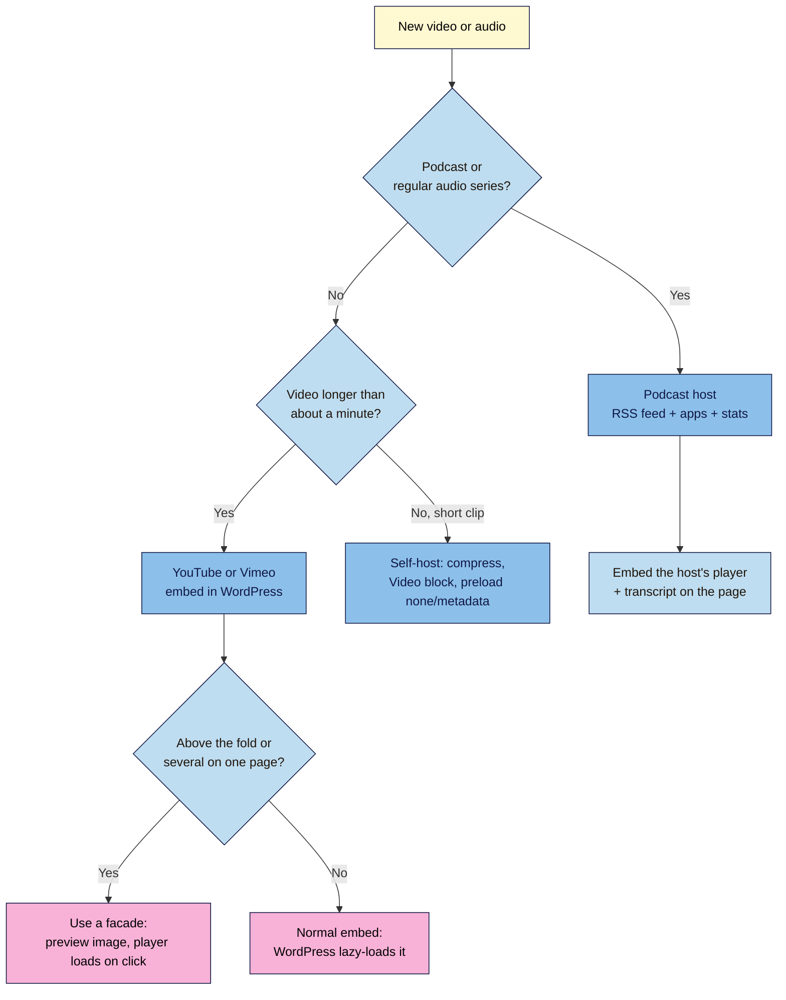

# M03.L05 — Video and audio: embed vs self-host
> After this lesson you know where each video and audio file should live, why podcasts need a podcast host, and how to stop embeds from slowing your pages.

**Time:** ~15 min reading + ~15 min exercise · **Level:** beginner · **Prereqs:** M02.L05, M03.L02
**Verified against:** WordPress 7.0 core source (lazy-loaded iframes since 5.7 with the first 3 content elements skipped; Video block `preload` default "metadata"; Video/Audio block settings), Chrome Lighthouse documentation on facades, and Apple Podcasts feed requirements on 2026-10-31

> ⚠️ **Freshness flag:** Lighthouse and PageSpeed Insights rename and regroup their audits regularly (older reports say "Lazy load third-party resources with facades"; newer ones may group this under third-party insights). Platform features and podcast-host plans change too.

## Learning objectives
1. **Compare** embedding (YouTube, Vimeo, podcast hosts) with self-hosting on bandwidth, performance and control.
2. **Explain** why podcasts belong on a podcast host, not in the Media Library.
3. **Use** lazy-loading or facade techniques to keep embeds from slowing the page.

## Why it matters
Leo uploaded his 300 MB cooking videos straight into the Media Library. His host suspended the site during a busy weekend for using too much bandwidth, and visitors on phones watched the videos stutter. He moved them to YouTube and embedded them, and his pages got faster and the videos started appearing in YouTube search. Then his pages with five embeds each got slow again, because every YouTube player loads its own heavy code. A one-line change to a "click to play" preview fixed it. Where media lives, and how it's loaded, is a big part of both speed and cost.

## Core concept
**Plain version:** big media files belong on services built to stream them. Your WordPress site just **shows** them. A video or podcast service handles storage, streaming at the right quality for each viewer, and the bandwidth bill. Your site stays light.

**Analogy:** you don't keep a cinema projector in your living room to show a friend a film; you use a streaming service. Your house (your hosting) stays the same size no matter how many people watch.

**Precise definitions:**
- **Embed:** showing media hosted elsewhere (YouTube, Vimeo, a podcast host) inside your post, usually as an `iframe` (M02.L05).
- **Self-hosting:** uploading the media file itself (`.mp4`, `.mp3`) to your Media Library and playing it with the **Video** or **Audio** block. Your server sends every byte to every viewer.
- **Bandwidth:** the data your host sends to visitors. Many plans limit it, or slow or suspend sites that use too much.
- **Adaptive streaming:** video services send smaller or larger versions depending on each viewer's connection and screen. A self-hosted `.mp4` is one fixed file.
- **Podcast host:** a service (Buzzsprout, Transistor, Spotify for Creators, Captivate and others) that stores episodes, creates your podcast **RSS feed**, and supplies it to Apple Podcasts, Spotify and other apps, with download statistics.
- **Lazy loading:** delaying something until the reader scrolls near it. WordPress adds `loading="lazy"` to embedded iframes automatically (since 5.7), except the **first three** images or iframes in the content, which load right away.
- **Facade:** a lightweight preview (thumbnail plus a play button) shown instead of the real player. The heavy player loads **only when someone clicks**. Lighthouse recommends facades such as `lite-youtube-embed`.

| | Embed (YouTube, Vimeo, podcast host) | Self-host (Media Library) |
|---|---|---|
| Bandwidth cost to you | None | Every view, full file |
| Streaming quality | Adaptive, smooth on slow connections | One fixed file |
| Page weight before play | The player's scripts load with the page (you'll measure how much in Part B) unless you use a facade | Small, if `preload` is "metadata" or "none" |
| Discovery | YouTube/podcast app search and recommendations | Only on your site |
| Control and branding | Platform logo, related videos, platform rules | Full control, no ads |
| Privacy | Third-party cookies/data (M02.L05, M08) | No third party |
| Good for | Almost all video; all podcasts | Short clips (a few seconds to ~1 minute), background loops, private or members-only clips |

## How it works

**In words:** podcasts go to a podcast host and you embed its player, with a transcript (M03.L03). Most videos go to YouTube or Vimeo and you embed them. Only short clips are worth self-hosting. If an embed is near the top of the page, or a page has several, use a facade so the heavy player loads only when someone presses play.

## Hands-on walkthrough
Use your **Local** site and Chrome. **Lighthouse** in Chrome DevTools works on Local; **PageSpeed Insights** (pagespeed.web.dev) needs a public URL, so use it once your site is live.

**Part A: build two test pages (5 min)**
1. Create a draft page **"Test: embed"**. Add a heading, a paragraph, then paste a YouTube video URL on its own line (it becomes a YouTube embed, M02.L05). Add two more paragraphs below.
2. Create a draft page **"Test: self-hosted"** with the same text. Add a **Video** block and upload a short clip (10–30 seconds, compressed to a few MB; phones can export a smaller "HD" or "720p" version).
3. Select the Video block and open its settings in the sidebar.
   **Expected:** toggles for **Autoplay**, **Loop**, **Muted**, **Playback controls** and **Play inline**, a **Preload** menu (**Auto**, **Metadata**, **None**; default **Metadata**), and **Poster image**.
   > 🖼️ **Image prompt:** Screenshot of the WordPress 7.0 editor with a Video block selected: the clip in the canvas and the right sidebar showing Autoplay, Loop, Muted, Playback controls and Play inline toggles, the Preload menu set to "Metadata", and the Poster image "Set poster image" button. Highlight the key element with a 3px #F9B2D7 outline; blur any personal details.
   > **Alt text:** Video block settings in the sidebar with the Preload menu set to Metadata and the Poster image option.
4. Keep **Preload: Metadata** (or set **None**), and choose a **Poster image** (a frame from the clip as a compressed JPEG/WebP) so the player isn't a black box. **Publish** both pages on Local (they're only on your computer).

**Part B: measure with Lighthouse (7 min)**
1. Open **"Test: embed"** in Chrome, in an **Incognito** window (so extensions don't skew results). Press **F12** → **Lighthouse** tab → **Mode: Navigation**, **Device: Mobile**, category **Performance** → **Analyze page load**.
2. Note the **Performance** score, **Largest Contentful Paint (LCP)** (how long until the biggest thing on screen appears), **Total Blocking Time (TBT)** (how long the page was too busy running scripts to respond; M07 goes deeper), and in **Network** (reload with DevTools open) the total **transferred** size.
3. Repeat for **"Test: self-hosted"**.
   **Expected (typical, your numbers will differ):** the embed page transfers far more data before anyone presses play (the YouTube player's scripts) and may show more blocking time and a third-party or facade warning. The self-hosted page is light **until** the video plays, because `preload` metadata only fetches the first bytes. Local sites are fast because they run on your computer, so compare the two pages with each other, not with other websites.
4. Fill in:

| Page | Performance | LCP | TBT | Transferred before play |
|---|---|---|---|---|
| Embed | | | | |
| Self-hosted | | | | |

**Part C: add a facade (3 min)**
WordPress core has no built-in facade. Pick one route:
- **Simplest, no plugin:** replace the embed with an **Image** block showing the video's thumbnail (your own, or a screenshot of your video) with a play-button graphic, linked to the YouTube URL. Readers watch on YouTube. Write useful alt text ("Watch: shaping sourdough in 3 minutes (video on YouTube)").
- **Plugin route:** many performance and caching plugins (M07) have an option such as "replace YouTube iframe with preview image" or "lazy load videos". Use the one already in your stack rather than adding another plugin, and vet anything new with the M06.L01 checklist.
- Re-run Lighthouse on the embed page.
  **Expected:** the transferred size before play drops sharply, and the facade or third-party warning disappears.

## When to use / when not to
- **Embed** almost every video: YouTube for reach and discovery, Vimeo for an ad-free, more controllable player (paid plans offer privacy and branding controls).
- **Use a podcast host** for any podcast. Apple Podcasts and other apps need a valid RSS feed with an `<enclosure>` for every episode, and servers that support **byte-range requests** for streaming. Podcast hosts handle this, plus distribution and stats; shared hosting often isn't built for thousands of downloads.
- **Self-host** only short, small clips: a 10-second demo loop, a muted background clip, or a private clip for members. Compress it, keep it under a few MB, set **Preload** to Metadata or None, and add a poster image.
- **Use a facade** when an embed is near the top of the page or a page has several embeds.
- **Trade-off:** embeds bring third-party data and branding; facades add a click and sometimes a plugin; self-hosting costs bandwidth and gives no adaptive streaming. Choose per piece of media, not once for the whole site.

## Use AI for this
**Example prompt:**
> "I publish [type of content] on WordPress with about [N] visitors a month. I have: weekly 40-minute podcast episodes, 8-minute tutorial videos, and 15-second product loops. For each, recommend embed vs self-host vs podcast host, how to load it without slowing the page (lazy-load or facade), and the privacy considerations. Keep it to one table."

**What AI does well here:** sorting your media into the right homes and explaining trade-offs.
**Where it gets it wrong:** it may claim WordPress has a built-in YouTube facade (it doesn't), quote old host bandwidth limits or podcast-host prices, or recommend several overlapping plugins.
**How to check:** test the page in Lighthouse before and after, read your hosting plan's fair-use or bandwidth terms, and check podcast hosts' current plan pages yourself.

## Common mistakes
- **Uploading long videos to the Media Library.** It eats storage and bandwidth and streams poorly on slow connections.
- **Hosting podcast MP3s on your WordPress site.** You lose app distribution and reliable stats, and risk bandwidth limits when an episode takes off.
- **Several YouTube embeds at the top of a page with no facade.** Each loads its own heavy player code.
- **Autoplaying video with sound.** Browsers usually block it (Chrome allows it only after a visitor has interacted with your site), and readers find it annoying. Muted autoplay is always allowed, so turn on **Muted** if you autoplay at all.
- **No poster image on a self-hosted video.** Readers see a black box or a random first frame.
- **Measuring Local sites against live ones.** Local runs on your computer; compare pages with each other.

## Troubleshooting
| Symptom | Likely cause | Fix |
|---|---|---|
| Upload fails for a video | File bigger than the upload limit (M03.L01) | Compress or trim it, or host it on YouTube/Vimeo instead |
| Self-hosted video stutters on phones | Large single file, no adaptive streaming | Export at 720p and a lower bitrate, or move it to a video platform |
| Lighthouse warns about third-party code or facades | YouTube/Vimeo player scripts loading on page load | Add a facade (Part C), or move the embed lower on the page |
| Autoplay doesn't start | Browsers usually block autoplay with sound, especially on a first visit | Turn on **Muted** (and **Play inline** for iPhones), or don't autoplay |
| Host warns about bandwidth | Self-hosted media getting lots of views | Move videos to YouTube/Vimeo, podcasts to a podcast host |
| Podcast episodes not appearing in Apple Podcasts | Feed missing required tags or episode file problems | Use your podcast host's feed and validator rather than a hand-made feed |

## Exercise
**Task:** list every video and audio file you plan to publish in the next three months. For each, decide where it lives (YouTube/Vimeo, podcast host, or self-hosted) and how it loads (normal lazy embed, facade, or Video/Audio block with preload Metadata/None). Then run the two-page Lighthouse comparison from Parts A–B and record the results.
**Expected outcome:** a media plan table (item · length · where it lives · how it loads · why) and your Lighthouse comparison table with one sentence on what you learned.
**Stretch goal:** once your site is live, run the same two pages through **PageSpeed Insights** and compare its numbers with your Local Lighthouse results.

## Key takeaways
- **Embed** most video (YouTube/Vimeo) and put **podcasts on a podcast host**; your site just shows them.
- **Self-host** only short, compressed clips with **Preload: Metadata/None** and a **poster image**.
- WordPress **lazy-loads embeds** automatically, except the first three images or iframes in the content.
- A **facade** shows a preview and loads the heavy player only on click; core doesn't include one.
- Measure with **Lighthouse** (works on Local) and **PageSpeed Insights** (live sites), comparing like with like.

## Teach it back
Explain to a friend in 3 sentences why their podcast shouldn't live in the WordPress Media Library, and what a "facade" does for a page with YouTube videos.

## Glossary terms added
- Self-hosting (media) — added to `wordpress-101/glossary.md`
- Bandwidth — added to `wordpress-101/glossary.md`
- Adaptive streaming — added to `wordpress-101/glossary.md`
- Podcast host — added to `wordpress-101/glossary.md`
- Lazy loading — added to `wordpress-101/glossary.md`
- Facade — added to `wordpress-101/glossary.md`

## Further reading
*All checked 2026-10-31.*
- Chrome for Developers — Lazy load third-party resources with facades: https://developer.chrome.com/docs/lighthouse/performance/third-party-facades
- web.dev — Best practices for using third-party embeds: https://web.dev/articles/embed-best-practices
- lite-youtube-embed (open-source YouTube facade): https://github.com/paulirish/lite-youtube-embed
- Chrome for Developers — Lighthouse overview: https://developer.chrome.com/docs/lighthouse/overview
- PageSpeed Insights: https://pagespeed.web.dev/
- Apple Podcasts for Creators — Podcast RSS feed requirements: https://podcasters.apple.com/support/823-podcast-requirements
- WordPress documentation — Video block: https://wordpress.org/documentation/article/video-block/ · Audio block: https://wordpress.org/documentation/article/audio-block/
- Vimeo Help Center — How to embed my video: https://help.vimeo.com/hc/en-us/articles/12426259908881
